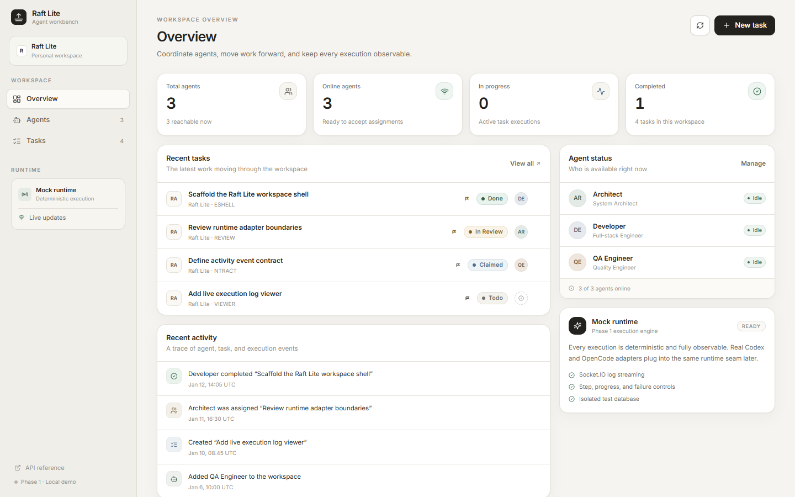

# Raft Lite

Raft Lite is a single-machine **AI agent collaboration platform** demo. It pairs a task board and an agent roster with a deterministic Mock Runtime, an independent Haft Agent Runner that can execute real Codex and OpenCode CLIs inside isolated Git worktrees, real REST persistence, live Socket.IO execution logs, and a test interface that is only enabled when explicitly running in E2E test mode.

The repository is a complete, runnable product slice rather than a static prototype: every primary UI flow writes through the real API to SQLite and is covered by unit, integration, component, and browser tests. The deterministic Fake Runner proves the complete server/runner/database/UI protocol without requiring a model account; real CLI execution is opt-in and independently tested.



## What it does

- **Agents**: create, edit, filter, inspect, and delete AI workers. Agent details show runtime configuration, current task, and execution history.
- **Tasks**: create, edit, search, filter, assign, transition through a validated state machine, cancel, and delete tasks on a five-lane Kanban board.
- **Executions**: start a task with one click, watch progress and streamed logs, inspect the persisted unified Git diff in a Changes tab, follow completion or failure, and cancel a running run.
- **Agent Runner**: a separate Node process pairs with the API over a versioned Socket.IO protocol, owns local CLI processes and Git worktrees, acknowledges and replays logs from a durable spool, confirms cancellations, survives crashes with a recovery journal, and reports full Git evidence/diffs. Fake mode is deterministic; real mode executes Codex or OpenCode.
- **Dashboard**: workspace metrics, recent tasks, activity feed, agent status, and runtime status.
- **Realtime**: task, agent, execution, log, and activity events are pushed over Socket.IO; TanStack Query caches are invalidated and updated live.
- **Testability**: stable `data-testid` attributes, a machine-readable UI interaction contract, deterministic seed data, a public API-backed test-data factory, and test-only runtime controls.

## Stack

| Layer            | Technology                                                                         |
| ---------------- | ---------------------------------------------------------------------------------- |
| Workspace        | pnpm workspaces, TypeScript 5.8, Node.js >= 20.19                                  |
| Shared contracts | Zod, shared DTOs/types, runner protocol v1, tsup (CJS + ESM + declarations)        |
| API              | NestJS 11, REST + Socket.IO, class-validator-free Zod pipe, Swagger/OpenAPI        |
| Persistence      | Prisma 6.16, SQLite, WAL journaling                                                |
| Web              | React 19, TypeScript, Vite 6, Tailwind CSS, Radix UI, TanStack Query, React Router |
| Runner           | Node.js, Socket.IO client, tsx/tsup, Codex/OpenCode child processes, Git worktrees |
| Unit/API tests   | Vitest, Supertest, Testing Library                                                 |
| End-to-end       | Playwright, serial workers, isolated API/web ports and SQLite database             |

## Repository layout

```text
apps/
  api/                 NestJS REST + Socket.IO API
    prisma/            schema, incremental migrations, deterministic seed
    src/modules/       agents, tasks, executions, runtime, runners, events, workspace, test
    test/              API integration and runner protocol tests
  runner/              Haft Agent Runner (independent process)
    src/               protocol client, fake/real executors, CLI parsers, Git worktrees, recovery journal/spool
  web/                 React/Vite SPA
    src/pages/         dashboard, agents, tasks, execution, not-found
    src/features/      agent/task forms, drawers, board, log/changes panels
    src/test/          component tests
packages/
  contracts/           shared Zod schemas, constants, DTOs, runner protocol v1
tests/
  contract/            machine-readable UI interaction contract
  fixtures/            Playwright fixtures + API test-data factory
  support/             contract-aware selector helpers
  e2e/functional/      CRUD, filters, workflow, errors, accessibility, Fake Runner
  e2e/business-loop/   cross-page end-to-end business scenario
  e2e/visual/          layout checks, screenshots, visual baseline
  e2e-real/            opt-in real Codex/OpenCode CLI suite
docs/                  architecture, data model, API, testing, runner docs, report
```

## Quick start

Prerequisites: Node.js 20.19+ and pnpm 11 (`corepack enable`).

```bash
pnpm install

# Environment (first run only). On Windows PowerShell use Copy-Item instead of cp.
cp apps/api/.env.example apps/api/.env
cp apps/web/.env.example apps/web/.env

# Create the local SQLite database and seed deterministic demo data.
pnpm --filter @raft-lite/api db:deploy
pnpm db:seed

# Start the API on :3001 and the web app on :5173.
pnpm dev
```

Open <http://localhost:5173>. The API is at <http://127.0.0.1:3001/api>, and interactive API documentation is at <http://127.0.0.1:3001/api/docs>.

The web dev server proxies `/api` and `/socket.io` to `http://127.0.0.1:3001`.
The API binds to `127.0.0.1` by default. Set `HOST=0.0.0.0` only when running in
a container or intentionally exposing the API on the LAN.

## Runner quick start

The Mock Runtime works without a runner. Codex and OpenCode agents require a
paired Haft Agent Runner on the same machine (or on a reachable trusted host).

1. Add a bootstrap token to `apps/api/.env` and restart the API:

   ```dotenv
   HAFT_RUNNER_BOOTSTRAP_TOKEN="replace-with-a-long-random-value"
   ```

2. Start a deterministic Fake Runner. It advertises `codex` and `opencode`
   capabilities without invoking a model:

   ```bash
   HAFT_RUNNER_BOOTSTRAP_TOKEN="replace-with-a-long-random-value" \
   HAFT_RUNNER_ID=runner_local \
   HAFT_RUNNER_COMPUTER_ID=computer_local \
   HAFT_RUNNER_MODE=fake \
   pnpm --filter @raft-lite/runner start
   ```

   PowerShell:

   ```powershell
   $env:HAFT_RUNNER_BOOTSTRAP_TOKEN = "replace-with-a-long-random-value"
   $env:HAFT_RUNNER_ID = "runner_local"
   $env:HAFT_RUNNER_COMPUTER_ID = "computer_local"
   $env:HAFT_RUNNER_MODE = "fake"
   pnpm --filter @raft-lite/runner start
   ```

3. Create an agent with runtime `Codex CLI` or `OpenCode CLI`, assign it to
   `computer_local`, and start a task. The task detail drawer shows runtime
   availability and the reason when a runtime cannot be used.

For real CLI execution, configure the runner's project allowlist, worktree root,
CLI paths/models, and authentication once per host. See
[docs/runner-setup.md](docs/runner-setup.md) for the full procedure and security
rules. Real CLI E2E is opt-in:

```bash
HAFT_REAL_CLI_E2E=1 pnpm test:e2e:real
```

## Commands

| Command              | Purpose                                                                                         |
| -------------------- | ----------------------------------------------------------------------------------------------- |
| `pnpm dev`           | Build contracts, then run API (`:3001`) and web (`:5173`) together.                             |
| `pnpm runner:dev`    | Build contracts, then start the runner in watch mode (requires runner configuration).           |
| `pnpm runner:start`  | Build contracts, then start the runner once (Fake mode by default).                             |
| `pnpm build`         | Build contracts, API, web, and runner.                                                          |
| `pnpm lint`          | ESLint across the workspace.                                                                    |
| `pnpm typecheck`     | TypeScript checks for contracts, API, web, and runner.                                          |
| `pnpm test`          | Contracts, API/runner integration, runner unit, and web component tests (72 total).             |
| `pnpm test:e2e`      | Reset the isolated E2E database, start API (`:3101`), web (`:5174`), Fake Runner, run 42 tests. |
| `pnpm test:e2e:real` | Opt-in real Codex/OpenCode suite with its own DB, ports, repository, and worktree root.         |
| `pnpm db:migrate`    | Create/apply a development Prisma migration.                                                    |
| `pnpm db:deploy`     | Apply existing migrations to the development database.                                          |
| `pnpm db:seed`       | Seed deterministic demo data.                                                                   |
| `pnpm format`        | Prettier formatting.                                                                            |

Screenshots are regenerated by the visual E2E suite into `docs/screenshots/`.

## Demo data

The seed is deterministic and uses fixed IDs and timestamps:

| Entity              | ID                                                                                                                          |
| ------------------- | --------------------------------------------------------------------------------------------------------------------------- |
| Workspace           | `ws_demo`                                                                                                                   |
| Project             | `project_demo`                                                                                                              |
| Computer            | `computer_local`                                                                                                            |
| Agents              | `agent_architect`, `agent_developer`, `agent_qa`                                                                            |
| Tasks               | `task_workspace_shell` (done), `task_arch_review` (in review), `task_log_viewer` (todo), `task_activity_contract` (claimed) |
| Completed execution | `execution_seed_completed`                                                                                                  |

Suggested tour:

1. Open **Overview** and note the seeded metrics and activity.
2. Open **Agents** and inspect Developer's execution history.
3. Open **Tasks**, start an execution on a claimed task, and follow the live progress and logs.
4. Cancel a running execution from its detail page.
5. Return to **Overview** to see the updated metrics and activity.

## Testing and selectors

The E2E test API is only registered when both `E2E_TEST_MODE=true` and `NODE_ENV!=production`; production builds expose no reset, seed, runtime-advance, or finish endpoints.

```bash
pnpm test       # 72 tests: contracts, API, runner, web
pnpm test:e2e   # 42 Playwright tests, including 3 Fake Runner protocol scenarios
```

The Playwright configuration uses one serial worker because all tests share one API and database, resets the deterministic seed before each test, and starts isolated services:

- API: `http://127.0.0.1:3101`
- Web: `http://127.0.0.1:5174`
- Fake Runner health: `http://127.0.0.1:3199`
- E2E database: `apps/api/prisma/e2e.db`

Real CLI tests never run inside the deterministic suite. They use API `:3201`,
runner health `:3299`, `apps/api/prisma/real-e2e.db`, a disposable Git repository,
and a separate worktree root, and only start when `HAFT_REAL_CLI_E2E=1`. See
[docs/testing.md](docs/testing.md) for the full strategy, selector contract, test
data factory, real CLI workflow, and troubleshooting.

## Documentation

- [Architecture](docs/architecture.md)
- [Data model](docs/data-model.md)
- [API design](docs/api.md)
- [Testing strategy and selectors](docs/testing.md)
- [Runner architecture](docs/runner-architecture.md)
- [Runner protocol v1](docs/runner-protocol.md)
- [Runner setup](docs/runner-setup.md)
- [Runtime integration](docs/runtime-integration.md)
- [Execution recovery](docs/execution-recovery.md)
- [Implementation report](docs/REPORT.md)

## Scope and limitations

This is a local, single-user demo. It has no web authentication, multi-tenant
isolation, or distributed scheduler. SQLite is sufficient for the single-machine
target but writes are serialized. The test-only API must stay disabled outside
test mode.

The Agent Runner is a separate process that owns local execution. Its token is
stored as a hash on the server and cached locally on the runner; it is never
forwarded to a CLI. Codex always runs with `--sandbox workspace-write`, and
OpenCode `--auto` is only passed when `HAFT_RUNNER_ALLOW_AUTO_APPROVE=1` is set
explicitly. A Git worktree isolates the working tree for review, but it is **not**
an OS sandbox. The runner never commits, pushes, merges, or fetches. See
[docs/REPORT.md](docs/REPORT.md) for the complete implemented / not implemented /
known-issues report and real CLI validation evidence.
