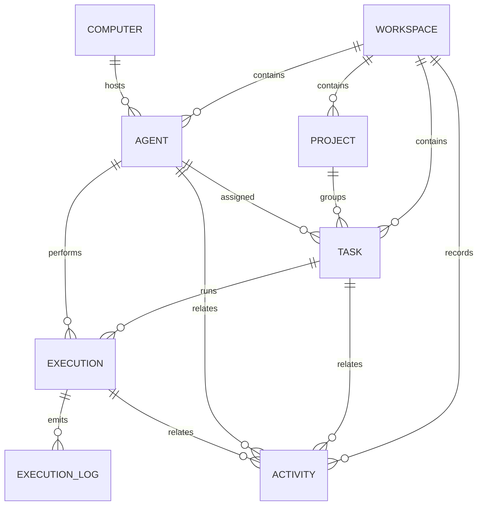

# Data model

The schema lives in [`apps/api/prisma/schema.prisma`](../apps/api/prisma/schema.prisma).
SQLite is the only datastore. Enum-like columns are stored as strings and are
validated at the API edge by the shared Zod schemas, which keeps SQLite
migrations simple and lets the contract package remain the single source of truth.

## Entity-relationship diagram



## Tables

### Workspace

The root of all data. The demo uses a single fixed row.

| Column                   | Type           | Notes                 |
| ------------------------ | -------------- | --------------------- |
| `id`                     | String, PK     | `ws_demo` in the seed |
| `name`                   | String         | Display name          |
| `slug`                   | String, unique | `raft-lite`           |
| `createdAt`, `updatedAt` | DateTime       |                       |

A `workspace.seeded` activity type exists in the contract for future use; the
current seed does not write it because the seed runs before normal activity
recording.

### Project

| Column                         | Type           | Notes                  |
| ------------------------------ | -------------- | ---------------------- |
| `id`                           | String, PK     | `project_demo`         |
| `workspaceId`                  | FK → Workspace | Cascade delete         |
| `key`                          | String         | Short key, e.g. `RAFT` |
| `name`, `description`, `color` | String         | Display metadata       |
| `createdAt`, `updatedAt`       | DateTime       |                        |

Unique on `(workspaceId, key)`; indexed by `workspaceId`.

### Computer

A machine that can host agents. The demo registers one local workstation.

| Column                   | Type       | Notes                      |
| ------------------------ | ---------- | -------------------------- |
| `id`                     | String, PK | `computer_local`           |
| `name`, `hostname`       | String     | Display / network identity |
| `status`                 | String     | `online` or `offline`      |
| `lastSeenAt`             | DateTime?  |                            |
| `createdAt`, `updatedAt` | DateTime   |                            |

### Agent

| Column                   | Type           | Notes                                       |
| ------------------------ | -------------- | ------------------------------------------- |
| `id`                     | String, PK     |                                             |
| `workspaceId`            | FK → Workspace | Cascade delete                              |
| `computerId`             | FK → Computer? | `SetNull` on delete                         |
| `name`                   | String         | 2–60 characters                             |
| `role`                   | String         | 2–80 characters                             |
| `description`            | String         | Default `""`, max 2000                      |
| `runtime`                | String         | `mock`, `codex`, or `opencode`              |
| `status`                 | String         | `idle`, `busy`, `offline`, or `error`       |
| `createdAt`, `updatedAt` | DateTime       |                                             |
| `lastActiveAt`           | DateTime?      | Updated on status changes and execution end |

Indexed by `workspaceId` and `status`.

**Status management:** `busy` is managed exclusively by executions. A manual
update to `busy` is rejected (`AGENT_STATUS_MANAGED`), and any status change is
rejected while the agent has a running execution (`AGENT_BUSY`). Executions set
the agent to `busy` on start, then `idle` on completion or cancellation and
`error` on failure. Deleting an agent with a running execution is rejected;
deleting an idle agent releases its active assigned tasks in the same
transaction (see Data retention).

### Task

| Column                   | Type           | Notes                             |
| ------------------------ | -------------- | --------------------------------- |
| `id`                     | String, PK     |                                   |
| `workspaceId`            | FK → Workspace | Cascade delete                    |
| `projectId`              | FK → Project   | Cascade delete                    |
| `assigneeAgentId`        | FK → Agent?    | `SetNull` on delete               |
| `title`                  | String         | 3–140 characters                  |
| `description`            | String         | Default `""`, max 4000            |
| `priority`               | String         | `low`, `medium`, `high`, `urgent` |
| `status`                 | String         | Seven-state machine below         |
| `createdAt`, `updatedAt` | DateTime       |                                   |

Indexed by `workspaceId`, `status`, and `assigneeAgentId`.

**Assignment rules:**

- Creating a task with an assignee starts it in `claimed`; without one it starts
  in `todo`.
- Assigning an agent to a `todo` task moves it to `claimed`.
- Unassigning the agent from a `claimed` task moves it back to `todo`.
- Tasks in `done` or `cancelled` cannot be assigned.
- A task with a running execution cannot be reassigned.
- Unassignment otherwise preserves the current status.

### Execution

| Column                   | Type       | Notes                                         |
| ------------------------ | ---------- | --------------------------------------------- |
| `id`                     | String, PK |                                               |
| `taskId`                 | FK → Task  | Cascade delete                                |
| `agentId`                | FK → Agent | Cascade delete                                |
| `runtime`                | String     | Recorded per run (`mock`)                     |
| `status`                 | String     | `running`, `completed`, `failed`, `cancelled` |
| `progress`               | Int        | 0–100                                         |
| `startedAt`              | DateTime   | Default now                                   |
| `endedAt`                | DateTime?  | Set on terminal states                        |
| `failureReason`          | String?    | Set on failure                                |
| `cancelReason`           | String?    | Set on cancellation                           |
| `createdAt`, `updatedAt` | DateTime   |                                               |

Indexed by `taskId`, `agentId`, and `status`.

A task may have at most one `running` execution at a time; this is enforced in
`ExecutionsService.startForTask` with an in-process start lock rather than by a
partial unique index (SQLite + Prisma portability). The same check prevents one
agent from running two executions concurrently. The lock covers the single API
instance used by this demo; multiple instances would need a database constraint
or distributed lock.

### ExecutionLog

| Column        | Type           | Notes                                 |
| ------------- | -------------- | ------------------------------------- |
| `id`          | String, PK     |                                       |
| `executionId` | FK → Execution | Cascade delete                        |
| `seq`         | Int            | Monotonic per execution               |
| `level`       | String         | `info`, `success`, `warning`, `error` |
| `message`     | String         | Human-readable log line               |
| `timestamp`   | DateTime       | Default now                           |

Unique on `(executionId, seq)`; indexed by `(executionId, timestamp)`. Logs are
read in ascending `seq` order. The client can pass `afterSeq` to fetch only newer
lines and `limit` (1–500, default 200).

### Activity

| Column        | Type            | Notes                            |
| ------------- | --------------- | -------------------------------- |
| `id`          | String, PK      |                                  |
| `workspaceId` | FK → Workspace  | Cascade delete                   |
| `type`        | String          | See activity types               |
| `summary`     | String          | Pre-rendered human-readable text |
| `taskId`      | FK → Task?      | `SetNull` on delete              |
| `agentId`     | FK → Agent?     | `SetNull` on delete              |
| `executionId` | FK → Execution? | `SetNull` on delete              |
| `metadata`    | String?         | Serialised JSON                  |
| `createdAt`   | DateTime        | Default now                      |

Indexed by `(workspaceId, createdAt)`.

Activity recording is best-effort: `ActivitiesService.record` catches write
errors so that a history failure cannot roll back a successful business
operation. Relationships use `SetNull` so history survives deletion of the
referenced task, agent, or execution.

`agent.deleted` stores released task IDs in `metadata` as `{ "taskIds": [...] }`.
A failure during runtime start stores `execution.failed` with
`{ "stage": "start", "error": "..." }`.

## Task state machine

```text
todo ──────► claimed ──────► in_progress ──────► in_review ──────► done
 │              │  ▲              │  ▲               │
 │              │  └──────────────┘  └───────────────┘
 │              ▼
 └──────────► cancelled ◄────────── failed ◄── in_progress / in_review
                 │                      │
                 └────────► todo ◄──────┘
```

Canonical transitions, enforced server-side by `canTransitionTask`:

| From          | Allowed to                                   |
| ------------- | -------------------------------------------- |
| `todo`        | `claimed`, `cancelled`                       |
| `claimed`     | `todo`, `in_progress`, `cancelled`           |
| `in_progress` | `in_review`, `done`, `failed`, `cancelled`   |
| `in_review`   | `in_progress`, `done`, `failed`, `cancelled` |
| `done`        | — terminal                                   |
| `failed`      | `todo`, `cancelled`                          |
| `cancelled`   | `todo`                                       |

Starting an execution sets the task to `in_progress` directly (the start path
accepts `todo`, `claimed`, or `in_progress`). Completion sets `done`; runtime
failure sets `failed`; cancellation sets `cancelled`. While an execution is
running, manual status changes and reassignment are rejected with
`TASK_EXECUTION_ACTIVE`.

## Board lanes

The API exposes exact statuses; the board groups them into five visual lanes so
that the layout stays readable. Each card still prints its exact status.

| Lane (`data-testid`) | Statuses                 |
| -------------------- | ------------------------ |
| `task-lane-todo`     | `todo`                   |
| `task-lane-active`   | `claimed`, `in_progress` |
| `task-lane-review`   | `in_review`              |
| `task-lane-done`     | `done`                   |
| `task-lane-stopped`  | `failed`, `cancelled`    |

## Deterministic seed

`apps/api/src/common/seed/demo-data.ts` is shared by the local seed script, API
tests, and E2E reset. All timestamps are fixed in January 2026 (UTC).

| Entity              | ID                                                                                                                          |
| ------------------- | --------------------------------------------------------------------------------------------------------------------------- |
| Workspace           | `ws_demo`                                                                                                                   |
| Project             | `project_demo`                                                                                                              |
| Computer            | `computer_local`                                                                                                            |
| Agents              | `agent_architect`, `agent_developer`, `agent_qa`                                                                            |
| Tasks               | `task_workspace_shell` (done), `task_arch_review` (in_review), `task_log_viewer` (todo), `task_activity_contract` (claimed) |
| Completed execution | `execution_seed_completed`                                                                                                  |
| Seed logs           | `log_seed_1` … `log_seed_5`                                                                                                 |
| Seed activities     | `activity_seed_1` … `activity_seed_4`                                                                                       |

The `empty` preset still creates the workspace, computer, project, and three
agents — so the shell and agent roster are usable — but omits tasks, executions,
and activities. E2E tests use this preset to verify empty states.

On API startup `SeedService` seeds the default preset only when the workspace
table is empty. Test resets always call `initializeDemoData` explicitly.

## SQLite configuration and migrations

- Prisma 6.16.2, SQLite provider.
- `PrismaService.onModuleInit` sets `PRAGMA journal_mode = WAL`,
  `PRAGMA synchronous = NORMAL`, and `PRAGMA busy_timeout = 5000`.
- The initial migration is
  `apps/api/prisma/migrations/20261106095317_init/migration.sql`.
- Development database: `apps/api/prisma/dev.db` (`DATABASE_URL=file:./dev.db`).
- API test database: `apps/api/prisma/test.db` (`apps/api/.env.test`).
- E2E database: `apps/api/prisma/e2e.db` (`apps/api/.env.e2e`).

`prisma db push --force-reset` is used for test databases; the development
database uses `prisma migrate deploy` (or `prisma migrate dev` when evolving the
schema). SQLite WAL sidecar files (`-wal`, `-shm`) can survive an interrupted
reset and make the file unreadable; see the troubleshooting section in
[testing.md](testing.md).

## Data retention

There is no automatic retention or archival. Deleting a task cascades to its
executions and logs. Activity rows remain and their foreign keys become `NULL`,
which is why the dashboard timeline can outlive the entities it references.
Deleting an agent cascades to its executions. In the delete transaction, tasks
in `claimed`, `in_progress`, or `in_review` are reset to `todo` and unassigned;
terminal tasks keep their status but also lose the assignee through the
`SetNull` relation. The demo UI blocks deletion while an execution is running to
keep this predictable.
