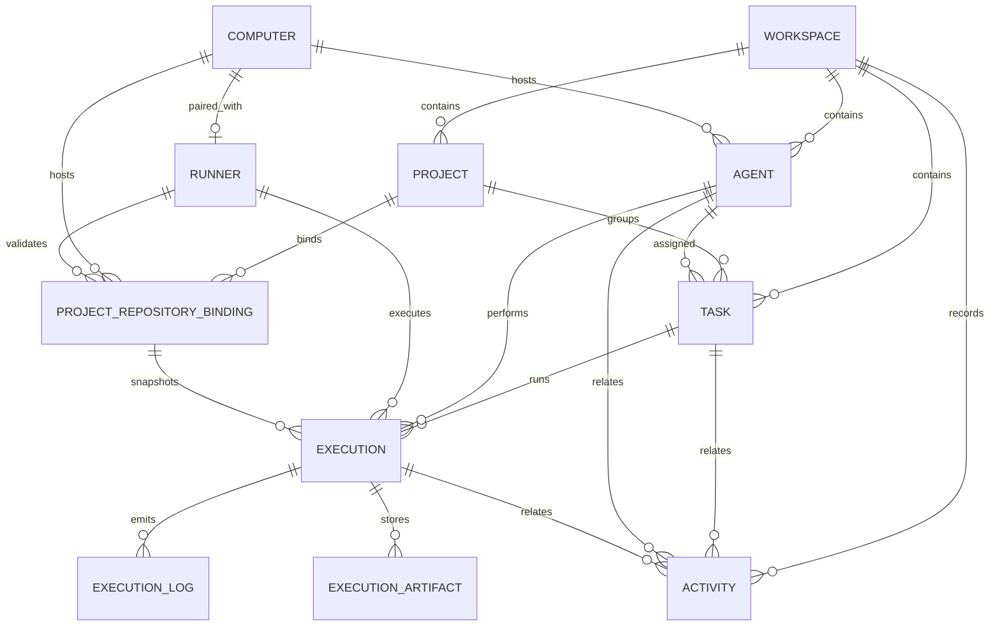

# Data model

The schema lives in [`apps/api/prisma/schema.prisma`](../apps/api/prisma/schema.prisma).
SQLite is the only datastore. Enum-like columns are stored as strings and are
validated at the API edge by the shared Zod schemas, which keeps SQLite
migrations simple and lets the contract package remain the single source of truth.

## Entity-relationship diagram



## Tables

### Workspace

The root of all data. The demo uses a single fixed row.

| Column                   | Type           | Notes                 |
| ------------------------ | -------------- | --------------------- |
| `id`                     | String, PK     | `ws_demo` in the seed |
| `name`                   | String         | Display name          |
| `slug`                   | String, unique | `raft-lite`           |
| `createdAt`, `updatedAt` | DateTime       |                       |

A `workspace.seeded` activity type exists in the contract for future use; the
current seed does not write it because the seed runs before normal activity
recording.

### Project

| Column                         | Type           | Notes                                                    |
| ------------------------------ | -------------- | -------------------------------------------------------- |
| `id`                           | String, PK     | `project_demo`                                           |
| `workspaceId`                  | FK → Workspace | Cascade delete                                           |
| `key`                          | String         | Short key, e.g. `RAFT`                                   |
| `name`, `description`, `color` | String         | Display metadata                                         |
| `defaultBranch`                | String         | Default `main`; sole authority for the branch            |
| `archivedAt`                   | DateTime?      | `null` = active; archives block new tasks and executions |
| `createdAt`, `updatedAt`       | DateTime       |                                                          |

Unique on `(workspaceId, key)`; indexed by `workspaceId` and
`(workspaceId, archivedAt)`.

### ProjectRepositoryBinding

A project's repository path on one Computer. The path is opaque user input; the
API never normalizes it and never inspects the filesystem. P2-01 creates every
binding as `unverified` and its REST API never writes any other status. Only
P2-02's Runner `repository.validation` response may move a binding to `ready`,
`missing`, or `error`.

| Column                    | Type          | Notes                                              |
| ------------------------- | ------------- | -------------------------------------------------- |
| `id`                      | String, PK    |                                                    |
| `projectId`               | FK → Project  | Cascade delete                                     |
| `computerId`              | FK → Computer | Cascade delete                                     |
| `path`                    | String        | Raw input; SHA-256 in `pathHash`                   |
| `pathHash`                | String        | Stable hash for audit/identity                     |
| `bindingVersion`          | Int           | Starts at 1; increments only on a real path change |
| `platform`                | String?       | Runner platform (reserved for P2-02)               |
| `status`                  | String        | `unverified` in P2-01; P2-02 adds the other states |
| `validationRequestId`     | String?       | P2-02 correlation/idempotency id                   |
| `canonicalPath`           | String?       | P2-02 runner realpath on success                   |
| `validationErrorCode`     | String?       | P2-02 concrete `REPO_*` code on failure            |
| `validationError`         | String?       | P2-02 human-readable failure message               |
| `lastValidatedAt`         | DateTime?     | P2-02 validation timestamp                         |
| `validatedByRunnerId`     | FK → Runner?  | P2-02 validator; `SetNull` on runner delete        |
| `validatedBindingVersion` | Int?          | P2-02 version that produced the last success       |
| `policyVersion`           | String?       | P2-02 runner path-policy fingerprint               |
| `createdAt`, `updatedAt`  | DateTime      |                                                    |

Unique on `(projectId, computerId)`; indexed by `(projectId, status)`,
`computerId`, and `validatedByRunnerId`. There is no `defaultBranch` column:
changing a Project's branch affects only future executions, and every execution
captures a branch snapshot.

See [p2-01-project-repository-binding.md](p2-01-project-repository-binding.md)
for the state machine, API, archive behavior, and concurrency guarantees.

### Computer

A machine that can host agents. The demo registers one local workstation.

| Column                   | Type       | Notes                      |
| ------------------------ | ---------- | -------------------------- |
| `id`                     | String, PK | `computer_local`           |
| `name`, `hostname`       | String     | Display / network identity |
| `status`                 | String     | `online` or `offline`      |
| `lastSeenAt`             | DateTime?  |                            |
| `createdAt`, `updatedAt` | DateTime   |                            |

### Runner

A Haft Agent Runner process paired with one Computer. The row is durable identity
and connection metadata; live sockets stay in API memory. `Runner.id` is the
protocol `runnerId`.

| Column                     | Type          | Notes                                        |
| -------------------------- | ------------- | -------------------------------------------- |
| `id`                       | String, PK    | Stable runner id (e.g. `runner_local`)       |
| `computerId`               | FK → Computer | Unique; cascade delete with the computer     |
| `tokenHash`                | String        | `sha256` of the issued runner token only     |
| `protocolVersion`          | Int           | Runner protocol version, currently `1`       |
| `runnerVersion`            | String        | Reported by the runner at registration       |
| `platform`, `architecture` | String        | Reported OS/CPU metadata                     |
| `status`                   | String        | `online`, `offline`, `busy`, or `degraded`   |
| `capabilitiesJson`         | String        | Serialised runtime capabilities and projects |
| `maxConcurrentExecutions`  | Int           | 1–32, clamped from the runner registration   |
| `lastHeartbeatAt`          | DateTime?     | Updated on every accepted heartbeat          |
| `connectedAt`              | DateTime?     | Last successful socket connection            |
| `disconnectedAt`           | DateTime?     | Last disconnect                              |
| `createdAt`, `updatedAt`   | DateTime      |                                              |

Unique on `computerId`; indexed by `status` and `lastHeartbeatAt`. Bootstrap
pairing creates or rotates the token hash. Runner tokens are never stored in
plaintext and never sent to CLI child processes.

### Agent

| Column                   | Type           | Notes                                       |
| ------------------------ | -------------- | ------------------------------------------- |
| `id`                     | String, PK     |                                             |
| `workspaceId`            | FK → Workspace | Cascade delete                              |
| `computerId`             | FK → Computer? | `SetNull` on delete                         |
| `name`                   | String         | 2–60 characters                             |
| `role`                   | String         | 2–80 characters                             |
| `description`            | String         | Default `""`, max 2000                      |
| `runtime`                | String         | `mock`, `codex`, or `opencode`              |
| `status`                 | String         | `idle`, `busy`, `offline`, or `error`       |
| `createdAt`, `updatedAt` | DateTime       |                                             |
| `lastActiveAt`           | DateTime?      | Updated on status changes and execution end |

Indexed by `workspaceId` and `status`.

**Status management:** `busy` is managed exclusively by executions. A manual
update to `busy` is rejected (`AGENT_STATUS_MANAGED`), and any status change is
rejected while the agent has a running execution (`AGENT_BUSY`). Executions set
the agent to `busy` on start, then `idle` on completion or cancellation and
`error` on failure. Deleting an agent with a running execution is rejected;
deleting an idle agent releases its active assigned tasks in the same
transaction (see Data retention).

### Task

| Column                   | Type           | Notes                             |
| ------------------------ | -------------- | --------------------------------- |
| `id`                     | String, PK     |                                   |
| `workspaceId`            | FK → Workspace | Cascade delete                    |
| `projectId`              | FK → Project   | Cascade delete                    |
| `assigneeAgentId`        | FK → Agent?    | `SetNull` on delete               |
| `title`                  | String         | 3–140 characters                  |
| `description`            | String         | Default `""`, max 4000            |
| `priority`               | String         | `low`, `medium`, `high`, `urgent` |
| `status`                 | String         | Seven-state machine below         |
| `createdAt`, `updatedAt` | DateTime       |                                   |

Indexed by `workspaceId`, `status`, and `assigneeAgentId`.

**Assignment rules:**

- Creating a task with an assignee starts it in `claimed`; without one it starts
  in `todo`.
- Assigning an agent to a `todo` task moves it to `claimed`.
- Unassigning the agent from a `claimed` task moves it back to `todo`.
- Tasks in `done` or `cancelled` cannot be assigned.
- A task with a running execution cannot be reassigned.
- Unassignment otherwise preserves the current status.

### Execution

| Column                     | Type          | Notes                                                               |
| -------------------------- | ------------- | ------------------------------------------------------------------- |
| `id`                       | String, PK    |                                                                     |
| `taskId`                   | FK → Task     | Cascade delete                                                      |
| `agentId`                  | FK → Agent    | Cascade delete                                                      |
| `runnerId`                 | FK → Runner?  | `SetNull` on runner delete; `null` for mock executions              |
| `repositoryProjectId`      | String?       | Project used when a real execution was created                      |
| `repositoryBindingId`      | FK → Binding? | `SetNull` on binding delete; history keeps the snapshot             |
| `repositoryBindingVersion` | Int?          | Binding version captured at creation                                |
| `repositoryDefaultBranch`  | String?       | Project branch captured at creation                                 |
| `runtime`                  | String        | `mock`, `codex`, or `opencode`                                      |
| `status`                   | String        | `running`, `completed`, `failed`, `cancelled`                       |
| `phase`                    | String        | `queued`, `preparing`, `running`, `finalizing`, or terminal outcome |
| `progress`                 | Int           | 0–100                                                               |
| `progressMode`             | String        | `determinate` or `indeterminate`                                    |
| `exitCode`                 | Int?          | Real CLI exit code; `null` when unavailable                         |
| `summary`                  | String?       | Final CLI summary or deterministic fake summary                     |
| `branchName`, `baseCommit` | String?       | Git evidence reported by the runner                                 |
| `headCommit`               | String?       | Head after the CLI finished; may equal `baseCommit`                 |
| `changedFiles`             | Int           | Changed-file count from the terminal Git payload                    |
| `diffStat`                 | String        | `git diff --stat` text plus untracked-file names; default `""`      |
| `gitStatus`                | String        | Bounded `git status --porcelain=v1` snapshot; default `""`          |
| `diffTruncated`            | Boolean       | The stored patch was cut at `EXECUTION_DIFF_MAX_BYTES`              |
| `lastRunnerSeq`            | Int           | Highest runner log sequence applied                                 |
| `startedAt`                | DateTime      | Default now                                                         |
| `endedAt`                  | DateTime?     | Set on terminal states                                              |
| `failureReason`            | String?       | Set on failure                                                      |
| `cancelReason`             | String?       | Set on cancellation                                                 |
| `createdAt`, `updatedAt`   | DateTime      |                                                                     |

Indexed by `taskId`, `agentId`, `runnerId`, `status`, and `phase`.

`status` remains the coarse product state; `phase` is an additive, more precise
execution stage used by the UI and runner protocol. Existing rows keep their
status values, and the migration maps terminal statuses to terminal phases.

For a real (`codex`/`opencode`) execution, the four `repository*` snapshot
columns are written in the same transaction that creates the Execution. They
survive a later binding path change or deletion, so history always shows the
project, binding version, and default branch that were actually used.

A task may have at most one `running` execution at a time; this is enforced in
`ExecutionsService.startForTask` with an in-process start lock rather than by a
partial unique index (SQLite + Prisma portability). The same check prevents one
agent from running two executions concurrently. The lock covers the single API
instance used by this demo; multiple instances would need a database constraint
or distributed lock.

### ExecutionLog

| Column        | Type           | Notes                                 |
| ------------- | -------------- | ------------------------------------- |
| `id`          | String, PK     |                                       |
| `executionId` | FK → Execution | Cascade delete                        |
| `seq`         | Int            | Server-assigned, monotonic per run    |
| `stream`      | String         | `stdout`, `stderr`, or `system`       |
| `eventId`     | String?        | Runner-generated stable event id      |
| `runnerSeq`   | Int?           | Runner-local sequence for idempotency |
| `level`       | String         | `info`, `success`, `warning`, `error` |
| `message`     | String         | Human-readable log line               |
| `timestamp`   | DateTime       | Default now                           |

Unique on `(executionId, seq)`, `(executionId, eventId)`, and
`(executionId, runnerSeq)`; indexed by `(executionId, timestamp)`. Logs are read
in ascending `seq` order. The client can pass `afterSeq` to fetch only newer
lines and `limit` (1–500, default 200).

The two sequence spaces are deliberate: `runnerSeq` is the runner's monotonic
sequence (1, 2, 3, ...) and is used only for deduplication and acknowledgement;
`seq` is assigned by the server so server-generated logs (phase messages,
failure summaries, cancellation notes) share one ordered stream with CLI output.

### ExecutionArtifact

Large payloads are kept out of `Execution` list/detail responses and stored once
per `(executionId, kind)`.

| Column                   | Type           | Notes                                       |
| ------------------------ | -------------- | ------------------------------------------- |
| `id`                     | String, PK     |                                             |
| `executionId`            | FK → Execution | Cascade delete                              |
| `kind`                   | String         | `git-diff` for the unified patch            |
| `content`                | String         | Unified diff text, capped at 1 MiB          |
| `byteSize`               | Int            | UTF-8 byte size of `content`                |
| `truncated`              | Boolean        | Whether the patch was cut at the size limit |
| `createdAt`, `updatedAt` | DateTime       |                                             |

Unique on `(executionId, kind)` and indexed by `executionId`. The artifact is
written from the owning runner's terminal event; duplicate terminal messages are
idempotent and another runner cannot attach Git evidence to it.

### Activity

| Column        | Type            | Notes                            |
| ------------- | --------------- | -------------------------------- |
| `id`          | String, PK      |                                  |
| `workspaceId` | FK → Workspace  | Cascade delete                   |
| `type`        | String          | See activity types               |
| `summary`     | String          | Pre-rendered human-readable text |
| `taskId`      | FK → Task?      | `SetNull` on delete              |
| `agentId`     | FK → Agent?     | `SetNull` on delete              |
| `executionId` | FK → Execution? | `SetNull` on delete              |
| `metadata`    | String?         | Serialised JSON                  |
| `createdAt`   | DateTime        | Default now                      |

Indexed by `(workspaceId, createdAt)`.

Activity recording is best-effort: `ActivitiesService.record` catches write
errors so that a history failure cannot roll back a successful business
operation. Relationships use `SetNull` so history survives deletion of the
referenced task, agent, or execution.

`agent.deleted` stores released task IDs in `metadata` as `{ "taskIds": [...] }`.
A failure during runtime start stores `execution.failed` with
`{ "stage": "start", "error": "..." }`.

## Task state machine

```text
todo ──────► claimed ──────► in_progress ──────► in_review ──────► done
 │              │  ▲              │  ▲               │
 │              │  └──────────────┘  └───────────────┘
 │              ▼
 └──────────► cancelled ◄────────── failed ◄── in_progress / in_review
                 │                      │
                 └────────► todo ◄──────┘
```

Canonical transitions, enforced server-side by `canTransitionTask`:

| From          | Allowed to                                   |
| ------------- | -------------------------------------------- |
| `todo`        | `claimed`, `cancelled`                       |
| `claimed`     | `todo`, `in_progress`, `cancelled`           |
| `in_progress` | `in_review`, `done`, `failed`, `cancelled`   |
| `in_review`   | `in_progress`, `done`, `failed`, `cancelled` |
| `done`        | — terminal                                   |
| `failed`      | `todo`, `cancelled`                          |
| `cancelled`   | `todo`                                       |

Starting an execution sets the task to `in_progress` directly (the start path
accepts `todo`, `claimed`, or `in_progress`). Completion sets `done`; runtime
failure sets `failed`; cancellation sets `cancelled`. While an execution is
running, manual status changes and reassignment are rejected with
`TASK_EXECUTION_ACTIVE`.

## Board lanes

The API exposes exact statuses; the board groups them into five visual lanes so
that the layout stays readable. Each card still prints its exact status.

| Lane (`data-testid`) | Statuses                 |
| -------------------- | ------------------------ |
| `task-lane-todo`     | `todo`                   |
| `task-lane-active`   | `claimed`, `in_progress` |
| `task-lane-review`   | `in_review`              |
| `task-lane-done`     | `done`                   |
| `task-lane-stopped`  | `failed`, `cancelled`    |

## Deterministic seed

`apps/api/src/common/seed/demo-data.ts` is shared by the local seed script, API
tests, and E2E reset. All timestamps are fixed in January 2026 (UTC).

| Entity              | ID                                                                                                                          |
| ------------------- | --------------------------------------------------------------------------------------------------------------------------- |
| Workspace           | `ws_demo`                                                                                                                   |
| Project             | `project_demo`                                                                                                              |
| Computer            | `computer_local`                                                                                                            |
| Agents              | `agent_architect`, `agent_developer`, `agent_qa`                                                                            |
| Tasks               | `task_workspace_shell` (done), `task_arch_review` (in_review), `task_log_viewer` (todo), `task_activity_contract` (claimed) |
| Completed execution | `execution_seed_completed`                                                                                                  |
| Seed logs           | `log_seed_1` … `log_seed_5`                                                                                                 |
| Seed activities     | `activity_seed_1` … `activity_seed_4`                                                                                       |

The `empty` preset still creates the workspace, computer, project, and three
agents — so the shell and agent roster are usable — but omits tasks, executions,
and activities. E2E tests use this preset to verify empty states.

On API startup `SeedService` seeds the default preset only when the workspace
table is empty. Test resets always call `initializeDemoData` explicitly. Test and
E2E resets preserve the `Computer` and `Runner` rows so an already-paired Fake
Runner stays connected across tests.

## SQLite configuration and migrations

- Prisma 6.16.2, SQLite provider.
- `PrismaService.onModuleInit` sets `PRAGMA journal_mode = WAL`,
  `PRAGMA synchronous = NORMAL`, and `PRAGMA busy_timeout = 15000`.
- Migrations are incremental and preserve user data:
  - `apps/api/prisma/migrations/20261106095317_init/migration.sql`
  - `apps/api/prisma/migrations/20261107090000_runner_phase1/migration.sql`
    (adds `Runner`, execution phase/progress/Git fields, and structured log
    columns; existing executions are copied and terminal statuses are mapped to
    terminal phases).
  - `apps/api/prisma/migrations/20261107160000_execution_git_diff/migration.sql`
    (adds `changedFiles`, `diffStat`, `gitStatus`, `diffTruncated`, and the
    `ExecutionArtifact` table; defaults keep existing rows valid).
- Development database: `apps/api/prisma/dev.db` (`DATABASE_URL=file:./dev.db`).
- API test database: `apps/api/prisma/test.db` (`apps/api/.env.test`).
- E2E database: `apps/api/prisma/e2e.db` (`apps/api/.env.e2e`).
- Real CLI E2E database: `apps/api/prisma/real-e2e.db`
  (`apps/api/.env.real-e2e`).

Test database URLs include `connection_limit=1&socket_timeout=20` to reduce
Prisma/SQLite lock contention during serial test resets; the server-side
`busy_timeout` covers normal writes. `prisma db push --force-reset` is used for
test databases; the development database uses `prisma migrate deploy` (or
`prisma migrate dev` when evolving the schema). SQLite WAL sidecar files (`-wal`,
`-shm`) can survive an interrupted reset and make the file unreadable; see the
troubleshooting section in [testing.md](testing.md).

## Data retention

There is no automatic retention or archival. Deleting a task cascades to its
executions and logs. Activity rows remain and their foreign keys become `NULL`,
which is why the dashboard timeline can outlive the entities it references.
Deleting an agent cascades to its executions. In the delete transaction, tasks
in `claimed`, `in_progress`, or `in_review` are reset to `todo` and unassigned;
terminal tasks keep their status but also lose the assignee through the
`SetNull` relation. The demo UI blocks deletion while an execution is running to
keep this predictable.

Deleting a computer cascades to its runner row. Deleting a runner (or a computer)
sets `Execution.runnerId` to `NULL` for historical executions, preserving the
execution and log history. Git worktrees and branches created by the runner are
outside the database and are not deleted automatically; see
[runner-setup.md](runner-setup.md) for cleanup guidance.
