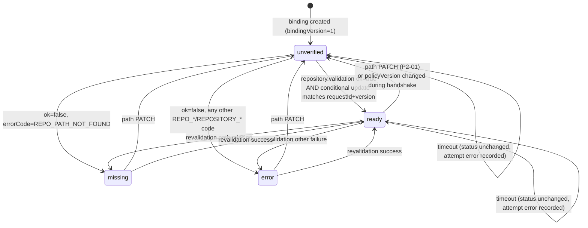
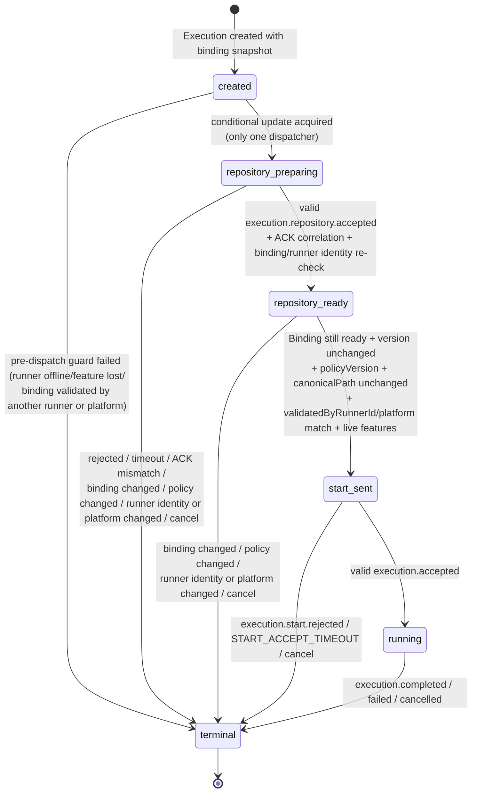
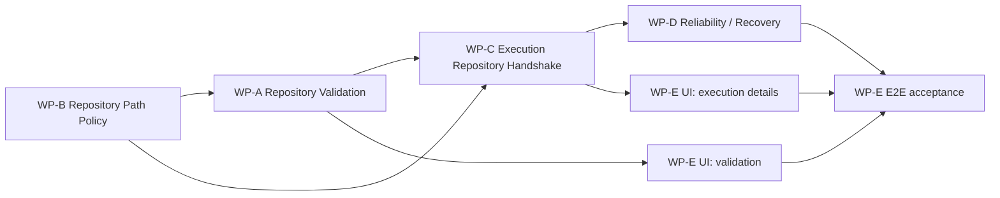

# P2-02 · Project-aware Runner, Repository Validation and Pre-execution Handshake — Implementation Plan

| Field                  | Value                                                                                                                                                                                                                              |
| ---------------------- | ---------------------------------------------------------------------------------------------------------------------------------------------------------------------------------------------------------------------------------- |
| Status                 | **Planning only** — documentation revision only; no product code, schema, migration or PR                                                                                                                                          |
| Baseline               | `origin/main` @ `eea16d94de2ce90342eb37805fb083777f839d00` (“Merge pull request #4 … feature/p2-01-project-crud-repository-binding”)                                                                                               |
| Planning branch        | `feature/p2-02-project-aware-runner`                                                                                                                                                                                               |
| Planning worktree      | `D:\CODE\GIT\Haft-p2-02`                                                                                                                                                                                                           |
| Date                   | 2026-11-10                                                                                                                                                                                                                         |
| Frozen source of truth | `docs/phase-2-technical-roadmap.md:520-677` (P2-02 card; **must not be edited by this work**)                                                                                                                                      |
| Predecessors           | P2-00 protocol baseline (merged), P2-01 Project + Repository Binding (merged)                                                                                                                                                      |
| Audience               | The coding agent that will implement P2-02 after this plan is approved                                                                                                                                                             |
| Internal work packages | WP-A Repository Validation, WP-B Repository Path Policy, WP-C Execution Repository Handshake, WP-D Reliability/Recovery, WP-E UI & Automated Acceptance. These are **internal planning units**, not new official roadmap task IDs. |

> **Hard scope rule.** This document describes work only. The implementation round must not modify product code, Prisma schema, migrations or roadmap cards, and must not create a PR, until the plan is explicitly approved. Revisions to this planning document itself may be committed and pushed to the planning branch; no product code is changed by those revisions.

---

## Table of contents

0. [Executive summary and readiness](#0-executive-summary-and-readiness)
1. [Current architecture (as-is)](#1-current-architecture-as-is)
2. [Source evidence](#2-source-evidence)
3. [Frozen protocol reuse list](#3-frozen-protocol-reuse-list)
4. [API → Runner sequences](#4-api--runner-sequences)
5. [Validation state machine](#5-validation-state-machine)
6. [Handshake state machine](#6-handshake-state-machine)
7. [Schema suggestions](#7-schema-suggestions)
8. [API and message contracts](#8-api-and-message-contracts)
9. [Runner repository path policy](#9-runner-repository-path-policy)
10. [Error-code mapping](#10-error-code-mapping)
11. [Timeout, retry and idempotency](#11-timeout-retry-and-idempotency)
12. [Reconnect and restart recovery](#12-reconnect-and-restart-recovery)
13. [UI design](#13-ui-design)
14. [Windows/Linux test matrix](#14-windowslinux-test-matrix)
15. [Work packages WP-A … WP-E](#15-work-packages-wp-a--wp-e)
16. [WP dependencies and parallelizable work](#16-wp-dependencies-and-parallelizable-work)
17. [Phased implementation order](#17-phased-implementation-order)
18. [Automated acceptance criteria](#18-automated-acceptance-criteria)
19. [Risks and open questions](#19-risks-and-open-questions)
20. [Rollback plan](#20-rollback-plan)
21. [Definition of Done](#21-definition-of-done)
22. [Final conclusion](#22-final-conclusion)

- [Appendix A — File-by-file change map](#appendix-a--file-by-file-change-map)
- [Appendix B — Commands and PR evidence](#appendix-b--commands-and-pr-evidence)

---

## 0. Executive summary and readiness

P2-02 is **ready to implement without changing the frozen wire protocol**. P2-00 already landed every message schema, feature name, error code and validation state that P2-02 needs:

- `repository.validate` / `repository.validation`;
- `execution.repository` / `execution.repository.accepted` / `execution.repository.rejected`;
- `execution.start.rejected`;
- `RUNNER_FEATURES` including `project-binding-v1`, `repository-validation-v1`, `repository-path-policy-v1`, `repository-handshake-v1`;
- the `unverified | ready | missing | error` binding vocabulary and all `REPOSITORY_*` / `REPO_*` error codes;
- an unchanged, strict v1 `execution.start` whose only repository field is `projectId`.

What is missing is **orchestration and enforcement**:

1. The API never exposes a validation route and never handles `repository.validation`; a binding can only become `ready` through the test-only fixture.
2. The Runner has no path policy, no `allowedRepositoryRoots`, no feature advertisement, and no repository context.
3. The API sends `execution.start` immediately and trusts a generic `execution.accepted`; there is no `execution.repository` handshake and no `dispatchState`.
4. The Runner sends `execution.accepted` **before** checking project mapping or CLI capability, so an accepted message does not prove that a repository context is ready.
5. The old `HAFT_RUNNER_PROJECTS` / `--project` / `INIT_CWD` / `process.cwd()` mapping is still the only execution path.

The implementation must make the following invariant true end-to-end, with automated evidence:

> **No `execution.start` may be sent — and no Codex/OpenCode process may be spawned — unless a valid `execution.repository.accepted` has been received, correlated, persisted, and followed by a successful binding re-check.**

Four review-driven rules are now part of that invariant:

1. **Device paths are never allowed.** `\\?\` and `\\.\` always return the existing `REPO_PATH_INVALID`; there is no configuration flag and no test branch that permits them.
2. **Validation is path-only.** `repository.validate` has no `defaultBranch` field. `Project.defaultBranch` existence is checked only in the `execution.repository` handshake, which returns `REPO_DEFAULT_BRANCH_NOT_FOUND` before any `execution.start`.
3. **Validation is bound to one Runner identity and platform.** A `ready` binding is executable only by the Runner that produced the validation and on the same platform. A different or replacement Runner requires revalidation.
4. **Worktree, recovery and main-repository roots are mutually isolated.** The policy rejects overlap in both directions, not only a repository path nested inside `worktreeRoot`/`recoveryRoot`.

The plan is deliberately **fail-closed**:

- old Runners stay connected but cannot start real executions;
- no cwd fallback, no silent degradation, no “best effort” path selection;
- validation success is the only way to write `ready`;
- a timeout never fabricates success;
- every pre-start failure cleans up the Runner context and leaves the main checkout untouched.

**Readiness verdict:** implementable now. The work is large but well-bounded. The highest-risk areas are Windows path normalization/junction escape and bidirectional root isolation, handshake idempotency across reconnects, and stale binding/policy/validator handling. Those are addressed in WP-B, WP-C and WP-D and in the risk register in §19.

---

## 1. Current architecture (as-is)

### 1.1 Components and responsibilities

| Layer                   | Current responsibility                                                                                     | Relevant location                                                                                     |
| ----------------------- | ---------------------------------------------------------------------------------------------------------- | ----------------------------------------------------------------------------------------------------- |
| Contracts               | Strict v1 envelope + additive Phase-2 messages, features, error codes, DTOs                                | `packages/contracts/src/runner-protocol.ts`, `constants.ts`, `types.ts`, `schemas.ts`                 |
| API REST                | Projects, bindings, tasks, executions, runtimes                                                            | `apps/api/src/modules/*`                                                                              |
| API Runner gateway      | Socket.IO `/runner` namespace, token auth, per-runner ordered message queue                                | `apps/api/src/modules/runners/runner.gateway.ts`                                                      |
| API Runner registry     | Identity, connection state, inbound routing, dispatch, ACK/reconnect                                       | `apps/api/src/modules/runners/runner-registry.service.ts`                                             |
| API runtime selection   | Mock runtime + `RunnerRuntimeService` adapters for codex/opencode                                          | `apps/api/src/modules/runtime/*`                                                                      |
| API execution lifecycle | Binding guard, Execution creation, terminal reconciliation, logs                                           | `apps/api/src/modules/executions/executions.service.ts`                                               |
| Persistence             | SQLite via Prisma                                                                                          | `apps/api/prisma/schema.prisma`                                                                       |
| Runner                  | Socket.IO client, config mapping, fake/real executors, Git worktrees, recovery journal                     | `apps/runner/src/*`                                                                                   |
| Web                     | Project drawer, binding CRUD, task/execution pages                                                         | `apps/web/src/*`                                                                                      |
| Tests                   | Vitest contracts/API/Runner, Playwright Fake Runner E2E, opt-in real CLI E2E, CI Linux+Windows unit matrix | `packages/contracts/test`, `apps/api/test`, `apps/runner/test`, `tests/*`, `.github/workflows/ci.yml` |

### 1.2 As-is binding flow (P2-01)

1. `POST /api/projects/:id/bindings` creates a `ProjectRepositoryBinding` with `bindingVersion=1`, `status='unverified'`, and no runner communication.
2. `PATCH /api/projects/:id/bindings/:bindingId` with a new `path` increments `bindingVersion`, resets `status='unverified'`, and clears all validation metadata.
3. There is **no** `POST …/validate` route. `project-detail-drawer.tsx` tells the user that P2-02 validation is required but offers no action.
4. The only way to get a `ready` binding is the test-only `POST /__test__/projects/:projectId/bindings/:bindingId/ready`, mounted only when `E2E_TEST_MODE=true`. It is used by `tests/support/repository.ts` and API integration tests.
5. `ExecutionsService.startForTask` requires `status='ready'` **and** `validatedBindingVersion === bindingVersion`. It snapshots `repositoryProjectId`, `repositoryBindingId`, `repositoryBindingVersion`, and `repositoryDefaultBranch` inside the execution-creation transaction.

### 1.3 As-is real-execution flow

```
POST /api/tasks/:id/start
  → ExecutionsService.startForTaskLocked
      → binding guard (ready + validated version)
      → RuntimeRegistryService.getAvailability
          → runner.capabilities.projectIds.includes(projectId)   ← old mapping gate
      → create Execution(status='running', phase='queued', repository snapshot)
      → RuntimeRegistryService.start('codex'|'opencode')
          → RunnerRuntimeService.start
              → RunnerRegistryService.dispatchStart
                  → send execution.start { executionId, runtime, taskId, taskTitle,
                                           taskDescription, projectId, prompt, options }
                  → wait up to START_ACCEPT_TIMEOUT_MS (20 s) for execution.accepted
  → RunnerClient.handleStart
      → send execution.accepted immediately
      → check config.projectPaths[projectId] (or cwd fallback)
      → check CLI installed/authenticated
      → executor.start(payload)
          → RealExecutor.prepareAndRun
              → config.projectPaths[payload.projectId]
              → GitWorktreeManager.prepare(projectPath, ...)
                  → only checks that the path is a Git root; no allowed roots,
                    no realpath, no UNC/device/bare/linked-worktree policy
```

### 1.4 Why the current accepted semantics are unsafe

`apps/runner/src/runner-client.ts:354-368` sends `execution.accepted` **before** the project mapping check at `:359` and **before** the CLI checks at `:370-398`. Therefore:

- the API treats “accepted” as “the Runner has the execution”, not “the repository context is ready”;
- a missing project mapping produces `execution.failed` after the API has already moved the execution to a running/started state;
- there is no durable evidence that a repository was ever resolved;
- a misconfigured Runner can accept an execution and only fail later, after the user has been told the execution started.

P2-02 must reverse this: `execution.accepted` means **all pre-start checks passed and the CLI is cleared to launch**. That semantic change is operational, not a schema change.

### 1.5 Gap summary

| Gap                          | Current state                                                    | P2-02 target                                                                                                                                                                |
| ---------------------------- | ---------------------------------------------------------------- | --------------------------------------------------------------------------------------------------------------------------------------------------------------------------- |
| Binding validation           | No API route, no Runner message handling                         | `POST …/validate`, `repository.validate`/`repository.validation`, conditional DB writes                                                                                     |
| Path safety                  | Only `git rev-parse --show-toplevel` equality                    | Allowed roots, realpath, UNC rejection, unconditional device-path rejection, bare/linked-worktree/submodule rejection, bidirectional worktree/recovery/repository isolation |
| Runner capability            | `features` parsed but never advertised or enforced               | Advertise four P2-02 features; API fails closed when absent                                                                                                                 |
| Execution repository context | No message, no context, no `dispatchState`                       | `execution.repository` → accepted/rejected; durable `dispatchState`; Runner in-memory context                                                                               |
| Start gating                 | `execution.start` sent immediately; accepted sent immediately    | No start before valid accepted; Runner rejects start when context is not ready                                                                                              |
| Old mapping                  | `HAFT_RUNNER_PROJECTS` / `--project` / cwd fallback              | Deleted from the execution path; `allowedRepositoryRoots` only                                                                                                              |
| Recovery                     | Reconcile only started sessions                                  | State-aware recovery for preparing/ready/start_sent/running; context TTL                                                                                                    |
| UI                           | Binding status only; no validation action, no repository details | Validate/Revalidate, canonical path, policy version, dispatch state, actionable errors                                                                                      |

---

## 2. Source evidence

All references are against baseline `eea16d9`. Line numbers are evidence anchors, not a substitute for reading the code.

| #   | File and lines                                                     | Evidence                                                                                                                | Consequence                                                                                           |
| --- | ------------------------------------------------------------------ | ----------------------------------------------------------------------------------------------------------------------- | ----------------------------------------------------------------------------------------------------- |
| E1  | `docs/phase-2-technical-roadmap.md:520-677`                        | Frozen P2-02 card: protocol compatibility, state machine, path policy, error table, acceptance                          | This plan must implement this card without changing it                                                |
| E2  | `packages/contracts/src/runner-protocol.ts:370-381`                | `executionStartPayloadSchema` is strict; repository field is only `projectId`                                           | Cannot add path/default branch to `execution.start`; must use `execution.repository`                  |
| E3  | `packages/contracts/src/runner-protocol.ts:404-425`                | `repositoryValidatePayloadSchema` and `executionRepositoryPayloadSchema` already exist                                  | Reuse, do not reinvent                                                                                |
| E4  | `packages/contracts/src/runner-protocol.ts:565-616`                | `repository.validation`, accepted/rejected, start.rejected schemas already exist                                        | Reuse, do not add fields                                                                              |
| E5  | `packages/contracts/src/runner-protocol.ts:98-128`                 | `features` is optional on the wire, defaults to `[]`, rejects duplicates/unknown values                                 | Old Runner compatibility is possible; absence means “not supported”                                   |
| E6  | `packages/contracts/src/constants.ts:78-88`                        | `RUNNER_FEATURES` freezes eight features, including the four P2-02 features                                             | Advertise exactly these names                                                                         |
| E7  | `packages/contracts/src/constants.ts:133-161`                      | All P2-02 `REPOSITORY_*` / `REPO_*` error codes already exist                                                           | Do not invent new codes for the same conditions                                                       |
| E8  | `apps/runner/src/config.ts:152-165,238-266`                        | `HAFT_RUNNER_PROJECTS` with `INIT_CWD ?? process.cwd()` fallback; `--project` overrides                                 | Must be deleted from the formal execution path                                                        |
| E9  | `apps/runner/src/runner-client.ts:345-401`                         | `execution.accepted` is sent before project/CLI checks                                                                  | Must be removed/reordered                                                                             |
| E10 | `apps/runner/src/runner-client.ts:523-529`                         | `capabilities()` returns runtimes/projectIds/maxConcurrent only                                                         | Must add `features`; `projectIds` becomes `[]`                                                        |
| E11 | `apps/api/src/modules/runtime/runner-runtime.service.ts:24-43`     | Dispatch has no repository path, binding or policy                                                                      | Must route through the handshake service                                                              |
| E12 | `apps/api/src/modules/runners/runner-registry.service.ts:503-577`  | `dispatchStart` sends immediately and waits for generic accepted with 20 s timeout                                      | Must be replaced by state-aware handshake dispatch                                                    |
| E13 | `apps/api/src/modules/runners/runner-registry.service.ts:404-500`  | Inbound handler covers register/heartbeat/snapshot/execution events only; new repository messages fall through silently | Must add typed branches and listeners                                                                 |
| E14 | `apps/api/src/modules/runners/runner-registry.service.ts:313-371`  | `register()` stores `features` in `capabilitiesJson` but keeps no live feature cache; reconciles all running executions | Must cache live features and reconcile only `dispatchState='running'`                                 |
| E15 | `apps/api/src/modules/executions/executions.service.ts:179-214`    | Binding guard + runtime availability; availability still uses `projectIds`                                              | Must add feature/canonical/policy guard and remove mapping gate                                       |
| E16 | `apps/api/src/modules/executions/executions.service.ts:256-295`    | Transaction snapshots binding version and default branch                                                                | Keep; add `dispatchState='created'`                                                                   |
| E17 | `apps/api/src/modules/executions/executions.service.ts:339-349`    | `runtimes.start(...)` awaited; failure rolls back task/agent                                                            | Preserve semantics, but handshake may take longer; failure must persist concrete code                 |
| E18 | `apps/api/src/modules/executions/executions.service.ts:654-708`    | `failExecutionStart` writes a generic reason and is not idempotent                                                      | Must write concrete `failureReason` and tolerate already-terminal executions                          |
| E19 | `apps/api/src/modules/runtime/runtime-registry.service.ts:162-165` | `PROJECT_NOT_MAPPED` gate on `runner.capabilities.projectIds`                                                           | Must be removed/replaced; new Runner advertises no project map                                        |
| E20 | `apps/api/prisma/schema.prisma:44-72`                              | Binding has all P2-02 validation metadata fields                                                                        | No new binding columns needed                                                                         |
| E21 | `apps/api/prisma/schema.prisma:157-201`                            | Execution has P2-01 repository snapshot fields, no path/context/dispatch state                                          | Add the six roadmap fields and indexes                                                                |
| E22 | `packages/contracts/src/types.ts:229-261`                          | `ExecutionDto` has no `repositoryPath`/`policyVersion`/`contextId`/`dispatchState`                                      | Add additive DTO fields                                                                               |
| E23 | `apps/api/src/modules/projects/projects.controller.ts:53-84`       | Binding routes exist; no validate route                                                                                 | Add `POST …/validate`                                                                                 |
| E24 | `apps/api/src/modules/projects/projects.service.ts:164-249`        | Create/update binding semantics already reset validation metadata                                                       | Reuse; add validation result application                                                              |
| E25 | `apps/api/src/common/serializers.ts:347-380`                       | `toExecutionDto` maps only the P2-01 snapshot fields                                                                    | Extend with new fields                                                                                |
| E26 | `apps/api/test/runner.integration.spec.ts:223-240`                 | `startAndAccept` waits for `execution.start` and immediately sends `execution.accepted`                                 | Existing tests must be rewritten to drive the handshake                                               |
| E27 | `tests/support/repository.ts:29-63`                                | Success-path E2E marks a binding ready through the test-only endpoint                                                   | Replace with real validation for P2-02 success paths; keep fixture only for explicit P2-01 regression |
| E28 | `playwright.config.ts:115-129`                                     | Fake Runner uses `HAFT_RUNNER_PROJECTS={project_demo: process.cwd()}`                                                   | Replace with a disposable temp Git repo + allowed root                                                |
| E29 | `playwright.real.config.ts:24-43`                                  | Real E2E uses `HAFT_RUNNER_PROJECTS`                                                                                    | Replace with `HAFT_RUNNER_ALLOWED_ROOTS`                                                              |
| E30 | `apps/web/src/features/projects/project-detail-drawer.tsx:281-367` | Binding UI shows status/path/last checked/error; no validate action or canonical/policy display                         | Add validate/revalidate and metadata                                                                  |
| E31 | `apps/web/src/pages/execution-page.tsx:199-329`                    | Execution detail has progress/task/agent cards; no repository card                                                      | Add repository/dispatch card                                                                          |
| E32 | `docs/runner-setup.md:93-114`                                      | Docs still describe `HAFT_RUNNER_PROJECTS` as the execution mapping                                                     | Rewrite for allowed roots and fail-closed behaviour                                                   |
| E33 | `docs/p2-01-project-repository-binding.md:354-372`                 | P2-01 explicitly defers validation, path policy, handshake and UI to P2-02                                              | Confirms the boundary and the expected deliverables                                                   |

### 2.1 Evidence-based conclusions

1. **Contracts are not the blocker.** The schemas and constants already exist and are tested. P2-02 is an implementation/enforcement card.
2. **The API is the only party allowed to mutate Binding validation state.** The Runner reports facts; the API performs conditional writes.
3. **The Runner is the only party allowed to inspect its filesystem.** The API must never resolve, stat, `realpath`, or Git-inspect the binding path.
4. **`repositoryPath` is Runner-reported data.** The API persists the canonical path returned by the Runner; it never computes it.
5. **The old mapping gate is not just obsolete; it is incompatible with P2-02.** A project-aware Runner intentionally advertises no project→path map, so the old gate would mark every execution unavailable.

---

## 3. Frozen protocol reuse list

### 3.1 Reuse matrix

| Frozen element                          | Location                     | P2-02 usage                                                            | Change allowed?          |
| --------------------------------------- | ---------------------------- | ---------------------------------------------------------------------- | ------------------------ |
| Protocol version `1`                    | `constants.ts:68`            | Unchanged                                                              | No                       |
| Strict envelope                         | `runner-protocol.ts:60-80`   | All new messages use the same envelope                                 | No                       |
| `execution.start` v1                    | `runner-protocol.ts:370-381` | Sent only after valid accepted; payload unchanged                      | **No**                   |
| `execution.accepted`                    | `runner-protocol.ts:506-511` | Schema unchanged; **semantics tightened** to “pre-start checks passed” | Schema no; semantics yes |
| `execution.cancel`                      | `runner-protocol.ts:383-388` | Cleanup for pre-start failures and operator cancel                     | No                       |
| `execution.reconcile`                   | `runner-protocol.ts:390-395` | Recovery for `start_sent` / `running`                                  | No                       |
| `runner.snapshot`                       | `runner-protocol.ts:636-651` | Recovery; must be filtered by `dispatchState`                          | No                       |
| `repository.validate`                   | `runner-protocol.ts:404-413` | Binding validation request                                             | No                       |
| `repository.validation`                 | `runner-protocol.ts:565-580` | Binding validation response                                            | No                       |
| `execution.repository`                  | `runner-protocol.ts:415-425` | Pre-start repository context request                                   | No                       |
| `execution.repository.accepted`         | `runner-protocol.ts:582-595` | Context accepted; API persists repository fields                       | No                       |
| `execution.repository.rejected`         | `runner-protocol.ts:597-607` | Context rejected; execution fails                                      | No                       |
| `execution.start.rejected`              | `runner-protocol.ts:609-616` | Pre-accept start rejection; no CLI spawn                               | No                       |
| `runner.register.capabilities.features` | `runner-protocol.ts:98-128`  | Advertise P2-02 features                                               | No                       |
| `repositoryPathSchema`                  | `runner-protocol.ts:182-186` | Wire-level path shape (non-empty, ≤4096, no NUL)                       | No                       |
| `repositoryDefaultBranchSchema`         | `runner-protocol.ts:192-221` | Wire-level branch shape                                                | No                       |
| `PROJECT_BINDING_STATUSES`              | `constants.ts:58-66`         | Binding state vocabulary                                               | No                       |
| `ERROR_CODES` P2-02 block               | `constants.ts:133-161`       | All validation/handshake failures                                      | No                       |
| `RUNNER_FEATURES`                       | `constants.ts:78-88`         | Feature names                                                          | No                       |

### 3.2 Features the new Runner must advertise

The P2-02 Runner advertises exactly the features it actually implements:

```json
{
  "features": [
    "project-binding-v1",
    "repository-validation-v1",
    "repository-path-policy-v1",
    "repository-handshake-v1"
  ]
}
```

Notes:

- Do **not** advertise `log-replay-v1`, `contiguous-log-ack-v1`, `terminal-log-barrier-v1` or `terminal-log-integrity-v1` unless those features are actually implemented. P2-02 is not P2-09.
- `features` is optional on the wire. An old Runner omits it and parses as `[]`.
- The API must use the **live connection** feature set for decisions, not `Runner.capabilitiesJson`. The DB copy is for display/diagnostics only.
- A Runner that advertises the features but has no `allowedRepositoryRoots` must still connect. Validation returns `REPOSITORY_POLICY_NOT_CONFIGURED`; it must not pretend to be ready.

### 3.3 v1 compatibility rules

1. `execution.start` remains byte-for-byte schema-compatible. Adding `repositoryPath`, `defaultBranch`, `bindingId` or any other field is forbidden.
2. `execution.accepted` keeps its v1 schema `{ executionId, acceptedAt }`. Its **meaning** changes for the new Runner; old Runners are not trusted for real executions.
3. The API sends `execution.repository` only to Runners that advertise `project-binding-v1` + `repository-handshake-v1` + `repository-path-policy-v1`.
4. The API sends `repository.validate` only to Runners that advertise `repository-validation-v1` + `repository-path-policy-v1`.
5. Old Runners remain connected. Real execution creation returns `409 PROJECT_BINDING_UNSUPPORTED` before an Execution row is created. Validation returns `409 RUNNER_FEATURE_UNSUPPORTED`.
6. No cwd fallback and no `HAFT_RUNNER_PROJECTS` execution path exist in the new Runner.
7. Deployment order is **API first, Runner second**. The P2-01-baseline API already accepts the optional `capabilities.features` field but ignores it. Because the new Runner advertises `projectIds: []` (no path map), the old API's `PROJECT_NOT_MAPPED` gate blocks real execution. Old API + new Runner is therefore **safe but non-functional**, not a supported rollout state. It must fail loudly (409), not silently fall back to cwd.

### 3.4 Response-message replay and the inbound dedupe trap

`RunnerRegistryService.handleInbound` drops any message whose envelope `messageId` was seen in the last 10 minutes (`runner-registry.service.ts:408-410,808-821`). This is correct for logs/terminal messages but dangerous for handshake responses:

- The API retries `execution.repository` (and `repository.validate`) with the **same outbound `messageId` and exactly the same payload**.
- The Runner must replay the cached result. If it reuses the **same inbound envelope `messageId`**, the API's dedupe will drop the replay and the handshake will time out.

**Frozen decision for this plan:** every Runner response replay uses a **fresh envelope `messageId`** but keeps the same payload idempotency key:

- `repository.validation` replay: same `requestId` + same payload; new `messageId`.
- `execution.repository.accepted` replay: same `executionId` + same `contextId` + same payload; new `messageId`.
- `execution.repository.rejected` / `execution.start.rejected`: new `messageId`; same payload.

The server-side idempotency keys are the payload fields, not the response envelope ID. This must be documented in `docs/runner-protocol.md` and covered by an integration test (ACK/response loss → retry → exactly one DB transition).

---

## 4. API → Runner sequences

### 4.1 Binding validation sequence

**Endpoint:** `POST /api/projects/:projectId/bindings/:bindingId/validate`

**Preconditions (checked before any message is sent):**

1. Project exists in the default workspace.
2. Binding exists, belongs to the project, and is not archived.
3. The target Computer has a registered Runner.
4. The Runner is live-connected (`RunnerRegistryService.isConnected`).
5. The live connection advertises `repository-validation-v1` and `repository-path-policy-v1`.
6. No guard blocks concurrent requests: the endpoint writes a new `validationRequestId` immediately before sending, so the newest request wins and older responses are discarded as stale.

**Failure before send:**

| Condition               | HTTP | Code                                      |
| ----------------------- | ---- | ----------------------------------------- |
| Binding/project missing | 404  | `BINDING_NOT_FOUND` / `PROJECT_NOT_FOUND` |
| No Runner registered    | 409  | `RUNNER_OFFLINE`                          |
| Runner offline          | 409  | `RUNNER_OFFLINE`                          |
| Feature missing         | 409  | `RUNNER_FEATURE_UNSUPPORTED`              |

```mermaid
sequenceDiagram
  autonumber
  participant Web
  participant API as API ProjectsService
  participant DB
  participant Registry as RunnerRegistry
  participant Runner

  Web->>API: POST /projects/:id/bindings/:bindingId/validate
  API->>DB: load Project + Binding + Runner
  API->>Registry: isConnected(runnerId), hasLiveFeatures([...])
  alt Runner offline or feature missing
    API-->>Web: 409 RUNNER_OFFLINE / RUNNER_FEATURE_UNSUPPORTED
  else eligible
    API->>API: requestId = uuid()
    API->>DB: UPDATE Binding SET validationRequestId=requestId
    API->>Registry: send repository.validate {requestId, projectId, computerId, bindingId, bindingVersion, path}
    API->>API: start 15 s timer (retry at half-timeout, same messageId/payload)
    Runner->>Runner: schema check, path policy, realpath, git root/bare/linked-worktree, head<br/>(no defaultBranch: the payload has no such field)
    Runner-->>API: repository.validation {requestId, bindingVersion, ok, platform, policyVersion, canonicalPath, headCommit, errorCode?, message?}
    API->>DB: conditional UPDATE WHERE id=? AND bindingVersion=? AND validationRequestId=?
    alt requestId/version mismatch
      API->>API: log STALE_REPOSITORY_VALIDATION; discard
    else success
      API->>DB: status=ready, canonicalPath, platform, policyVersion, validatedByRunnerId, validatedBindingVersion, lastValidatedAt, clear errors
      API-->>Web: 200 RepositoryValidationResultDto
    else path missing
      API->>DB: status=missing, validationErrorCode=REPO_PATH_NOT_FOUND, clear canonicalPath
      API-->>Web: 200 with status=missing
    else other failure
      API->>DB: status=error, validationErrorCode, validationError, clear canonicalPath
      API-->>Web: 200 with status=error
    end
  end
  Note over API,Runner: Timeout → 504 REPOSITORY_VALIDATION_TIMEOUT; Binding status unchanged;<br/>validationRequestId cleared so a late response is stale.
```

**Message contract used:** `repository.validate` → `repository.validation` (exact schemas in §8). No other messages are involved. The API never reads the Runner filesystem; it only persists the Runner-reported facts.

**Validation is path-only.** The frozen `repository.validate` payload is `{ requestId, projectId, computerId, bindingId, bindingVersion, path }` and has no `defaultBranch`. Repository validation therefore checks path existence, `realpath`, `allowedRepositoryRoots`, Git main-worktree shape, `policyVersion` and `headCommit` only. It must not read the Project's `defaultBranch` and must not claim that the default branch exists. Branch existence is checked by the `execution.repository` handshake (§4.2, §8.6). A binding can legitimately be `ready` before a later handshake rejects a missing default branch with `REPO_DEFAULT_BRANCH_NOT_FOUND`.

**Response semantics:** a validation that ran and produced a negative result is **not** an HTTP error. The route returns `200` with `status='missing'|'error'`, `errorCode`, and a human-readable `message`. HTTP errors are reserved for “validation could not be attempted” (404/409/504) or “the result was stale” (409 `BINDING_VERSION_STALE`).

### 4.2 Execution repository handshake sequence

**Trigger:** `POST /api/tasks/:id/start` for a `codex` or `opencode` execution (mock execution bypasses P2-02 entirely).

**Preconditions before creating the Execution:**

1. Task is startable and assigned.
2. Project is not archived.
3. Binding exists and `status='ready'` **and** `validatedBindingVersion === bindingVersion`.
4. Binding has non-null `canonicalPath`, non-null `policyVersion`, non-null `platform`, and non-null `validatedByRunnerId` (P2-02 strengthens P2-01's ready check).
5. The binding was validated by the **selected live Runner** and on the **same platform**:
   - `binding.validatedByRunnerId === selectedRunner.id`;
   - `binding.platform === selectedRunner.platform`.
     `selectedRunner` is the live Runner registration for `task.assignee.computerId` that will own the dispatch. A `ready` binding validated by a different Runner row, or on a different platform, is not executable. The API returns `409 PROJECT_BINDING_NOT_READY` and requires revalidation on the selected Runner; it must not dispatch.
6. Computer has a live Runner.
7. Frozen task/agent/busy/offline checks from P2-01 still pass.
8. The live Runner advertises `project-binding-v1`, `repository-handshake-v1`, `repository-path-policy-v1` (all three are required; a partial advertisement is unsupported).
9. Runtime availability says the CLI is installed and authenticated (pre-check; the Runner re-checks before accepted).
10. The runner has capacity: count other non-terminal executions assigned to it (excluding this `executionId`) and require `count < maxConcurrentExecutions`. Preserve the existing `dispatchStart` concurrency limit when moving dispatch into the handshake service; do not drop it.
11. This execution is not already in `repository_preparing` / `repository_ready` / `start_sent` / `running`; a duplicate dispatch returns `EXECUTION_ALREADY_RUNNING` without sending another message.

If 3, 4 or 5 fails → `409 PROJECT_BINDING_NOT_READY`. If 6 fails → `409 RUNNER_OFFLINE`. If 8 fails → `409 PROJECT_BINDING_UNSUPPORTED`. **No Execution row is created for these failures.**

The Execution snapshot still records `repositoryDefaultBranch` from the Project. The API does **not** verify that the branch exists at this point; that check belongs to the Runner in `execution.repository` (§8.6). A missing branch is therefore an execution failure after the row is created, with `failureReason` beginning `REPO_DEFAULT_BRANCH_NOT_FOUND`, no `execution.start`, and no CLI spawn.

```mermaid
sequenceDiagram
  autonumber
  participant Web
  participant Exec as ExecutionsService
  participant DB
  participant HS as RepositoryHandshakeService
  participant Registry as RunnerRegistry
  participant Runner
  participant CLI as Codex/OpenCode

  Web->>Exec: POST /tasks/:id/start
  Exec->>DB: precheck Binding=ready + version + canonicalPath + policyVersion<br/>+ validatedByRunnerId + platform
  Exec->>Registry: resolve selectedRunner; check id/platform/features
  alt guard fails (including runner identity or platform mismatch)
    Exec-->>Web: 409 PROJECT_BINDING_NOT_READY / RUNNER_OFFLINE / PROJECT_BINDING_UNSUPPORTED
  else guard passes
    Exec->>DB: transaction: create Execution(status=running, phase=queued,<br/>repository snapshot, dispatchState=created)
    Exec->>HS: dispatch({executionId, runnerId, runtime, prompt, options})
    HS->>DB: conditional update dispatchState created→repository_preparing
    alt already dispatched
      HS->>HS: reuse existing pending dispatch / return EXECUTION_ALREADY_RUNNING
    else acquired
      HS->>Registry: send execution.repository {executionId, projectId, bindingId,<br/>bindingVersion, path, defaultBranch, policyVersion}
      HS->>HS: 2 s / 4 s retries, same messageId+payload, total 15 s
      Runner->>Runner: validate fields, policyVersion, path policy,<br/>defaultBranch existence (check-ref-format + rev-parse ^{commit}), base commit;<br/>create/reuse in-memory context; DO NOT spawn CLI
      alt rejected
        Runner-->>HS: execution.repository.rejected {code, message, retryable}
        HS->>Registry: execution.cancel (best effort, release context)
        HS-->>Exec: reject with concrete code
        Exec->>DB: failExecutionStart: terminal + failureReason + task/agent rollback
        Exec-->>Web: RUNTIME_START_FAILED + details.code
      else accepted
        Runner-->>HS: execution.repository.accepted {executionId, projectId, bindingId,<br/>bindingVersion, policyVersion, contextId, canonicalPath, defaultBranch, baseCommit, acceptedAt}
        HS->>DB: verify ACK against Execution snapshot + current Binding
        HS->>DB: transactional re-read Binding (status/version/policyVersion/canonicalPath/<br/>validatedByRunnerId/platform), re-resolve the live selected Runner, and live features
        alt mismatch / binding changed / policy changed /<br/>runner identity or platform changed / features lost
          HS->>DB: maybe Binding=unverified (policy change only)
          HS->>Registry: execution.cancel
          HS-->>Exec: reject with concrete code
          Exec->>DB: failExecutionStart: terminal + failureReason + task/agent rollback
        else valid
          HS->>DB: conditional update dispatchState repository_preparing→repository_ready<br/>(repositoryPath, policyVersion, contextId, baseCommit, preparedAt)
          HS->>DB: conditional update repository_ready→start_sent
          HS->>Registry: send execution.start (unchanged v1 payload)
          Runner->>Runner: require context ready; re-check policy; re-check CLI capability
          alt context not ready / policy changed / CLI missing / no capacity
            Runner-->>HS: execution.start.rejected {code, message, retryable}
            HS->>Registry: execution.cancel (release context)
            HS-->>Exec: reject with concrete code
            Exec->>DB: failExecutionStart: terminal + failureReason + task/agent rollback
          else cleared to launch
            Runner-->>HS: execution.accepted {executionId, acceptedAt}
            Runner->>CLI: spawn in isolated worktree
            HS->>DB: conditional update start_sent→running
            HS-->>Exec: resolve
            Exec-->>Web: 200 ExecutionDto
          end
        end
      end
    end
  end
  Note over HS,Runner: No execution.start before a valid accepted.<br/>No CLI spawn before accepted.<br/>All pre-start failures cancel and release the context.<br/>Synchronous failures are persisted only by ExecutionsService.failExecutionStart (§6.5).
```

**What `ready` means.** A `ready` Binding means that the path and repository policy were validated successfully by a specific Runner, on a specific platform, at a specific binding version. It does **not** mean that every `Project.defaultBranch` has passed the pre-execution check, and it does **not** transfer to a replacement Runner. The identity/platform gate (precheck) and the transactional binding re-check (after accepted) are therefore mandatory, not optional hardening.

### 4.3 Message order assertions

The implementation must assert these orders in tests, not just hope for them:

1. Validation: `repository.validate` → `repository.validation` (no other message before the response).
2. Execution success: `execution.repository` → `execution.repository.accepted` → `execution.start` → `execution.accepted`.
3. There is **never** an `execution.start` before a valid `execution.repository.accepted`.
4. There is **never** an `execution.accepted` before the Runner's repository context is ready.
5. On pre-start failure: `execution.repository.rejected` / `execution.start.rejected` → `execution.cancel`; no `execution.start` after the rejection.
6. On ACK loss: retry the same `execution.repository` message; the Runner replays accepted; the API performs exactly one `repository_preparing → repository_ready` transition.

---

## 5. Validation state machine

### 5.1 Binding states

P2-01 already defines the four states. P2-02 defines **who may move them** and **which fields move with them**.



`ready` is scoped to the Runner identity and platform that produced the response. If the selected Runner is different, or its live platform differs from `binding.platform`, the binding is **not executable** even though its stored status is still `ready`. The API does not mutate the binding merely because a different Runner was selected; the execution precheck returns `PROJECT_BINDING_NOT_READY` and the user must revalidate on the selected Runner. This keeps the persisted status honest and avoids silently invalidating a valid binding when an unrelated Runner connects.

### 5.2 Transition rules

| Current      | Event                                   | Guard                                                                                                   | Next         | Fields written                                                                                                                                                         |
| ------------ | --------------------------------------- | ------------------------------------------------------------------------------------------------------- | ------------ | ---------------------------------------------------------------------------------------------------------------------------------------------------------------------- |
| `unverified` | validation success                      | `ok=true`, `canonicalPath` + `headCommit` + `policyVersion` + `platform` present, request/version match | `ready`      | `canonicalPath`, `platform`, `policyVersion`, `validatedByRunnerId`, `validatedBindingVersion=bindingVersion`, `lastValidatedAt`, clear `validationErrorCode/Error`    |
| `unverified` | validation failure                      | `errorCode=REPO_PATH_NOT_FOUND`                                                                         | `missing`    | `validationErrorCode/Error`, `canonicalPath=null`, `validatedBindingVersion=null`, `policyVersion=null`                                                                |
| `unverified` | validation failure                      | any other error                                                                                         | `error`      | same as above                                                                                                                                                          |
| `ready`      | revalidation success                    | same success guard as `unverified` (including `platform` present)                                       | `ready`      | refresh `canonicalPath`, `platform`, `policyVersion`, `validatedByRunnerId`, `validatedBindingVersion`, `lastValidatedAt`, clear errors                                |
| `ready`      | revalidation failure                    | `REPO_PATH_NOT_FOUND`                                                                                   | `missing`    | clear canonical path/validation version/policy; keep `path`                                                                                                            |
| `ready`      | revalidation failure                    | other                                                                                                   | `error`      | same                                                                                                                                                                   |
| any          | path PATCH                              | P2-01 update                                                                                            | `unverified` | P2-01 already resets all validation metadata                                                                                                                           |
| `ready`      | policy change detected during handshake | Runner rejects `REPOSITORY_POLICY_CHANGED`                                                              | `unverified` | keep `path`; clear `canonicalPath`, `validatedBindingVersion`, `policyVersion`, `lastValidatedAt`; set `validationErrorCode=REPOSITORY_POLICY_CHANGED`                 |
| any          | validation timeout                      | no response within configured window                                                                    | unchanged    | set `validationErrorCode=REPOSITORY_VALIDATION_TIMEOUT`, `validationError=...`; keep `status`, `canonicalPath`, `validatedBindingVersion`; clear `validationRequestId` |
| any          | stale response                          | requestId/version mismatch                                                                              | unchanged    | none; log `STALE_REPOSITORY_VALIDATION`                                                                                                                                |

### 5.3 Concurrency and out-of-order rules

1. **Last request wins.** Before sending, the API sets `validationRequestId` to the new UUID. An older response whose `requestId` no longer matches is discarded.
2. **Version guard.** The conditional update is:
   ```sql
   UPDATE ProjectRepositoryBinding
   SET ...
   WHERE id = ?
     AND projectId = ?
     AND computerId = ?
     AND bindingVersion = ?
     AND validationRequestId = ?
   ```
   `count = 0` means the binding changed or a newer validation started. Log `STALE_REPOSITORY_VALIDATION`; do not apply the result.
3. **No partial success.** A response with `ok=true` but missing `canonicalPath`, `headCommit`, `policyVersion`, or `platform` is treated as `ok=false` with `REPO_VALIDATION_FAILED`. The API never fills missing Runner facts.
4. **Timeout does not mutate status.** It records the attempt error and clears `validationRequestId`. A late response then fails the requestId guard and is discarded.
5. **Deleting a binding** while validation is in flight is allowed. The conditional update finds no row; the HTTP request returns `BINDING_NOT_FOUND` or `BINDING_VERSION_STALE` depending on when the deletion is observed. No orphan state is created.
6. **Runner re-pairing or replacement invalidates executability, not the stored status.** `validatedByRunnerId` may become null by FK `SetNull`, or may still point at the old Runner row when a new Runner registers for the same Computer. Both cases must fail closed: the execution precheck requires `validatedByRunnerId === selectedRunner.id`, `binding.platform === selectedRunner.platform`, `status='ready'`, `validatedBindingVersion === bindingVersion`, non-null `canonicalPath`, non-null `policyVersion`, and the full live feature set. Any mismatch returns `PROJECT_BINDING_NOT_READY` before an Execution row is created. Revalidation on the selected Runner is the only way to make the binding executable again.
7. **Clear `validationRequestId`** in the same conditional update that applies a result. On timeout or send failure, clear it only if it still equals the failed request's ID; never clear a newer request's ID.
8. **Identity/platform is checked twice.** The API precheck runs before Execution creation; the handshake re-runs the same identity/platform/features/version/path checks transactionally after `execution.repository.accepted` and before sending `execution.start`. The re-check re-resolves the live selected Runner for the execution's computer inside the transaction and requires it to still be the Runner that received the handshake; it must not accept a deleted or replaced Runner row merely because that row's id appears in the Binding. The inbound socket's authenticated `runnerId` must equal the re-resolved selected Runner id.

### 5.4 What validation does **not** do

- It does not create an Execution.
- It does not send `execution.repository`.
- It does not reserve a worktree.
- It does not read, receive, or check `Project.defaultBranch`. The frozen `repository.validate` payload has no `defaultBranch`; branch existence is checked only by the `execution.repository` handshake.
- It does not guarantee the path will still be valid at execution time. The handshake re-checks; TOCTOU is a documented residual risk.
- It does not authorize a different Runner or platform. A `ready` binding is executable only by `validatedByRunnerId` on the same `platform`; a replacement Runner requires revalidation.

---

## 6. Handshake state machine

### 6.1 States

`dispatchState` is persisted on `Execution` and is independent of `status`/`phase`:

| State                  | Meaning                                                                          | `status` normally                    |
| ---------------------- | -------------------------------------------------------------------------------- | ------------------------------------ |
| `created`              | Execution row exists; handshake not acquired                                     | `running`                            |
| `repository_preparing` | `execution.repository` sent; waiting for accepted/rejected                       | `running`                            |
| `repository_ready`     | Valid accepted persisted; binding re-check in progress or start about to be sent | `running`                            |
| `start_sent`           | `execution.start` persisted as sent; waiting for accepted                        | `running`                            |
| `running`              | Runner accepted start; CLI may be running                                        | `running`                            |
| `terminal`             | Execution finished/failed/cancelled; no further dispatch transitions             | `failed` / `cancelled` / `completed` |

`status`/`phase` remain the user-visible lifecycle. `dispatchState` must never be used as a UI status badge replacement; it is a protocol-phase indicator.

### 6.2 State diagram



### 6.3 Transition rules

| From                   | Event                              | Guard / action                                                                                                                                                                                                                                                                                                                                                                                                                                       | To                        | Persisted evidence                                                                                                 |
| ---------------------- | ---------------------------------- | ---------------------------------------------------------------------------------------------------------------------------------------------------------------------------------------------------------------------------------------------------------------------------------------------------------------------------------------------------------------------------------------------------------------------------------------------------- | ------------------------- | ------------------------------------------------------------------------------------------------------------------ |
| `created`              | dispatcher acquires                | `updateMany({id, dispatchState:'created'}, {dispatchState:'repository_preparing'})`; `count=0` means another dispatcher won                                                                                                                                                                                                                                                                                                                          | `repository_preparing`    | state only                                                                                                         |
| `created`              | pre-dispatch guard fails           | runner offline / feature lost / binding validated by a different runner / platform mismatch; fail execution, cancel if a Runner context might exist; no `execution.repository` is sent                                                                                                                                                                                                                                                               | `terminal`                | `failureReason` (`RUNNER_OFFLINE` / `PROJECT_BINDING_UNSUPPORTED` / `PROJECT_BINDING_NOT_READY`)                   |
| `repository_preparing` | `execution.repository.accepted`    | executionId/projectId/bindingId/bindingVersion/policyVersion/defaultBranch match snapshot; `canonicalPath` matches current Binding (platform-aware); Binding still ready/same version/policy; `validatedByRunnerId === runnerId` and `runnerId` is still the re-resolved live selected Runner; `binding.platform === runner.platform`; live features still present. The Runner has already verified defaultBranch existence before sending accepted. | `repository_ready`        | `repositoryPath`, `repositoryPolicyVersion`, `repositoryContextId`, `repositoryBaseCommit`, `repositoryPreparedAt` |
| `repository_preparing` | `execution.repository.rejected`    | verify executionId + binding fields; code is the failure                                                                                                                                                                                                                                                                                                                                                                                             | `terminal`                | `failureReason = code: message`                                                                                    |
| `repository_preparing` | timeout (15 s total)               | retries exhausted                                                                                                                                                                                                                                                                                                                                                                                                                                    | `terminal`                | `failureReason = REPOSITORY_HANDSHAKE_TIMEOUT`                                                                     |
| `repository_preparing` | ACK mismatch                       | `REPOSITORY_CONTEXT_MISMATCH`                                                                                                                                                                                                                                                                                                                                                                                                                        | `terminal`                | `failureReason`                                                                                                    |
| `repository_preparing` | binding version/status changed     | `REPOSITORY_BINDING_CHANGED`                                                                                                                                                                                                                                                                                                                                                                                                                         | `terminal`                | `failureReason`                                                                                                    |
| `repository_preparing` | policyVersion changed              | `REPOSITORY_POLICY_CHANGED`; set Binding `unverified`                                                                                                                                                                                                                                                                                                                                                                                                | `terminal`                | `failureReason` + binding state                                                                                    |
| `repository_preparing` | runner identity/platform changed   | `PROJECT_BINDING_NOT_READY`; do not send `execution.start`; require revalidation on the selected Runner                                                                                                                                                                                                                                                                                                                                              | `terminal`                | `failureReason`                                                                                                    |
| `repository_ready`     | start guard passes                 | re-read Binding: ready, same version, same policyVersion, same canonicalPath (platform-aware), `validatedByRunnerId === runnerId`, `binding.platform === runner.platform`; re-resolve the live selected Runner and require it is still `runnerId`; re-check live features; then `updateMany({dispatchState:'repository_ready'}, {dispatchState:'start_sent'})`                                                                                       | `start_sent`              | state only                                                                                                         |
| `repository_ready`     | start guard fails                  | `REPOSITORY_BINDING_CHANGED` / `REPOSITORY_POLICY_CHANGED` / `PROJECT_BINDING_NOT_READY`; a changed canonicalPath is `REPOSITORY_BINDING_CHANGED`; an identity/platform mismatch is `PROJECT_BINDING_NOT_READY`                                                                                                                                                                                                                                      | `terminal`                | `failureReason`; maybe binding unverified                                                                          |
| `start_sent`           | `execution.accepted`               | executionId + runner ownership; only valid in `start_sent`                                                                                                                                                                                                                                                                                                                                                                                           | `running`                 | state only                                                                                                         |
| `start_sent`           | `execution.start.rejected`         | code/message from payload                                                                                                                                                                                                                                                                                                                                                                                                                            | `terminal`                | `failureReason`                                                                                                    |
| `start_sent`           | accept timeout (20 s)              | `START_ACCEPT_TIMEOUT`                                                                                                                                                                                                                                                                                                                                                                                                                               | `terminal`                | `failureReason`; send cancel                                                                                       |
| `running`              | terminal message                   | existing `finishExecution`                                                                                                                                                                                                                                                                                                                                                                                                                           | `terminal`                | existing terminal fields + `dispatchState='terminal'`                                                              |
| any non-terminal       | operator cancel / pre-start cancel | send `execution.cancel`; Runner releases context                                                                                                                                                                                                                                                                                                                                                                                                     | `terminal` when confirmed | `cancelReason`                                                                                                     |

The table describes the logical end state. For failures inside the synchronous `POST /tasks/:id/start` call, the row ending in `terminal` is written by `ExecutionsService.failExecutionStart` (see §6.5), not by the handshake service, so there is exactly one Task/Agent rollback. Recovery paths write it through `finishExecution`.

### 6.4 Conditional-update rule

Every transition uses:

```ts
const result = await prisma.execution.updateMany({
  where: { id: executionId, dispatchState: expected },
  data: { dispatchState: next, ... },
});
if (result.count === 0) {
  // Stale event or competing dispatcher. Log with executionId + expected + next.
  // Never roll the state backwards.
  return false;
}
```

`count = 0` is not an error; it is evidence that the event is stale. Log `execution.dispatch_state_stale` with `executionId`, `expected`, `received`, and the message type, then discard.

### 6.5 Failure ownership and cleanup invariants

There must be **exactly one** writer for the synchronous failure state; otherwise `failExecutionStart` and the handshake service race and the task/agent rollback is skipped or applied twice.

**Synchronous pre-start failure** (rejected, timeout, mismatch, binding/policy change, runner identity/platform change, send failure):

1. `RepositoryHandshakeService` clears its pending dispatch entry and timers, sends `execution.cancel` (best effort), and throws `RepositoryDispatchError(code, message, retryable)`.
2. It does **not** set `Execution.status='failed'` and does **not** set `dispatchState='terminal'`. The row stays in its current dispatch state until the caller handles the error, so an API crash cannot leave a terminal-dispatch/running-status hybrid.
3. `ExecutionsService.failExecutionStart` is the single writer:
   - conditionally sets `status='failed'`, `phase='failed'`, `endedAt`, `failureReason="<CODE>: <message>"`, `dispatchState='terminal'`;
   - restores the Task and Agent to the statuses captured before the start transaction, preserving the existing P2-01 rollback contract;
   - is idempotent: if the execution is already terminal, it does not overwrite `failureReason`, and it does not restore Task/Agent a second time.
4. The Runner releases the context on `execution.cancel`; if the Runner is offline, the 10-minute pre-start TTL handles it.

**Recovered pre-start failure** (API restart, reconnect, or `start_sent` unconfirmed, where the original `startForTask` call stack no longer exists):

1. `RepositoryHandshakeService` emits a `failed` `RuntimeEvent` with the concrete reason.
2. `ExecutionsService.finishExecution` performs the terminal transition, sets `dispatchState='terminal'`, and applies the normal runtime-failure Task/Agent semantics (`task=failed`, `agent=error`).
3. The handshake service sends `execution.cancel` and releases the context.

This asymmetry is deliberate: a request-scoped start failure can restore the pre-start Task/Agent state; a recovery failure cannot reconstruct it and follows the existing runner-loss semantics.

**Invariants:**

1. Any failure **before** `execution.start` sends `execution.cancel` with a reason that starts with the failure code.
2. The Runner treats `execution.cancel` in `repository_preparing` or `repository_ready` as: abort preparation, release context, **do not spawn CLI**.
3. The API never sends `execution.start` after a cancel or rejection.
4. The API never sends `execution.start` to a Runner other than `binding.validatedByRunnerId`, and never when `binding.platform !== selectedRunner.platform`.
5. The main checkout is never touched, even on failure.
6. Late accepted/rejected messages after `dispatchState='terminal'` are ignored, not applied.

---

## 7. Schema suggestions

### 7.1 Prisma model changes

Add these columns to `Execution` (all additive, nullable except `dispatchState`):

```prisma
model Execution {
  // ...existing P2-01 fields...
  repositoryPath           String?
  repositoryPolicyVersion  String?
  repositoryContextId      String?
  repositoryBaseCommit     String?
  repositoryPreparedAt     DateTime?
  dispatchState            String   @default("created")

  @@index([dispatchState])
  @@index([runnerId, dispatchState])
}
```

Notes:

- `repositoryPath` stores the **Runner-reported canonical path**, not the raw user path. The raw path remains on the Binding.
- `repositoryPolicyVersion` is the policy fingerprint returned in `execution.repository.accepted`, not the Binding's value copied blindly.
- `repositoryContextId` is opaque to the API. It is used for correlation/debugging and must not be interpreted.
- `repositoryBaseCommit` is the commit from which the execution context was prepared. The existing `baseCommit` column remains the Git result's base commit at terminal time. They will often be equal; do not conflate them.
- `repositoryPreparedAt` should be the API receipt time of the accepted message, not the Runner's `acceptedAt`, to avoid clock skew in server-side ordering. Log the Runner `acceptedAt` separately.
- `dispatchState` is a string in SQLite/Prisma for migration simplicity, but the API must validate it against the frozen union before writing.

### 7.2 Optional audit table

Recommended for recovery/debugging, but explicitly optional per the roadmap:

```prisma
model RepositoryHandshakeEvent {
  id             String   @id @default(cuid())
  executionId    String
  state          String
  bindingVersion Int?
  policyVersion  String?
  code           String?
  message        String?
  createdAt      DateTime @default(now())
  execution      Execution @relation(fields: [executionId], references: [id], onDelete: Cascade)

  @@index([executionId, createdAt])
}
```

If this table is added, the `Execution` model also needs the back-relation:

```prisma
repositoryHandshakeEvents RepositoryHandshakeEvent[]
```

Decision for the implementation round:

- **Recommended:** create the table. Handshake recovery is much easier to debug with a durable event trail, and the roadmap explicitly allows it.
- **Minimum acceptable:** structured logs with `eventType`, `executionId`, `runnerId`, `dispatchState`, `code`, `messageId`, and timestamps. If the table is skipped, these logs become part of the Definition of Done and must be searchable in CI artifacts.

Do not write secrets, tokens, full prompts, or diff content into the audit table/logs.

### 7.3 Migration and backfill

Create a new migration, e.g.:

`apps/api/prisma/migrations/20261110xxxxxx_p2_02_repository_handshake/migration.sql`

Required SQL semantics:

1. `ALTER TABLE Execution ADD COLUMN repositoryPath TEXT;`
2. `ALTER TABLE Execution ADD COLUMN repositoryPolicyVersion TEXT;`
3. `ALTER TABLE Execution ADD COLUMN repositoryContextId TEXT;`
4. `ALTER TABLE Execution ADD COLUMN repositoryBaseCommit TEXT;`
5. `ALTER TABLE Execution ADD COLUMN repositoryPreparedAt DATETIME;`
6. `ALTER TABLE Execution ADD COLUMN dispatchState TEXT NOT NULL DEFAULT 'created';`
7. `CREATE INDEX Execution_dispatchState_idx ON Execution(dispatchState);`
8. `CREATE INDEX Execution_runnerId_dispatchState_idx ON Execution(runnerId, dispatchState);`
9. Backfill:

   ```sql
   UPDATE Execution SET dispatchState = 'terminal'
   WHERE status IN ('completed', 'failed', 'cancelled');

   UPDATE Execution SET dispatchState = 'running'
   WHERE status = 'running' AND runtime != 'mock';
   ```

   Mock executions that are still running should be `running` too; the simplest safe backfill is:

   ```sql
   UPDATE Execution SET dispatchState = 'running' WHERE status = 'running';
   ```

   This prevents the handshake recovery scanner from trying to re-dispatch pre-P2-02 executions.

10. If the audit table is created, create it and its indexes.

Validation of the migration:

- Apply to a fresh database.
- Apply to a database containing the existing `project_demo`, completed/mock executions, and at least one running runner execution.
- Confirm no existing row becomes `created` if it is already terminal/running.

### 7.4 Contract/type additions

Add to `packages/contracts/src/constants.ts`:

```ts
export const DISPATCH_STATES = [
  'created',
  'repository_preparing',
  'repository_ready',
  'start_sent',
  'running',
  'terminal',
] as const;

export type DispatchState = (typeof DISPATCH_STATES)[number];

export const DISPATCH_STATE_LABELS: Record<DispatchState, string> = {
  created: 'Created',
  repository_preparing: 'Preparing repository',
  repository_ready: 'Repository ready',
  start_sent: 'Starting CLI',
  running: 'Running',
  terminal: 'Terminal',
};
```

Add to `packages/contracts/src/types.ts` `ExecutionDto` (all additive):

```ts
repositoryPath: string | null;
repositoryPolicyVersion: string | null;
repositoryContextId: string | null;
repositoryBaseCommit: string | null;
repositoryPreparedAt: string | null;
dispatchState: DispatchState;
```

Add a validation response DTO:

```ts
export interface RepositoryValidationResultDto {
  binding: ProjectBindingDto;
  status: ProjectBindingStatus;
  canonicalPath: string | null;
  platform: string | null;
  policyVersion: string | null;
  headCommit: string | null;
  validatedAt: string | null;
  errorCode: ErrorCode | null;
  message: string | null;
}
```

Why wrap `binding`? The UI already has a `ProjectBindingDto` cache; returning the updated binding avoids an extra GET. The flat fields match the roadmap's response shape. The extra `binding` field is additive and harmless.

Update `apps/api/src/common/serializers.ts` `toExecutionDto` to map the six new fields. `dispatchState` should default to `'created'` only for legacy rows that somehow lack it; normal reads always have the column.

### 7.5 What not to add

- No `defaultBranch` column on `ProjectRepositoryBinding`; the Project remains the authority.
- No raw path on `Execution` separate from `repositoryPath`; the Binding snapshot already has `repositoryBindingId`.
- No `policyVersion` on `Runner`; it is a Runner-local computed value and is reported per validation/ACK.
- No new protocol message or payload field. If a new field seems necessary, stop and update the frozen P2-00 contract first.
- No `dispatchState` values beyond the six frozen ones.

---

## 8. API and message contracts

### 8.1 REST: validate a binding

`POST /api/projects/:projectId/bindings/:bindingId/validate`

Request body: **none** (an empty body is acceptable; do not require `path`). The server reads the binding's current path/version.

Success/failure response (HTTP 200):

```json
{
  "data": {
    "binding": {
      "id": "bind_...",
      "status": "ready",
      "canonicalPath": "D:\\src\\haft",
      "policyVersion": "0123456789abcdef",
      "...": "remaining ProjectBindingDto fields"
    },
    "status": "ready",
    "canonicalPath": "D:\\src\\haft",
    "platform": "win32",
    "policyVersion": "0123456789abcdef",
    "headCommit": "a...40",
    "validatedAt": "2026-11-10T12:00:00.000Z",
    "errorCode": null,
    "message": null
  }
}
```

Validation-failed response (HTTP 200):

```json
{
  "data": {
    "binding": {
      "id": "bind_...",
      "status": "missing",
      "...": "remaining ProjectBindingDto fields"
    },
    "status": "missing",
    "canonicalPath": null,
    "platform": "linux",
    "policyVersion": "fedcba9876543210",
    "headCommit": null,
    "validatedAt": "2026-11-10T12:00:00.000Z",
    "errorCode": "REPO_PATH_NOT_FOUND",
    "message": "The configured path does not exist on the runner host"
  }
}
```

HTTP error cases:

| Case                                         | Status | Code                                      |
| -------------------------------------------- | ------ | ----------------------------------------- |
| Project/binding missing                      | 404    | `PROJECT_NOT_FOUND` / `BINDING_NOT_FOUND` |
| Runner not registered/offline                | 409    | `RUNNER_OFFLINE`                          |
| Feature missing                              | 409    | `RUNNER_FEATURE_UNSUPPORTED`              |
| Result stale (version changed while waiting) | 409    | `BINDING_VERSION_STALE`                   |
| No response within timeout                   | 504    | `REPOSITORY_VALIDATION_TIMEOUT`           |

### 8.2 REST: execution DTO

`GET /api/executions/:id`, list responses and socket `execution.updated` events include the new fields:

```json
{
  "id": "exec_...",
  "status": "running",
  "phase": "queued",
  "dispatchState": "repository_preparing",
  "repositoryProjectId": "project_demo",
  "repositoryBindingId": "bind_...",
  "repositoryBindingVersion": 3,
  "repositoryDefaultBranch": "main",
  "repositoryPath": null,
  "repositoryPolicyVersion": null,
  "repositoryContextId": null,
  "repositoryBaseCommit": null,
  "repositoryPreparedAt": null,
  "failureReason": null
}
```

After accepted:

```json
{
  "dispatchState": "repository_ready",
  "repositoryPath": "D:\\src\\haft",
  "repositoryPolicyVersion": "0123456789abcdef",
  "repositoryContextId": "ctx_...",
  "repositoryBaseCommit": "a...40",
  "repositoryPreparedAt": "2026-11-10T12:00:01.000Z"
}
```

### 8.3 Runner register capabilities

The new Runner sends:

```json
{
  "computerId": "computer_local",
  "runnerVersion": "0.2.0",
  "platform": "win32",
  "architecture": "x64",
  "capabilities": {
    "runtimes": [
      {
        "runtime": "codex",
        "installed": true,
        "version": "1.2.3",
        "authenticated": true,
        "message": null
      }
    ],
    "projectIds": [],
    "maxConcurrentExecutions": 1,
    "features": [
      "project-binding-v1",
      "repository-validation-v1",
      "repository-path-policy-v1",
      "repository-handshake-v1"
    ]
  }
}
```

`projectIds` is retained for v1 schema compatibility but is intentionally empty: there is no project→path map anymore. Do not derive it from allowed roots.

The current `runnerVersion` is hard-coded to `'0.1.0'` in `apps/runner/src/config.ts:218`. The P2-02 Runner must bump it (for example `'0.2.0'`) so support can distinguish a feature-advertising Runner from the P2-01 binary. The exact version is a release decision; the capability list, not the version string, is what the API enforces.

This applies to **both** `fake` and `real` modes. The Playwright Fake Runner must advertise the same four features, or the new API will reject every E2E start with `PROJECT_BINDING_UNSUPPORTED`. The Fake Executor remains synthetic; the capability advertisement is about protocol support, not about spawning a real CLI.

### 8.4 `repository.validate` (server → Runner)

| Field            | Type         | Required | Validation                                                               |
| ---------------- | ------------ | -------- | ------------------------------------------------------------------------ |
| `requestId`      | id string    | yes      | UUID/ULID-like, 1–100 chars; idempotency key                             |
| `projectId`      | id string    | yes      | matches binding project                                                  |
| `computerId`     | id string    | yes      | must equal the Runner's configured computer                              |
| `bindingId`      | id string    | yes      | matches binding                                                          |
| `bindingVersion` | positive int | yes      | matches binding at request time                                          |
| `path`           | string       | yes      | `repositoryPathSchema` (non-empty, ≤4096, no NUL); **opaque to the API** |

This payload intentionally has **no `defaultBranch`**. Repository validation is a path/repository-shape operation and must not infer a branch from the Project. Do not add a branch field, do not read the Project, and do not return `REPO_DEFAULT_BRANCH_NOT_FOUND` from this handler. Branch existence is verified during `execution.repository` (§8.6).

The Runner must:

1. Reject if `computerId` does not equal `config.computerId`.
2. Apply the path policy from §9. Device paths (`\\?\`, `\\.\`) are always rejected with `REPO_PATH_INVALID`; there is no opt-in.
3. Cache the result by `requestId` for 5 minutes; a duplicate request with the same `requestId` and identical payload returns the cached result with a **new envelope messageId**.
4. If the same `requestId` is reused with a different payload, return `ok=false` with `REPO_VALIDATION_FAILED` and a message; do not overwrite the cache.

### 8.5 `repository.validation` (Runner → server)

| Field            | Type         | Required when   | Meaning                         |
| ---------------- | ------------ | --------------- | ------------------------------- |
| `requestId`      | id string    | always          | echoes request                  |
| `projectId`      | id string    | always          | echoes request                  |
| `computerId`     | id string    | always          | echoes request                  |
| `bindingId`      | id string    | always          | echoes request                  |
| `bindingVersion` | positive int | always          | echoes request                  |
| `ok`             | boolean      | always          | true only if all checks passed  |
| `platform`       | string       | always          | `process.platform`              |
| `policyVersion`  | string       | always          | current policy fingerprint      |
| `canonicalPath`  | string       | when `ok=true`  | realpath of the repository root |
| `headCommit`     | string       | when `ok=true`  | `git rev-parse HEAD`            |
| `errorCode`      | `ErrorCode`  | when `ok=false` | one of the P2-02 codes          |
| `message`        | string       | when `ok=false` | human-readable, no secrets      |

The API must reject `ok=true` if `canonicalPath`, `headCommit`, `policyVersion`, or `platform` is missing/empty. It must not synthesize them. It must also reject an `errorCode=REPO_DEFAULT_BRANCH_NOT_FOUND` from this message as a protocol violation: branch existence is not a validation concern in P2-02.

### 8.6 `execution.repository` (server → Runner)

| Field            | Type          | Required | Meaning                                                     |
| ---------------- | ------------- | -------- | ----------------------------------------------------------- |
| `executionId`    | id string     | yes      | execution id; Runner idempotency key                        |
| `projectId`      | id string     | yes      | from Execution snapshot                                     |
| `bindingId`      | id string     | yes      | from Execution snapshot                                     |
| `bindingVersion` | positive int  | yes      | from Execution snapshot                                     |
| `path`           | string        | yes      | Binding `path` (raw, as configured)                         |
| `defaultBranch`  | branch string | yes      | Execution `repositoryDefaultBranch` snapshot                |
| `policyVersion`  | string        | yes      | Binding `policyVersion` from the last successful validation |

The API must not send this message unless the Binding is `ready`, its version matches the snapshot, its `policyVersion` is non-null, `validatedByRunnerId === selectedRunner.id`, `binding.platform === selectedRunner.platform`, and the live Runner still advertises the three required features.

**Mandatory default-branch check (Runner).** Before sending `execution.repository.accepted`, the Runner must:

1. run `git check-ref-format --branch <defaultBranch>`; non-zero exit → reject with `REPO_DEFAULT_BRANCH_NOT_FOUND`;
2. run `git rev-parse --verify --quiet "refs/heads/<defaultBranch>^{commit}"` as a single argv element via `execFile` (no shell interpolation, no string concatenation into a shell command); non-zero → reject with `REPO_DEFAULT_BRANCH_NOT_FOUND`;
3. only then resolve the base commit and create the context.

This is the **only** stage at which P2-02 performs a real default-branch existence check. The API must not duplicate it, and `repository.validate` must not receive it. A rejection is an `execution.repository.rejected`; no `execution.start` is sent and no CLI is spawned.

### 8.7 `execution.repository.accepted` (Runner → server)

| Field            | Type          | Required | API correlation                                             |
| ---------------- | ------------- | -------- | ----------------------------------------------------------- |
| `executionId`    | id string     | yes      | must match                                                  |
| `projectId`      | id string     | yes      | must match Execution snapshot                               |
| `bindingId`      | id string     | yes      | must match Execution snapshot                               |
| `bindingVersion` | positive int  | yes      | must match Execution snapshot                               |
| `policyVersion`  | string        | yes      | must equal current Binding `policyVersion`                  |
| `contextId`      | id string     | yes      | persisted as `repositoryContextId`                          |
| `canonicalPath`  | string        | yes      | must match current Binding `canonicalPath` (platform-aware) |
| `defaultBranch`  | branch string | yes      | must match Execution snapshot                               |
| `baseCommit`     | string        | yes      | persisted as `repositoryBaseCommit`                         |
| `acceptedAt`     | ISO datetime  | yes      | logged; `repositoryPreparedAt` uses API receipt time        |

Platform-aware path comparison:

- `win32`: normalize separators (`/` → `\`), trim trailing separators, compare case-insensitively.
- `linux`/`darwin`: normalize separators, compare exactly.
- Do **not** use `path.resolve` on a path from a different platform; the API may be running on Linux while the Runner is Windows. Use the live `selectedRunner.platform` to pick the comparator.
- Because `binding.platform` must equal `selectedRunner.platform` before dispatch, the comparator platform is unambiguous. An identity/platform mismatch is `PROJECT_BINDING_NOT_READY` and must be rejected before any `canonicalPath` comparison, not downgraded to `REPOSITORY_CONTEXT_MISMATCH`.

### 8.8 `execution.repository.rejected` (Runner → server)

| Field            | Type         | Required | Meaning                                                           |
| ---------------- | ------------ | -------- | ----------------------------------------------------------------- |
| `executionId`    | id string    | yes      | must match                                                        |
| `projectId`      | id string    | yes      | must match                                                        |
| `bindingId`      | id string    | yes      | must match                                                        |
| `bindingVersion` | positive int | yes      | must match                                                        |
| `code`           | `ErrorCode`  | yes      | `REPO_*`, `REPOSITORY_POLICY_*`, `REPOSITORY_CONTEXT_*`           |
| `message`        | string       | yes      | no secrets                                                        |
| `retryable`      | boolean      | yes      | API may retry only if true and state still `repository_preparing` |

The API persists `failureReason = code: message` and fails the execution. It does **not** automatically retry a rejected context; `retryable` is recorded for diagnostics and future policy. It sends `execution.cancel` as cleanup regardless, so no context is left behind.

### 8.9 `execution.start.rejected` (Runner → server)

| Field         | Type        | Required | Meaning                                                                                    |
| ------------- | ----------- | -------- | ------------------------------------------------------------------------------------------ |
| `executionId` | id string   | yes      | must match                                                                                 |
| `code`        | `ErrorCode` | yes      | `REPOSITORY_CONTEXT_NOT_READY`, `REPOSITORY_POLICY_CHANGED`, `REPOSITORY_CONTEXT_REJECTED` |
| `message`     | string      | yes      | no secrets                                                                                 |
| `retryable`   | boolean     | yes      | usually false for a pre-start rejection                                                    |

The API only accepts this message while `dispatchState='start_sent'`. It fails the execution with `failureReason = code: message`, sends cancel, and never retries `execution.start`.

`REPO_DEFAULT_BRANCH_NOT_FOUND` is **not** a valid `execution.start.rejected` code. Branch existence must already have been checked by `execution.repository`; if start ever sees a missing branch, that is a `REPOSITORY_CONTEXT_NOT_READY` condition (the context is no longer valid), never a new branch-specific start rejection.

**CLI capability race:** if the CLI disappears between the API precheck and `execution.start`, the Runner must still not send `execution.accepted`. Because `execution.start.rejected.code` is restricted to the frozen P2 error enum, use `REPOSITORY_CONTEXT_NOT_READY` with a message prefixed `CLI_NOT_INSTALLED:` or `CLI_NOT_AUTHENTICATED:`. Do not add a new error code in P2-02; if the team wants a dedicated code, it must be added to the P2-00 registry first.

### 8.10 `execution.start` (server → Runner) — unchanged

The payload is exactly the v1 schema:

```json
{
  "executionId": "exec_...",
  "runtime": "codex",
  "taskId": "task_...",
  "taskTitle": "Ship P2-02",
  "taskDescription": "...",
  "projectId": "project_demo",
  "prompt": "...",
  "options": {}
}
```

No `path`, `bindingId`, `bindingVersion`, `defaultBranch`, `policyVersion` or `contextId` may be added. The Runner associates the start with the context created by `execution.repository`.

**Pre-accept admission checks.** `execution.accepted` may be sent only after all of the following pass, in order:

1. a context exists for `executionId` and `state='ready'`;
2. the context's `policyVersion` equals the runner's current `policyVersion`;
3. `policy.assertStillAllowed(context.canonicalPath)` still passes;
4. the runtime is enabled in `config.realRuntimes`;
5. the CLI capability is installed and authenticated;
6. the runner has capacity (`sessions.size < maxConcurrentExecutions`) and no session already exists for `executionId`.

The current `RealExecutor.start()` performs checks 4–6 _after_ the old immediate accepted (`real-executor.ts:126-143`). P2-02 must move them before the accepted message. Use a synchronous admission check (for example `executor.canAdmit(payload, context)`), then send `execution.accepted`, then call `executor.start`. If admission fails, send `execution.start.rejected` and never call `executor.start`. After accepted, the executor may only fail asynchronously; it must not reject for a reason that should have been checked before accepted.

### 8.11 Envelope and replay rules

- All messages use the frozen envelope: `protocolVersion`, `messageId`, `runnerId`, `type`, `sentAt`, `payload`.
- Outbound retries of `execution.repository` and `repository.validate` reuse the **same `messageId` and byte-identical payload**.
- Runner response replays use a **new `messageId`** and the same payload idempotency key (`requestId` / `executionId` / `contextId`).
- The API's inbound dedupe remains envelope-scoped; do not weaken it for logs/terminal messages.
- `sentAt` is informational; do not use it for ordering. Ordering is enforced by the per-runner queue and DB conditional updates.

---

## 9. Runner repository path policy

### 9.1 Configuration surface

| Concern                  | CLI                                  | Environment                              | Default                       |
| ------------------------ | ------------------------------------ | ---------------------------------------- | ----------------------------- |
| Allowed repository roots | `--allowed-root <path>` (repeatable) | `HAFT_RUNNER_ALLOWED_ROOTS` (JSON array) | `[]` (fail closed)            |
| Allow UNC paths          | `--allow-unc`                        | `HAFT_RUNNER_ALLOW_UNC=1`                | `false`                       |
| Worktree root            | existing                             | `HAFT_RUNNER_WORKTREE_ROOT`              | `~/.haft/worktrees`           |
| Recovery root            | existing                             | `HAFT_RUNNER_RECOVERY_ROOT`              | `~/.haft/recovery/<runnerId>` |
| Git binary               | existing                             | `HAFT_GIT_BIN`                           | `git`                         |

**Device paths are not configurable.** Windows device paths (`\\?\` and `\\.\`, including `\\?\GLOBALROOT\...`, `\\?\Volume{...}`, `\\.\PhysicalDrive...` and `\\?\UNC\...`) are **always** rejected with the existing `REPO_PATH_INVALID`. The plan defines no `allowDevicePaths` configuration field, no `--allow-device-paths` flag, no `HAFT_RUNNER_ALLOW_DEVICE_PATHS` environment variable, and no positive test branch. Do not add one during implementation. For `policyVersion` compatibility with the frozen roadmap, the hash input contains the fixed constant `allowDevicePaths: false`; it is never read from configuration and cannot be changed at runtime or by an operator.

**Worktree/recovery roots are policy inputs.** `worktreeRoot` and `recoveryRoot` must be absolute and mutually disjoint at policy construction. They are additionally checked against every validated repository canonical path in both directions (§9.4 step 7). A configuration that nests one inside the other is invalid and fails closed with `REPOSITORY_POLICY_NOT_CONFIGURED`.

Deleted from the formal execution path:

- `--project <id=path>`
- `HAFT_RUNNER_PROJECTS`
- `HAFT_RUNNER_PROJECT_ID`
- `HAFT_RUNNER_WORKSPACE_ROOT`
- any `INIT_CWD` / `process.cwd()` fallback

Remove the `project` entry from the `parseArgs` options; after that, `--project` is rejected as an unknown option by strict mode. `HAFT_RUNNER_PROJECTS` should be ignored rather than read; log a one-time warning if it is set: “HAFT_RUNNER_PROJECTS is no longer used; configure --allowed-root/HAFT_RUNNER_ALLOWED_ROOTS”. This makes the migration visible without preserving the old behavior.

`RunnerConfig` changes:

```ts
export interface RunnerConfig {
  // ...existing fields...
  allowedRepositoryRoots: string[];
  allowUnc: boolean;
  // projectPaths: REMOVED
  // allowDevicePaths: NO CONFIG FIELD — device paths are always rejected.
  // policyVersion hashes the fixed constant allowDevicePaths: false (not configurable).
}
```

`main.ts` must stop logging `Object.keys(config.projectPaths)` and log `allowedRepositoryRoots` plus `policyVersion` instead.

### 9.2 Policy object

New file: `apps/runner/src/repository-policy.ts`.

```ts
export interface RepositoryPolicyConfig {
  allowedRepositoryRoots: string[];
  allowUnc: boolean;
  worktreeRoot: string;
  recoveryRoot: string;
  gitBinary: string;
  platform: NodeJS.Platform;
}

export interface RepositoryValidationResult {
  ok: boolean;
  platform: NodeJS.Platform;
  policyVersion: string;
  canonicalPath?: string;
  headCommit?: string;
  errorCode?: ErrorCode;
  message?: string;
}

export class RepositoryPathPolicy {
  readonly policyVersion: string;
  /** Set when the policy configuration itself is unusable (for example overlapping roots). */
  readonly configError: ErrorCode | null;
  constructor(config: RepositoryPolicyConfig);
  /** Path-only validation; the frozen validate payload has no defaultBranch. */
  async validate(path: string): Promise<RepositoryValidationResult>;
  /** Re-runs containment plus bidirectional worktree/recovery isolation before a write. */
  async assertStillAllowed(canonicalPath: string): Promise<void>;
}
```

The constructor validates that `worktreeRoot` and `recoveryRoot` are absolute, distinct and non-overlapping; a violation sets `configError=REPOSITORY_POLICY_NOT_CONFIGURED` while still computing a `policyVersion` so the Runner can report a well-formed failure. The policy is constructed once at Runner startup and passed to `RunnerClient`, `RealExecutor`, `GitWorktreeManager` and `RepositoryContextManager`. It must be cheap to call repeatedly; Git commands are the expensive part.

### 9.3 `policyVersion`

Compute once at startup and recompute only if configuration changes (it does not at runtime):

```ts
const canonical = {
  allowDevicePaths: false, // fixed constant; never read from config, never true
  allowUnc: config.allowUnc,
  allowedRepositoryRoots: [...config.allowedRepositoryRoots].sort(),
  recoveryRoot: normalizeForPolicy(config.recoveryRoot),
  worktreeRoot: normalizeForPolicy(config.worktreeRoot),
};
const policyVersion = createHash('sha256')
  .update(JSON.stringify(canonical))
  .digest('hex')
  .slice(0, 16);
```

Rules:

- Roots are sorted; order must not change the hash.
- Use normalized absolute paths. If a root exists, use its `realpath`; otherwise canonicalize the longest existing prefix with `realpath` and append the non-existing remainder with `resolve`, so parent junctions/symlinks cannot hide an overlap.
- `allowUnc` participates in the hash; flipping it must change the version.
- `worktreeRoot` / `recoveryRoot` participate because they affect bidirectional isolation.
- `allowDevicePaths` is a **fixed constant `false`**. It exists only to keep the `policyVersion` hash input aligned with the frozen roadmap; it is not a configuration field, is never parsed from CLI/env/JSON, and cannot be set to `true`. Device paths are nevertheless rejected before any policy hash is consulted, so changing this constant could never authorize them.
- Do not include the Runner ID, hostname, time, or environment variables that do not affect path decisions.
- Test: same config → same hash; reordered roots → same hash; changed root or `allowUnc` → different hash; overlapping `worktreeRoot`/`recoveryRoot` → invalid config with a stable `policyVersion`; `allowDevicePaths` is always `false` and has no config surface.

**Frozen-roadmap note.** The P2-02 card lists `allowDevicePaths` as a `policyVersion` input. This plan keeps that key in the hash as the fixed constant `false`, preserving the card's hash input shape while providing no way to enable device paths. This is a fail-closed narrowing of the card's path policy, not a change to the frozen protocol, schema or error-code registry; `docs/phase-2-technical-roadmap.md` itself is not edited.

### 9.4 Validation algorithm and error precedence

The order matters for deterministic tests. Return the first failure.

1. **Policy configured**
   - If there are no usable allowed roots → `REPOSITORY_POLICY_NOT_CONFIGURED`.
   - If `worktreeRoot` or `recoveryRoot` is not absolute, or the two overlap (equal or one inside the other) → `REPOSITORY_POLICY_NOT_CONFIGURED`.
2. **Input shape**
   - Empty/whitespace, NUL → `REPO_PATH_INVALID`.
   - On Windows, device path prefix `\\?\` or `\\.\` → `REPO_PATH_INVALID` (message: device paths are always rejected). This is unconditional: there is no flag, no prefix stripping, and no containment fallback for device paths.
   - On Windows, UNC path `\\server\share` (a `\\?\UNC\...` path is already rejected as a device path):
     - if `allowUnc=false` → `REPO_UNC_NOT_ALLOWED`.
3. **Absolute**
   - `path.isAbsolute` must be true; otherwise `REPO_PATH_NOT_ABSOLUTE`.
   - `C:foo` is not absolute → `REPO_PATH_NOT_ABSOLUTE`.
4. **Traversal**
   - Split on both separators before resolution; if any segment is `..` → `REPO_PATH_TRAVERSAL`.
   - Also reject if the normalized relative path from any allowed root starts with `..` after resolution (defense in depth).
5. **Existence and type**
   - `realpath` the target; `ENOENT` → `REPO_PATH_NOT_FOUND`.
   - `stat` and require a directory → `REPO_PATH_INVALID`.
6. **Allowed-root containment**
   - For each configured root, `realpath` the root (if it exists) and compare the target with `path.relative(root, target)`.
   - Allow equality (`relative === ''`): an allowed root may itself be the repository root.
   - Reject if `relative` starts with `..` or is absolute.
   - Windows: case-insensitive comparison; POSIX: exact.
   - No string-prefix checks (`startsWith(root)`) — a sibling `C:\repos-evil` must not pass for root `C:\repos`.
   - No match → `REPO_PATH_OUTSIDE_ALLOWED_ROOTS`.
7. **Bidirectional worktree/recovery isolation**
   - Let `repo = canonicalPath`. Canonicalize `worktreeRoot` and `recoveryRoot` with `realpath` when they exist, or with `realpath(longest existing prefix)` plus the `resolve`d remainder when they do not.
   - Reject with `REPO_PATH_NESTED_IN_WORKTREE_ROOT` if **any** of the following is true (equality counts as overlap):
     - `repo` is inside `worktreeRoot` or `recoveryRoot`;
     - `worktreeRoot` is inside `repo`;
     - `recoveryRoot` is inside `repo`.
   - `worktreeRoot` and `recoveryRoot` overlapping each other is a **policy configuration** error and returns `REPOSITORY_POLICY_NOT_CONFIGURED` (normally detected at construction; step 7 must not relabel it as `REPO_PATH_NESTED_IN_WORKTREE_ROOT`).
   - Use the same `path.relative` containment helper in both directions; never compare string prefixes. Do not rely on a lexical `startsWith` and do not skip the reverse direction because the forward direction passed.
   - The message must identify which pair overlapped (for example `worktreeRoot is inside repository`, `recoveryRoot is inside repository`, `repository is inside recoveryRoot`) so the operator can fix the configuration.
   - This is the invariant that keeps all four guarantees true: worktrees are never created inside the user's repository; recovery journals are never written into the repository; the main repository can never become the execution cwd; all execution happens in an independent worktree outside the repository.
8. **Git shape**
   - `git -C <canonical> rev-parse --is-bare-repository` → `true` → `REPO_BARE_UNSUPPORTED`.
   - `git -C <canonical> rev-parse --show-toplevel`; realpath the output and require equality with the canonical path → otherwise `REPO_NOT_GIT_ROOT`.
   - `git -C <canonical> rev-parse --show-superproject-working-tree`; non-empty → `REPO_PATH_IS_WORKTREE` (submodule).
   - `git -C <canonical> rev-parse --git-dir` and `--git-common-dir`; if realpaths differ → `REPO_PATH_IS_WORKTREE` (linked worktree).
9. **HEAD**
   - `git rev-parse HEAD`; empty/failure → `REPO_VALIDATION_FAILED` (empty repository or detached/unborn HEAD).
10. **Unexpected Git failure**
    - Any other non-zero exit / spawn error → `REPO_VALIDATION_FAILED` with a summarized message.

**There is deliberately no branch step.** `repository.validate` receives no `defaultBranch`, so this algorithm must not run `check-ref-format` or `rev-parse refs/heads/<branch>`, and must not return `REPO_DEFAULT_BRANCH_NOT_FOUND`. The default-branch existence check lives in `execution.repository` (§8.6) and in `RepositoryContextManager.prepare` (§9.8).

Return:

```ts
{
  ok: true,
  platform: process.platform,
  policyVersion,
  canonicalPath,
  headCommit,
}
```

### 9.5 Windows-specific rules

- Drive letters: compare paths case-insensitively; preserve the realpath's actual case in `canonicalPath`.
- `path.relative` on Windows is case-insensitive for the common prefix; still normalize separators and trailing separators before comparing.
- **Device paths are always rejected** with `REPO_PATH_INVALID`: `\\?\GLOBALROOT\...`, `\\?\Volume{...}`, `\\?\C:\...`, `\\?\UNC\...`, `\\.\PhysicalDrive...`, and any other `\\?\`/`\\.\` form. There is no allow flag, no prefix stripping, and no containment fallback. Do not add a test that expects a device path to succeed.
- Reject UNC by default. A UNC path can be slow and can cross trust boundaries; allowing it must be an explicit operator decision and must change `policyVersion`.
- Junctions/symlinks: `realpath` follows them. A junction inside an allowed root pointing outside must fail containment. A junction that makes `worktreeRoot` or `recoveryRoot` appear outside the repository while physically pointing inside it must fail the bidirectional isolation check. Test with `fs.symlink(target, path, 'junction')` on Windows; this usually does not require admin rights.
- Case-only differences (`C:\Repo` vs `c:\repo`) must be accepted.
- Do not lowercase the stored canonical path; only the comparator lowercases.

### 9.6 POSIX-specific rules

- Case-sensitive comparison.
- `//server/share` is not treated as UNC; it is a normal absolute path. Still enforce realpath containment.
- Symlinks are followed by `realpath`; a symlink escaping an allowed root fails containment. The same realpath comparison enforces bidirectional worktree/recovery isolation, so a symlinked `worktreeRoot`/`recoveryRoot` cannot hide an overlap with the repository.
- Device paths (`/dev/...`) are not a Windows-device-path concept. They are not automatically rejected by name, but they will fail the directory/Git checks and return `REPO_PATH_INVALID` after `stat`.

### 9.7 TOCTOU and worktree creation

The policy is checked:

1. During `repository.validate` (path-only; no branch).
2. During `execution.repository` (context preparation, including defaultBranch existence).
3. Immediately before `git worktree add` in `RealExecutor.prepareAndRun`.
4. Immediately before creating a recovery-journal directory or writing a journal entry.

The third and fourth checks are the mitigation for the validation→execution TOCTOU window. They must re-run `assertStillAllowed(canonicalPath)`, including the bidirectional isolation check, so a repository cannot become nested under `worktreeRoot`/`recoveryRoot` and a worktree/recovery path cannot become nested under the repository. Do **not** duplicate the default-branch existence check here: the handshake already verified it and the worktree is created from the context's validated `defaultBranch`/`baseCommit`. If the branch disappears between handshake and worktree creation, the executor fails asynchronously after accepted; this is a documented residual race, not a validation result.

Residual risk remains: a local attacker with write access to the allowed root can swap a symlink between the final check and `git worktree add`. Document this explicitly in `docs/runner-setup.md`.

`GitWorktreeManager.prepare` keeps its existing worktree-root containment check. Add a policy callback or pass the policy object so the pre-`worktree add` re-check is guaranteed, not optional, and assert that the final worktree path is under `worktreeRoot` and outside the repository canonical path. The recovery journal must similarly assert that its directory is under `recoveryRoot` and outside the repository canonical path before writing.

### 9.8 Repository context manager

New file: `apps/runner/src/repository-context.ts`.

```ts
export interface RepositoryContext {
  contextId: string;
  executionId: string;
  projectId: string;
  bindingId: string;
  bindingVersion: number;
  policyVersion: string;
  canonicalPath: string;
  defaultBranch: string;
  baseCommit: string;
  state: 'ready' | 'starting' | 'started';
  createdAt: number;
  lastUsedAt: number;
}

export class RepositoryContextManager {
  prepare(payload: ExecutionRepositoryPayload): Promise<RepositoryContext>;
  beginStart(executionId: string): 'acquired' | 'starting' | 'started' | 'missing';
  markStarted(executionId: string): void;
  release(executionId: string): void;
  sweep(now?: number): void;
}
```

Rules:

- Key: `executionId`.
- Idempotency: if a context exists and `projectId`, `bindingId`, `bindingVersion`, `policyVersion`, `canonicalPath`, and `defaultBranch` are identical → return the **same** `contextId`.
- If any of those differ → throw `REPOSITORY_CONTEXT_CONFLICT`.
- `prepare` is the **only** P2-02 stage that checks default-branch existence. It must:
  - run `git check-ref-format --branch <defaultBranch>` and fail `REPO_DEFAULT_BRANCH_NOT_FOUND` on non-zero;
  - run `git rev-parse --verify --quiet "refs/heads/<defaultBranch>^{commit}"` with the whole ref expression as a single argv element via `execFile` (no shell) and fail `REPO_DEFAULT_BRANCH_NOT_FOUND` on non-zero; the `^{commit}` peel ensures the ref resolves to a Commit object, not a tag, tree or other non-commit object;
  - pass the default branch to `git worktree add` only after both checks pass.
    `repository.validate` must not perform these checks, because it never receives `defaultBranch`.
- `prepare` must not spawn a CLI. It only validates, resolves, checks the policy and default branch, reads `HEAD`, asserts bidirectional root isolation, and stores the context.
- `prepare` must assert that `canonicalPath` is not inside `worktreeRoot`/`recoveryRoot`, that `worktreeRoot`/`recoveryRoot` are not inside `canonicalPath`, and that `worktreeRoot`/`recoveryRoot` do not overlap. A failure is `REPO_PATH_NESTED_IN_WORKTREE_ROOT` (or `REPOSITORY_POLICY_NOT_CONFIGURED` for a root/root overlap).
- Pre-start TTL: 10 minutes. A context in `state='ready'` is swept after 10 minutes of inactivity. `state='started'` contexts are never swept by this TTL; a `starting` context is short-lived and must either become `started` or be released.
- `beginStart` is atomic:
  - `ready` → set `starting` and return `acquired`;
  - `starting` → return `starting` (a duplicate start arrived while admission is running; do not start a second spawn). The handler stores the in-flight admission promise per `executionId`; the duplicate awaits it and then re-sends `execution.accepted` on success or `execution.start.rejected` on failure;
  - `started` → return `started` (re-send `execution.accepted`, no spawn);
  - missing → return `missing` (reject with `REPOSITORY_CONTEXT_NOT_READY`).
- On admission success: `markStarted` then send `execution.accepted`, then call `executor.start`.
- On admission failure: release the context and send `execution.start.rejected`; a later retry must go through `execution.repository` again.
- `execution.cancel` before start: release the context.
- Terminal completion/failure/cancellation: release the context.
- Contexts are in-memory only. On process restart they are gone; the API must resend `execution.repository`.

### 9.9 Removal of the old mapping

Delete/stop using:

- `parseProjectPaths` in `apps/runner/src/config.ts`.
- `projectPaths` in `RunnerConfig`.
- `config.projectPaths` reads in `real-executor.ts`, `runner-client.ts`, `main.ts`.
- `--project`, `HAFT_RUNNER_PROJECTS`, `HAFT_RUNNER_PROJECT_ID`, `HAFT_RUNNER_WORKSPACE_ROOT`.
- Any `INIT_CWD`/`process.cwd()` fallback for repository selection.

Keep `process.cwd()` only for non-repository purposes such as resolving the token file default if that is how the Runner is launched. It must never become a repository path.

---

## 10. Error-code mapping

### 10.1 Validation-path mapping

| Code                                | Produced by   | API HTTP                | Binding status | UI copy                                                                                                             | Retryable?               |
| ----------------------------------- | ------------- | ----------------------- | -------------- | ------------------------------------------------------------------------------------------------------------------- | ------------------------ |
| `REPOSITORY_POLICY_NOT_CONFIGURED`  | Runner        | 200 (validation result) | `error`        | “The runner has no allowed repository roots, or its worktree/recovery roots overlap. Fix the runner configuration.” | no, until config changes |
| `REPO_PATH_INVALID`                 | Runner        | 200                     | `error`        | “The path is not a usable directory (or is a device path).”                                                         | no                       |
| `REPO_PATH_NOT_ABSOLUTE`            | Runner        | 200                     | `error`        | “Use an absolute path on the runner host.”                                                                          | no                       |
| `REPO_PATH_TRAVERSAL`               | Runner        | 200                     | `error`        | “The path contains `..` or escapes the allowed root.”                                                               | no                       |
| `REPO_UNC_NOT_ALLOWED`              | Runner        | 200                     | `error`        | “UNC paths are disabled on this runner.”                                                                            | operator decision        |
| `REPO_PATH_OUTSIDE_ALLOWED_ROOTS`   | Runner        | 200                     | `error`        | “The path is outside the runner's allowed roots.”                                                                   | no                       |
| `REPO_PATH_NOT_FOUND`               | Runner        | 200                     | `missing`      | “The path does not exist on the runner host.”                                                                       | yes after fixing         |
| `REPO_NOT_GIT_ROOT`                 | Runner        | 200                     | `error`        | “The path is not the root of a Git repository.”                                                                     | no                       |
| `REPO_BARE_UNSUPPORTED`             | Runner        | 200                     | `error`        | “Bare repositories are not supported.”                                                                              | no                       |
| `REPO_PATH_IS_WORKTREE`             | Runner        | 200                     | `error`        | “Linked worktrees and submodules are not supported; bind the main checkout.”                                        | no                       |
| `REPO_PATH_NESTED_IN_WORKTREE_ROOT` | Runner        | 200                     | `error`        | “The repository and the runner's worktree/recovery roots overlap in either direction.”                              | no                       |
| `REPO_VALIDATION_FAILED`            | Runner        | 200                     | `error`        | “Repository validation failed; see the runner message.”                                                             | maybe                    |
| `REPOSITORY_VALIDATION_TIMEOUT`     | API           | 504                     | unchanged      | “The runner did not answer in time. The binding state was not changed.”                                             | yes                      |
| `BINDING_VERSION_STALE`             | API           | 409                     | unchanged      | “The binding changed while validation was running; validate again.”                                                 | yes                      |
| `STALE_REPOSITORY_VALIDATION`       | API log/audit | —                       | unchanged      | not shown as a primary error                                                                                        | —                        |
| `RUNNER_OFFLINE`                    | API           | 409                     | unchanged      | “The runner for this computer is offline.”                                                                          | yes when online          |
| `RUNNER_FEATURE_UNSUPPORTED`        | API           | 409                     | unchanged      | “The runner does not support repository validation. Upgrade the runner.”                                            | no until upgrade         |

`REPO_DEFAULT_BRANCH_NOT_FOUND` is intentionally absent from this table. It is **not** a repository-validation result: the validation payload has no `defaultBranch`. It is produced only by `execution.repository`/`RepositoryContextManager.prepare`, and is listed in §10.2.

### 10.2 Execution/handshake mapping

| Code                               | Source                | Execution result             | `dispatchState` | UI copy / action                                                                                              | Cleanup            |
| ---------------------------------- | --------------------- | ---------------------------- | --------------- | ------------------------------------------------------------------------------------------------------------- | ------------------ |
| `PROJECT_BINDING_MISSING`          | API precheck          | no Execution created         | —               | Create a binding for the computer.                                                                            | none               |
| `PROJECT_BINDING_NOT_READY`        | API precheck          | no Execution created         | —               | Validate/revalidate the binding on this runner; it may have been validated by a different runner or platform. | none               |
| `PROJECT_BINDING_UNSUPPORTED`      | API precheck          | no Execution created         | —               | Upgrade the runner; old runners cannot execute real CLIs.                                                     | none               |
| `RUNNER_OFFLINE`                   | API precheck          | no Execution created         | —               | Start/reconnect the runner.                                                                                   | none               |
| `REPOSITORY_HANDSHAKE_TIMEOUT`     | API                   | failed                       | `terminal`      | “The runner did not accept the repository context in time.”                                                   | cancel + release   |
| `REPOSITORY_CONTEXT_REJECTED`      | Runner/API            | failed                       | `terminal`      | See the Runner message; fix the repository/policy.                                                            | cancel + release   |
| `REPOSITORY_CONTEXT_MISMATCH`      | API                   | failed                       | `terminal`      | “The runner returned a repository context that does not match the binding.”                                   | cancel + release   |
| `REPOSITORY_CONTEXT_CONFLICT`      | Runner                | failed                       | `terminal`      | “The execution id is already bound to a different repository context.”                                        | cancel + release   |
| `REPOSITORY_CONTEXT_NOT_READY`     | Runner                | failed                       | `terminal`      | “The runner did not have a ready repository context when start arrived.”                                      | release            |
| `REPOSITORY_BINDING_CHANGED`       | API                   | failed                       | `terminal`      | “The binding changed during preparation; start again.”                                                        | cancel + release   |
| `REPOSITORY_POLICY_CHANGED`        | Runner/API            | failed; Binding `unverified` | `terminal`      | “The runner path policy changed; revalidate the binding.”                                                     | cancel + release   |
| `REPOSITORY_POLICY_NOT_CONFIGURED` | Runner                | failed                       | `terminal`      | Configure allowed roots and make worktree/recovery roots mutually disjoint.                                   | release            |
| `REPO_DEFAULT_BRANCH_NOT_FOUND`    | Runner                | failed                       | `terminal`      | “The project default branch does not exist in this repository.”                                               | cancel + release   |
| `START_ACCEPT_TIMEOUT`             | API                   | failed                       | `terminal`      | “The runner did not confirm that the CLI started.”                                                            | cancel             |
| `RUNNER_START_UNCONFIRMED`         | API                   | failed                       | `terminal`      | “The runner reconnected but did not report this execution; it was not restarted.”                             | cancel/reconcile   |
| `RUNNER_DISCONNECTED`              | API existing recovery | failed                       | `terminal`      | “The runner stayed offline past the recovery grace window.”                                                   | cancel best effort |
| `RUNNER_RESTARTED`                 | API existing recovery | failed                       | `terminal`      | “The runner restarted and no longer owns this execution.”                                                     | none               |
| `REPO_*`                           | Runner                | failed                       | `terminal`      | Show the concrete path/branch error from the Runner message.                                                  | cancel + release   |

### 10.3 Mapping rules

1. **Do not collapse `REPO_*` into a generic error.** The UI must show the code and the actionable message.
2. **Do not map validation failures to HTTP 500.** They are expected outcomes.
3. **Do not map a timeout to a state change.** Timeout is not failure of the binding; it is failure to observe a result.
4. **Do not reuse `REPOSITORY_CONTEXT_REJECTED` for path errors.** Prefer the concrete `REPO_*` code from `execution.repository.rejected`.
5. **Do not emit `REPO_DEFAULT_BRANCH_NOT_FOUND` from validation.** It is exclusively a handshake/context-preparation code. A validation handler that returns it is a protocol violation.
6. **Do not add new codes.** The P2-00 registry is the single source of truth. If a condition truly has no code, use the closest existing code and document the message; do not fork the vocabulary.
7. **HTTP status mapping:** `runtimeUnavailable` currently maps unknown reason codes to `422 UNPROCESSABLE_ENTITY`. Add `PROJECT_BINDING_UNSUPPORTED` and `PROJECT_BINDING_NOT_READY` to its `conflictCodes` set so the task-start response is `409` as specified in §4.2, or throw a direct `AppException(..., HttpStatus.CONFLICT)` from the new feature/identity guard.

---

## 11. Timeout, retry and idempotency

### 11.1 Validation

| Parameter                          | Value                                              | Notes                                                                                                        |
| ---------------------------------- | -------------------------------------------------- | ------------------------------------------------------------------------------------------------------------ |
| `REPOSITORY_VALIDATION_TIMEOUT_MS` | default `15000`, clamp `5000–30000`                | API env; also accept `HAFT_REPOSITORY_VALIDATION_TIMEOUT_MS` as an alias if the team prefers the HAFT prefix |
| Retry count                        | 1                                                  | Same `requestId`, same `messageId`, same payload                                                             |
| Retry timing                       | half of total timeout (e.g., 7.5 s) if no response | Do not retry after a response has been received                                                              |
| Runner cache TTL                   | 5 minutes                                          | Keyed by `requestId`; payload hash guards reuse                                                              |
| Timeout result                     | `504 REPOSITORY_VALIDATION_TIMEOUT`                | Binding status/canonical/validated version unchanged; set attempt error; clear `validationRequestId`         |
| Send failure                       | same cleanup as timeout                            | Clear `validationRequestId` only if it still equals this requestId                                           |
| Late response                      | discarded                                          | RequestId guard fails; log `STALE_REPOSITORY_VALIDATION`                                                     |
| Concurrent requests                | allowed                                            | Newest `validationRequestId` wins; older responses are stale                                                 |

Implementation detail: the API should store a pending validation record:

```ts
interface PendingValidation {
  requestId: string;
  bindingId: string;
  projectId: string;
  computerId: string;
  bindingVersion: number;
  message: RepositoryValidateMessage; // exact envelope for retry
  timer: NodeJS.Timeout;
  retried: boolean;
  resolve: (result: RepositoryValidationResultDto) => void;
  reject: (error: unknown) => void;
}
```

`message` is stored so the retry reuses the exact same `messageId` and payload.

### 11.2 Execution handshake

| Parameter                      | Value                                                                               | Notes                                                                |
| ------------------------------ | ----------------------------------------------------------------------------------- | -------------------------------------------------------------------- |
| First send                     | immediately after `created → repository_preparing`                                  | Same message object stored for retries                               |
| Retry schedule                 | t=0 initial send; t=2 s first retry; t=6 s second retry                             | Total attempts: initial + 2 retries; same messageId/payload          |
| Total timeout                  | 15 s                                                                                | Fail at t=15 s if no accepted/rejected                               |
| Retry message                  | **same `messageId` and byte-identical payload**                                     | Non-negotiable; tests must assert this                               |
| Reconnect after retries        | new attempt may use a new `messageId`                                               | Execution id remains the key; Runner idempotency is by `executionId` |
| Runner context idempotency     | same `executionId` + same bindingVersion/policyVersion/path → same `contextId`      | Different values → `REPOSITORY_CONTEXT_CONFLICT`                     |
| API ACK idempotency            | conditional `updateMany` on `dispatchState`                                         | Duplicate accepted only applies once                                 |
| Start accept timeout           | 20 s (`START_ACCEPT_TIMEOUT_MS`)                                                    | Preserve current value unless a documented reason changes it         |
| Start retry                    | none                                                                                | On timeout, fail and cancel; never spawn twice                       |
| Duplicate start                | Runner idempotent by `executionId`; if already started, resend `execution.accepted` | No second spawn                                                      |
| Context TTL (pre-start)        | 10 minutes                                                                          | Sweep `state='ready'` contexts; `started` contexts exempt            |
| Reconcile grace (`start_sent`) | 30 s                                                                                | After reconnect/snapshot says absent → `RUNNER_START_UNCONFIRMED`    |

### 11.3 Idempotency keys

| Operation                  | Key                                      | Enforced by                                             |
| -------------------------- | ---------------------------------------- | ------------------------------------------------------- |
| Validation request         | `requestId`                              | Runner cache; API pending map; DB `validationRequestId` |
| Validation response        | `requestId` + `bindingVersion`           | API correlation + conditional update                    |
| Repository context         | `executionId`                            | Runner context map                                      |
| Repository accepted replay | `executionId` + `contextId`              | Runner returns the same context; API conditional update |
| Start                      | `executionId`                            | Runner session map; duplicate start returns accepted    |
| Terminal events            | `executionId`                            | Existing `finishExecution` status guard                 |
| DB state transitions       | `executionId` + expected `dispatchState` | `updateMany` count check                                |

### 11.4 Failure cleanup

Synchronous pre-start failures are thrown to `ExecutionsService`; that service performs the following exactly once:

1. `failExecutionStart` conditionally sets `status='failed'`, `phase='failed'`, `endedAt`, `failureReason = "<CODE>: <message>"`, `dispatchState='terminal'`. It obtains the code/message from `RepositoryDispatchError`; for any other (non-handshake) error it keeps the existing generic failure reason and records the underlying message in the log, so the P2-01 runtime-start rollback test remains valid.
2. It restores the Task and Agent to the statuses captured before the start transaction.
3. It appends an error log and emits `execution.updated` / task / agent events so the UI sees the failure.
4. It is idempotent: if another path has already made the execution terminal, it does not overwrite `failureReason` and does not restore Task/Agent again.
5. `RepositoryHandshakeService` sends `execution.cancel` with `reason = "<CODE>: handshake failed"` (best effort; log if the transport is offline) before throwing.
6. The Runner releases the context on cancel; if the Runner is offline, the 10-minute pre-start TTL handles it.

Recovered pre-start failures use `finishExecution` through a `failed` `RuntimeEvent` and therefore follow the existing task=`failed`, agent=`error` semantics. Do not mix the two paths: a recovered failure must not call `failExecutionStart`, and a synchronous failure must not emit a `failed` event and then also call `failExecutionStart`.

### 11.5 Binding change semantics (frozen)

- Execution captures `repositoryBindingVersion` at creation.
- Before `execution.start`, the API performs a transactional re-check of the Binding and live Runner. It requires:
  - `status='ready'`
  - `bindingVersion === execution.repositoryBindingVersion`
  - `policyVersion` non-null and unchanged since the handshake payload
  - `canonicalPath` non-null and equal (platform-aware) to the accepted `repositoryPath`
  - the selected live Runner for `execution.computerId`, re-resolved inside the same transaction, is still the Runner that received the handshake (`selectedRunner.id === execution.runnerId`) and its live platform still equals `binding.platform`
  - `binding.validatedByRunnerId === selectedRunner.id` (re-resolved live Runner, not a possibly deleted row)
  - `binding.platform === selectedRunner.platform`
  - the live Runner still advertises `project-binding-v1`, `repository-handshake-v1`, `repository-path-policy-v1`
- If the path/version/policy changed → `REPOSITORY_BINDING_CHANGED` (or `REPOSITORY_POLICY_CHANGED` for policy), fail, cancel. A changed `canonicalPath` at the same version is also `REPOSITORY_BINDING_CHANGED`; it means a revalidation resolved the path differently.
- If the live selected Runner is a replacement (different `runnerId`), or its identity/platform no longer matches the Binding → `PROJECT_BINDING_NOT_READY`, fail, cancel, and require revalidation. This is not a binding-content change, so it must not be reported as `REPOSITORY_BINDING_CHANGED`.
- `defaultBranch` is not a Binding field and is not part of this Binding re-check. The ACK's `defaultBranch` is compared with the Execution snapshot; its existence was verified by the Runner during context preparation.
- Once `execution.start` is sent, the current Execution continues with its snapshot. Binding edits/deletion only affect new executions.
- Binding deletion cascades `repositoryBindingId` to null via `SetNull`, but the snapshot fields remain; an in-flight pre-start execution detects the missing binding and fails.

### 11.6 Policy change semantics (frozen)

- `policyVersion` is Runner-local. The API does not know it changed until the Runner reports:
  - validation response → new `policyVersion` is stored on the binding;
  - handshake rejection `REPOSITORY_POLICY_CHANGED`.
- On handshake rejection: Execution failed; Binding set to `unverified`; keep the configured `path`; clear canonical/validated/policy fields; require revalidation.
- Existing executions that already sent `execution.start` are not affected by a later policy change.

### 11.7 Message ordering

The API's per-runner inbound queue already serializes messages. The handshake service must process events in that order:

- `repository.validation` before the validation timeout callback.
- `execution.repository.accepted` before any subsequent `execution.accepted`.
- `execution.start.rejected` before the start-accept timeout.

Do not introduce parallel `void handle...()` calls inside the inbound listener; await each handler.

---

## 12. Reconnect and restart recovery

### 12.1 Recovery matrix

| `dispatchState`        | Runner reconnects (same process)                                                | API restarts                         | Both restart                     | Action                                                                |
| ---------------------- | ------------------------------------------------------------------------------- | ------------------------------------ | -------------------------------- | --------------------------------------------------------------------- |
| `created`              | N/A                                                                             | scan → resend repository             | resend repository after register | Acquire `created → repository_preparing`, send `execution.repository` |
| `repository_preparing` | resend same message if within attempt window; otherwise new attempt             | scan → resend repository             | resend repository                | Runner context may or may not exist; idempotent prepare               |
| `repository_ready`     | resend `execution.repository` to refresh/confirm context, then start            | scan → resend repository, then start | same                             | Do not skip the refresh                                               |
| `start_sent`           | send `execution.reconcile`; use snapshot to decide                              | scan → reconcile                     | reconcile                        | Active → `running`; absent → 30 s grace → `RUNNER_START_UNCONFIRMED`  |
| `running`              | existing `runner.snapshot` / `execution.reconcile`; never re-prepare or respawn | existing recovery grace              | existing                         | Preserve logs/worktree                                                |
| `terminal`             | ignore late messages                                                            | ignore                               | ignore                           | No state rollback                                                     |

### 12.2 API startup scan

`RepositoryHandshakeService.onModuleInit()`:

1. Query non-terminal executions with `runnerId != null`:
   ```ts
   where: {
     status: 'running',
     dispatchState: { in: ['created', 'repository_preparing', 'repository_ready', 'start_sent'] },
   }
   ```
2. Group by `runnerId`.
3. For each runner that is currently connected and registered, resume immediately.
4. For offline runners, keep the rows in an in-memory `pendingByRunner` map. Resume when `runner.register` arrives.
5. Do **not** change `dispatchState` just because the API restarted.
6. Do **not** resend `execution.start` for `start_sent`; reconcile first.
7. The existing 60 s runner-disconnect grace still applies to pre-start rows: if the runner never reconnects, `RunnerRegistryService.failOrphanedExecutions` fails them with `RUNNER_DISCONNECTED`. This is the terminal cleanup for an offline runner; it must not fire while the runner is connected or while the handshake is still retrying.

### 12.3 Runner registration hook

`RunnerRegistryService.register()` must notify `RepositoryHandshakeService` **after** it has:

- persisted the Runner row and `capabilitiesJson`;
- updated the live connection features/platform/version;
- marked the runner online.

Then:

- before resuming each `created` / `repository_preparing` / `repository_ready` row, re-run the binding identity/platform precheck against the Runner that just registered: `status='ready'`, `validatedBindingVersion === bindingVersion`, `validatedByRunnerId === runnerId`, `binding.platform === runner.platform`, non-null `canonicalPath`/`policyVersion`, and the full live feature set. A row whose binding was validated by a different Runner (including a replacement Runner registered for the same Computer) is failed with `PROJECT_BINDING_NOT_READY`; do not send `execution.repository` and require revalidation;
- resume only the rows that pass this re-check;
- send `execution.reconcile` for `start_sent` and `running` executions (existing behavior for running, extended for start_sent).

The `register()` recovery query at `runner-registry.service.ts:361-364` must change from `{ runnerId, status:'running' }` to `{ runnerId, status:'running', dispatchState: { in: ['start_sent','running'] } }`. Pre-start rows are resumed by the handshake service, not by `execution.reconcile`; including them in the reconcile message adds noise and can trigger stale-snapshot handling.

Do not send handshake messages before the `runner.register` message has supplied features. A socket connection without register has `features=[]` and must be treated as unsupported.

### 12.4 Snapshot handling must not fail pre-start executions

Current `reconcileSnapshot` (`runner-registry.service.ts:633-702`) fails any server-running execution that the Runner does not report, unless it was created after the connection. That would incorrectly fail `created` / `repository_preparing` / `repository_ready` / `start_sent` executions because they have no CLI session yet.

Required change:

```ts
const running = await prisma.execution.findMany({
  where: {
    runnerId,
    status: 'running',
    dispatchState: { in: ['start_sent', 'running'] },
  },
  select: { id: true, createdAt: true, dispatchState: true },
});
```

- For `start_sent` executions absent from the snapshot: notify `RepositoryHandshakeService`; start the 30 s `RUNNER_START_UNCONFIRMED` grace. Do not emit `RUNNER_RESTARTED` immediately.
- For `running` executions absent from the snapshot: preserve the existing `RUNNER_RESTARTED` / recovery behavior.
- For pre-start states: ignore in `reconcileSnapshot`; the handshake service owns them.

### 12.5 `execution.reconcile` behavior on the Runner

The current Runner logs `execution.reconcile` and does nothing (`runner-client.ts:292-298`). P2-02 must make it useful for `start_sent`:

- On `execution.reconcile`, send a fresh `runner.snapshot` containing active sessions (and pending log count).
- The API uses the snapshot to decide `start_sent → running` or `RUNNER_START_UNCONFIRMED`.
- This reuses the frozen `runner.snapshot` message; no new protocol message is needed.

### 12.6 Runner-side context persistence

- Contexts are **not** persisted across Runner process restarts.
- On reconnect after a process restart, the Runner has no context; the API must resend `execution.repository`.
- On reconnect without a process restart, the in-memory context may still exist. The API still resends; the Runner returns the same `contextId` if the payload matches.
- If the Runner has a context but the API restarted and lost its pending message, the resend is safe due to idempotency.

### 12.7 API restart and old executions

The migration backfills existing running executions to `dispatchState='running'`, so the P2-02 handshake scanner does not try to re-dispatch pre-P2-02 executions. Existing `RunnerRegistryService.onModuleInit` recovery continues to handle them.

### 12.8 Recovery test scenarios

1. Disconnect during `repository_preparing`; reconnect; assert resend with same executionId and successful completion.
2. Disconnect during `repository_ready`; reconnect; assert repository resend then start; no duplicate context.
3. Disconnect during `start_sent`; reconnect; Runner reports active → `running`; no second spawn.
4. Disconnect during `start_sent`; reconnect; Runner reports absent → 30 s grace → `RUNNER_START_UNCONFIRMED`.
5. API restart during each non-terminal state; restart Runner; assert no stuck `repository_preparing` and no false `RUNNER_RESTARTED`.
6. Runner process restart during `repository_preparing`; assert API resends and Runner creates a new context with the same executionId.
7. Terminal state receives late accepted/rejected; assert ignored and no state rollback.
8. Context TTL: prepare but never start; after 10 minutes the context is swept and a later start is rejected with `REPOSITORY_CONTEXT_NOT_READY`.
9. Runner replacement: delete/replace the Runner that validated a binding, register a new Runner for the same Computer, then resume/start. For a new start, assert `PROJECT_BINDING_NOT_READY`, no `execution.repository`, and no Execution row; for an existing pre-start row, assert the row fails with `PROJECT_BINDING_NOT_READY` and no `execution.repository`/`execution.start` is sent. Revalidate on the new Runner and assert a subsequent execution proceeds.
10. Platform mismatch: a binding validated by a Runner whose live `platform` differs from `binding.platform` is rejected with `PROJECT_BINDING_NOT_READY` before dispatch; after revalidation on the matching platform it succeeds.
11. Missing default branch: a ready binding whose Project `defaultBranch` does not exist is accepted by validation but rejected by `execution.repository` with `REPO_DEFAULT_BRANCH_NOT_FOUND`; assert no `execution.start`, no CLI spawn, and `failureReason` starts with the code.

---

## 13. UI design

### 13.1 Project detail drawer — binding validation

Current UI (`apps/web/src/features/projects/project-detail-drawer.tsx:281-367`) shows:

- computer name;
- configured path;
- `ProjectBindingStatusBadge`;
- last checked time;
- validation error code/message;
- edit/delete actions;
- explanatory text that P2-02 validation is required.

P2-02 adds:

1. **Validate / Revalidate button** per binding row.
   - Label: `Validate` when `status='unverified'`, `Revalidate` when `status='ready'`, `Retry validation` when `status='missing'|'error'`.
   - Disabled while the request is in flight, or when the computer has no online runner.
   - `data-testid="binding-validate-button"`, `data-binding-id`.
   - Spinner + `aria-busy="true"` while running.
2. **Validation metadata** below the path:
   - `Canonical path`: `binding.canonicalPath` or “Not validated”.
   - `Platform`: `binding.platform` or “—”.
   - `Policy`: `binding.policyVersion` (monospace, short) or “—”.
   - `Last validated`: `binding.lastValidatedAt` or “Never”.
   - `Binding version`: `binding.bindingVersion` (useful for support).
3. **Actionable error block**:
   - Show `validationErrorCode` + `validationError`.
   - Add a suggested action from the error-code map in §10.1.
   - If the last attempt timed out but the binding is still `ready`, show a warning: “Last revalidation timed out. The previous successful validation is still in effect.” Do not flip the badge to error.
4. **Toast on completion**:
   - success → “Repository validated” + canonical path;
   - negative result → “Validation failed” + code/message, `variant: 'error'`;
   - 409/504 → the API error message.
5. **Query invalidation**: on completion, invalidate `queryKeys.projects.detail(project.id)` and `queryKeys.projects.list()`; the drawer already uses `useProject`.

API addition in `apps/web/src/services/api.ts`:

```ts
validateProjectBinding: (projectId: string, bindingId: string) =>
  request<RepositoryValidationResultDto>(
    `/projects/${encodeURIComponent(projectId)}/bindings/${encodeURIComponent(bindingId)}/validate`,
    { method: 'POST' },
  ),
```

Component structure:

- Keep `ProjectDetailDrawer` as the orchestrator.
- Extract `BindingValidationPanel` (new file `apps/web/src/features/projects/binding-validation-panel.tsx`) for metadata + error copy + validate button. This keeps the drawer readable and makes component tests easier.
- Add `repository-error-copy.ts` with `describeRepositoryError(code, message)` used by both project and execution views.

### 13.2 Project binding form

No behavioral change:

- create → `unverified`;
- edit path → `unverified` and all validation metadata cleared;
- no client-side “ready” toggle;
- no path normalization on the client. The path is opaque to the API and the client.

Add helper text: “The path is resolved on the runner host. Haft never reads it from the API server.”

### 13.3 Execution detail — repository and dispatch card

Current page (`apps/web/src/pages/execution-page.tsx:199-329`) has a progress panel and a right column with Task/Agent cards. Add a **Repository** card below the progress panel or in the right column:

- `data-testid="execution-repository-card"`.
- Header: “Repository”.
- Fields:
  - Project: `execution.repositoryProjectId` (link to project if available).
  - Binding: short `repositoryBindingId`, version `v{n}`.
  - Branch: `repositoryDefaultBranch`.
  - Path: `repositoryPath` (monospace, wrap/truncate with title tooltip).
  - Policy: `repositoryPolicyVersion` (short mono).
  - Context: short `repositoryContextId`.
  - Base commit: short `repositoryBaseCommit` (7 chars) with full title.
  - Prepared: `repositoryPreparedAt`.
- Dispatch state chip:
  - `created` → “Created”
  - `repository_preparing` → “Preparing repository” (animated/pulsing dot)
  - `repository_ready` → “Repository ready”
  - `start_sent` → “Starting CLI”
  - `running` → “Running”
  - `terminal` → no chip or “Finished”
  - `data-testid="execution-dispatch-state"`, `data-state={execution.dispatchState}`.
- During `repository_preparing`/`start_sent`, show a small status line: “Waiting for the runner to confirm the repository context.”
- On failure, show a dedicated error block:
  - `failureReason` (already exists) with `data-testid="execution-repository-error"`.
  - Parse `CODE: message`; map `CODE` through `describeRepositoryError`.
  - If `failureReason` starts with `PROJECT_BINDING_` or `REPO_`, show a “Fix repository binding” link to the project drawer.
- Do not show a path while `repositoryPath` is null; show “Pending runner confirmation”.
- Do not allow editing the path from the execution page.

### 13.4 Task start gating

The existing task UI likely disables real execution when no binding/ready binding. P2-02 adds three reasons:

- Runner lacks `project-binding-v1` / `repository-handshake-v1` / `repository-path-policy-v1` → “Upgrade the runner to enable project-aware execution.”
- Runner has no allowed roots → the binding validation will fail; the task start button should remain disabled until `ready`.
- Binding is `ready` but was validated by a different Runner or platform → “Revalidate the repository on this runner before starting.” The binding row must offer Revalidate; do not present the old `ready` badge as executable.

Use `RuntimeAvailabilityDto.reasonCode`:

- `PROJECT_BINDING_UNSUPPORTED` → upgrade message.
- `PROJECT_BINDING_NOT_READY` / `PROJECT_BINDING_MISSING` → link to project binding; for `NOT_READY`, include the revalidate action.

If the task UI currently only consumes `available/reason`, add `reasonCode` handling without changing the DTO (the field already exists).

### 13.5 Accessibility and test IDs

- Validate button has an accessible name that includes the computer name: `aria-label={`Validate repository on ${computerName}`}`.
- Validation result block uses `role="status"` / `aria-live="polite"`.
- Error block uses `role="alert"`.
- Dispatch chip is text, not color-only.
- Keyboard: all new buttons are real `<button>` elements; no clickable divs.
- Test IDs:
  - `binding-validate-button`
  - `binding-validation-error`
  - `binding-canonical-path`
  - `binding-policy-version`
  - `binding-last-validated`
  - `execution-repository-card`
  - `execution-repository-path`
  - `execution-repository-branch`
  - `execution-dispatch-state`
  - `execution-repository-error`

### 13.6 UI states and edge cases

| Binding status                                   | Validate button               | Message                                                                                                 |
| ------------------------------------------------ | ----------------------------- | ------------------------------------------------------------------------------------------------------- |
| `unverified`                                     | enabled                       | “Validate the repository path on the runner before starting a real execution.”                          |
| `ready`                                          | enabled as “Revalidate”       | “Validated on {date}. Revalidate if the path or runner policy changed.”                                 |
| `missing`                                        | enabled as “Retry validation” | “The path no longer exists on the runner. Fix the path or restore the directory.”                       |
| `error`                                          | enabled as “Retry validation” | Show code/message + suggested fix                                                                       |
| `ready` + last attempt timeout                   | enabled as “Revalidate”       | Warning about last timeout; keep ready badge                                                            |
| `ready` but validated by another runner/platform | enabled as “Revalidate”       | “This binding was validated by a different runner (or platform). Revalidate on this runner to execute.” |
| Runner offline                                   | disabled                      | “The runner for this computer is offline.”                                                              |
| Feature missing                                  | disabled                      | “Upgrade the runner to support repository validation.”                                                  |

### 13.7 Do not

- Do not let the browser/API normalize or validate the path beyond `repositoryPathSchema`.
- Do not display the raw path as trusted; display it as text only.
- Do not add a “force ready” UI action.
- Do not show `repositoryPath` before the Runner accepted the context.
- Do not block mock executions on binding state.

---

## 14. Windows/Linux test matrix

### 14.1 CI reality

`.github/workflows/ci.yml` already runs deterministic unit suites on:

- `ubuntu-latest`
- `windows-latest`

and the Playwright Fake Runner E2E suite on `ubuntu-latest`. P2-02 should use the existing matrix and add Windows-specific Runner policy tests to the unit layer. Do not add a Windows E2E job in this card unless the team explicitly accepts the cost; the Windows unit matrix plus Linux E2E is the required minimum.

### 14.2 Path-policy and handshake matrix

The **Stage** column is normative: a row marked `validate` must be asserted through `repository.validate`; a row marked `handshake` must be asserted through `execution.repository`. Do not test a handshake-only condition through the validation route, and do not test a validation-only condition through the handshake.

| Stage     | Case                                                        | Windows        | Linux         | Expected result                                                                         |
| --------- | ----------------------------------------------------------- | -------------- | ------------- | --------------------------------------------------------------------------------------- |
| validate  | Allowed root contains repo                                  | yes            | yes           | `ok=true`                                                                               |
| validate  | Same path with different case (`C:\Repo` vs `c:\repo`)      | yes            | n/a           | `ok=true` (Windows) / `REPO_PATH_NOT_FOUND` or outside (Linux)                          |
| validate  | Relative path `repo`                                        | yes            | yes           | `REPO_PATH_NOT_ABSOLUTE`                                                                |
| validate  | Drive-relative `C:repo`                                     | yes            | n/a           | `REPO_PATH_NOT_ABSOLUTE`                                                                |
| validate  | `..` traversal                                              | yes            | yes           | `REPO_PATH_TRAVERSAL`                                                                   |
| validate  | NUL in path                                                 | yes            | yes           | `REPO_PATH_INVALID` (contract also rejects)                                             |
| validate  | UNC `\\server\share`                                        | yes            | n/a           | `REPO_UNC_NOT_ALLOWED` (default)                                                        |
| validate  | Device `\\?\C:\repo`                                        | yes            | n/a           | `REPO_PATH_INVALID` — **always**, no opt-in                                             |
| validate  | Device `\\.\PhysicalDrive0`                                 | yes            | n/a           | `REPO_PATH_INVALID` — **always**, no opt-in                                             |
| validate  | Device `\\?\UNC\server\share`                               | yes            | n/a           | `REPO_PATH_INVALID` — device namespace wins over UNC allow                              |
| validate  | Junction/symlink escaping root                              | yes (junction) | yes (symlink) | `REPO_PATH_OUTSIDE_ALLOWED_ROOTS`                                                       |
| validate  | Nonexistent path                                            | yes            | yes           | `REPO_PATH_NOT_FOUND`                                                                   |
| validate  | File instead of directory                                   | yes            | yes           | `REPO_PATH_INVALID`                                                                     |
| validate  | Path outside allowed roots                                  | yes            | yes           | `REPO_PATH_OUTSIDE_ALLOWED_ROOTS`                                                       |
| validate  | Repo inside worktreeRoot                                    | yes            | yes           | `REPO_PATH_NESTED_IN_WORKTREE_ROOT`                                                     |
| validate  | Repo inside recoveryRoot                                    | yes            | yes           | `REPO_PATH_NESTED_IN_WORKTREE_ROOT`                                                     |
| validate  | worktreeRoot inside repo                                    | yes            | yes           | `REPO_PATH_NESTED_IN_WORKTREE_ROOT`                                                     |
| validate  | recoveryRoot inside repo                                    | yes            | yes           | `REPO_PATH_NESTED_IN_WORKTREE_ROOT`                                                     |
| validate  | worktreeRoot/recoveryRoot overlap each other                | yes            | yes           | `REPOSITORY_POLICY_NOT_CONFIGURED`                                                      |
| validate  | repo, worktreeRoot, recoveryRoot mutually disjoint          | yes            | yes           | `ok=true`                                                                               |
| validate  | Non-Git directory                                           | yes            | yes           | `REPO_NOT_GIT_ROOT`                                                                     |
| validate  | Bare repo                                                   | yes            | yes           | `REPO_BARE_UNSUPPORTED`                                                                 |
| validate  | Linked worktree                                             | yes            | yes           | `REPO_PATH_IS_WORKTREE`                                                                 |
| validate  | Submodule                                                   | yes            | yes           | `REPO_PATH_IS_WORKTREE`                                                                 |
| validate  | Empty repo / no HEAD                                        | yes            | yes           | `REPO_VALIDATION_FAILED`                                                                |
| validate  | Missing/non-commit Project.defaultBranch is **not** checked | yes            | yes           | `ok=true` even when `refs/heads/<defaultBranch>` is absent or does not peel to a commit |
| validate  | Policy version stable across root order                     | yes            | yes           | same hash                                                                               |
| validate  | Policy version changes with root/`allowUnc`                 | yes            | yes           | different hash                                                                          |
| handshake | Missing default branch                                      | yes            | yes           | `execution.repository.rejected` + `REPO_DEFAULT_BRANCH_NOT_FOUND`; no start             |
| handshake | Invalid ref syntax in default branch                        | yes            | yes           | `REPO_DEFAULT_BRANCH_NOT_FOUND`; no start                                               |
| handshake | Default branch ref does not peel to a commit                | yes            | yes           | `REPO_DEFAULT_BRANCH_NOT_FOUND`; no start                                               |
| handshake | Valid default branch                                        | yes            | yes           | accepted → start                                                                        |
| handshake | Policy changed after validation                             | yes            | yes           | `REPOSITORY_POLICY_CHANGED`; Binding `unverified`                                       |

### 14.3 Test files and responsibilities

| Layer           | File                                                            | Coverage                                                                                                                                            |
| --------------- | --------------------------------------------------------------- | --------------------------------------------------------------------------------------------------------------------------------------------------- |
| Contracts       | `packages/contracts/test/phase2-vocabulary.test.ts` (extend)    | `DISPATCH_STATES` frozen; no duplicates; labels complete                                                                                            |
| Contracts       | existing `runner-protocol-additive-messages.test.ts`            | Re-run; no schema change; v1 strictness                                                                                                             |
| Runner unit     | `apps/runner/test/repository-policy.spec.ts` (new)              | All path cases; device-path unconditional rejection; bidirectional root isolation; policyVersion; Git shape                                         |
| Runner unit     | `apps/runner/test/repository-context.spec.ts` (new)             | Idempotency, conflict, TTL, start gating; defaultBranch existence checked here only                                                                 |
| Runner unit     | `apps/runner/test/repository-validation.spec.ts` (new)          | Cache/replay, requestId reuse, result mapping                                                                                                       |
| Runner unit     | `apps/runner/test/config.spec.ts` (update)                      | `allowedRepositoryRoots`, removed `projectPaths`, ignored `HAFT_RUNNER_PROJECTS`                                                                    |
| Runner unit     | `apps/runner/test/git-worktree.spec.ts` (extend)                | Pre-worktree policy re-check, worktree root containment unchanged                                                                                   |
| Runner unit     | `apps/runner/test/real-executor.spec.ts` (update)               | Uses context path, not `config.projectPaths`; spawn count remains 0 before start                                                                    |
| API integration | `apps/api/test/repository-validation.integration.spec.ts` (new) | Validate route, messages, success/failure/stale/timeout/offline/feature                                                                             |
| API integration | `apps/api/test/runner.integration.spec.ts` (extend)             | Handshake order, state machine, no-start-without-accepted, recovery, start.rejected, defaultBranch rejection, runner replacement, platform mismatch |
| API integration | `apps/api/test/projects.integration.spec.ts` (extend)           | Binding DTO fields, validation route auth/404, no P2-02 fields in P2-01 CRUD                                                                        |
| Web component   | existing web tests                                              | Validate button, status/metadata, execution repository card, error copy                                                                             |
| E2E functional  | `tests/e2e/functional/repository-validation.spec.ts` (new)      | UI validate → ready → start                                                                                                                         |
| E2E functional  | `tests/e2e/functional/runner-execution.spec.ts` (update)        | Handshake success, missing-default-branch failure, main checkout unchanged                                                                          |
| E2E functional  | `tests/e2e/functional/runner-recovery.spec.ts` (new or extend)  | Reconnect states                                                                                                                                    |
| E2E real        | `tests/e2e-real/*` (update)                                     | Real validation + handshake, no `HAFT_RUNNER_PROJECTS`                                                                                              |

### 14.4 Windows test implementation notes

- Use `fs.mkdtemp` under the OS temp directory for repos and allowed roots.
- Create Git repos with `execFileSync('git', [...], { cwd, env })`; set author/committer env variables to avoid global config dependence.
- Create junctions with `fs.symlink(target, link, 'junction')`. Junctions are directory links and generally work without Developer Mode/admin.
- For symlink escape tests on POSIX, use `fs.symlink(target, link, 'dir')`.
- Skip a test only if the OS genuinely cannot create the link (e.g., permission denied), and log the reason. Do not silently skip the whole Windows suite.
- Always clean up temp directories in `afterEach`, with retries for Windows file locks (`rmSync(..., { recursive: true, force: true, maxRetries: 5, retryDelay: 100 })`).
- Use `path.win32` for expected Windows comparisons, `path.posix` for Linux.

### 14.5 E2E fixture changes

`playwright.config.ts`:

- Create a disposable temp Git repo at `test-results/e2e/repository`.
- Initialize it with one commit and a `README.md`.
- Set:
  ```ts
  HAFT_RUNNER_ALLOWED_ROOTS: JSON.stringify([join(process.cwd(), 'test-results', 'e2e', 'repository')]),
  HAFT_RUNNER_WORKTREE_ROOT: join(process.cwd(), 'test-results', 'e2e', 'worktrees'),
  HAFT_RUNNER_RECOVERY_ROOT: join(process.cwd(), 'test-results', 'e2e', 'recovery'),
  ```
- Remove `HAFT_RUNNER_PROJECTS`.
- Ensure the binding created by `ensureReadyRepositoryBinding` uses the same path.
- `repository`, `worktrees` and `recovery` must be **siblings**, never nested inside one another. If the fixture puts `worktrees` or `recovery` under `repository`, the new bidirectional isolation check will reject the fixture by design.
- Capture the main repo `HEAD` before the test and assert it is unchanged after the execution. The Fake Runner is synthetic but must not touch the main checkout; the handshake context only reads `HEAD`.

`playwright.real.config.ts`:

- Replace `HAFT_RUNNER_PROJECTS` with `HAFT_RUNNER_ALLOWED_ROOTS: JSON.stringify([PROJECT_DIR])`.
- Keep `PROJECT_DIR` as `test-results/real-e2e/workspace`.
- Set `HAFT_RUNNER_WORKTREE_ROOT` to `test-results/real-e2e/worktrees` and `HAFT_RUNNER_RECOVERY_ROOT` to `test-results/real-e2e/recovery`; both must be siblings of `workspace`, not children of it.
- Ensure `prepare-project.mjs` creates the Git repo before the Runner starts (it already does).
- Update `ensureReadyRepositoryBinding` to call the real validate endpoint, not the test-only fixture, and to assert `binding.validatedByRunnerId` equals the live Runner id.

`tests/support/repository.ts`:

- `ensureReadyRepositoryBinding` should:
  1. create the binding if absent;
  2. call `factory.validateProjectBinding(projectId, binding.id)`;
  3. poll the project detail until `binding.status === 'ready'` and `validatedBindingVersion === bindingVersion`;
  4. return the binding.
- Keep `markProjectBindingReady` as an explicit test-only helper for P2-01 regression tests, not for P2-02 success paths.
- Add `factory.validateProjectBinding`.

### 14.6 Commands

```bash
pnpm --filter @raft-lite/contracts test
pnpm --filter @raft-lite/runner test
pnpm --filter @raft-lite/api test
pnpm --filter @raft-lite/web test
pnpm test:e2e
pnpm test:e2e:real   # opt-in, requires CLIs/auth
```

Windows local:

```powershell
pnpm --filter @raft-lite/runner test -- repository-policy
pnpm --filter @raft-lite/api test -- repository-validation
```

CI must show unit suites green on both `ubuntu-latest` and `windows-latest`, and Playwright Fake Runner E2E green on `ubuntu-latest`.

### 14.7 Execution-gate matrix (API integration)

This matrix is mandatory and maps directly to the independent-review scenario A–E.

| #   | Setup                                                                                                                        | Action              | Expected                                                                                |
| --- | ---------------------------------------------------------------------------------------------------------------------------- | ------------------- | --------------------------------------------------------------------------------------- |
| G1  | Runner A validates binding B on Computer C; A is selected                                                                    | Start task          | `200`; handshake proceeds                                                               |
| G2  | Runner A validated B; Runner A is deleted and Runner D registers for the same Computer C                                     | Start task          | `409 PROJECT_BINDING_NOT_READY`; zero Execution rows; no `execution.repository`         |
| G3  | Runner A validated B; binding.platform is `win32`, live Runner platform is `linux`                                           | Start task          | `409 PROJECT_BINDING_NOT_READY`; zero Execution rows                                    |
| G4  | Same as G2/G3, then B is revalidated by the new Runner/platform                                                              | Start task          | `200`; handshake proceeds                                                               |
| G5  | Runner A validates B and sends `execution.repository.accepted`; before `execution.start`, A is replaced by D (same Computer) | Handshake continues | `PROJECT_BINDING_NOT_READY`; no `execution.start`; `execution.cancel`; execution failed |
| G6  | Same as G5, but the live platform changes to one that differs from `binding.platform`                                        | Handshake continues | `PROJECT_BINDING_NOT_READY`; no `execution.start`                                       |
| G7  | Binding `ready`, but live Runner loses `repository-handshake-v1`                                                             | Start task          | `409 PROJECT_BINDING_UNSUPPORTED`; zero Execution rows                                  |
| G8  | Binding `ready`, live features complete, identity/platform match                                                             | Start task          | `200`; success order `execution.repository` → accepted → `execution.start` → accepted   |
| G9  | Binding `ready` with `validatedByRunnerId = NULL` (old Runner deleted, no replacement registered)                            | Start task          | `409 PROJECT_BINDING_NOT_READY`; zero Execution rows; revalidate required               |
| G10 | Same Runner reconnects/registers again (same `runnerId`, same `platform`)                                                    | Start task          | `200`; binding remains executable without revalidation                                  |

The key assertion for G2–G6 and G9 is not only the HTTP/status result but also that **no `execution.start` message is emitted and `spawnCount === 0`**.

The A–E review variants map as follows: (A) same Runner re-registration → G10 stays executable; (B) old Runner deleted and validator becomes NULL → G9 rejects; (C) replacement Runner on the same Computer → G2 rejects until G4 revalidates; (D) platform mismatch → G3/G6 reject; (E) replacement/mismatch during the handshake window → G5/G6 fail before start and cancel.

---

## 15. Work packages WP-A … WP-E

### WP-A — Repository Validation

**Goal:** make `unverified → ready` possible only through a real Runner validation, with correct timeout/staleness semantics.

**Depends on:** WP-B (path policy) for the Runner side. The API scaffolding can start once the policy interface is frozen.

**Files:**

- `apps/runner/src/repository-validation-cache.ts` (new)
- `apps/runner/src/runner-client.ts` (handle `repository.validate`)
- `apps/api/src/modules/runners/repository-validation.service.ts` (new)
- `apps/api/src/modules/runners/repository-state.ts` (new shared helpers)
- `apps/api/src/modules/runners/runners.module.ts`
- `apps/api/src/modules/projects/projects.controller.ts`
- `apps/api/src/modules/projects/projects.service.ts`
- `apps/api/src/modules/projects/projects.module.ts`
- `packages/contracts/src/types.ts` (`RepositoryValidationResultDto`)
- `apps/api/src/common/serializers.ts` (if needed)

**Implementation steps:**

1. Add `RepositoryValidationResultDto` to contracts.
2. Implement `RepositoryValidationCache`:
   - `get(requestId, payloadHash)`, `set(...)`, 5-minute TTL, max entries (e.g., 500).
   - On requestId reuse with a different payload hash, return a failure result, do not overwrite.
3. In `RunnerClient.handleMessage`, add `case 'repository.validate'`:
   - call `cache.get(...)`; if hit, send `repository.validation` with a new envelope ID;
   - else call `pathPolicy.validate(payload.path)` and send the result;
   - do **not** read, infer, or validate a default branch; the payload has none;
   - never throw; convert unexpected errors to `REPO_VALIDATION_FAILED`.
4. In `RunnerRegistryService`, add `sendRepositoryValidate(runnerId, payload, messageId?)` and an inbound branch that emits a typed protocol event carrying the authenticated `runnerId` and `platform`.
5. Implement `RepositoryValidationService.validate(projectId, bindingId)`:
   - load binding/project;
   - resolve runner by computer;
   - check live features;
   - set `validationRequestId`;
   - send with retry at half-timeout;
   - await response or timeout;
   - correlate requestId/project/computer/binding/version, and bind the result to the authenticated `runnerId` that produced it;
   - conditional update, including `validatedByRunnerId` and `platform`;
   - return DTO.
6. Add `ProjectsService.validateBinding` (or controller delegation) and the route:
   ```ts
   @Post(':id/bindings/:bindingId/validate')
   @HttpCode(200)
   validateBinding(@Param('id') id, @Param('bindingId') bindingId) { ... }
   ```
7. Ensure binding CRUD still sends zero Runner messages. Do not call validation from create/update.
8. Add tests listed in §14.3.

**Exit criteria:**

- A real Runner can move a binding to `ready`; no test-only helper is used for the success path.
- Failure codes map to `missing`/`error` as specified.
- Timeout returns 504 and leaves status unchanged.
- Stale response cannot overwrite a newer request/version.
- Old Runner returns 409 `RUNNER_FEATURE_UNSUPPORTED`.
- The API never reads the filesystem.
- Validation never checks `Project.defaultBranch` and never returns `REPO_DEFAULT_BRANCH_NOT_FOUND`; a missing branch is not a validation failure.

---

### WP-B — Repository Path Policy

**Goal:** a single, testable Runner-side authority for “is this path allowed and a valid main Git checkout root?”

**Depends on:** nothing (foundational). It is the first code to write.

**Files:**

- `apps/runner/src/repository-policy.ts` (new)
- `apps/runner/src/config.ts`
- `apps/runner/src/main.ts`
- `apps/runner/src/health-server.ts` (only if it reports config)
- `apps/runner/test/repository-policy.spec.ts` (new)
- `apps/runner/test/config.spec.ts` (update)

**Implementation steps:**

1. Add config fields and CLI/env parsing from §9.1. Do **not** add a device-path flag; device paths are always rejected.
2. Remove `parseProjectPaths`, `projectPaths`, `--project`, `HAFT_RUNNER_PROJECTS`, `HAFT_RUNNER_PROJECT_ID`, `HAFT_RUNNER_WORKSPACE_ROOT`, and cwd fallback.
3. Implement `RepositoryPathPolicy`:
   - constructor validates allowed roots are absolute; validates that `worktreeRoot` and `recoveryRoot` are absolute and mutually disjoint; sets `configError=REPOSITORY_POLICY_NOT_CONFIGURED` on overlap; logs warnings for missing roots;
   - computes `policyVersion`;
   - `validate(path)` returns the algorithm from §9.4, with no branch parameter and no branch check;
   - `assertStillAllowed(canonicalPath)` for the pre-worktree and pre-recovery-write re-check, including bidirectional root isolation.
4. Add a `comparablePath`/`containsPath` helper that uses `path.relative` and platform-aware case handling. Add a `canonicalizeRoot` helper that realpaths the longest existing prefix and resolves the remainder; use it for both containment directions.
5. Update `main.ts` logging.
6. Unit tests for every `validate` row in §14.2 that does not require a full Runner, including all four overlap directions and the disjoint success case.

**Exit criteria:**

- No execution path reads `process.cwd()` or `INIT_CWD`.
- Every path failure returns the expected `REPO_*` code.
- Device paths always return `REPO_PATH_INVALID`; no test expects a device path to be accepted.
- `policyVersion` is deterministic and changes when policy changes.
- Windows and Linux unit tests pass.
- A path inside `worktreeRoot`/`recoveryRoot`, a root inside the repository, and a `worktreeRoot`/`recoveryRoot` overlap are all rejected.
- `validate()` has no default-branch parameter and cannot return `REPO_DEFAULT_BRANCH_NOT_FOUND`.

---

### WP-C — Execution Repository Handshake

**Goal:** implement `dispatchState`, `execution.repository`, accepted/rejected, context management, and strict start gating.

**Depends on:** WP-A (a real `ready` binding), WP-B.

**Files:**

- `apps/api/prisma/schema.prisma`
- `apps/api/prisma/migrations/20261110xxxxxx_p2_02_repository_handshake/migration.sql`
- `packages/contracts/src/constants.ts`, `types.ts`
- `apps/api/src/common/serializers.ts`
- `apps/api/src/modules/runners/repository-handshake.service.ts` (new)
- `apps/api/src/modules/runners/repository-errors.ts` (new)
- `apps/api/src/modules/runners/runner-registry.service.ts`
- `apps/api/src/modules/runners/runners.module.ts`
- `apps/api/src/modules/runtime/runner-runtime.service.ts`
- `apps/api/src/modules/runtime/runtime-registry.service.ts`
- `apps/api/src/modules/executions/executions.service.ts`
- `apps/runner/src/repository-context.ts` (new)
- `apps/runner/src/runner-client.ts`
- `apps/runner/src/executor.ts`
- `apps/runner/src/real-executor.ts`
- `apps/runner/src/fake-executor.ts`
- Runner tests

**Implementation steps:**

1. Add the Prisma fields/migration/backfill from §7.
2. Add `DISPATCH_STATES` and DTO fields.
3. Implement `RunnerRegistryService`:
   - live `features/platform/version` on `RunnerConnectionInfo`;
   - `hasLiveFeatures`, `getLiveFeatures`;
   - typed outbound helpers;
   - inbound branches for `execution.repository.accepted/rejected`, `execution.start.rejected`, `execution.accepted`;
   - protocol event bus;
   - register/disconnect/snapshot hooks.
4. Implement `RepositoryHandshakeService`:
   - `dispatch(input)` with pending map, timers, retries;
   - `onProtocolEvent` for accepted/rejected/start.rejected/accepted, carrying the authenticated inbound `runnerId`;
   - conditional transitions;
   - ACK correlation and a **transactional binding re-check**: re-resolve the live selected Runner; require it is still the inbound `runnerId`; then check status, version, policyVersion, canonicalPath, `validatedByRunnerId === selectedRunner.id`, `binding.platform === selectedRunner.platform`, and live features;
   - start send only after the re-check passes;
   - `PROJECT_BINDING_NOT_READY` for identity/platform mismatch, with cancel and no start;
   - failure cleanup/cancel;
   - `noteTerminal`.

   Do **not** inject `ExecutionsService` into `RepositoryHandshakeService`; that creates a module cycle and couples protocol state to HTTP orchestration. Synchronous failures throw `RepositoryDispatchError`. Recovered failures publish a `failed` `RuntimeEvent` through the existing `RunnerRegistryService.onExecutionEvent` listener chain, which `RuntimeRegistryService` already forwards to `ExecutionsService`. Add a narrow public method (for example `publishExecutionEvent(event: RuntimeEvent)`) to `RunnerRegistryService`; do not make the private `emit` public and do not inject `RuntimeRegistryService` into the handshake service.

5. Wire `RunnerRuntimeService.start` to `handshake.dispatch`.
6. In `ExecutionsService`:
   - strengthen binding precheck: `status='ready'`, `validatedBindingVersion === bindingVersion`, non-null `canonicalPath`/`policyVersion`/`platform`/`validatedByRunnerId`, `validatedByRunnerId === selectedRunner.id`, `binding.platform === selectedRunner.platform`;
   - if the identity/platform guard fails, return `PROJECT_BINDING_NOT_READY` before creating the Execution; never fall back to a different Runner;
   - feature check before creation;
   - snapshot `repositoryDefaultBranch` from the Project but do **not** check branch existence here;
   - create with `dispatchState='created'`;
   - mock path stays `runtimes.start` with `dispatchState='running'`;
   - `failExecutionStart` is the single writer for synchronous pre-start failure: `failureReason="<CODE>: <message>"`, `dispatchState='terminal'`, task/agent rollback, idempotent;
   - `finishExecution` sets `dispatchState='terminal'`;
   - recovered pre-start failures go through `finishExecution`, never `failExecutionStart`.
7. In `RuntimeRegistryService.availability`, remove the `projectIds` gate; add feature reasons.
8. In the Runner:
   - `RepositoryContextManager`, including the mandatory `defaultBranch` checks (`check-ref-format` + `rev-parse --verify "refs/heads/<branch>^{commit}"` via `execFile`) and bidirectional root isolation;
   - handle `execution.repository` and send accepted/rejected;
   - remove the early `execution.accepted`;
   - `handleStart` checks context/policy/pre-accept admission (CLI, runtime enabled, capacity), sends `execution.start.rejected` or `execution.accepted`;
   - add `canStart(payload, context)` (or equivalent) to `RunnerExecutor` and implement it in both `RealExecutor` and `FakeExecutor`; `start()` must not perform an admission failure after accepted;
   - pass the context to executors;
   - `RealExecutor` uses `context.canonicalPath`, re-checks policy and both containment directions before `git worktree add`, and asserts the final worktree path is under `worktreeRoot` and outside the repository;
   - `FakeExecutor` uses the context but remains synthetic;
   - the recovery journal asserts its directory is under `recoveryRoot` and outside the repository before writing;
   - `execution.cancel` releases pre-start contexts.
   - `execution.reconcile` sends a fresh snapshot.
9. Add integration tests for message order, no-start-without-accepted, start.rejected, ACK mismatch, binding change, policy change, missing default branch (handshake only), runner replacement and platform mismatch (§14.7).

**Exit criteria:**

- Execution success order is repository → accepted → start → accepted.
- No `execution.start` is sent before a valid accepted (spy/assert).
- No CLI spawn before accepted (Runner spy).
- `execution.start.rejected` prevents spawn.
- `RUNTIME_NOT_ENABLED`, `RUNNER_BUSY` and missing CLI produce `execution.start.rejected`, never accepted-then-failed.
- Binding/policy changes fail before start, with cancel.
- A missing `Project.defaultBranch` is caught by `execution.repository` with `REPO_DEFAULT_BRANCH_NOT_FOUND`, before `execution.start`; validation still succeeds.
- A binding validated by another Runner or platform is rejected with `PROJECT_BINDING_NOT_READY`, both at the API precheck and at the post-accepted re-check.
- Once start is sent, later binding edits do not affect the execution.
- Old Runner returns 409 before Execution creation.

---

### WP-D — Reliability and Recovery

**Goal:** make the handshake survive retries, duplicates, disconnects, API restarts and Runner restarts without leaks, double starts or false failures.

**Depends on:** WP-C. Some work (audit table) can start once the state machine is frozen.

**Files:**

- `apps/api/src/modules/runners/repository-handshake.service.ts`
- `apps/api/src/modules/runners/runner-registry.service.ts`
- `apps/api/src/modules/executions/executions.service.ts`
- `apps/api/src/modules/runners/repository-audit.service.ts` (optional)
- `apps/runner/src/repository-context.ts`
- `apps/runner/src/runner-client.ts`
- tests in §14.3

**Implementation steps:**

1. Implement the retry schedules and same-messageId/payload rule.
2. Implement the recovery matrix in §12.
3. Fix `reconcileSnapshot` to exclude pre-start states and notify the handshake service for `start_sent`; change `register()` recovery to reconcile only `start_sent`/`running`. Before resuming any pre-start row, re-check the binding identity/platform against the newly registered Runner; a replacement Runner fails the row with `PROJECT_BINDING_NOT_READY` and requires revalidation.
4. Make `RunnerClient` respond to `execution.reconcile` with a fresh snapshot.
5. Implement context TTL sweep and cancel/release.
6. Add structured audit logs (or the audit table) for every transition.
7. Make `failExecutionStart` and `finishExecution` idempotent under cancel/failure races, and keep the synchronous (`failExecutionStart`) vs recovered (`finishExecution`) ownership rule from §6.5.
8. Add reconnect/restart tests for all four states.
9. Add a “no duplicate spawn” test that counts `spawnProcess` calls across duplicate accepted/start messages.
10. Add a “main checkout unchanged” test that captures `git rev-parse HEAD` before/after.

**Exit criteria:**

- ACK loss retry succeeds and creates one DB transition.
- Duplicate accepted/rejected is harmless.
- Disconnect/reconnect at each state follows the matrix.
- API restart does not leave executions stuck or restart them.
- Runner replacement during recovery fails pre-start rows with `PROJECT_BINDING_NOT_READY`; no `execution.repository`/`execution.start` is sent to the replacement without revalidation.
- Context TTL releases pre-start contexts.
- No double CLI spawn.
- Main checkout HEAD unchanged.

---

### WP-E — UI and Automated Acceptance

**Goal:** expose validation and handshake state to users, and prove the whole flow end-to-end.

**Depends on:** WP-A for validation UI/API; WP-C for execution DTO; WP-D for recovery acceptance. UI component work can start once the DTO shape is frozen (after WP-C step 2).

**Files:**

- `apps/web/src/features/projects/binding-validation-panel.tsx` (new)
- `apps/web/src/features/projects/project-detail-drawer.tsx`
- `apps/web/src/features/executions/repository-panel.tsx` (new)
- `apps/web/src/pages/execution-page.tsx`
- `apps/web/src/services/api.ts`
- `apps/web/src/lib/repository-error-copy.ts` (new)
- `apps/web/src/components/ui/status-badge.tsx` (optional dispatch badge)
- `tests/support/repository.ts`
- `tests/fixtures/test-data-factory.ts`
- `playwright.config.ts`
- `playwright.real.config.ts`
- `tests/e2e/functional/*`
- `tests/e2e-real/*`
- docs from §21/Appendix A

**Implementation steps:**

1. Add `validateProjectBinding` to the API client.
2. Extract `BindingValidationPanel`; wire validate/revalidate; invalidate queries; show metadata/errors.
3. Add `RepositoryPanel` to the execution page; show dispatch state, path, branch, binding version, policy, context, base commit, prepared time.
4. Add `describeRepositoryError` and use it in both places.
5. Update the task start gating for `PROJECT_BINDING_UNSUPPORTED` and `PROJECT_BINDING_NOT_READY` (including the “validated by another runner/platform” case); the binding row must offer Revalidate.
6. Update the Fake Runner E2E config to a temp Git repo + allowed roots, with worktree/recovery roots as disjoint siblings.
7. Update `ensureReadyRepositoryBinding` to use real validation and assert the validating Runner id.
8. Add E2E tests:
   - validate from the UI → binding ready → start → execution completes;
   - invalid path → error code shown;
   - runner offline/feature missing → disabled/409;
   - binding ready but validated by another runner → start gated with revalidate action;
   - missing default branch → execution failed with `REPO_DEFAULT_BRANCH_NOT_FOUND`, no CLI;
   - handshake failure → execution failed, no CLI;
   - reconnect during preparing/start_sent;
   - main checkout HEAD unchanged.
9. Update real E2E config and helper.
10. Update docs.

**Exit criteria:**

- A user can validate a binding from the Project drawer and see canonical path/policy/error.
- An execution detail shows the repository snapshot and dispatch phase.
- E2E success path uses real validation, not the test-only fixture.
- A replacement-Runner or platform mismatch is visible as “revalidate on this runner”, not as a silently executable binding.
- Windows unit + Linux E2E green.
- Docs describe the migration away from `HAFT_RUNNER_PROJECTS`, the unconditional device-path rejection, and the bidirectional root isolation.

---

## 16. WP dependencies and parallelizable work

### 16.1 Dependency graph



### 16.2 Strict dependencies

| Dependency                   | Why it is strict                                                                                                   |
| ---------------------------- | ------------------------------------------------------------------------------------------------------------------ |
| WP-B → WP-A                  | Validation cannot return a truthful `ok` without the path policy and `policyVersion`                               |
| WP-A → WP-C                  | Handshake requires a Binding that can legitimately become `ready` and a `canonicalPath`/`policyVersion` to compare |
| WP-B → WP-C                  | The Runner must re-check the same policy during context preparation and before `git worktree add`                  |
| WP-C → WP-D                  | Recovery is defined over the `dispatchState` machine; it cannot be implemented before the states/transitions exist |
| WP-D → WP-E final acceptance | The E2E suite must prove reconnect/timeout/idempotency, not just the happy path                                    |

### 16.3 Parallelizable work

| Work                                    | Can start when                                        | Constraint                                                       |
| --------------------------------------- | ----------------------------------------------------- | ---------------------------------------------------------------- |
| WP-B unit tests / policy implementation | Immediately                                           | Must not depend on API changes                                   |
| WP-A API DTO/route skeleton             | After `RepositoryValidationResultDto` shape is frozen | Do not invent Runner behavior; use a fake registry in unit tests |
| WP-A Runner validation cache/handler    | After WP-B interface is frozen                        | Can be developed against a stub policy                           |
| WP-C Prisma migration + DTO fields      | After §7 is approved                                  | Migration must be additive and backfilled                        |
| WP-C UI repository card                 | After `ExecutionDto` fields are frozen                | Can use mocked executions until the API lands                    |
| WP-E validation panel                   | After the validate route/DTO is stable                | Can use mocked API responses                                     |
| Documentation                           | After §9/§12 are stable                               | Must be updated again if behavior changes                        |
| Windows path tests                      | Immediately with WP-B                                 | CI matrix already exists                                         |

### 16.4 Do **not** parallelize

- **DB migration + serializer + DTO**: they must land together; otherwise the API compiles against fields that do not exist or returns undefined.
- **Handshake dispatch + recovery**: implementing dispatch without the state-aware snapshot filter will cause false `RUNNER_RESTARTED` failures in tests. WP-C may land the happy path behind tests, but WP-D must be completed before acceptance.
- **Removing `projectIds` gate + adding feature gate**: remove the old gate and add the new one in the same change; otherwise a window exists where any project is considered available.
- **Removing `HAFT_RUNNER_PROJECTS` + adding allowed roots**: do them in the same Runner release. A Runner with neither cannot execute; a Runner with both could accidentally fall back.
- **API-first deployment and Runner upgrade**: they are ordered, not parallel. Do not deploy the new Runner against an old API.

### 16.5 Critical path

`WP-B policy` → `WP-A validation` → `WP-C handshake` → `WP-D recovery` → `WP-E acceptance`.

The shortest safe path to a demonstrable feature is:

1. WP-B + WP-A → validate a real binding from the UI/API.
2. WP-C → start one execution through the handshake.
3. WP-D → reconnect/timeout tests.
4. WP-E → full E2E and docs.

### 16.6 Merge strategy

Assuming one branch `feature/p2-02-project-aware-runner`:

- Commit in phase order; do not mix unrelated refactors.
- Each phase must leave `pnpm typecheck`, `pnpm lint`, and the relevant tests green.
- The migration and the code that reads the new columns must be in the same commit.
- The removal of the old mapping must be a distinct, clearly described commit so rollback review is possible.
- Do not edit `docs/phase-2-technical-roadmap.md`.

---

## 17. Phased implementation order

### Phase 0 — Baseline and guardrails (no product code)

- Confirm `origin/main` is still `eea16d9` or a descendant containing P2-01.
- Confirm the planning branch is based on the merged main, not on an old P2-01 feature branch.
- Run the existing deterministic suites once to establish a green baseline.
- Record the baseline test counts and any known flaky tests.
- Do not change code.

**Exit:** baseline is green; branch is correct.

### Phase 1 — WP-B Path Policy

- Add config fields/CLI/env parsing (no device-path flag).
- Remove the old project map and cwd fallback.
- Implement `repository-policy.ts`, including unconditional device-path rejection and bidirectional worktree/recovery/repository isolation.
- Add unit tests for the full path matrix, including all overlap directions and the disjoint success case.
- Update `main.ts` logging.

**Exit:** Runner policy tests green on Windows and Linux; `rg HAFT_RUNNER_PROJECTS apps/runner/src` returns nothing; `rg -i "allow.?device" apps/runner` returns nothing.

### Phase 2 — WP-A Validation API and Runner handler

- Add contracts `RepositoryValidationResultDto`.
- Implement validation cache and Runner handler.
- Implement API validation service/route and conditional writes.
- Add integration tests for success/failure/stale/timeout/offline/feature.
- Update the UI validation panel (can be Phase 5, but the route must be usable).

**Exit:** a real Runner can validate a binding; no test-only fixture is needed for success.

### Phase 3 — WP-C Schema, DTO and Handshake Happy Path

- Add Prisma fields/migration/backfill.
- Add `DISPATCH_STATES` and `ExecutionDto` fields; update serializer.
- Implement live feature cache and outbound helpers in `RunnerRegistryService`.
- Implement `RepositoryHandshakeService` happy path + failure path.
- Add the mandatory `defaultBranch` check in `RepositoryContextManager.prepare` (handshake only).
- Add the identity/platform precheck in `ExecutionsService` and the transactional re-check in `RepositoryHandshakeService`.
- Wire `RunnerRuntimeService`.
- Implement Runner context manager and start gating.
- Remove the early accepted and the old `projectIds` gate.
- Add message-order/no-start-without-accepted tests, plus missing-branch, runner-replacement and platform-mismatch tests.

**Exit:** one Fake Runner execution completes through the handshake; no start before accepted; old Runner gets 409; missing default branch fails before start; replacement Runner/platform is rejected with `PROJECT_BINDING_NOT_READY`.

### Phase 4 — WP-D Reliability and Recovery

- Add retries/timeouts/idempotency.
- Fix snapshot/reconcile filtering.
- Implement reconnect/restart recovery, including the identity/platform re-check before resuming pre-start rows.
- Implement context TTL and cancel cleanup.
- Make failure/terminal handling idempotent.
- Add recovery tests, including replacement Runner and missing default branch.

**Exit:** reconnect matrix green; no double spawn; no stuck states; main checkout unchanged; replacement Runner cannot resume without revalidation.

### Phase 5 — WP-E UI and E2E

- Finish Project drawer validation UI.
- Add execution repository panel.
- Update Fake Runner/real E2E config.
- Replace the test-only ready helper in success paths.
- Add E2E tests.
- Update docs.

**Exit:** UI + E2E acceptance complete; docs updated.

### Phase 6 — Hardening and PR evidence

- Run the full unit matrix on Windows/Linux.
- Run Fake Runner E2E.
- Run opt-in real E2E if CLIs/auth are available (otherwise record `NOT_VERIFIED` with a reason).
- Verify migration on empty and existing DBs.
- Verify no `HAFT_RUNNER_PROJECTS` / cwd fallback in the execution path.
- Verify no device-path allow flag and that every device-path test returns `REPO_PATH_INVALID`.
- Verify `defaultBranch` is checked only in `execution.repository`/context preparation, never in `repository.validate`.
- Verify `validatedByRunnerId` and `platform` are enforced at both execution gates.
- Verify bidirectional worktree/recovery/repository isolation on Windows and Linux.
- Verify invariant tests.
- Prepare PR description with evidence (Appendix B).

**Exit:** Definition of Done satisfied.

### Phase ordering rules

- Do not start Phase 3 before Phase 1 and 2 are functionally complete; a handshake test can use a test-only ready binding temporarily, but the acceptance path must use real validation.
- Do not start Phase 4 before the Phase 3 state machine exists.
- Phase 5 UI can start earlier, but its acceptance tests must wait for Phase 4.
- If time is constrained, the minimum shippable cut is Phases 1–3 + the core Phase 4 recovery; do not ship without WP-D’s no-double-spawn and reconnect-preparing tests.

---

## 18. Automated acceptance criteria

Each criterion must have an automated test or a reproducible command in the PR. “Manual inspection” is not acceptance.

### 18.1 Validation

| ID     | Criterion                                                                                                                                                                                                                                                                                                         | Test                                                                              |
| ------ | ----------------------------------------------------------------------------------------------------------------------------------------------------------------------------------------------------------------------------------------------------------------------------------------------------------------- | --------------------------------------------------------------------------------- |
| AC-01  | A valid path on a supported Runner moves the binding to `ready` and stores `canonicalPath`, `platform`, `policyVersion`, `validatedByRunnerId`, `validatedBindingVersion`, `lastValidatedAt`. Validation does **not** check `Project.defaultBranch`; `ok=true` is allowed even when the default branch is absent. | `repository-validation.integration.spec.ts` success case + branch-separation case |
| AC-02  | A nonexistent path moves the binding to `missing` with `REPO_PATH_NOT_FOUND` and clears `canonicalPath`                                                                                                                                                                                                           | integration + policy unit                                                         |
| AC-03  | Non-Git/bare/linked-worktree/submodule/outside-root paths move the binding to `error` with the exact `REPO_*` code                                                                                                                                                                                                | policy unit + integration                                                         |
| AC-03B | Windows device paths (`\\?\`, `\\.\`, including `\\?\UNC\...`) always return `REPO_PATH_INVALID`; no flag, env var or positive test branch exists                                                                                                                                                                 | policy unit (Windows) + grep evidence                                             |
| AC-03C | Bidirectional isolation: repo inside worktreeRoot/recoveryRoot, worktreeRoot/recoveryRoot inside repo, and worktree/recovery overlap are rejected; a disjoint three-root layout succeeds                                                                                                                          | policy unit (Windows + Linux)                                                     |
| AC-04  | A stale validation response (older requestId or bindingVersion) never overwrites the current binding                                                                                                                                                                                                              | integration stale-response test                                                   |
| AC-05  | Two concurrent validations: only the newest requestId can write                                                                                                                                                                                                                                                   | integration concurrency test                                                      |
| AC-06  | Validation timeout returns 504 and leaves `status`, `canonicalPath`, `validatedBindingVersion` unchanged                                                                                                                                                                                                          | integration timeout test                                                          |
| AC-07  | Runner offline → 409 `RUNNER_OFFLINE`                                                                                                                                                                                                                                                                             | integration                                                                       |
| AC-08  | Old Runner features `[]` → 409 `RUNNER_FEATURE_UNSUPPORTED`                                                                                                                                                                                                                                                       | integration                                                                       |
| AC-09  | The API never reads/stats/realpaths the binding path                                                                                                                                                                                                                                                              | code review + spy test (no `fs` in API module)                                    |
| AC-10  | Binding CRUD still sends zero Runner messages                                                                                                                                                                                                                                                                     | extend `runner.integration.spec.ts`                                               |

### 18.2 Execution gating

| ID     | Criterion                                                                                                                                                                                                                                                                                                        | Test                                                                                 |
| ------ | ---------------------------------------------------------------------------------------------------------------------------------------------------------------------------------------------------------------------------------------------------------------------------------------------------------------- | ------------------------------------------------------------------------------------ |
| AC-11  | Missing/unverified/stale/canonical-null/policy-null/validator-null/platform-null binding → 409 before Execution creation                                                                                                                                                                                         | API integration                                                                      |
| AC-11B | Runner replacement scenario A–E: Runner A validates; A is deleted/replaced by B on the same Computer; execution is rejected with `PROJECT_BINDING_NOT_READY`; only revalidation by B allows execution; a NULL validator (A deleted, no replacement) also rejects; same-Runner re-registration remains executable | API integration (§14.7 G2/G4/G9/G10)                                                 |
| AC-11C | Platform mismatch: `binding.platform !== selectedRunner.platform` → 409 `PROJECT_BINDING_NOT_READY` before Execution creation                                                                                                                                                                                    | API integration (§14.7 G3)                                                           |
| AC-12  | Old Runner (no features) → 409 `PROJECT_BINDING_UNSUPPORTED` before Execution creation                                                                                                                                                                                                                           | API integration                                                                      |
| AC-13  | Execution success order is `execution.repository` → accepted → `execution.start` → accepted                                                                                                                                                                                                                      | API integration message log                                                          |
| AC-14  | **No `execution.start` is sent before a valid accepted**                                                                                                                                                                                                                                                         | spy + assertion on message order; must fail if the handshake is bypassed             |
| AC-15  | **No CLI spawn before accepted**                                                                                                                                                                                                                                                                                 | Runner unit with `spawnProcess` spy; `RealExecutor.start` not called before accepted |
| AC-15B | Runtime-disabled, runner-busy, CLI-missing and context-not-ready are rejected **before** accepted                                                                                                                                                                                                                | Runner unit admission test                                                           |
| AC-16  | `execution.start.rejected` fails the execution and never spawns                                                                                                                                                                                                                                                  | API + Runner unit                                                                    |
| AC-17  | ACK mismatch (wrong canonicalPath/bindingVersion/policy/defaultBranch) → `REPOSITORY_CONTEXT_MISMATCH`, failed, cancel                                                                                                                                                                                           | API integration                                                                      |
| AC-17B | Missing default branch → `execution.repository.rejected` with `REPO_DEFAULT_BRANCH_NOT_FOUND`; no `execution.start`, no CLI; validation had succeeded                                                                                                                                                            | API integration + Runner unit (§14.2 handshake rows)                                 |
| AC-17C | Runner identity/platform changes after accepted but before start → `PROJECT_BINDING_NOT_READY`, no `execution.start`, cancel                                                                                                                                                                                     | API integration (§14.7 G5/G6)                                                        |
| AC-18  | Binding changed during preparing → `REPOSITORY_BINDING_CHANGED`, failed, cancel                                                                                                                                                                                                                                  | API integration                                                                      |
| AC-19  | policyVersion changed → `REPOSITORY_POLICY_CHANGED`, failed, Binding `unverified`                                                                                                                                                                                                                                | API integration                                                                      |
| AC-20  | Once `execution.start` is sent, a Binding edit does not change the execution path/branch                                                                                                                                                                                                                         | API integration                                                                      |
| AC-21  | Binding deletion during preparing → failed, no CLI, snapshot retained                                                                                                                                                                                                                                            | API integration                                                                      |
| AC-21B | A synchronous handshake failure restores Task/Agent to their pre-start state; a recovered failure marks the Task failed                                                                                                                                                                                          | API integration                                                                      |

### 18.3 Idempotency and recovery

| ID     | Criterion                                                                                                                                                                     | Test            |
| ------ | ----------------------------------------------------------------------------------------------------------------------------------------------------------------------------- | --------------- |
| AC-22  | `execution.repository` retry reuses the same messageId and byte-identical payload                                                                                             | API integration |
| AC-23  | Runner returns the same `contextId` for duplicate repository messages                                                                                                         | Runner unit     |
| AC-24  | Different bindingVersion/path for the same executionId → `REPOSITORY_CONTEXT_CONFLICT`                                                                                        | Runner unit     |
| AC-25  | Duplicate `execution.accepted` only transitions `start_sent → running` once                                                                                                   | API integration |
| AC-26  | ACK loss → retry → exactly one `repository_ready` transition                                                                                                                  | API integration |
| AC-27  | Disconnect/reconnect in `repository_preparing`, `repository_ready`, `start_sent`, `running` follows §12                                                                       | integration/E2E |
| AC-27B | `runner.snapshot` and `register()` reconcile do not fail pre-start executions                                                                                                 | integration     |
| AC-27C | A replacement Runner registering for the same Computer cannot resume pre-start rows validated by the old Runner; they fail with `PROJECT_BINDING_NOT_READY` until revalidated | integration     |
| AC-27D | A ready binding with a missing default branch recovers as `REPO_DEFAULT_BRANCH_NOT_FOUND`, never as a validation failure                                                      | integration/E2E |
| AC-28  | Runner reports absent after `start_sent` → 30 s grace → `RUNNER_START_UNCONFIRMED`, no restart                                                                                | integration     |
| AC-29  | Pre-start context TTL expires after 10 minutes; later start is rejected                                                                                                       | Runner unit     |
| AC-30  | No double CLI spawn across duplicate start/accepted                                                                                                                           | Runner unit     |
| AC-31  | API restart does not leave stuck preparing states or false `RUNNER_RESTARTED`                                                                                                 | integration/E2E |

### 18.4 Isolation, compatibility, migration, UI

| ID     | Criterion                                                                                                                                                                                                                                                                                                                                                 | Test                                                                           |
| ------ | --------------------------------------------------------------------------------------------------------------------------------------------------------------------------------------------------------------------------------------------------------------------------------------------------------------------------------------------------------- | ------------------------------------------------------------------------------ |
| AC-32  | Main checkout HEAD unchanged after a Fake Runner execution                                                                                                                                                                                                                                                                                                | E2E                                                                            |
| AC-33  | No `HAFT_RUNNER_PROJECTS` or cwd fallback in the execution path                                                                                                                                                                                                                                                                                           | `rg` + config unit test                                                        |
| AC-33B | No configurable `allowDevicePaths` / `HAFT_RUNNER_ALLOW_DEVICE_PATHS` / `--allow-device-paths` surface in code, tests or config, and no test expects a device path to be accepted; the only occurrence with runtime effect is the fixed `allowDevicePaths: false` constant in the `policyVersion` hash (comments and prohibition statements do not count) | `rg` evidence (scoped to `apps`, `packages`, `tests`, `playwright*.config.ts`) |
| AC-33C | `defaultBranch` existence is checked only in `execution.repository`/context preparation; validation code has no branch check                                                                                                                                                                                                                              | `rg` + integration branch-separation test                                      |
| AC-34  | Old Runner connects, mock works, real execution 409                                                                                                                                                                                                                                                                                                       | integration                                                                    |
| AC-35  | New API + old Runner does not send repository messages; new Runner + new API succeeds                                                                                                                                                                                                                                                                     | integration                                                                    |
| AC-36  | Migration works on an empty DB and an existing DB; backfill sets terminal/running correctly                                                                                                                                                                                                                                                               | migration test/manual SQL verification with recorded output                    |
| AC-37  | `execution.start` v1 contract still rejects unknown repository fields                                                                                                                                                                                                                                                                                     | existing contracts test                                                        |
| AC-38  | UI shows validation status/canonical/policy/error and execution repository/dispatch state                                                                                                                                                                                                                                                                 | web/E2E                                                                        |
| AC-39  | Windows path matrix passes on `windows-latest`                                                                                                                                                                                                                                                                                                            | CI unit                                                                        |
| AC-40  | Linux path matrix passes on `ubuntu-latest`                                                                                                                                                                                                                                                                                                               | CI unit                                                                        |

### 18.5 The core invariant test (must be obvious in the PR)

Write a test named exactly:

```ts
it('never sends execution.start without a valid execution.repository.accepted', ...)
```

It must:

1. Register a Runner with the required features.
2. Create a ready binding through the validation route; assert `validatedByRunnerId` equals that Runner and `platform` matches.
3. Start a task.
4. Capture every outbound server message.
5. Assert that the index of `execution.start` is greater than the index of `execution.repository.accepted`.
6. Assert that no `execution.start` appears when the repository is rejected/timeout/mismatched.
7. Assert that the Runner's `spawnProcess`/CLI start count is 0 before accepted.
8. Assert that replacing the Runner or changing the platform causes `PROJECT_BINDING_NOT_READY` and no `execution.start`.

This test is the primary evidence for the roadmap’s acceptance criterion “未收到有效 `execution.repository.accepted` 时绝不发送 `execution.start`”.

---

## 19. Risks and open questions

### 19.1 Risk register (16 named risks)

Each risk is analyzed with: trigger, existing protection, missing protection, proposed solution, and test method.

#### R1 — TOCTOU between validation and worktree creation

| Field               | Detail                                                                                                                                                                                                                                                                                                                                                                                |
| ------------------- | ------------------------------------------------------------------------------------------------------------------------------------------------------------------------------------------------------------------------------------------------------------------------------------------------------------------------------------------------------------------------------------- |
| Trigger             | The path is valid during `repository.validate`/`execution.repository`, then a local process replaces a directory or symlink before `git worktree add`.                                                                                                                                                                                                                                |
| Existing protection | `GitWorktreeManager.prepare` checks existence, Git root, HEAD, branch, and worktree-root containment at execution time.                                                                                                                                                                                                                                                               |
| Missing protection  | No allowed-root/realpath/bidirectional-isolation re-check immediately before `git worktree add`; validation and execution use separate moments.                                                                                                                                                                                                                                       |
| Proposed solution   | Re-run `policy.assertStillAllowed(canonicalPath)` (including both containment directions) immediately before `git worktree add`; fail closed with `REPO_PATH_OUTSIDE_ALLOWED_ROOTS`/`REPO_PATH_INVALID`/`REPO_PATH_NESTED_IN_WORKTREE_ROOT`. Do **not** re-run the branch check here; the handshake already verified it. Document the residual race; do not claim OS-level isolation. |
| Test method         | Unit test with a policy mock that changes its answer between context preparation and worktree preparation; assert no `git worktree add` and a concrete failure.                                                                                                                                                                                                                       |

#### R2 — Windows case/drive normalization mismatch

| Field               | Detail                                                                                                                                                                  |
| ------------------- | ----------------------------------------------------------------------------------------------------------------------------------------------------------------------- |
| Trigger             | API and Runner disagree on `C:\Repo` vs `c:\repo`; `startsWith` or exact string comparison produces false mismatch or false containment.                                |
| Existing protection | `comparablePath` in `git-worktree.ts` normalizes some paths for the Git-root check.                                                                                     |
| Missing protection  | No shared platform-aware comparator for allowed roots, ACK canonicalPath, or bidirectional worktree/recovery/repository isolation.                                      |
| Proposed solution   | Centralize a `compareRepositoryPath(a, b, platform)` using `path.relative` + case folding on `win32`; never use string prefixes; store canonical path with actual case. |
| Test method         | Windows unit tests for case-only differences, trailing separators, `/` vs `\`, drive-relative `C:repo`, and sibling roots (`C:\repo-evil`).                             |

#### R3 — UNC and device path handling

| Field               | Detail                                                                                                                                                                                                                                                                                                                           |
| ------------------- | -------------------------------------------------------------------------------------------------------------------------------------------------------------------------------------------------------------------------------------------------------------------------------------------------------------------------------- |
| Trigger             | A binding path uses `\\server\share`, `\\?\C:\...`, `\\.\PhysicalDrive...`, or another Windows device namespace; realpath/containment behaves unexpectedly.                                                                                                                                                                      |
| Existing protection | `repositoryPathSchema` rejects NUL/length only; Git may accept UNC.                                                                                                                                                                                                                                                              |
| Missing protection  | No explicit device-path rejection; no policy version sensitivity for UNC.                                                                                                                                                                                                                                                        |
| Proposed solution   | **Always** reject `\\?\` and `\\.\` (including `\\?\UNC\...`) with `REPO_PATH_INVALID`; there is no flag, no prefix stripping and no containment fallback. Reject UNC unless `allowUnc=true`; include the fixed constant `allowDevicePaths: false`, `allowUnc`, allowed roots, worktreeRoot and recoveryRoot in `policyVersion`. |
| Test method         | Windows-only policy tests: device forms always reject; UNC default reject; allowed UNC succeeds; no test expects a device path to be accepted.                                                                                                                                                                                   |

#### R4 — Symlink/junction escape from allowed roots

| Field               | Detail                                                                                                                                       |
| ------------------- | -------------------------------------------------------------------------------------------------------------------------------------------- |
| Trigger             | An allowed root contains a symlink/junction to a repository outside the root; lexical checks pass.                                           |
| Existing protection | `realpath` is used nowhere in the current Git worktree path.                                                                                 |
| Missing protection  | No realpath of target/roots; no `path.relative` containment.                                                                                 |
| Proposed solution   | `realpath` target and each allowed root; compare realpaths with `path.relative`; reject `..`/absolute results. Re-check before worktree add. |
| Test method         | POSIX symlink and Windows junction tests pointing outside the root; assert `REPO_PATH_OUTSIDE_ALLOWED_ROOTS`, and inside-root links succeed. |

#### R5 — Bare repository, linked worktree or submodule misclassification

| Field               | Detail                                                                                                                                  |
| ------------------- | --------------------------------------------------------------------------------------------------------------------------------------- |
| Trigger             | A user binds a bare repo, a `git worktree` checkout, or a submodule; `git rev-parse --show-toplevel` may still return a plausible root. |
| Existing protection | `GitWorktreeManager` checks `--show-toplevel` equality and HEAD.                                                                        |
| Missing protection  | No `--is-bare-repository`, `--show-superproject-working-tree`, or `--git-dir` vs `--git-common-dir` checks.                             |
| Proposed solution   | Add all four checks with the precedence in §9.4; return `REPO_BARE_UNSUPPORTED` / `REPO_PATH_IS_WORKTREE`.                              |
| Test method         | Git fixtures: bare repo, linked worktree, submodule; assert exact codes; a normal repo succeeds.                                        |

#### R6 — Worktree/recovery/repository overlap (both directions)

| Field               | Detail                                                                                                                                                                                                                                                                                                                                                                                                                                                                                  |
| ------------------- | --------------------------------------------------------------------------------------------------------------------------------------------------------------------------------------------------------------------------------------------------------------------------------------------------------------------------------------------------------------------------------------------------------------------------------------------------------------------------------------- |
| Trigger             | Any overlap: a binding points inside `worktreeRoot`/`recoveryRoot`; `worktreeRoot`/`recoveryRoot` is inside the repository; the repository is inside either root; or `worktreeRoot` and `recoveryRoot` overlap each other.                                                                                                                                                                                                                                                              |
| Existing protection | `GitWorktreeManager` checks the new worktree path is inside `worktreeRoot`, but not that the project path is outside it, and not the reverse direction.                                                                                                                                                                                                                                                                                                                                 |
| Missing protection  | No bidirectional repository/root check and no worktreeRoot/recoveryRoot disjointness check.                                                                                                                                                                                                                                                                                                                                                                                             |
| Proposed solution   | At policy construction, reject overlapping `worktreeRoot`/`recoveryRoot` with `REPOSITORY_POLICY_NOT_CONFIGURED`. At validation/context preparation, reject every repository/root overlap in both directions with `REPO_PATH_NESTED_IN_WORKTREE_ROOT`. Use `realpath` + `path.relative`, including the longest existing prefix for roots that do not exist yet. This guarantees the main repository cannot become the execution cwd and the recovery journal cannot be written into it. |
| Test method         | Policy tests for all four overlap directions, root/root overlap, equality, and a disjoint three-root success case on Windows and Linux.                                                                                                                                                                                                                                                                                                                                                 |

#### R7 — Missing default branch or empty repository

| Field               | Detail                                                                                                                                                                                                                                                                                                                                                                                                                                             |
| ------------------- | -------------------------------------------------------------------------------------------------------------------------------------------------------------------------------------------------------------------------------------------------------------------------------------------------------------------------------------------------------------------------------------------------------------------------------------------------- |
| Trigger             | Project `defaultBranch` does not exist, or the repo has no commits/unborn HEAD.                                                                                                                                                                                                                                                                                                                                                                    |
| Existing protection | Contract validates branch syntax; the Runner context manager can check branch existence during execution preparation.                                                                                                                                                                                                                                                                                                                              |
| Missing protection  | `repository.validate` has no `defaultBranch` field and cannot check branch existence; a binding can legitimately be `ready` with a bad branch until the handshake.                                                                                                                                                                                                                                                                                 |
| Proposed solution   | Check `defaultBranch` **only** in the `execution.repository` handshake/context preparation: `git check-ref-format --branch`, then `git rev-parse --verify --quiet "refs/heads/<branch>^{commit}"` via `execFile` argv; return `REPO_DEFAULT_BRANCH_NOT_FOUND` before accepted. The `^{commit}` peel rejects refs that do not resolve to a Commit. Do not add a branch check to validation. Empty/no HEAD at validation → `REPO_VALIDATION_FAILED`. |
| Test method         | Git fixture where validation succeeds but the project default `release/missing` does not exist; assert validation `ok=true`, handshake `REPO_DEFAULT_BRANCH_NOT_FOUND`, no `execution.start`, no CLI. Also create a `refs/heads/<branch>` that exists but does not peel to a commit and assert the same handshake rejection. Empty repo fixture fails validation with `REPO_VALIDATION_FAILED`.                                                    |

#### R8 — Stale binding version, concurrent path edit, or Runner replacement

| Field               | Detail                                                                                                                                                                                                                                                                                                            |
| ------------------- | ----------------------------------------------------------------------------------------------------------------------------------------------------------------------------------------------------------------------------------------------------------------------------------------------------------------- |
| Trigger             | A user edits/deletes a binding while validation or handshake is in flight; or the Runner row that validated the binding is deleted/replaced, or a new Runner registers for the same Computer.                                                                                                                     |
| Existing protection | P2-01 increments `bindingVersion` and clears validation metadata on path change; the Execution snapshots the version.                                                                                                                                                                                             |
| Missing protection  | Validation/handshake do not consistently re-read and compare the version or the validator identity/platform; stale results can overwrite; a replacement Runner could inherit a `ready` binding it never validated.                                                                                                |
| Proposed solution   | Conditional DB updates with `bindingVersion` + `validationRequestId`; pre-start re-read; fail with `BINDING_VERSION_STALE`/`REPOSITORY_BINDING_CHANGED`; cancel. Mandatory identity/platform checks at both the API precheck and the post-accepted transactional re-check, returning `PROJECT_BINDING_NOT_READY`. |
| Test method         | Integration test edits the binding after sending `execution.repository`/`repository.validate`; assert stale result is discarded and execution fails before start. Replacement scenario A–E (§14.7) asserts reject-until-revalidated.                                                                              |

#### R9 — Stale/out-of-order validation response

| Field               | Detail                                                                                                                                                           |
| ------------------- | ---------------------------------------------------------------------------------------------------------------------------------------------------------------- |
| Trigger             | Two validations run concurrently; the older response arrives last.                                                                                               |
| Existing protection | None; there is no validation protocol yet.                                                                                                                       |
| Missing protection  | No requestId/version correlation or conditional update.                                                                                                          |
| Proposed solution   | `validationRequestId` last-write-wins; conditional update `WHERE bindingVersion=? AND validationRequestId=?`; stale responses log `STALE_REPOSITORY_VALIDATION`. |
| Test method         | Integration test sends response for request A after request B starts; assert B wins and A is discarded.                                                          |

#### R10 — Duplicate/retried handshake messages and ACK loss

| Field               | Detail                                                                                                                                                        |
| ------------------- | ------------------------------------------------------------------------------------------------------------------------------------------------------------- |
| Trigger             | Socket retries, duplicate accepted/rejected, or ACK loss cause repeated context preparation or multiple state transitions.                                    |
| Existing protection | Inbound envelope `messageId` dedupe (10 min); DB status guards on terminal events.                                                                            |
| Missing protection  | Dedupe is envelope-scoped and would drop legitimate response replays; no payload-key idempotency; no `dispatchState` conditional updates.                     |
| Proposed solution   | Retries reuse same outbound messageId/payload; response replays use new envelope messageId; Runner contexts keyed by executionId; DB transitions conditional. |
| Test method         | Integration test drops the first accepted, retries, asserts one `repository_ready`; Runner unit asserts same `contextId`; duplicate accepted test.            |

#### R11 — Handshake timeout, duplicate dispatcher or API restart

| Field               | Detail                                                                                                                                                                      |
| ------------------- | --------------------------------------------------------------------------------------------------------------------------------------------------------------------------- |
| Trigger             | No accepted within 15 s; two API requests dispatch the same execution; API restarts mid-handshake; context leaks.                                                           |
| Existing protection | In-process `startForTask` lock; `pendingStarts` prevents duplicate dispatch for one process.                                                                                |
| Missing protection  | No durable dispatcher lease/`dispatchState`; `pendingStarts` is in-memory; no recovery scanner; no context TTL.                                                             |
| Proposed solution   | `created → repository_preparing` conditional update is the dispatcher lease; 2 s/4 s retries; 15 s timeout; API startup scan; pre-start context TTL 10 min; failure cancel. |
| Test method         | Concurrent dispatch test (one wins), timeout test, API restart test, TTL unit test.                                                                                         |

#### R12 — Binding changed during handshake

| Field               | Detail                                                                                                                                                                            |
| ------------------- | --------------------------------------------------------------------------------------------------------------------------------------------------------------------------------- |
| Trigger             | Path edit/revalidation/deletion after `execution.repository` is sent but before `execution.start`.                                                                                |
| Existing protection | Execution snapshot preserves the old version; P2-01 blocks new executions on unverified bindings.                                                                                 |
| Missing protection  | The handshake does not re-read the binding before start; it could start with a path that is no longer the validated one.                                                          |
| Proposed solution   | Before `start_sent`, re-read Binding: status ready, same version, same policyVersion; otherwise `REPOSITORY_BINDING_CHANGED`, fail, cancel. Once start is sent, use the snapshot. |
| Test method         | Integration test edits/deletes the binding during preparing and during ready; assert no start and correct failure.                                                                |

#### R13 — Policy changed during handshake

| Field               | Detail                                                                                                                                                       |
| ------------------- | ------------------------------------------------------------------------------------------------------------------------------------------------------------ |
| Trigger             | Runner restarts/reconfigures allowed roots between validation and execution.                                                                                 |
| Existing protection | `policyVersion` is stored on the Binding and included in `execution.repository`.                                                                             |
| Missing protection  | API does not know the Runner's current policy; no rejection path.                                                                                            |
| Proposed solution   | Runner compares request `policyVersion` with its current policy; rejects `REPOSITORY_POLICY_CHANGED`; API sets Binding `unverified` and fails the execution. |
| Test method         | Runner unit with a policyVersion mismatch; integration asserts binding becomes unverified and no start.                                                      |

#### R14 — Runner disconnect/restart loses context

| Field               | Detail                                                                                                                                                      |
| ------------------- | ----------------------------------------------------------------------------------------------------------------------------------------------------------- |
| Trigger             | Runner process restarts and loses in-memory contexts; API still has preparing/ready executions.                                                             |
| Existing protection | `runner.snapshot`/`execution.reconcile` recovery for running executions; recovery journal for processes/logs.                                               |
| Missing protection  | Pre-start states are not recovered; snapshot would falsely fail them as `RUNNER_RESTARTED`; no resend policy.                                               |
| Proposed solution   | Recovery matrix in §12; filter snapshot to `start_sent`/`running`; resend `execution.repository` for preparing/ready; reconcile for start_sent; 30 s grace. |
| Test method         | Disconnect/restart at each state; assert resend/reconcile/failure exactly as §12.                                                                           |

#### R15 — Old Runner compatibility and API-first deployment window

| Field               | Detail                                                                                                                                                                                                                                                                                      |
| ------------------- | ------------------------------------------------------------------------------------------------------------------------------------------------------------------------------------------------------------------------------------------------------------------------------------------- |
| Trigger             | New API starts while old Runners are still connected; old Runner omits `features`; old API receives a new Runner's `features`.                                                                                                                                                              |
| Existing protection | `features` is optional and defaults to `[]`; execution guard rejects non-ready bindings.                                                                                                                                                                                                    |
| Missing protection  | Old Runner still sends accepted before checks; it must never be used for real execution. Old API + new Runner accepts registration but ignores `features`, so without an explicit check the old mapping gate is the only thing preventing a real start.                                     |
| Proposed solution   | New API: old Runner stays connected but real execution returns 409 before Execution creation. Deploy API first, Runner second. Document old API + new Runner as safe-but-unsupported: registration succeeds, `projectIds=[]` blocks real starts via `PROJECT_NOT_MAPPED`, mock still works. |
| Test method         | Integration: register with `features: []`; `POST /tasks/:id/start` → 409 `PROJECT_BINDING_UNSUPPORTED` and zero Execution rows. Compatibility matrix test/manual evidence.                                                                                                                  |

#### R16 — Worktree isolation / main checkout modification

| Field               | Detail                                                                                                                                                    |
| ------------------- | --------------------------------------------------------------------------------------------------------------------------------------------------------- |
| Trigger             | CLI runs in the main checkout; `git worktree add` path escapes; failure cleanup mutates the user's tree.                                                  |
| Existing protection | One worktree per execution under `worktreeRoot`; branch created at `HEAD`; runner never commits/pushes/fetches.                                           |
| Missing protection  | No policy re-check before worktree add; no E2E assertion that the main checkout HEAD is unchanged; context preparation reads HEAD but must not write.     |
| Proposed solution   | Use the context canonical path; re-check policy; keep worktree-root containment; never run in the main checkout; capture HEAD before/after in E2E.        |
| Test method         | E2E captures `git rev-parse HEAD` before/after; runner unit asserts CLI cwd is the worktree path, never the canonical repository path; failure path test. |

### 19.2 Open questions and recommended decisions

| #   | Question                                                                                                                                         | Recommended decision                                                                                                                                                                                                                                                | Owner / when |
| --- | ------------------------------------------------------------------------------------------------------------------------------------------------ | ------------------------------------------------------------------------------------------------------------------------------------------------------------------------------------------------------------------------------------------------------------------- | ------------ |
| Q1  | Should a validation failure return HTTP 200 or 422?                                                                                              | **200** with `status='missing'` or `'error'`, plus `errorCode` and `message`. The validation ran successfully; the repository failed. This keeps UI error handling simple and matches the roadmap's 200/201 wording.                                                | WP-A         |
| Q2  | Is `RepositoryHandshakeEvent` required?                                                                                                          | **Recommended** for supportability. If omitted, structured logs must be equivalent and included in CI artifacts.                                                                                                                                                    | WP-D         |
| Q3  | How to report a CLI capability race in `execution.start.rejected` when no P2 code fits?                                                          | Use `REPOSITORY_CONTEXT_NOT_READY` + message prefix `CLI_NOT_INSTALLED:`/`CLI_NOT_AUTHENTICATED:`. Do not add a new code in P2-02.                                                                                                                                  | WP-C         |
| Q4  | Should `ready` be executable when `validatedByRunnerId` is null, points to a deleted Runner, or `binding.platform` differs from the live Runner? | **No — mandatory, not a recommendation.** Require `validatedByRunnerId === selectedRunner.id` and `binding.platform === selectedRunner.platform` at both the API precheck and the post-accepted re-check; otherwise `409 PROJECT_BINDING_NOT_READY` and revalidate. | WP-C         |
| Q5  | Multi-API-instance support?                                                                                                                      | Out of scope for the SQLite single-instance demo. DB conditional updates prevent double transitions, but in-memory pending maps/timers and `startForTask` lock are not distributed. Document as a Phase 3+ concern.                                                 | Architecture |
| Q6  | Is displaying `repositoryPath` in the UI acceptable?                                                                                             | Yes for P2-02; P2-03 authentication must protect it. Do not log it at info level or send it to analytics.                                                                                                                                                           | WP-E         |
| Q7  | `repositoryPreparedAt`: Runner `acceptedAt` or API receipt time?                                                                                 | **API receipt time** to avoid clock skew; log `acceptedAt` separately for diagnostics.                                                                                                                                                                              | WP-C         |
| Q8  | Should validation `headCommit` be persisted?                                                                                                     | It is not necessary for execution (the context re-reads HEAD), but it is useful for audit. Persist it in the optional handshake/validation audit table, not as a new Binding column.                                                                                | WP-A/D       |
| Q9  | Should Runner capabilities include `policyVersion` for a proactive API check?                                                                    | Not in the frozen schema. The handshake detects policy changes. Do not add a capability field in P2-02.                                                                                                                                                             | WP-B/C       |
| Q10 | What is the exact rollback order?                                                                                                                | Runner → old Runner config, then API → old API. Prefer Runner first; an accidental API-first rollback is fail-closed (`projectIds=[]` blocks real starts) but non-functional. See §20.                                                                              | Release      |

### 19.3 Top three technical risks

1. **Windows path policy and root isolation correctness (R2/R3/R4/R6).** A single normalization bug can either reject legitimate paths or allow an escape; a one-direction containment check can put worktrees or recovery journals inside the user's repository. Mitigation: one policy module, one bidirectional comparator, realpath + longest-existing-prefix canonicalization, a full Windows/Linux matrix, junction tests, and no string-prefix checks.
2. **Handshake idempotency and recovery (R10/R11/R14).** The inbound dedupe, in-memory pending maps, reconnect snapshots and API restarts interact in non-obvious ways. Mitigation: payload-key idempotency, response replay with new envelope IDs, DB conditional transitions, state-filtered snapshots, and explicit recovery tests for every state.
3. **Stale binding/policy/validator during handshake (R8/R12/R13/R15).** The window between validation, context preparation and start is where correctness is most likely to rot, including a replacement Runner inheriting a ready binding. Mitigation: re-read the Binding and live Runner before start, compare `validatedByRunnerId`/`platform`/`policyVersion`, fail closed, and prove with race tests plus old-Runner compatibility tests.

---

## 20. Rollback plan

### 20.1 Compatibility matrix

| API             | Runner          | Result                                                                                                                                                                                                                                                         |
| --------------- | --------------- | -------------------------------------------------------------------------------------------------------------------------------------------------------------------------------------------------------------------------------------------------------------- |
| Old (pre-P2-02) | Old (pre-P2-02) | Current baseline. `HAFT_RUNNER_PROJECTS` works.                                                                                                                                                                                                                |
| **New**         | **Old**         | Old Runner connects (features `[]`). Mock works. Real execution returns `409 PROJECT_BINDING_UNSUPPORTED` before Execution creation. Validation returns `409 RUNNER_FEATURE_UNSUPPORTED`. This is the supported API-first rollout window.                      |
| Old             | **New**         | **Safe but unsupported.** The P2-01-baseline API accepts the optional `features` field but ignores it. The new Runner advertises `projectIds: []`, so the old `PROJECT_NOT_MAPPED` gate blocks real execution; mock works. Do not use this as a rollout state. |
| **New**         | **New**         | Full P2-02.                                                                                                                                                                                                                                                    |

### 20.2 Deployment order

1. **Back up the database** (SQLite file + WAL if present).
2. Deploy the new API.
3. Verify:
   - old Runners still connect and heartbeat;
   - real execution is blocked with `PROJECT_BINDING_UNSUPPORTED`;
   - mock execution still works;
   - no pending execution is stuck in `repository_preparing`.
4. Deploy the new Runner with:
   - `HAFT_RUNNER_ALLOWED_ROOTS` configured;
   - `HAFT_RUNNER_WORKTREE_ROOT`/`RECOVERY_ROOT` configured as mutually disjoint directories outside every repository;
   - `HAFT_RUNNER_PROJECTS` removed (or left in the environment but ignored; log the warning);
   - no device-path allow flag (it does not exist).
5. Validate a disposable binding; start a disposable execution; verify the handshake order.
6. Only then enable real execution for users.

### 20.3 Rollback order

Rollback is the reverse order. Old API + new Runner does not start executions (`projectIds=[]` hits the old `PROJECT_NOT_MAPPED` gate), so an accidental API-first rollback is fail-closed; the recommended order is still Runner first:

1. **Quiesce new starts**: disable task starts (operator/feature flag at the deployment layer) and let active handshakes finish or fail.
2. **Roll back the Runner first** to the previous version with the previous `HAFT_RUNNER_PROJECTS` mapping and worktree/recovery roots. This restores old Runner behavior. New API + old Runner is supported but real executions remain blocked (`409 PROJECT_BINDING_UNSUPPORTED`).
3. **Roll back the API** to the previous version.
4. Confirm old API + old Runner works, and `HAFT_RUNNER_PROJECTS` is restored.
5. Do **not** drop the new DB columns or audit table during rollback. They are additive and ignored by the old API. Dropping them risks data loss and is not required.
6. If a forward fix is needed, keep the additive schema and deploy a new API/Runner pair.

### 20.4 In-flight executions during rollback

- `repository_preparing` / `repository_ready`: fail them before rollback with `REPOSITORY_HANDSHAKE_TIMEOUT`/`REPOSITORY_BINDING_CHANGED` and send cancel. The old API can then recover them as running/failed by `status`.
- `start_sent`: reconcile; if the Runner is still alive, let it report accepted; otherwise fail with `RUNNER_START_UNCONFIRMED` after the grace window.
- `running`: do not kill. Old API's recovery logic handles `status='running'`; the Runner continues. The new `dispatchState` column is ignored.
- `terminal`: leave.

### 20.5 No runtime fallback

Do **not** implement a “if handshake fails, use `HAFT_RUNNER_PROJECTS`” fallback. That would violate the core invariant and resurrect the exact vulnerability P2-02 removes. Rollback is by version, not by silent degradation.

### 20.6 Rollback evidence

The PR/rollout record must include:

- the exact old/new image or commit SHAs;
- confirmation that the migration is additive and was not rolled back;
- the compatibility matrix result for new API + old Runner, and for old API + new Runner (safe-but-unsupported);
- confirmation that no real execution was started during the old-API window;
- the set of in-flight executions and their final states.

---

## 21. Definition of Done

P2-02 is done only when all of the following are true.

### 21.1 Product behavior

- [ ] A real Runner can validate a binding through `POST /api/projects/:id/bindings/:bindingId/validate`.
- [ ] Only a matching successful `repository.validation` can write `status='ready'`.
- [ ] Validation failure writes `missing` or `error` with the exact code/message; timeout does not change the binding status.
- [ ] Validation is path-only: it never reads/checks `Project.defaultBranch` and never returns `REPO_DEFAULT_BRANCH_NOT_FOUND`.
- [ ] Windows device paths (`\\?\`, `\\.\`, including `\\?\UNC\...`) always return `REPO_PATH_INVALID`; no allow flag/env var exists.
- [ ] A real execution requires a ready binding, matching `bindingVersion`, non-null `canonicalPath`, non-null `policyVersion`, non-null `platform`, non-null `validatedByRunnerId`, matching Runner identity, matching platform, and the required live features.
- [ ] A binding validated by a different or replacement Runner is rejected with `409 PROJECT_BINDING_NOT_READY` at both execution gates until revalidated.
- [ ] An old Runner can connect but real execution returns `409 PROJECT_BINDING_UNSUPPORTED` before an Execution is created.
- [ ] A missing `Project.defaultBranch` is rejected by the `execution.repository` handshake with `REPO_DEFAULT_BRANCH_NOT_FOUND` before `execution.start` and before any CLI spawn.
- [ ] The success order is `execution.repository` → accepted → `execution.start` → accepted.
- [ ] **No `execution.start` is sent without a valid accepted.**
- [ ] **No CLI process is spawned before accepted.**
- [ ] `execution.start.rejected` and pre-start failures fail the execution, send cancel, and release the context.
- [ ] Binding/policy changes during preparation fail closed.
- [ ] Once `execution.start` is sent, later binding edits do not change the current execution.
- [ ] The main checkout and user working tree are never modified; the CLI runs in an isolated worktree.
- [ ] `worktreeRoot`, `recoveryRoot` and the repository are mutually disjoint in both directions; a worktree is never created inside the repository and a recovery journal is never written into it.
- [ ] `HAFT_RUNNER_PROJECTS`, `--project`, `INIT_CWD` and `process.cwd()` are not repository-selection mechanisms.
- [ ] Mock executions still work without a binding or Runner.

### 21.2 Contracts and data

- [ ] No change to `execution.start` v1 schema.
- [ ] No new protocol message, payload field, feature name or error code beyond the P2-00 frozen registry.
- [ ] `DISPATCH_STATES` is frozen and tested.
- [ ] `ExecutionDto` exposes the six new fields additively.
- [ ] Prisma migration is additive, backfills existing rows, and works on empty and existing DBs.
- [ ] `RepositoryHandshakeEvent` exists, or structured logs provide equivalent evidence.
- [ ] `toExecutionDto` and `ProjectBindingDto` are updated and serialized consistently.

### 21.3 Tests

- [ ] Contracts tests pass, including v1 strictness and feature parsing.
- [ ] Runner policy tests pass on Windows and Linux (CI matrix), including unconditional device-path rejection and all four bidirectional isolation directions.
- [ ] Runner context/idempotency/TTL tests pass, including defaultBranch existence checked only at context preparation.
- [ ] API validation integration tests pass (success/failure/stale/timeout/offline/feature, plus the branch-separation case).
- [ ] API handshake integration tests pass (order, no-start-without-accepted, mismatch, binding/policy change, start.rejected, duplicates, recovery, missing default branch, Runner replacement, platform mismatch).
- [ ] Fake Runner E2E passes (validate → start → complete; failure; reconnect; replacement-gated start).
- [ ] Real CLI E2E is either green or recorded as `NOT_VERIFIED` with a concrete reason (CLI/auth unavailable), not silently skipped.
- [ ] The core invariant test named `never sends execution.start without a valid execution.repository.accepted` exists and passes.
- [ ] Main checkout HEAD unchanged E2E passes.
- [ ] Old Runner compatibility test passes.
- [ ] Migration test/evidence recorded.

### 21.4 UI

- [ ] Project binding row has Validate/Revalidate, canonical path, platform, policy, last validated, and actionable errors.
- [ ] A `ready` binding validated by another Runner/platform is shown with a Revalidate action, not as executable.
- [ ] Execution detail shows repository path/branch/binding version/policy/context/base commit/prepared time and `dispatchState`.
- [ ] Failure reasons are visible with actionable `PROJECT_BINDING_*` / `REPO_*` copy.
- [ ] Buttons are disabled when the runner is offline/unsupported; no “force ready” path.
- [ ] Accessibility: labels, `aria-live`, keyboard, non-color-only state.

### 21.5 Documentation

- [ ] This plan is updated if implementation decisions diverge.
- [ ] `docs/api.md` documents the validation endpoint and the new Execution DTO fields.
- [ ] `docs/runner-protocol.md` documents the P2-02 messages, feature advertisement, replay/messageId rules, the path-only validation semantics, and the handshake-only defaultBranch check.
- [ ] `docs/runner-setup.md` replaces `HAFT_RUNNER_PROJECTS` with `HAFT_RUNNER_ALLOWED_ROOTS`, explains unconditional device-path rejection, bidirectional root isolation, the policy and migration, and the API-first deployment order.
- [ ] `docs/data-model.md` documents the new Execution fields and the optional audit table.
- [ ] `docs/execution-recovery.md` documents the dispatch-state recovery matrix.
- [ ] `docs/testing.md` lists the new Windows/Linux and E2E tests.
- [ ] `docs/p2-01-project-repository-binding.md` links to this plan and removes “P2-02 pending” statements that are now implemented.
- [ ] Rollback instructions are included in the PR.

### 21.6 PR evidence

- [ ] “No accepted → no start” test output.
- [ ] Message-order trace for a successful execution.
- [ ] Failure trace for `execution.repository.rejected`, `execution.start.rejected`, timeout, binding change, policy change.
- [ ] Windows and Linux unit test reports.
- [ ] Evidence that device paths always return `REPO_PATH_INVALID` and no allow flag exists (`rg` output).
- [ ] Evidence that `defaultBranch` is checked only in the handshake (`rg` + branch-separation test).
- [ ] Runner replacement and platform mismatch test output (scenario A–E and §14.7).
- [ ] Fake Runner E2E report.
- [ ] Old Runner compatibility result.
- [ ] Migration before/after row counts and `dispatchState` backfill evidence.
- [ ] Confirmation that no P2-03/P2-05 work was included.

### 21.7 Explicit non-goals

- No AuthSession/login (P2-03).
- No real Codex/OpenCode behavior changes beyond repository context selection (P2-05).
- No log replay/barrier/integrity implementation (P2-09).
- No new roadmap task IDs or edits to the frozen P2-02 card.
- No repository URL cloning; the binding remains a local path on the Runner host.
- No OS-level sandbox/permission isolation claim.

---

## 22. Final conclusion

### 22.1 Is P2-02 ready to implement?

**Yes.** The contract layer is already frozen and complete; P2-01 already provides the Binding model and the execution snapshot fields. The remaining work is a bounded implementation of path policy, validation orchestration, handshake state, recovery and UI. No protocol redesign is required.

The only genuinely hard parts are the Windows path policy and bidirectional root isolation, the handshake idempotency/recovery matrix, and stale binding/policy/validator handling. They are addressed by WP-B, WP-C/WP-D and the risk register, respectively.

### 22.2 Reusable protocols

Reuse without modification:

- `RUNNER_PROTOCOL_VERSION = 1` and the strict envelope.
- `RUNNER_FEATURES` — use `project-binding-v1`, `repository-validation-v1`, `repository-path-policy-v1`, `repository-handshake-v1`.
- `execution.start` v1 — **no new fields**.
- `execution.accepted` — same schema, tightened semantics.
- `execution.cancel`, `execution.reconcile`, `runner.snapshot`.
- `repository.validate` / `repository.validation` — path-only; the payload has no `defaultBranch`.
- `execution.repository` / `execution.repository.accepted` / `execution.repository.rejected` — the handshake is the only stage that checks `defaultBranch` existence.
- `execution.start.rejected`.
- `runner.register.capabilities.features`.
- `repositoryPathSchema`, `repositoryDefaultBranchSchema`.
- `PROJECT_BINDING_STATUSES`, `ERROR_CODES` P2-02 block.

Do **not** add: new messages, new payload fields, new feature names, new error codes, or a new protocol version.

### 22.3 Modules to modify

| Module                               | Change                                                                                                                                                                                                                    |
| ------------------------------------ | ------------------------------------------------------------------------------------------------------------------------------------------------------------------------------------------------------------------------- |
| `packages/contracts`                 | Add `DISPATCH_STATES`, `ExecutionDto` fields, `RepositoryValidationResultDto`; no protocol schema changes                                                                                                                 |
| `apps/api/prisma`                    | Add six Execution columns, indexes, optional audit table, migration/backfill                                                                                                                                              |
| `apps/api/src/modules/runners`       | Live feature cache, typed outbound helpers, validation service, handshake service, protocol event bus, recovery hooks                                                                                                     |
| `apps/api/src/modules/projects`      | Validate route/service, conditional binding updates                                                                                                                                                                       |
| `apps/api/src/modules/executions`    | Stronger binding precheck (including validator identity/platform), feature gate, `dispatchState`, concrete failure reasons, idempotent failure/terminal handling                                                          |
| `apps/api/src/modules/runtime`       | Remove `projectIds` gate; route runner starts through the handshake service                                                                                                                                               |
| `apps/api/src/common/serializers.ts` | Map the new Execution fields                                                                                                                                                                                              |
| `apps/runner/src`                    | Config/allowed roots, `repository-policy.ts` with bidirectional isolation, `repository-context.ts` with handshake-only defaultBranch check, validation cache, handshake handling, remove early accepted, executor context |
| `apps/web/src`                       | Validation panel, execution repository card, error copy, API client                                                                                                                                                       |
| `tests/*`, `playwright*.config.ts`   | Real validation in fixtures, temp Git repo, Windows/Linux policy tests, recovery E2E                                                                                                                                      |
| `docs/*`                             | Protocol, setup, data model, recovery, testing, P2-01 cross-link                                                                                                                                                          |

### 22.4 DB fields to add

On `Execution`:

- `repositoryPath String?`
- `repositoryPolicyVersion String?`
- `repositoryContextId String?`
- `repositoryBaseCommit String?`
- `repositoryPreparedAt DateTime?`
- `dispatchState String @default("created")`
- `@@index([dispatchState])`
- `@@index([runnerId, dispatchState])`

Optional/recommended:

- `RepositoryHandshakeEvent { id, executionId, state, bindingVersion, policyVersion, code, message, createdAt }` with `@@index([executionId, createdAt])`.

No new `ProjectRepositoryBinding` columns; P2-01 already added `platform`, `canonicalPath`, `validationRequestId`, `validationErrorCode`, `validationError`, `lastValidatedAt`, `validatedByRunnerId`, `validatedBindingVersion`, `policyVersion`.

### 22.5 Old logic to delete

- `apps/runner/src/config.ts` `parseProjectPaths`.
- `RunnerConfig.projectPaths`.
- `--project` and `HAFT_RUNNER_PROJECTS` / `HAFT_RUNNER_PROJECT_ID` / `HAFT_RUNNER_WORKSPACE_ROOT`.
- `INIT_CWD` / `process.cwd()` repository fallback.
- `config.projectPaths[payload.projectId]` in `real-executor.ts` and `runner-client.ts`.
- Early `execution.accepted` in `RunnerClient.handleStart`.
- `PROJECT_NOT_MAPPED` gate in `RuntimeRegistryService.availability`.
- `RunnerRegistryService.pendingStarts` / `dispatchStart` / `START_ACCEPT_TIMEOUT_MS` (move to the handshake service).
- Test-only ready fixture as the success-path mechanism in E2E.
- Docs that describe `HAFT_RUNNER_PROJECTS` as the execution mapping.

### 22.6 Strict WP dependencies vs parallelizable work

**Strict:**

- WP-B → WP-A → WP-C → WP-D → WP-E acceptance.
- WP-B → WP-C (the same policy is re-checked before worktree creation).
- WP-C → WP-D (recovery is defined over the state machine).

**Parallelizable after interface freeze:**

- WP-B Runner tests and policy implementation.
- WP-A API DTO/route skeleton and Runner validation cache.
- WP-C Prisma migration + DTO fields.
- WP-C UI repository card (mocked data).
- WP-E validation panel (mocked API).
- Documentation and Windows tests.

**Never parallelize:** migration + serializer + DTO; old gate removal + new feature gate; removing `HAFT_RUNNER_PROJECTS` + adding allowed roots; API-first deployment with a simultaneous Runner upgrade.

### 22.7 First modules to code

Recommended order for the first implementation session:

1. `packages/contracts/src/constants.ts` + `types.ts` — `DISPATCH_STATES`, `ExecutionDto`, `RepositoryValidationResultDto`.
2. `apps/runner/src/repository-policy.ts` + `config.ts` — the path authority and the removal of the old map.
3. `apps/runner/src/repository-context.ts` + validation cache — Runner-side idempotent context and result replay.
4. `apps/api/src/modules/runners/runner-registry.service.ts` — live feature cache, typed sends, inbound protocol events.
5. `apps/api/src/modules/runners/repository-validation.service.ts` + `projects` route — first end-to-end P2-02 feature.
6. `apps/api/src/modules/runners/repository-handshake.service.ts` + `executions`/`runtime` wiring — the core invariant.
7. `apps/runner/src/runner-client.ts` + executors — remove early accepted and enforce context-ready start.
8. UI/E2E/docs.

Do not start with the UI; it will encode assumptions that the handshake may invalidate.

### 22.8 Top three technical risks

1. **Windows path policy and bidirectional root isolation (R2/R3/R4/R6).**
2. **Handshake idempotency and reconnect/restart recovery (R10/R11/R14).**
3. **Stale binding/policy/validator handling and the old-Runner deployment window (R8/R12/R13/R15).**

### 22.9 Final go/no-go

**Go**, subject to the following gates:

- WP-B policy tests green on Windows and Linux before WP-A acceptance, including unconditional device-path rejection and all four bidirectional isolation directions.
- The core invariant test exists and fails if `execution.start` is sent without accepted.
- The Runner never sends `execution.accepted` before context/policy/CLI/runtime/capacity admission.
- `defaultBranch` is checked only by `execution.repository`/context preparation; validation remains path-only.
- `validatedByRunnerId` and `platform` are enforced at both execution gates; a replacement Runner cannot inherit a ready binding.
- The migration is proven additive on an existing DB.
- The old Runner compatibility path is proven to return 409 before Execution creation.
- The team accepts the documented residual TOCTOU and multi-instance limitations.

---

## Appendix A — File-by-file change map

### A.1 Contracts

| File                                                | Change                                                             |
| --------------------------------------------------- | ------------------------------------------------------------------ |
| `packages/contracts/src/constants.ts`               | Add `DISPATCH_STATES`, `DispatchState`, `DISPATCH_STATE_LABELS`    |
| `packages/contracts/src/types.ts`                   | Add six `ExecutionDto` fields; add `RepositoryValidationResultDto` |
| `packages/contracts/test/phase2-vocabulary.test.ts` | Freeze `DISPATCH_STATES`; assert no duplicates/missing labels      |
| `packages/contracts/src/runner-protocol.ts`         | **No change** (verify only)                                        |
| `packages/contracts/src/schemas.ts`                 | **No change** (binding schemas already exist)                      |

### A.2 API

| File                                                                    | Change                                                                                                                                     |
| ----------------------------------------------------------------------- | ------------------------------------------------------------------------------------------------------------------------------------------ |
| `apps/api/prisma/schema.prisma`                                         | Execution fields/indexes; optional audit model                                                                                             |
| `apps/api/prisma/migrations/…_p2_02_repository_handshake/migration.sql` | Add columns/indexes/backfill                                                                                                               |
| `apps/api/src/modules/runners/runner-registry.service.ts`               | Live features, typed sends, inbound branches, event bus, register/disconnect/snapshot hooks, remove `dispatchStart`/`pendingStarts`        |
| `apps/api/src/modules/runners/repository-validation.service.ts`         | New: validation orchestration, pending map, retry/timeout, conditional writes                                                              |
| `apps/api/src/modules/runners/repository-handshake.service.ts`          | New: dispatch state machine, retries, ACK correlation, transactional binding/runner identity re-check, start gating, recovery              |
| `apps/api/src/modules/runners/repository-state.ts`                      | New: shared binding/state helpers                                                                                                          |
| `apps/api/src/modules/runners/repository-errors.ts`                     | New: typed dispatch error                                                                                                                  |
| `apps/api/src/modules/runners/repository-audit.service.ts`              | Optional: audit table writer                                                                                                               |
| `apps/api/src/modules/runners/runners.module.ts`                        | Register/export new providers                                                                                                              |
| `apps/api/src/modules/projects/projects.controller.ts`                  | Add validate route                                                                                                                         |
| `apps/api/src/modules/projects/projects.service.ts`                     | Delegate validation; keep CRUD semantics                                                                                                   |
| `apps/api/src/modules/projects/projects.module.ts`                      | Inject validation service if needed                                                                                                        |
| `apps/api/src/modules/runtime/runner-runtime.service.ts`                | Delegate start to handshake service                                                                                                        |
| `apps/api/src/modules/runtime/runtime-registry.service.ts`              | Remove `projectIds` gate; add feature reason                                                                                               |
| `apps/api/src/modules/executions/executions.service.ts`                 | Stronger precheck (including `validatedByRunnerId`/platform), feature gate, `dispatchState`, concrete failure, idempotent terminal/failure |
| `apps/api/src/common/serializers.ts`                                    | Map new Execution fields                                                                                                                   |
| `apps/api/test/repository-validation.integration.spec.ts`               | New                                                                                                                                        |
| `apps/api/test/runner.integration.spec.ts`                              | Rewrite success helper; add handshake/recovery, missing-default-branch, Runner-replacement and platform-mismatch tests                     |
| `apps/api/test/projects.integration.spec.ts`                            | Extend binding/validation tests                                                                                                            |

### A.3 Runner

| File                                             | Change                                                                                                                 |
| ------------------------------------------------ | ---------------------------------------------------------------------------------------------------------------------- |
| `apps/runner/src/config.ts`                      | Allowed roots/UNC flags; unconditional device-path rejection; remove project map/cwd fallback                          |
| `apps/runner/src/main.ts`                        | Log allowed roots/policyVersion; remove projectIds log                                                                 |
| `apps/runner/src/repository-policy.ts`           | New: path policy, unconditional device rejection, bidirectional root isolation                                         |
| `apps/runner/src/repository-context.ts`          | New: context lifecycle; handshake-only defaultBranch existence check                                                   |
| `apps/runner/src/repository-validation-cache.ts` | New                                                                                                                    |
| `apps/runner/src/runner-client.ts`               | Handle validation/repository/start; remove early accepted; advertise features; release contexts                        |
| `apps/runner/src/executor.ts`                    | `start(payload, context)` signature                                                                                    |
| `apps/runner/src/real-executor.ts`               | Use context canonical path; re-check policy and both containment directions before worktree add; remove `projectPaths` |
| `apps/runner/src/fake-executor.ts`               | Use context; remain synthetic; no main-checkout writes                                                                 |
| `apps/runner/src/git-worktree.ts`                | Policy hook; enforce worktree path under `worktreeRoot` and outside repository                                         |
| `apps/runner/test/repository-policy.spec.ts`     | New: device paths, all overlap directions, policyVersion, Git shape                                                    |
| `apps/runner/test/repository-context.spec.ts`    | New: idempotency/TTL; defaultBranch check at prepare only                                                              |
| `apps/runner/test/repository-validation.spec.ts` | New                                                                                                                    |
| `apps/runner/test/config.spec.ts`                | Update                                                                                                                 |
| `apps/runner/test/real-executor.spec.ts`         | Update context path/spawn assertions                                                                                   |
| `apps/runner/test/git-worktree.spec.ts`          | Extend pre-worktree re-check                                                                                           |

### A.4 Web, tests, docs

| File                                                          | Change                                                                                   |
| ------------------------------------------------------------- | ---------------------------------------------------------------------------------------- |
| `apps/web/src/features/projects/binding-validation-panel.tsx` | New                                                                                      |
| `apps/web/src/features/projects/project-detail-drawer.tsx`    | Use panel; invalidate queries                                                            |
| `apps/web/src/features/executions/repository-panel.tsx`       | New                                                                                      |
| `apps/web/src/pages/execution-page.tsx`                       | Add repository card                                                                      |
| `apps/web/src/services/api.ts`                                | Add validate call                                                                        |
| `apps/web/src/lib/repository-error-copy.ts`                   | New                                                                                      |
| `tests/fixtures/test-data-factory.ts`                         | Add validate call                                                                        |
| `tests/support/repository.ts`                                 | Real validation helper                                                                   |
| `playwright.config.ts`                                        | Temp Git repo; allowed roots; disjoint worktree/recovery roots; remove project map       |
| `playwright.real.config.ts`                                   | Allowed roots; disjoint worktree/recovery roots; remove project map                      |
| `tests/e2e/functional/repository-validation.spec.ts`          | New                                                                                      |
| `tests/e2e/functional/runner-execution.spec.ts`               | Update for handshake                                                                     |
| `tests/e2e/functional/runner-recovery.spec.ts`                | New/extend                                                                               |
| `tests/e2e-real/*`                                            | Update helper/config                                                                     |
| `docs/api.md`                                                 | Validation endpoint + new Execution fields                                               |
| `docs/runner-protocol.md`                                     | P2-02 messages/features/replay rules; path-only validation; handshake-only defaultBranch |
| `docs/runner-setup.md`                                        | Allowed roots migration/deployment order; device-path rejection; disjoint roots          |
| `docs/data-model.md`                                          | Execution fields/audit                                                                   |
| `docs/execution-recovery.md`                                  | Dispatch recovery matrix                                                                 |
| `docs/testing.md`                                             | New test matrix                                                                          |
| `docs/p2-01-project-repository-binding.md`                    | Cross-link/update pending list; identity/platform-scoped `ready`                         |

---

## Appendix B — Commands and PR evidence

### B.1 Baseline and targeted commands

```bash
# Contracts
pnpm --filter @raft-lite/contracts test

# Runner (Windows + Linux CI)
pnpm --filter @raft-lite/runner test
pnpm --filter @raft-lite/runner test -- repository-policy
pnpm --filter @raft-lite/runner test -- repository-context
pnpm --filter @raft-lite/runner test -- repository-validation

# API
pnpm --filter @raft-lite/api test
pnpm --filter @raft-lite/api test -- repository-validation
pnpm --filter @raft-lite/api test -- runner.integration

# Web
pnpm --filter @raft-lite/web test

# Static gates
pnpm lint
pnpm typecheck
pnpm build

# E2E
pnpm test:e2e

# Opt-in real CLI
pnpm test:e2e:real
```

### B.2 Invariant evidence script (conceptual)

The PR should include a test trace similar to:

```
[server] → execution.repository {executionId: exec_1, bindingVersion: 3, defaultBranch: main, policyVersion: abc...}
[runner] → execution.repository.accepted {executionId: exec_1, contextId: ctx_1, canonicalPath: ...}
[server] → execution.start {executionId: exec_1}
[runner] → execution.accepted {executionId: exec_1}
assert index(execution.start) > index(execution.repository.accepted)
assert binding.validatedByRunnerId === selectedRunner.id
assert binding.platform === selectedRunner.platform
assert spawnCount === 1
```

And a failure trace (validation succeeded; only the handshake checks the branch):

```
[server] → repository.validate → ok=true (path/repository policy only; no defaultBranch)
[server] → execution.repository {defaultBranch: release/missing}
[runner] → execution.repository.rejected {code: REPO_DEFAULT_BRANCH_NOT_FOUND}
assert no execution.start
assert spawnCount === 0
assert execution.failureReason === "REPO_DEFAULT_BRANCH_NOT_FOUND: ..."
```

### B.3 Grep evidence

```bash
# Must return no execution-path reads
rg "HAFT_RUNNER_PROJECTS|INIT_CWD|projectPaths" apps/runner/src apps/api/src

# Must return nothing: no configurable device-path allow surface in code, tests or config
rg "allowDevicePaths: (true|process\.env|config\.)|HAFT_RUNNER_ALLOW_DEVICE_PATHS|--allow-device-paths" apps packages tests playwright*.config.ts

# Must return exactly the single fixed hash-input line (no config surface)
rg -n "allowDevicePaths: false" apps/runner/src/repository-policy.ts

# Branch existence checks must be confined to the Runner handshake/context
rg "REPO_DEFAULT_BRANCH_NOT_FOUND|check-ref-format" apps/runner/src apps/api/src

# Validator identity/platform must be enforced in both execution gates
rg "validatedByRunnerId" apps/api/src/modules/executions apps/api/src/modules/runners

# Allowed: docs migration notes and negative tests
rg "HAFT_RUNNER_PROJECTS" docs tests
```

### B.4 Migration evidence

Record:

- `SELECT COUNT(*) FROM Execution WHERE dispatchState = 'created'` before/after migration (expect 0 for pre-existing rows).
- Terminal/running counts per `dispatchState`.
- A fresh-database `prisma migrate deploy` output.
- An existing-database `prisma migrate deploy` output.

### B.5 Compatibility evidence

- New API + old Runner: registration succeeds, heartbeat succeeds, real start returns `409 PROJECT_BINDING_UNSUPPORTED`, zero Execution rows created.
- New API + new Runner: validation ready + handshake success.
- Old API + new Runner: registration and heartbeat succeed (the optional `features` field is accepted but ignored), real start is blocked by the old `PROJECT_NOT_MAPPED` gate because `projectIds=[]`, and zero Execution rows are created. Record this as safe-but-unsupported.

---

_End of plan. This document is a planning artifact. It is revised and committed on the planning branch only; no product code, schema, migration or PR is created by the revision._
