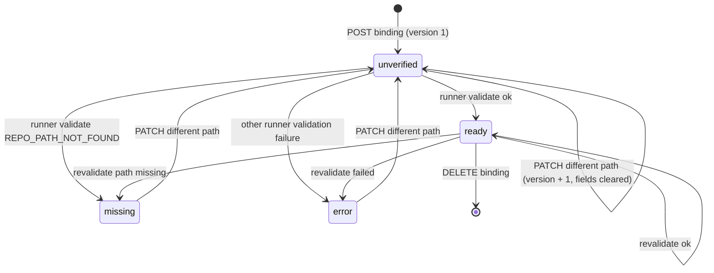
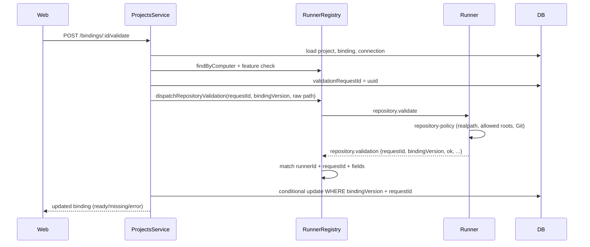
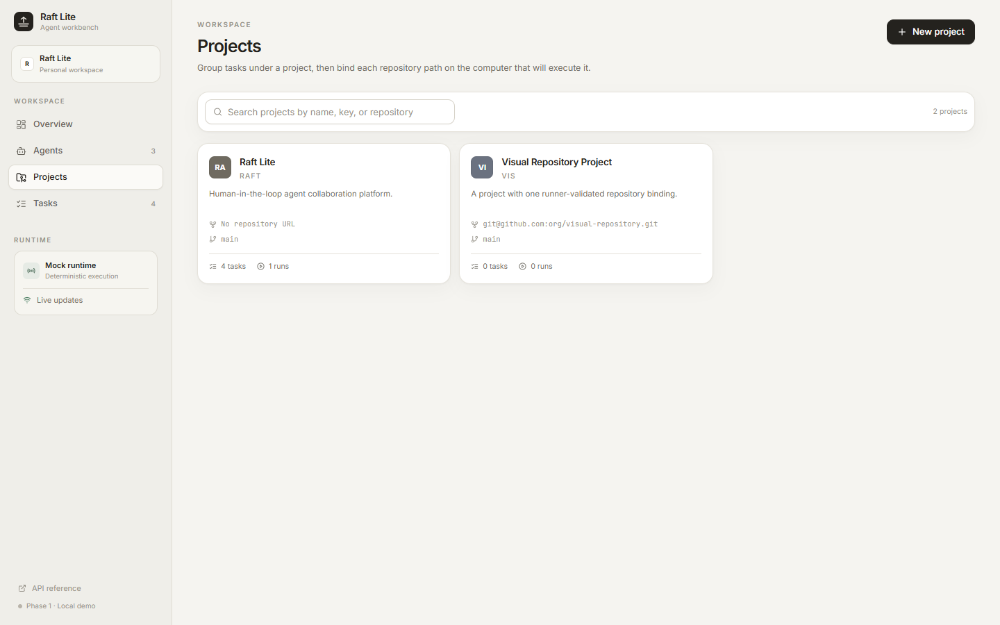
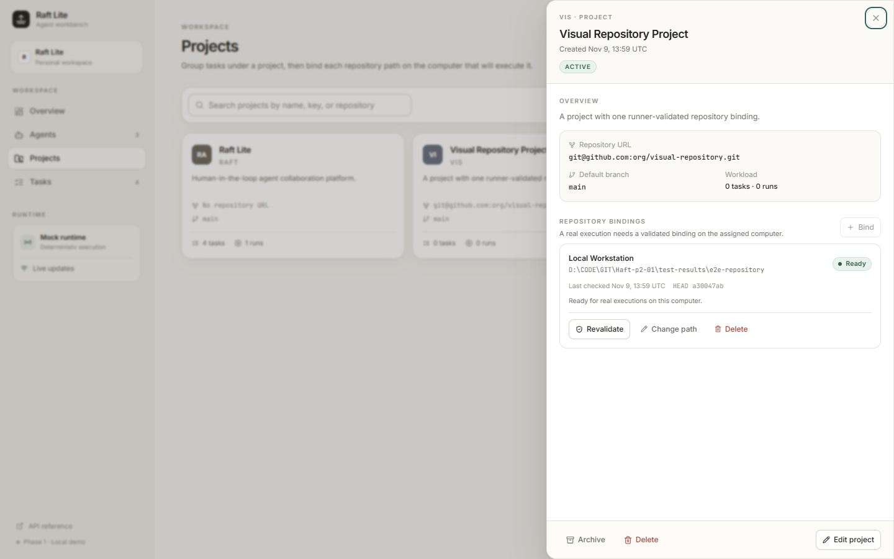
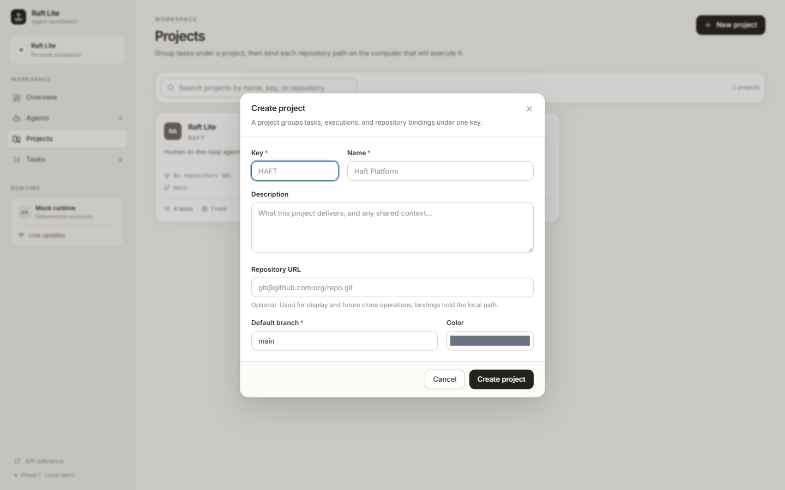

# P2-01 — Project CRUD and repository bindings

Status: **implemented** on `feature/p2-01-project-crud-repository-binding`,
based on `main` at `6a5ad16` (P2-00 contracts + P2-04 CI baseline).

This document records the delivered data model, API, runner validation flow,
error strategy, migration/rollback procedure, test evidence, and known limits.
The frozen Phase 2 roadmap is intentionally not edited.

## 1. Scope ruling

The P2-01 task brief and the frozen roadmap differ on two points:

| Topic      | Frozen roadmap (P2-01 card)             | This implementation                                                   |
| ---------- | --------------------------------------- | --------------------------------------------------------------------- |
| `repoUrl`  | Explicitly not added                    | Added as optional display metadata. It is never used for clone/fetch. |
| Validation | `repository.validate` deferred to P2-02 | Implemented end to end because the P2-01 task brief requires it.      |

To avoid implementing P2-02 ahead of schedule, this change deliberately does
**not** include:

- the `execution.repository` → `execution.repository.accepted/.rejected` handshake;
- `Execution.dispatchState`, repository path/policy/context/base-commit fields;
- execution-time re-validation, feature-gated start, or `REPOSITORY_*` handshake
  error paths;
- removal of the legacy `HAFT_RUNNER_PROJECTS` execution mapping or the
  `INIT_CWD`/`process.cwd()` fallback. Those remain P2-02 work;
- default-branch existence checks. The runner validates the path and Git root;
  branch validation belongs to the P2-02 handshake.

`execution.start` remains protocol v1 and still carries only `projectId`. The
runner uses the canonical path learned from a successful `repository.validate`
for P2-01 execution routing, and keeps the legacy project map as a fallback
until P2-02 removes it.

## 2. Data model

Migration: `apps/api/prisma/migrations/20261109120103_p2_01_project_repository_binding`.

### Project

New columns:

| Column          | Type      | Notes                                                     |
| --------------- | --------- | --------------------------------------------------------- |
| `repoUrl`       | String?   | Display metadata; validated at the API edge, never cloned |
| `defaultBranch` | String    | Default `main`; the only authoritative branch source      |
| `archivedAt`    | DateTime? | `null` = active; set/cleared through `archived` boolean   |

Existing rows keep their ids, task relations, and execution history. The
migration copies every old column and lets the new columns take their defaults.

### ProjectRepositoryBinding

| Column                    | Type          | Notes                                                     |
| ------------------------- | ------------- | --------------------------------------------------------- |
| `id`                      | String, PK    |                                                           |
| `projectId`               | FK → Project  | Cascade delete                                            |
| `computerId`              | FK → Computer | Cascade delete; unique with `projectId`                   |
| `path`                    | String        | Raw user input; API does not normalize platform paths     |
| `pathHash`                | String        | Stable SHA-256 of the raw path                            |
| `bindingVersion`          | Int           | Starts at 1; increments only when `path` actually changes |
| `platform`                | String?       | Runner platform (`win32`, `linux`, `darwin`)              |
| `status`                  | String        | `unverified`, `ready`, `missing`, or `error`              |
| `validationRequestId`     | String?       | Current/last runner request correlation id                |
| `canonicalPath`           | String?       | Runner realpath; only a successful validation writes it   |
| `headCommit`              | String?       | Runner `git rev-parse HEAD` at validation time            |
| `validationErrorCode`     | String?       | Runner policy error code on failure                       |
| `validationError`         | String?       | Human-readable failure reason                             |
| `lastValidatedAt`         | DateTime?     | Set on success and failure                                |
| `validatedByRunnerId`     | FK → Runner?  | `SetNull` when the runner row is removed                  |
| `validatedBindingVersion` | Int?          | Version that produced the last successful result          |
| `policyVersion`           | String?       | Runner path-policy fingerprint                            |
| `createdAt`, `updatedAt`  | DateTime      |                                                           |

Constraints: `@@unique([projectId, computerId])`, indexes on
`(projectId, status)`, `computerId`, and `validatedByRunnerId`.

### Execution snapshot

`Execution` keeps the P2-01 repository snapshot fields:

| Column                     | Type                      | Notes                                   |
| -------------------------- | ------------------------- | --------------------------------------- |
| `repositoryProjectId`      | String?                   | Project used when the run was created   |
| `repositoryBindingId`      | FK → Binding? (`SetNull`) | Binding used; history survives deletion |
| `repositoryBindingVersion` | Int?                      | Binding version captured at creation    |
| `repositoryDefaultBranch`  | String?                   | Project branch snapshot                 |

`defaultBranch` is never stored on a binding. Changing it affects only future
executions; existing executions retain their snapshot.

## 3. Binding state machine



Rules enforced by the API and tests:

- Creation always writes `status = unverified`, version 1.
- Only a matching `repository.validation` response can write `ready`.
- The client cannot set `status`, `canonicalPath`, `headCommit`,
  `validatedBindingVersion`, `policyVersion`, or `platform`.
- A path change increments `bindingVersion`, resets the status to `unverified`,
  and clears all validation fields in one update.
- A same-value path PATCH does not increment the version and does not clear
  validation.
- A validation response is applied only when `bindingVersion`,
  `pathHash`, and `validationRequestId` still match the request.
- A timeout/disconnect leaves the previous status unchanged and clears the
  in-flight request id; the UI can retry.

## 4. API

All responses use the normal `{ data, requestId }` / `{ error, requestId }`
envelope.

### Projects

| Method   | Path                | Notes                                                    |
| -------- | ------------------- | -------------------------------------------------------- |
| `GET`    | `/api/projects`     | `ListDto<ProjectDto>` with task/execution/binding counts |
| `POST`   | `/api/projects`     | Create; key is trimmed and upper-cased                   |
| `GET`    | `/api/projects/:id` | `ProjectDetailDto`, including bindings                   |
| `PATCH`  | `/api/projects/:id` | Name/description/color/repoUrl/defaultBranch/archived    |
| `DELETE` | `/api/projects/:id` | 409 `PROJECT_HAS_TASKS`; otherwise cascades bindings     |

Create request:

```json
{
  "key": "HAFT",
  "name": "Haft Platform",
  "description": "Phase 2 project management",
  "color": "#6f6a60",
  "repoUrl": "git@github.com:org/haft.git",
  "defaultBranch": "main"
}
```

Validation rules:

- key: 2–12 chars, starts with a letter, `[A-Z0-9_-]`, unique per workspace;
  duplicates return `409 PROJECT_KEY_CONFLICT`.
- name: 2–80 chars.
- repoUrl: `http(s)`, `ssh`, `git`, or `git@host:path`; `null` clears it.
- defaultBranch: non-empty, ≤255, no whitespace/control characters, not
  starting with `-`, no `..`, not `HEAD`.
- archived projects are rejected for new tasks with `409 PROJECT_ARCHIVED`.

Delete is intentionally strict. Archive (`PATCH { "archived": true }`) is the
non-destructive path and preserves tasks, executions, and bindings.

### Repository bindings

| Method   | Path                                             | Notes                                        |
| -------- | ------------------------------------------------ | -------------------------------------------- |
| `GET`    | `/api/projects/:id/bindings`                     | `ListDto<ProjectBindingDto>`                 |
| `POST`   | `/api/projects/:id/bindings`                     | `{ computerId, path }`; initial `unverified` |
| `PATCH`  | `/api/projects/:id/bindings/:bindingId`          | Only `{ path }`                              |
| `DELETE` | `/api/projects/:id/bindings/:bindingId`          | Historical execution snapshots remain        |
| `POST`   | `/api/projects/:id/bindings/:bindingId/validate` | Dispatch `repository.validate` to the runner |

Create:

```json
{
  "computerId": "computer_local",
  "path": "D:\\code\\haft-work"
}
```

PATCH with any field other than `path` returns
`400 BINDING_FIELD_IMMUTABLE` (not a silent ignore). This includes
`defaultBranch`, `status`, `bindingVersion`, `policyVersion`, `canonicalPath`,
`computerId`, and validation timestamps.

Validation success response (`200`):

```json
{
  "data": {
    "id": "cm...",
    "status": "ready",
    "canonicalPath": "D:\\code\\haft-work",
    "platform": "win32",
    "headCommit": "74ebaa2...",
    "policyVersion": "3f5c...",
    "lastValidatedAt": "2026-11-09T12:29:00.000Z",
    "validatedByRunnerId": "runner_e2e",
    "validatedBindingVersion": 1,
    "validationErrorCode": null,
    "validationError": null,
    "bindingVersion": 1
  },
  "requestId": "..."
}
```

Failure returns `422 PROJECT_BINDING_INVALID` with the updated binding in
`details.binding` and the concrete runner code in `details.errorCode`:

```json
{
  "error": {
    "code": "PROJECT_BINDING_INVALID",
    "message": "Repository path does not exist",
    "details": {
      "bindingStatus": "missing",
      "bindingVersion": 1,
      "errorCode": "REPO_PATH_NOT_FOUND",
      "binding": { "status": "missing", "...": "..." }
    }
  },
  "requestId": "..."
}
```

Precondition failures happen before any runner dispatch:

| Status | Code                            | Cause                                             |
| ------ | ------------------------------- | ------------------------------------------------- |
| 404    | `PROJECT_NOT_FOUND`             | Project absent or in another workspace            |
| 404    | `BINDING_NOT_FOUND`             | Binding absent or belongs to another project      |
| 409    | `RUNNER_OFFLINE`                | No connected runner for the binding's computer    |
| 409    | `PROJECT_BINDING_UNSUPPORTED`   | Runner lacks a required repository feature        |
| 409    | `STALE_REPOSITORY_VALIDATION`   | Concurrent/duplicate validation or stale response |
| 504    | `REPOSITORY_VALIDATION_TIMEOUT` | Runner did not answer within the configured time  |

## 5. Runner validation flow



The API never reads the runner's filesystem and never fakes a successful
validation. The runner advertises `project-binding-v1`,
`repository-validation-v1`, and `repository-path-policy-v1`; it does **not**
advertise `repository-handshake-v1` in P2-01.

The runner caches a validation response for the same `requestId` for five
minutes and replays it on retry. The API sets `validationRequestId` before
dispatch and applies the result only when the binding version, path hash, and
request id still match.

### Path policy

`apps/runner/src/repository-policy.ts` implements the frozen P2-02 vocabulary
ahead of P2-02 so validation cannot be a weaker path check than execution:

- `allowedRepositoryRoots` is required; empty means fail closed with
  `REPOSITORY_POLICY_NOT_CONFIGURED`.
- Reject relative paths, `..`, NUL, Windows device paths (`\\?\`, `\\.\`), and
  UNC paths.
- `realpath` the target and every allowed root, then compare with
  `path.relative`; string-prefix checks are forbidden.
- The target must be an existing directory and a Git main-worktree root.
- Reject bare repositories, linked worktrees, submodules, and paths inside the
  worktree/recovery quarantine roots.
- A symlink or junction that escapes an allowed root is rejected.
- `policyVersion` is a SHA-256 prefix over the normalized allowed roots,
  unc/device switches, worktree root, and recovery root.

Only `REPO_PATH_NOT_FOUND` maps to `missing`; all other failures map to `error`.
`EACCES`/I/O failures are validation errors, not missing paths.

## 6. UI

The Projects page provides:

- list, search, empty/loading/error states, archived badge;
- create/edit dialog with key, name, description, repoUrl, default branch, color;
- details drawer with counts, repo URL, default branch, bindings;
- binding create/change-path/delete, manual Validate/Revalidate, progress,
  status badge, canonical path/HEAD policy metadata, last-checked time, and
  concrete failure reason;
- archive/restore and a guarded delete confirmation.

The Task form loads real projects from `GET /api/projects`, hides archived
projects for new tasks, shows a link to Projects when none are available, and
stores the selected `projectId`. Task detail blocks a real execution until a
binding exists, is `ready`, and its `validatedBindingVersion` matches
`bindingVersion`. The server repeats the guard, so a stale client cannot bypass
it.

Screenshots (regenerated by the visual E2E suite):







## 7. Error-code strategy

- Validation failures are `400 VALIDATION_ERROR` with field details.
- Duplicate key/computer and archived-project selection are `409` with a typed
  code, never a raw Prisma 500.
- Immutable binding fields are `400 BINDING_FIELD_IMMUTABLE` with the offending
  field list.
- Runner preconditions are `409`; runner-produced path failures are `422`
  `PROJECT_BINDING_INVALID` with the concrete `REPO_*` code in details.
- A timeout is `504 REPOSITORY_VALIDATION_TIMEOUT`.
- A stale result is `409 STALE_REPOSITORY_VALIDATION` and is never applied.
- Execution guards are `409 PROJECT_BINDING_MISSING` or
  `409 PROJECT_BINDING_NOT_READY` with binding status/version details.

## 8. Migration and rollback

Apply:

```bash
pnpm --filter @raft-lite/api db:deploy
```

The migration was verified twice:

1. **Empty database** — all four migrations apply; Project has
   `repoUrl/defaultBranch/archivedAt`; `ProjectRepositoryBinding` and its unique
   index exist.
2. **Existing database** — the first three migrations were applied, then
   `project_demo`, an agent, a task, and a completed execution were inserted,
   then the P2-01 migration was applied. Results:
   - `_prisma_migrations` count: 4;
   - `project_demo` survived with `repoUrl = NULL`, `defaultBranch = "main"`,
     `archivedAt = NULL`;
   - `task_existing` still points at `project_demo`;
   - `execution_existing` remains `completed/completed`;
   - the binding table and unique index exist.

Rollback for a pre-release environment:

1. Stop API/runner writers and back up the SQLite file.
2. Remove the four P2-01 `Execution` snapshot columns and the
   `ProjectRepositoryBinding` table only if no P2-01 rows must be kept.
3. Recreate `Project` without `repoUrl/defaultBranch/archivedAt` (SQLite table
   rebuild), preserving ids and task relations.
4. Drop the four migration rows or restore the prior database backup.

Because SQLite cannot drop columns atomically in older servers, the supported
production rollback is **restore the pre-migration backup**; the destructive
manual SQL is only for disposable development databases. Historical tasks and
executions must not be deleted as part of rollback.

## 9. Test evidence

Commands run on the implementation host (Windows, Node 24.14.0, pnpm 11.5.2).
The deterministic Vitest layers total 251 tests (107 + 33 + 70 + 41):

| Layer                    | Result               |
| ------------------------ | -------------------- |
| Contracts                | 107 tests / 5 files  |
| API integration          | 33 tests / 5 files   |
| Runner unit              | 70 tests / 13 files  |
| Web component            | 41 tests / 11 files  |
| Deterministic Playwright | 44 passed / 44 tests |
| Migration checks         | empty + existing OK  |
| Lint / typecheck / build | all passed           |
| Format check             | passed               |

New coverage includes:

- contracts: project key/name/repoUrl/defaultBranch/path schemas, binding DTOs,
  immutable-field and status constants;
- API: project CRUD/counts/archive/delete conflict/cross-workspace 404, binding
  create/duplicate/path versioning/immutable fields, runner offline, stale
  binding ownership, validation timeout, and the real-execution gate for
  missing, unverified, and stale-version bindings;
- runner: allowed-root fail-closed, relative/traversal/UNC/device paths,
  prefix escape, missing/plain/bare repositories, subdirectory, linked worktree,
  submodule, worktree/recovery quarantine, symlink/junction escape, canonical
  path/HEAD/policy version;
- web: Projects list/empty/error/archived, project form, binding create/validate
  states, task-project selection and archived filtering;
- E2E: full Project → Computer binding → Fake Runner validate → ready → Task →
  Fake Runner execution → logs/result → reload persistence, plus the existing
  runner execution suites now create a validated binding first.

Fake Runner E2E requires `HAFT_RUNNER_ALLOWED_ROOTS` and a disposable main Git
worktree at `test-results/e2e-repository`. Real CLI E2E uses the same binding
path with `PROJECT_ROOT` and its own allowed root.

## 10. Known issues and P2-02 readiness

Known limits in this card:

- No real Codex/OpenCode model execution was run as part of P2-01 acceptance;
  the opt-in real CLI suite is preserved and must be run manually with
  authenticated CLIs. This is not reported as a P2-01 pass.
- Validation retries are user-triggered after a timeout; the API does not
  automatically resend the same `requestId` (the runner cache already supports
  it).
- The in-flight duplicate guard is process-local, matching the single-instance
  SQLite demo; multiple API instances need a database/distributed lease.
- `defaultBranch` existence is not checked during validation; P2-02 must reject
  a missing branch during the execution handshake.
- Legacy `HAFT_RUNNER_PROJECTS` mapping is still used for execution routing;
  P2-02 must remove it and the cwd fallback.
- `repoUrl` is display metadata only; no clone/fetch behavior exists.

P2-02 can start from this branch once merged:

- Binding model, statuses, versions, path hash, snapshot fields, and validation
  persistence are in place.
- `repository.validate`/`repository.validation`, request correlation,
  timeout/disconnect handling, runner feature reporting, and the path policy are
  in place and tested.
- Remaining P2-02 work is the `execution.repository` handshake, dispatch state,
  execution-time policy recheck/branch check, feature-gated start, removal of
  the legacy path map/cwd fallback, and execution-side repository fields.
