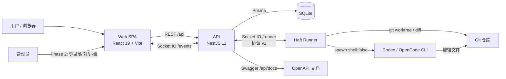
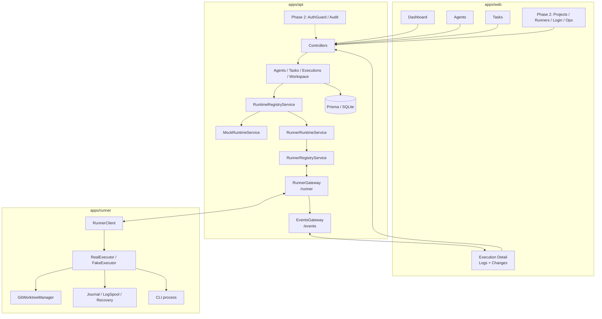
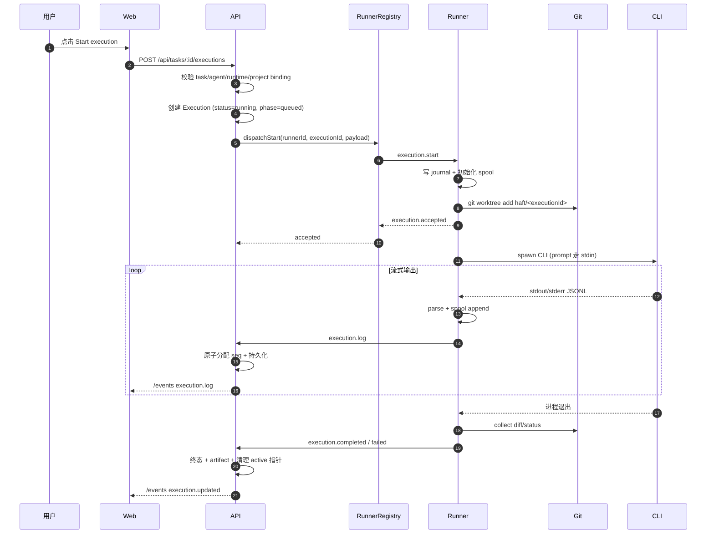
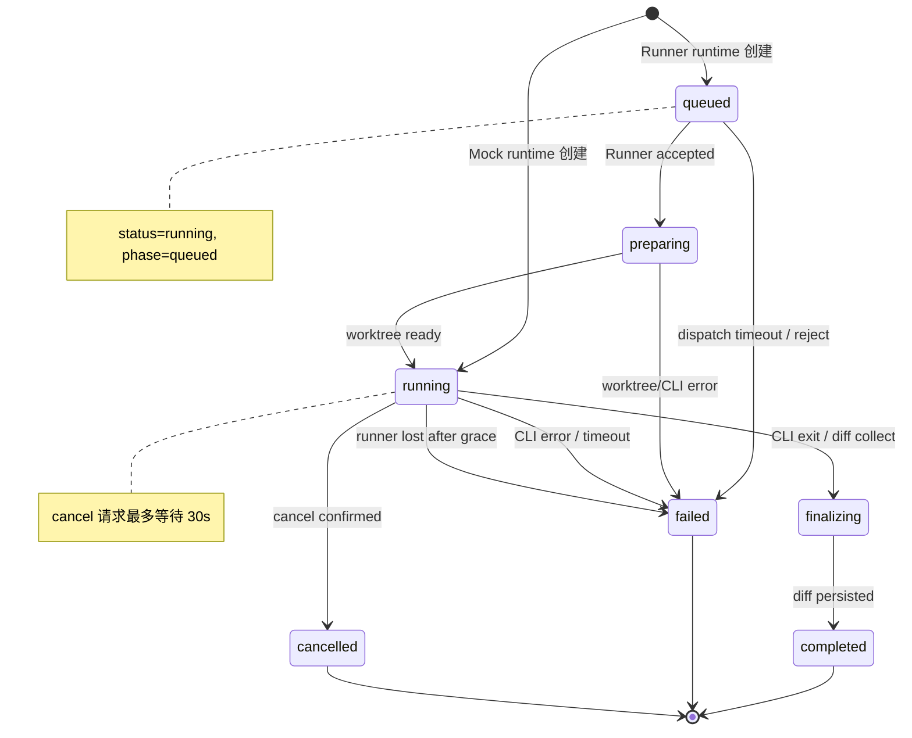
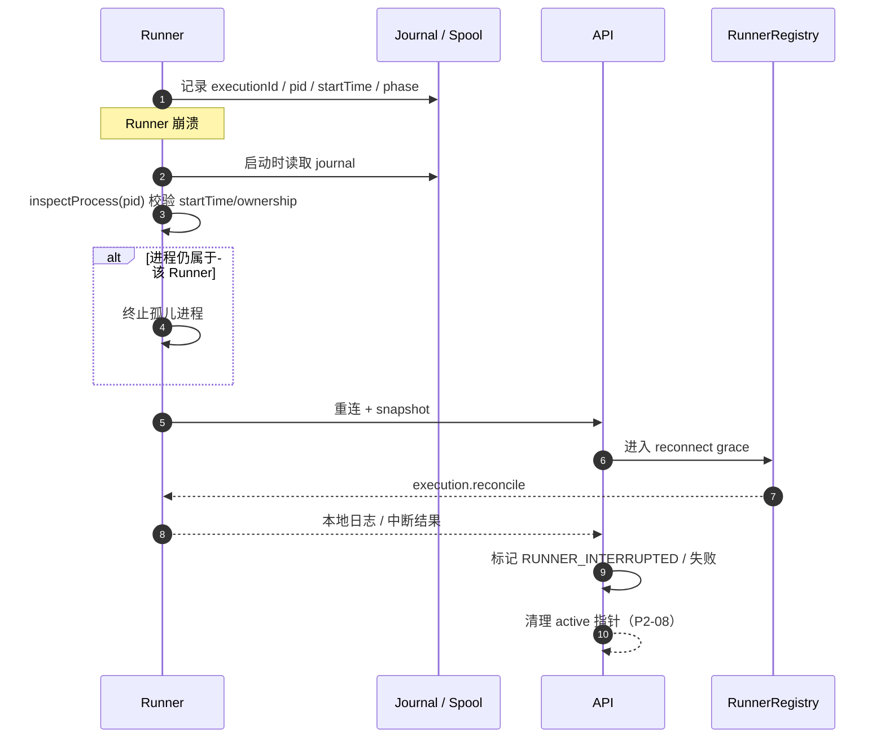
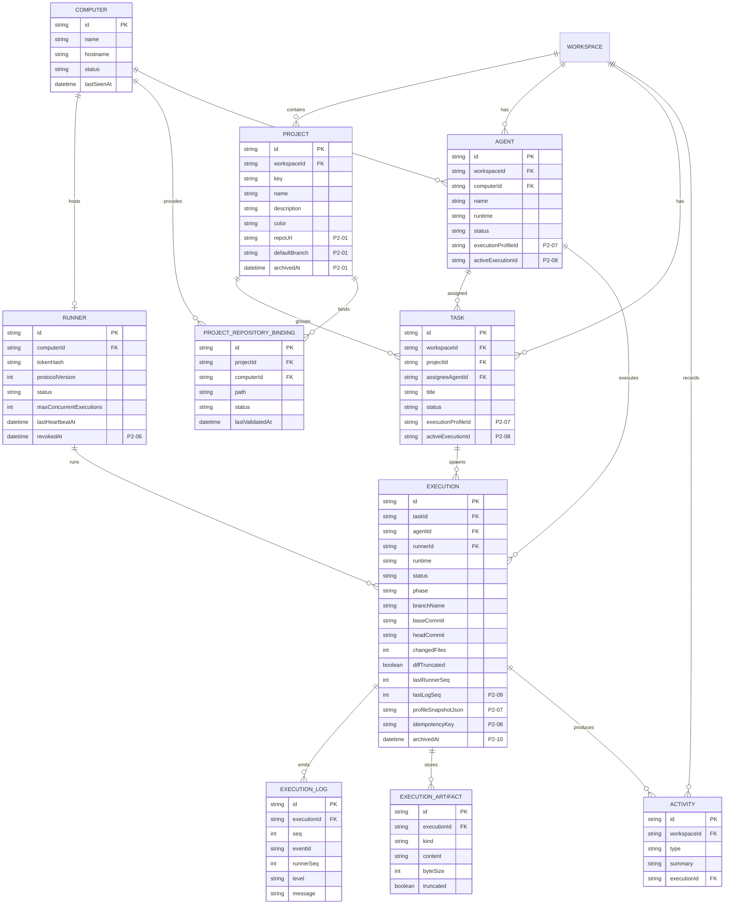
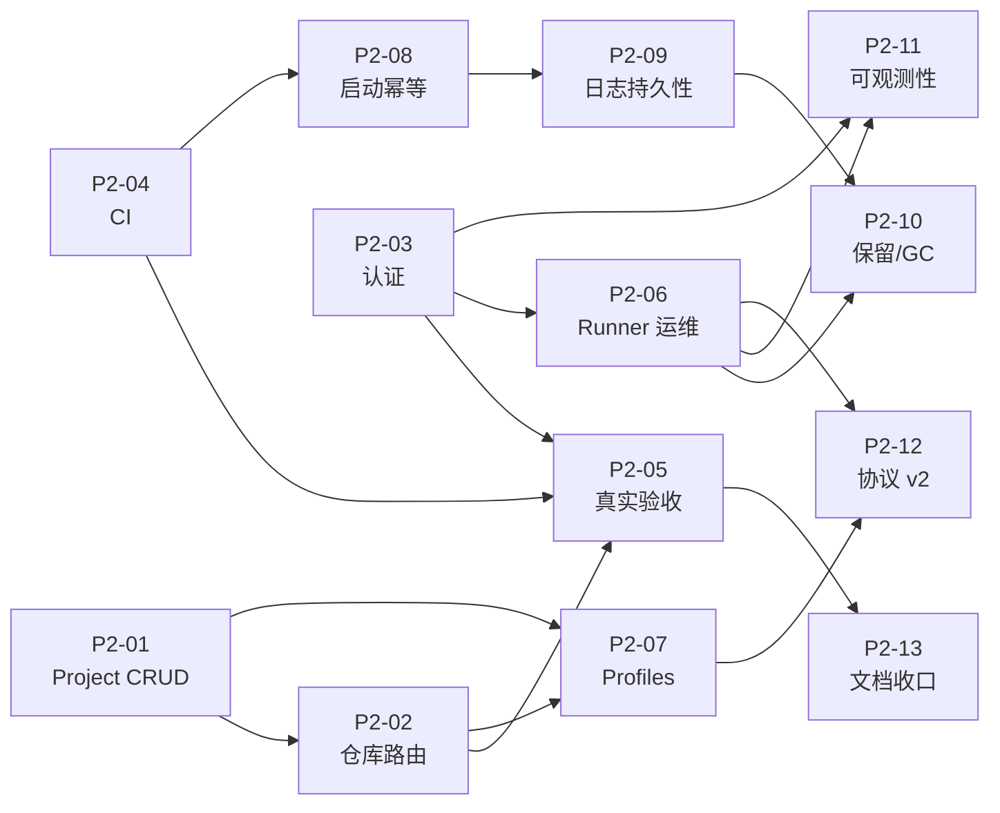

# Haft Phase 2 技术路线图与架构评审

> **文档类型**：只读架构评审 + Phase 2 技术路线图  
> **评审基线**：`main` / `633f7841f9cbcafa65cdfed8d266f51497891f90`  
> **生成日期**：2026-11-09  
> **评审范围**：`apps/api`、`apps/web`、`apps/runner`、`packages/contracts`、`tests`、`docs`  
> **证据原则**：以 HEAD 代码、测试和已提交验收 artifact 为准，不以 `REPORT.md` 的口头声明为准。  
> **状态说明**：评审期间未创建/修改任何文件、未运行服务、测试、迁移或 Git 写操作；本文档为评审结论的 Markdown 固化版本。

## 目录

1. Executive Summary（执行摘要）
2. Repository Snapshot（仓库快照）
3. Current Architecture Review（当前架构评审）
4. Phase 1.1 Acceptance Review（Phase 1.1 验收复核）
5. Technical Debt & Risk Register（技术债与风险登记）
6. Phase 2 Roadmap（Phase 2 路线图）
7. Detailed Task Breakdown（详细任务卡）
8. Architecture & Data Flow Diagrams（架构与数据流图）
9. Automated Acceptance Strategy（自动化验收策略）
10. Security Review（安全评审）
11. Recommended Execution Order（建议执行顺序）
12. Final Recommendation（最终建议）

---

## 1. Executive Summary（执行摘要）

**总体结论：Phase 1 的代码基础是真实存在的，但 Phase 1.1 的“真实 Codex 验收”没有被证明。**

- 代码层面已经具备：独立 Runner、Socket.IO Runner 协议 v1、Codex/OpenCode 真实 CLI 执行、Git worktree 隔离、unified diff artifact、执行日志、取消/超时、journal + NDJSON spool + 崩溃恢复、Fake Runner 确定性 E2E。核心设计不是空壳。
- 验收层面：唯一已提交的验收报告 `docs/acceptance/phase-1-real-codex-acceptance.md` 结论是 **BLOCKED**，原因是缺少 Project 创建 API/UI，验收在预检阶段停止，未启动服务、未运行真实 Codex、未执行自动化测试。
- `docs/REPORT.md` 声称 Phase 1.1 的真实 Codex API/UI 测试 PASS（114 个确定性测试、42 个 E2E、真实 Codex 30.2s/34.4s），但没有提交对应的 JUnit、日志、截图、diff 或验收报告 artifact；且与 BLOCKED 验收文档直接矛盾。按“已提交 artifact 优先”的原则，**不能把 REPORT.md 的 PASS 当作当前 HEAD 的真实验收证据**。
- 当前最大产品缺口不是“CLI 能不能跑”，而是“能否创建一个真实 Project 并把它绑定到 Runner 上的仓库”。`Project` 只有 `key/name/description/color`，没有仓库路径、默认分支、Project CRUD API 或 UI；Runner 只能通过 `HAFT_RUNNER_PROJECTS` 环境变量把 projectId 映射到路径，且存在 fallback 到 cwd 的风险。
- 安全与运维缺口同样阻塞“可对外演示”：Web/API 没有认证，`/events` 无鉴权，`/runner` 在未配置 `WEB_ORIGIN` 时 CORS 为 `origin: true`，bootstrap token 是静态可复用密钥，Runner/Computer 没有配对、撤销、轮换 UI，没有 CI，没有保留/清理策略。
- 正确性风险集中在并发与持久化：启动锁是进程内 `Map`，`nextLogSeq` 是 `max(seq)+1` 的读后写，`LogSpool.append` 捕获写入错误后仍然 resolve，调用方可能把“未落盘”的日志发出去。
- Phase 2 的正确主题是：**从“可演示的单机 Demo”升级为“可验收、可运维、可安全暴露的 Phase 2 平台”**。优先级必须是 Project CRUD/仓库绑定 → 显式 Runner 路由 → 认证 → CI → 真实验收证据；之后再做 Runner 运维、执行 profile、数据库级幂等、日志持久化、保留策略、可观测性、协议 v2。
- 建议采用 4 个 wave：Wave 1（P0）打通验收与安全基线；Wave 2（P1）解决运维与正确性；Wave 3（P2）解决生命周期与可观测性；Wave 4（P3）做协议演进与文档收口。**在 P2-03 认证完成前，不要让 API 离开 localhost。**

**Phase 2 完成的最低标准：**

1. 能通过 UI/API 创建 Project，并为目标 Computer 绑定仓库路径和默认分支。
2. Runner 只使用服务端下发的显式绑定路径，不再 fallback 到 cwd。
3. 在固定 commit、干净工作区、独立 DB/端口下，真实 Codex API + UI 验收通过，并把证据提交到 `docs/acceptance/`。
4. 所有 REST 与 `/events` 默认拒绝匿名访问；Runner token 可配对、撤销、轮换。
5. CI 在 Linux + Windows 上绿；README/REPORT 的测试数字和验收状态可追溯。
6. 并发启动、日志序号、spool 写入失败都有自动化测试证明，而不是靠“单实例不会发生”。

---

## 2. Repository Snapshot（仓库快照）

| 项目 | 值 |
|---|---|
| 仓库路径 | `D:\CODE\GIT\Haft` |
| 分支 | `main`，与 `origin/main` 同步 |
| HEAD | `633f7841f9cbcafa65cdfed8d266f51497891f90` |
| HEAD 标题 | `fix: harden runner recovery and diff evidence` |
| 工作区 | `git status --porcelain` 无输出，干净 |
| Worktree | 仅 `D:/CODE/GIT/Haft 633f784 [main]` |
| 提交历史 | `9c8e65a` 初始化 → `cf39a76` Runner/真实 CLI → `34c5618` BLOCKED 验收报告 → `553eb9a` diff/恢复 → `633f784` 加固 |
| 包管理 | pnpm `11.5.2`，Node `>=20.19` |
| Monorepo | `apps/api`、`apps/web`、`apps/runner`、`packages/contracts` |
| API | NestJS 11 + Prisma 6.16.2 + SQLite；REST `/api`、Socket.IO `/events`、`/runner` |
| Web | React 19 + Vite + TanStack Query + React Router + Socket.IO Client |
| Runner | 独立 Node 进程；Codex/OpenCode CLI；Git worktree；journal/spool/recovery |
| 确定性测试 | **114**：contracts 5 + API 27 + runner 60 + web 22 |
| E2E | **42**：38 functional（含 3 个 Fake Runner）+ 1 business-loop + 3 visual |
| 真实 CLI E2E | **9** 个 opt-in（6 CLI + 3 UI），需 `HAFT_REAL_CLI_E2E=1` |
| CI | **无** `.github/workflows` |
| 已提交验收 artifact | `docs/acceptance/phase-1-real-codex-acceptance.md`，结论 **BLOCKED** |
| 文档一致性 | README 仍写 “72 tests”（`README.md:139,175`）；REPORT 写 114/42 并声称真实 Codex PASS |

**关键观察：**

- 这是“单机、单 workspace、单 SQLite”的架构，不是多租户/多实例架构。很多简化是刻意为之，但 Phase 2 必须把“单实例假设”显式化，否则会在验收或部署时暴露。
- 代码质量整体高于普通 Demo：Zod 严格 schema、`shell:false`、stdin 传 prompt、token 不传 CLI、diff 1 MiB 上限、日志 8k 行上限、测试端点双重门禁、token hash + `timingSafeEqual`，这些都应保留。
- 当前文档存在“实现完成”和“验收完成”混写的问题。Phase 2 必须把“代码存在”“确定性测试通过”“真实 CLI 验收通过”分成三个不同状态。

---

## 3. Current Architecture Review（当前架构评审）

### 3.1 运行时与执行主链路

```text
React SPA
  → REST /api（NestJS Controllers → Services → Prisma → SQLite）
  → Socket.IO /events（执行状态/日志广播）
  → RuntimeRegistryService
      → MockRuntimeService（内存模拟，演示/测试）
      → RunnerRuntimeService（服务端不 spawn CLI）
          → RunnerRegistryService + RunnerGateway（/runner，协议 v1）
              → Runner 进程
                  → RealExecutor / FakeExecutor
                  → GitWorktreeManager（worktree + diff）
                  → CLI（codex/opencode，spawn shell:false）
```

- `RuntimeRegistryService` 是唯一的 runtime 选择点，`ExecutionsService` 不直接按 runtime 名称分支，这是很好的边界（`apps/api/src/modules/runtime/runtime-registry.service.ts`）。
- `RunnerRuntimeService` 明确“Nest 进程永不 spawn CLI”，只向拥有该 Computer 的 Runner 发消息（`apps/api/src/modules/runtime/runner-runtime.service.ts`）。
- Runner 协议是严格 Zod envelope，消息带 `messageId`，设计上支持至少一次投递和幂等处理（`packages/contracts/src/runner-protocol.ts:12-18`）。
- Runner 侧 `RealExecutor` 负责 CLI 生命周期、超时、取消、journal、日志解析和 Git evidence；`GitWorktreeManager` 负责 worktree 创建、diff 收集、截断和清理。

### 3.2 数据模型

当前模型：`Workspace → Project → Task → Execution → ExecutionLog/ExecutionArtifact`，以及 `Computer → Runner`、`Agent → Execution`、`Activity`。

关键事实：

- `Project` 只有 `id/workspaceId/key/name/description/color`，**没有 `repoPath`、`repoUrl`、`defaultBranch`**（`apps/api/prisma/schema.prisma:22-36`）。
- `Execution` 有 `branchName/baseCommit/headCommit/changedFiles/diffStat/gitStatus/diffTruncated/lastRunnerSeq`，但没有服务端日志序号游标、没有执行 profile/options 快照（`schema.prisma:119-157`）。
- `ExecutionLog` 已有 `@@unique([executionId, seq])`、`@@unique([executionId, eventId])`、`@@unique([executionId, runnerSeq])`，数据库层具备幂等基础（`schema.prisma:176-192`）。
- `Runner` 有 `tokenHash`、`protocolVersion`、`capabilitiesJson`、`maxConcurrentExecutions`，但没有 `revokedAt`、没有配对 token 表（`schema.prisma:52-73`）。
- `Workspace` 只有一个 seed 的 `ws_demo`，大量 service 直接使用 `DEFAULT_WORKSPACE_ID`，没有真正的多 workspace 解析。

### 3.3 API 与 Web 表面

- API 模块：`agents`、`tasks`、`executions`、`runtime`、`runners`、`computers`、`workspace`、`events`、`test`、`health`。
- Web 路由只有：Dashboard、Agents、Tasks、Execution Detail（`apps/web/src/app.tsx:9-21`）。
- **没有 Projects 页面、没有 Runners/Computers 管理页面、没有登录页、没有设置页。**
- `GET /api/workspace` 会返回 projects，但只是 seed 数据的只读展示；没有 `POST/PATCH/DELETE /api/projects`。
- Runner/Computer 只有只读 `GET`，没有配对、撤销、轮换、改名的管理面。

### 3.4 Runner 协议与恢复

- 协议版本硬编码为 `1`（`packages/contracts/src/constants.ts:54`，`runner-protocol.ts:45,57`）。
- 握手支持 `token` 或 `bootstrapToken`；服务端存 SHA-256 hash，并用 `timingSafeEqual` 比较（`runner-registry.service.ts:163-251,808-859`）。
- 派发有 20s accept 超时（`runner-registry.service.ts:50`）；断线有 60s 默认 reconnect grace（`:51`）。
- 断线期间执行不立即失败；重连后 `execution.reconcile` 让 Runner 报告本地状态；超过 grace 才失败为 `RUNNER_DISCONNECTED`。
- Runner 恢复依赖 journal + NDJSON spool + PID start-time/ownership 检查；恢复后**不会重跑**，而是把中断执行标记为 `RUNNER_INTERRUPTED`。
- `execution.reconcile` 目前主要是“日志 + 失败/终态”语义，不是完整的状态机对账；这是 Phase 2 要补的运维能力。

### 3.5 认证与信任边界

- Web/API：**没有认证/授权**。所有 REST 路由匿名可访问；`/events` 只做了 CORS，没有会话校验（`events.gateway.ts:23-37`）。
- `/runner`：有握手 token 认证，但 CORS 在未设置 `WEB_ORIGIN` 时返回 `true`（`runner.gateway.ts:30-44`），意味着浏览器来源不受限；真正的安全边界仍是 token，但这是一个容易误配置的危险默认值。
- Bootstrap token：`HAFT_RUNNER_BOOTSTRAP_TOKEN` 是静态环境变量，可重复使用；没有 TTL、一次性消费、撤销或轮换（`runner-registry.service.ts:218-251`，`apps/api/.env.example:9-13`）。
- Test API：仅当 `E2E_TEST_MODE=true` 且 `NODE_ENV!=production` 时注册（`app.module.ts:16-17,33`），这是正确的门禁；但没有额外的网络/认证保护，误配置仍有风险。

### 3.6 当前架构的优点

1. **契约先行**：请求体、查询、Runner 消息都由 Zod 严格校验，API/Web/Runner 不易静默漂移。
2. **Runtime 抽象清晰**：Mock 与 Runner 两种 runtime 通过同一接口选择，测试与真实执行分离。
3. **进程安全基础好**：`spawn` 参数数组、`shell:false`、prompt 走 stdin、CLI 环境清洗、token 不传 CLI、Codex `workspace-write` sandbox。
4. **Git 隔离正确方向**：每个执行独立 worktree/branch，diff 作为 artifact 持久化，主 checkout 不被直接修改。
5. **恢复设计认真**：journal、spool、PID identity、reconcile、grace window 都不是“假装恢复”。
6. **测试分层完整**：contracts/API/runner/web/E2E/Fake Runner/真实 CLI opt-in 的层次清楚，114 个确定性测试是实打实的基础。

### 3.7 当前架构的主要问题

| 问题 | 证据 | 影响 |
|---|---|---|
| 没有 Project CRUD/仓库绑定 | `schema.prisma:22-36`；无 `Controller('projects')`；`workspace.controller.ts` 只读 | 真实验收无法创建专用 Project；Runner 只能靠 env 映射 |
| 没有 Web/API 认证 | `events.gateway.ts:23-37`；无全局 guard | 任何本机/局域网客户端可读写所有数据、订阅执行日志 |
| `/runner` CORS 默认放开 | `runner.gateway.ts:30-44` | 误配置时浏览器来源不受限；应 fail closed |
| Bootstrap token 静态可复用 | `runner-registry.service.ts:218-251` | 泄露后可长期配对；无撤销/轮换 |
| 启动锁仅进程内 | `executions.service.ts:48,79-87,960-975` | 多 API 实例或并发请求可能重复创建执行 |
| `nextLogSeq` 读后写 | `executions.service.ts:894-900` | 并发日志可能撞 `(executionId,seq)` 唯一约束或丢日志 |
| `LogSpool.append` 吞错 | `log-spool.ts:43-72` | 磁盘写失败仍 resolve，调用方可能发送未落盘日志 |
| `git collect` 失败返回 null | `git-worktree.ts:142,239` | diff evidence 可能静默丢失，执行仍可能被当成成功 |
| 无保留/清理策略 | 无定时任务；`keepWorktrees` 默认 true；branch 不删除 | 日志、artifact、worktree、branch 无限增长 |
| 无 CI | 无 `.github` | 114/42 个测试靠人工执行，回归不可控 |
| 文档状态失真 | README `72`；REPORT `PASS`；验收文档 `BLOCKED` | 对外结论不可信，验收无法审计 |

---

## 4. Phase 1.1 Acceptance Review（Phase 1.1 验收复核）

### 4.1 权威 artifact

`docs/acceptance/phase-1-real-codex-acceptance.md` 是唯一已提交的 Phase 1 真实验收报告。其开头明确写着：

> **验收结论：BLOCKED**  
> 本次验收在环境预检阶段发现前置能力缺失：Haft 当前没有 Project 创建 API/UI，无法按验收要求创建专用 Project。……未创建验收仓库、未启动服务、未执行真实 Codex、未运行自动化测试，也未伪造任何执行结果。  
> —— `docs/acceptance/phase-1-real-codex-acceptance.md:3-5`

报告记录的执行基线是 `cf39a76`（`:73`），即 **Runner/真实 CLI 刚加入、diff/recovery 加固之前** 的 commit。

### 4.2 时间线与状态变化

| Commit | 内容 | 对验收的意义 |
|---|---|---|
| `cf39a76` | Runner 架构 + 真实 CLI 执行 | 验收报告在此基线预检，因无 Project CRUD 而 BLOCKED |
| `34c5618` | 提交 BLOCKED 验收报告 | 唯一已提交的验收 artifact |
| `553eb9a` | 增加 git diff evidence + runner crash recovery | 代码层补齐了 Phase 1.1 的证据/恢复能力 |
| `633f784` | 加固 runner recovery 和 diff evidence | 当前 HEAD；Project CRUD 缺口仍在 |

**关键判断：** 验收文档的 HEAD 较旧，但它记录的阻塞条件在 HEAD 仍然成立——Project CRUD 依旧不存在。因此不能因为 `553eb9a`/`633f784` 增加了 diff/recovery，就推断 Phase 1.1 已通过。

### 4.3 逐项验收结论

| 验收项 | 状态 | 证据/说明 |
|---|---|---|
| 创建专用 Project | **FAIL** | 无 Project CRUD API/UI；`Project` 无仓库字段；seed 只有 `project_demo` |
| 创建/绑定验收仓库 | **FAIL/PARTIAL** | Runner 支持 worktree；但仓库映射只能靠 `HAFT_RUNNER_PROJECTS` 环境变量，且存在 cwd fallback |
| 创建 Agent/Task 并路由到 Runner | **PARTIAL** | 代码路径存在；Fake Runner 测试覆盖；真实 Project 绑定缺失 |
| 真实 Codex API 执行 | **UNVERIFIED at HEAD** | `tests/e2e-real/real-cli.spec.ts` 存在但 opt-in；无 HEAD 上的已提交运行证据 |
| 真实 Codex UI 执行 | **UNVERIFIED at HEAD** | `tests/e2e-real/real-ui.spec.ts` 存在但 opt-in；无 HEAD 上的已提交运行证据 |
| 实时日志/状态到终态 | **IMPLEMENTED + deterministic tests** | API/runner/web 测试覆盖；真实 CLI 未验证 |
| Changes 面板渲染持久化 diff | **IMPLEMENTED + deterministic tests** | `553eb9a` 增加 diff artifact、`GET /api/executions/:id/diff`、Changes UI |
| 主 checkout/HEAD/remote 不被修改 | **IMPLEMENTED + test assertions** | worktree 隔离和 E2E 断言存在；无真实验收 artifact |
| 崩溃恢复 | **IMPLEMENTED + tests** | journal/spool/PID identity/reconcile；真实崩溃未做验收 |
| 验收证据可审计 | **FAIL** | 只有 BLOCKED 报告；REPORT.md 的 PASS 无 artifact 链接 |

### 4.4 对 `REPORT.md` 的处理

`docs/REPORT.md` 写了：

- 真实 Codex/OpenCode 执行 “Done”（`:257`）。
- 真实浏览器 UI + 真实 Codex UI E2E “Done — 34.4 s pass”（`:281`）。
- 真实 CLI E2E “Pass — 2 passed, 1 skipped”（`:297`）。
- API + real Codex “PASS — 30.2 s”；UI + real Codex “PASS — 34.4 s”（`:311-312`）。
- 手动验收命令与结果（`:326-328`）。

但这些声明没有对应的已提交 JUnit、JSON、日志、截图、视频、diff 或验收报告。仓库根目录的 `.log` 文件被 `.gitignore` 忽略（`.gitignore:6`），不能作为 HEAD 上的可审计证据。**结论：REPORT.md 只能视为“作者曾声称运行过”，不能视为“当前 HEAD 已通过验收”。**

### 4.5 Phase 1.1 最终评级

**代码能力：CONDITIONAL PASS（实现基本完整，确定性测试覆盖）。**  
**真实验收：BLOCKED / UNPROVEN。**  
**对外表述：不得写“Phase 1.1 已完成/真实 Codex 已通过”，直到 P2-05 产出可复现 artifact。**

---

## 5. Technical Debt & Risk Register（技术债与风险登记）

严重度定义：**P0** 阻塞验收或安全暴露；**P1** 影响正确性/可运维性；**P2** 影响规模化/生命周期；**P3** polish/演进。

| ID | 严重度 | 领域 | 证据 | 影响 | Phase 2 卡片 |
|---|---|---|---|---|---|
| TD-01 | P0 | Project/仓库绑定 | `schema.prisma:22-36`；无 projects controller；`workspace.controller.ts` 只读 | 无法创建验收 Project；Runner 仓库映射靠 env | P2-01/P2-02 |
| TD-02 | P0 | 认证/授权 | `events.gateway.ts:23-37`；无全局 guard | 任意客户端可读写 API、订阅日志 | P2-03 |
| TD-03 | P1 | CORS | `runner.gateway.ts:30-44`；`events.gateway.ts:23-29` | 未配置 `WEB_ORIGIN` 时默认 `origin: true` | P2-03 |
| TD-04 | P1 | Runner 配对 | `runner-registry.service.ts:218-251`；`.env.example:9-13` | 静态 bootstrap token 可复用，无 TTL/撤销/轮换 | P2-06 |
| TD-05 | P1 | 启动并发 | `executions.service.ts:48,79-87,97-107,123-133` | check-then-create 竞态；多实例会重复执行 | P2-08 |
| TD-06 | P1 | 日志序号 | `executions.service.ts:654,887,894-900` | `max(seq)+1` 并发冲突/丢日志 | P2-09 |
| TD-07 | P1 | Spool 持久性 | `log-spool.ts:43-72` | 写失败被吞，未落盘日志仍可能发送 | P2-09 |
| TD-08 | P1 | 项目路由 | `apps/runner/src/config.ts:152-164,244` | 无 env 映射时 fallback cwd，可能跑错仓库 | P2-02 |
| TD-09 | P1 | Runner/Computer 运维 | 只有 GET；Web 无 runners 路由 | 无法配对、撤销、轮换、改名、看能力 | P2-06 |
| TD-10 | P1 | 测试门禁 | 无 `.github`；README `72` vs 实际 `114` | 回归不可控；文档不可信 | P2-04/P2-13 |
| TD-11 | P1 | 验收真实性 | `acceptance:3-5` vs `REPORT.md:281,297,309-313` | PASS 声明不可审计，和 BLOCKED 矛盾 | P2-05/P2-13 |
| TD-12 | P1 | Prompt/CLI 权限 | `cli-args.ts`、`real-executor.ts`；无审批 UI | CLI 以 Runner 用户权限运行；任务文本可诱导越权 | P2-03/P2-07 |
| TD-13 | P2 | Diff 证据 | `git-worktree.ts:142,239` | `collect` 失败返回 null，证据静默丢失 | P2-09/P2-11 |
| TD-14 | P2 | 恢复对账 | `runner-registry.service.ts:592-702` | reconcile 偏日志/失败，不是完整状态机对账 | P2-11/P2-12 |
| TD-15 | P2 | 执行 options | `agent-runtime.interface.ts:18-24`；`runner-protocol.ts:113-121` | 协议支持 model/agent/variant/sandbox/timeout，但 API 不持久化/不选 | P2-07 |
| TD-16 | P2 | 保留/清理 | 无定时任务；`keepWorktrees` 默认 true；branch 不删 | 日志/artifact/worktree/branch 无限增长 | P2-10 |
| TD-17 | P2 | 多实例/SQLite | Prisma SQLite；registry 内存态 | 单写者、无水平扩展；重启丢失 live 状态 | P2-08/P2-12 |
| TD-18 | P2 | 可观测性 | 仅基础 health；无 metrics/audit | 无法定位队列、runner、失败趋势 | P2-11 |
| TD-19 | P2 | 速率/背压 | Socket 2 MiB；日志 8k 行；无 rate limit | 大量日志/事件可拖垮 API/Runner | P2-09/P2-11 |
| TD-20 | P2 | 敏感数据 | diff/log 全量持久化；无 redaction/retention | 源码、token、路径可能进入日志/DB | P2-10/P2-11 |
| TD-21 | P2 | 单 workspace | `DEFAULT_WORKSPACE_ID` 遍布 service | 无法真正多 workspace/多团队 | P2-12/P2-13 |
| TD-22 | P3 | 协议演进 | `RUNNER_PROTOCOL_VERSION=1`，literal 1 | 未来字段变更会破坏旧 Runner | P2-12 |
| TD-23 | P3 | 备份/升级 | SQLite；无 runbook | 迁移/回滚/备份无标准流程 | P2-10/P2-13 |

---

## 6. Phase 2 Roadmap（Phase 2 路线图）

### 6.1 路线图总览

| Wave | 主题 | 卡片 | 退出标准 | 预估 |
|---|---|---|---|---|
| **2.0 Unblock & Prove** | 打通验收与安全基线 | P2-01、P2-02、P2-03、P2-04、P2-05 | Project CRUD + 显式仓库绑定；认证默认拒绝匿名；CI 绿；真实 Codex 验收 artifact 提交 | 2–3 周 |
| **2.1 Operate & Harden** | 运维与正确性 | P2-06、P2-07、P2-08、P2-09 | Runner 可配对/撤销/轮换；执行 profile 可配置；DB 级幂等；日志持久化不再吞错 | 3–4 周 |
| **2.2 Lifecycle & Observability** | 生命周期与可观测性 | P2-10、P2-11 | 保留/GC 可 dry-run；health/metrics/audit/execution timeline 可用 | 2–3 周 |
| **2.3 Evolve** | 协议演进与文档收口 | P2-12、P2-13 | 协议 v2 协商；README/REPORT/验收状态一致 | 1–2 周 |

### 6.2 路线图原则

1. **先证明，再扩展。** 没有 P2-05 的真实 artifact，不进入 P1/P2 功能开发。
2. **先 fail closed，再谈体验。** 认证、CORS、配对 token 都必须默认拒绝，而不是“本地 demo 先放开”。
3. **数据库约束优先于进程内锁。** 任何“只能有一个”的规则都要能由 DB 唯一约束/事务证明。
4. **验收证据必须可复现。** 固定 commit、固定环境、独立 DB/端口、提交报告；不接受“我本地跑过”。
5. **每张卡一个 PR。** 每张卡都必须带迁移、测试、文档和回滚说明；P0 卡必须有 E2E 或真实验收证据。

---

## 7. Detailed Task Breakdown（详细任务卡）

### P2-01 · Project CRUD 与仓库绑定

- **ID/Phase/Priority/Size**：P2-01 / Phase 2.0 / **P0** / M
- **当前问题**：只有 seed 的 `project_demo`，没有 Project 创建/编辑/归档 API 或 UI；`Project` 没有仓库路径、默认分支、仓库 URL；真实验收无法创建专用 Project。
- **代码证据**：`apps/api/prisma/schema.prisma:22-36`；`apps/api/src/modules/workspace/workspace.controller.ts` 仅 GET；全仓库无 `Controller('projects')`；`docs/acceptance/phase-1-real-codex-acceptance.md:3-5`。
- **目标**：提供完整 Project 生命周期，并为每个 Computer 绑定仓库路径/默认分支；Task 可以引用真实 Project；Runner 可以拿到显式仓库绑定。
- **涉及模块**：contracts、API ProjectsModule、Prisma、Web Projects 页面、Task 表单、seed。
- **可能文件**：
  - `packages/contracts/src/schemas.ts`、`types.ts`
  - `apps/api/src/modules/projects/projects.module.ts`、`projects.controller.ts`、`projects.service.ts`
  - `apps/api/prisma/schema.prisma`、`apps/api/prisma/migrations/*`
  - `apps/web/src/pages/projects-page.tsx`、`apps/web/src/features/projects/*`
  - `apps/web/src/app.tsx`、`components/layout/app-shell.tsx`
  - `apps/web/src/features/tasks/task-form-dialog.tsx`
- **API 设计**：
  - `GET /api/projects` → `ListDto<ProjectDto>`（含 task/execution 计数）
  - `POST /api/projects` `{ key, name, description?, color?, repoUrl?, defaultBranch? }`
  - `GET /api/projects/:id`
  - `PATCH /api/projects/:id`
  - `DELETE /api/projects/:id`（有 task 时 409，或改为 archive）
  - `GET /api/projects/:id/bindings`
  - `POST /api/projects/:id/bindings` `{ computerId, path }`
  - `PATCH /api/projects/:id/bindings/:bindingId`
  - `DELETE /api/projects/:id/bindings/:bindingId`
  - `POST /api/projects/:id/bindings/:bindingId/validate`（通过 Runner 校验路径是 git 仓库）
- **Schema 变更**：
  - `Project` 增加 `repoUrl String?`、`defaultBranch String @default("main")`、`archivedAt DateTime?`
  - 新增 `ProjectRepositoryBinding { id, projectId, computerId, path, status, lastValidatedAt, createdAt, updatedAt, @@unique([projectId, computerId]) }`
  - `status`：`unverified | ready | missing | error`
- **UI 变更**：新增 Projects 列表/创建/编辑/归档；Project 详情显示仓库绑定、默认分支、最近执行；Task 表单的 Project 选择改为真实 API 数据；空状态引导创建 Project。
- **自动化测试**：
  - contract：合法/非法 key、空 name、重复 key、非法路径。
  - API integration：CRUD、重复 key 409、删除有 task 的 project 409、binding CRUD、跨 workspace 404。
  - web component：列表、创建对话框、校验错误、空状态。
  - E2E：创建 Project → 创建 Task → 启动 Fake Runner 执行。
  - migration：`project_demo` 自动获得默认值，不破坏 seed。
- **验收标准**：UI/API 可创建 Project；刷新后持久化；Task 可引用；绑定可查询；重复 key 返回 409 而非 500；迁移在空库和既有库都可执行。
- **依赖**：无；阻塞 P2-02、P2-05。
- **风险**：仓库路径在 Runner 主机而非 API 主机；多 Runner 需要 binding；路径可能含凭据；删除 Project 的级联策略；Windows 路径/符号链接。
- **DoD**：迁移 + API + UI + contracts + 单元/集成/E2E + 文档 + 回滚说明；PR 附 API 示例和截图。

### P2-02 · Project-aware Runner 路由与安全默认值

- **ID/Phase/Priority/Size**：P2-02 / Phase 2.0 / **P0** / M
- **当前问题**：Runner 通过 `HAFT_RUNNER_PROJECTS` 把 projectId 映射到路径，缺省时 fallback 到 cwd（`config.ts:244`）；服务端不发送显式仓库路径；可能对错误仓库执行。
- **代码证据**：`apps/runner/src/config.ts:152-164,244`；`packages/contracts/src/runner-protocol.ts:145-156`（只有 `projectId`）；`apps/api/src/modules/runtime/runner-runtime.service.ts` 的 dispatch payload；`runner-registry.service.ts` 的 projectIds 能力。
- **目标**：服务端按目标 Computer 的 `ProjectRepositoryBinding` 下发 `{ projectId, path, defaultBranch }`；Runner 校验并只使用该路径；移除 cwd fallback；未知/缺失绑定明确失败。
- **涉及模块**：contracts、API Runtime/Runners、Runner config/executor/git、Web Execution 详情。
- **可能文件**：
  - `packages/contracts/src/runner-protocol.ts`
  - `apps/api/src/modules/runtime/runner-runtime.service.ts`
  - `apps/api/src/modules/runners/runner-registry.service.ts`
  - `apps/runner/src/config.ts`、`executor.ts`、`real-executor.ts`、`git-worktree.ts`
  - `apps/web/src/pages/execution-page.tsx`
- **API 设计**：无新 REST；协议 `execution.start.payload` 增加 `project: { id, path, defaultBranch }`（严格 schema）。可选新增 `project.binding.validate` 消息，返回 `{ ok, headCommit, defaultBranch, error }`。
- **Schema 变更**：使用 P2-01 的 `ProjectRepositoryBinding`；不新增表。
- **UI 变更**：Execution 详情显示 repository path/branch；启动失败时显示 `PROJECT_BINDING_MISSING`/`PROJECT_PATH_INVALID` 的可操作提示。
- **自动化测试**：
  - protocol schema：缺 path、相对路径、`..`、非字符串、超长路径。
  - runner：路径不存在、不是 git 仓库、是 bare repo、在 worktree root 内、符号链接逃逸 → 拒绝。
  - API：无 binding 时 start 返回 409；binding 属于其他 Computer 时拒绝。
  - 回归：确认不会读取 cwd；删除 `HAFT_RUNNER_PROJECTS` 后行为明确。
  - E2E：Fake Runner 使用临时 git 仓库，主 checkout HEAD 不变。
- **验收标准**：真实执行只使用服务端绑定路径；未绑定/非法路径在启动阶段失败；主 checkout 和工作区不被修改；错误码可在 UI 展示。
- **依赖**：P2-01。
- **风险**：路径穿越/符号链接；Windows 盘符/UNC；远程 Runner 路径不一致；旧 Runner 兼容；绑定过期。
- **DoD**：协议 schema 更新 + Runner 校验 + API 路由 + 测试 + 文档（迁移指南：env 映射废弃）。

### P2-03 · Web/API 认证与授权基线

- **ID/Phase/Priority/Size**：P2-03 / Phase 2.0 / **P0** / L
- **当前问题**：REST 与 `/events` 匿名可访问；没有登录页；没有全局 guard；test API 只靠环境变量；Runner token 是唯一认证机制。
- **代码证据**：`apps/api/src/modules/events/events.gateway.ts:23-37`；`app.module.ts` 无 `APP_GUARD`；`apps/web/src/app.tsx` 无登录路由；`.env.example` 无认证配置。
- **目标**：单管理员本地认证；所有 REST 默认 401；`/events` 使用同一会话；Runner `/runner` 保持 token 认证；登录/登出/会话检查可用；CSRF 防护；登录限速。
- **涉及模块**：API AuthModule、全局 guard、Web AuthProvider/Login、Socket auth、E2E fixtures、contracts。
- **可能文件**：
  - `apps/api/src/modules/auth/*`
  - `apps/api/src/app.module.ts`、`app.setup.ts`、`main.ts`
  - `apps/api/src/modules/events/events.gateway.ts`
  - `packages/contracts/src/auth.ts`（或 schemas）
  - `apps/web/src/features/auth/*`、`pages/login-page.tsx`
  - `apps/web/src/lib/api-client.ts`、`providers/socket-provider.tsx`
  - `tests/e2e/fixtures/*`
- **API 设计**：
  - `POST /api/auth/login` `{ password }` → `Set-Cookie: haft_session=...; HttpOnly; SameSite=Lax; Path=/`（生产 `Secure`）
  - `POST /api/auth/logout`
  - `GET /api/auth/me`
  - `GET /api/health` 公开；`GET /api/docs` 生产环境可关闭
  - 所有变更请求要求 `X-CSRF-Token`（double-submit cookie）
  - 401 `AUTH_REQUIRED`；403 `CSRF_INVALID`
- **Schema 变更**：MVP 无 DB 表；使用签名 HttpOnly cookie（`HAFT_SESSION_SECRET` + scrypt 密码 hash）。若需要单会话撤销，再增加 `Session` 表。
- **UI 变更**：登录页；`RequireAuth` 包装 AppShell；顶部用户菜单/登出；401 自动跳转；Socket 连接携带 cookie；E2E 登录 fixture。
- **自动化测试**：
  - 所有受保护路由匿名 401；登录后 200。
  - 错误密码 401 + 限速 429。
  - Cookie `HttpOnly/SameSite` 属性；CSRF 缺失 403。
  - `/events` 匿名连接被拒绝；登录后收到事件。
  - Runner `/runner` 握手不受影响。
  - E2E：登录 → 创建/执行 → 登出；确认没有 `E2E_TEST_MODE` 绕过认证。
- **验收标准**：匿名 curl 任何业务 API 都是 401；浏览器登录后全流程可用；`/events` 未认证无法订阅；Runner 协议测试仍全绿。
- **依赖**：P2-04 建议先行（避免 CI 长期红）；可与 P2-01/P2-02 并行但会改大量测试。
- **风险**：破坏现有 E2E；CORS credentials；cookie Secure 在 localhost；CSRF 复杂度；会话 secret 管理；默认密码必须 fail closed。
- **DoD**：认证模块 + 全局 guard + Web 登录 + 所有测试更新 + 安全测试 + 部署文档（必须设置 secret）。

### P2-04 · CI 质量门禁

- **ID/Phase/Priority/Size**：P2-04 / Phase 2.0 / **P0** / M
- **当前问题**：没有 `.github/workflows`；114 个确定性测试和 42 个 E2E 全靠人工运行；README 数字已过期；Windows 特定 runner 代码没有 CI 覆盖。
- **代码证据**：仓库无 `.github`；`package.json:9-31` 有完整脚本；`README.md:139,175` 写 72；runner 有 Windows process identity 代码。
- **目标**：PR 必须通过 lint/typecheck/format/build/unit/integration/E2E；Linux + Windows 矩阵覆盖 runner；Playwright 报告作为 artifact；真实 CLI 作为手动/夜间 job。
- **涉及模块**：CI、脚本、文档。
- **可能文件**：`.github/workflows/ci.yml`、`.github/workflows/real-cli.yml`、`docs/testing.md`、`README.md`。
- **API 设计**：无。
- **Schema 变更**：无。
- **UI 变更**：无。
- **自动化测试**：
  - `static` job：`pnpm install --frozen-lockfile`、`pnpm lint`、`pnpm typecheck`、`pnpm format:check`、`pnpm build`。
  - `unit` job：matrix `ubuntu-latest` + `windows-latest`，`pnpm test`。
  - `e2e` job：Ubuntu，`pnpm exec playwright install --with-deps chromium`，`pnpm test:e2e`，上传 `playwright-report/`、`test-results/`。
  - `real-cli` job：`workflow_dispatch`，environment approval，`HAFT_REAL_CLI_E2E=1 pnpm test:e2e:real`，上传证据。
  - `forbidOnly` 已开启；失败保留 trace/video。
- **验收标准**：main 上 CI 绿；PR 必需检查；artifact 保留 ≥14 天；真实 CLI job 不与确定性 job 混跑；README 测试数字与 CI 输出一致。
- **依赖**：无；为 P2-05 提供可复现环境。
- **风险**：Windows runner 成本/不稳定；Playwright 浏览器安装；SQLite 文件锁；CI 时长；secret 泄漏。
- **DoD**：CI 文件 + 分支保护说明 + 失败排查文档 + 一次完整绿跑链接。

### P2-05 · 真实 Codex 验收重跑与证据归档

- **ID/Phase/Priority/Size**：P2-05 / Phase 2.0 / **P0** / M
- **当前问题**：唯一已提交验收报告是 BLOCKED；REPORT.md 声称 PASS 但无 artifact；当前 HEAD 没有可复现的真实 Codex 证据。
- **代码证据**：`docs/acceptance/phase-1-real-codex-acceptance.md:3-5,73`；`docs/REPORT.md:281,297,309-313,326-328`；`tests/e2e-real/real-cli.spec.ts`、`real-ui.spec.ts` 均 opt-in；无 CI artifact。
- **目标**：在固定 commit、干净工作区、独立 DB/端口/仓库下执行真实 Codex API + UI 验收；提交完整证据；如果失败，写 FAIL/BLOCKED 而不是 PASS。
- **涉及模块**：tests/e2e-real、scripts、docs/acceptance、CI 手动 workflow。
- **可能文件**：
  - `tests/e2e-real/real-cli.spec.ts`、`real-ui.spec.ts`
  - `playwright.real.config.ts`
  - `scripts/acceptance/real-codex.mjs`（preflight + evidence bundle）
  - `docs/acceptance/phase-1.1-real-codex-<date>.md`
  - `docs/REPORT.md`、`README.md`
- **API 设计**：无（使用 P2-01 的 Project API + 现有执行 API）。
- **Schema 变更**：无。
- **UI 变更**：无（测试驱动真实 UI）。
- **自动化测试**：
  - preflight：`git status --porcelain` 空、`codex --version`、`codex login status`、端口空闲、验收仓库/worktree root 干净。
  - 创建 Project + 绑定仓库；创建 Agent/Task；启动真实 Codex。
  - 断言终态、日志、diff artifact、Changes 面板、主 checkout HEAD/remote 不变。
  - 证据：JUnit XML、JSON 摘要、API/Runner 日志、diff、截图、视频（脱敏）。
  - OpenCode：显式 `SKIPPED`，不冒充 PASS。
- **验收标准**：`HAFT_REAL_CLI_E2E=1 pnpm test:e2e:real` 的 Codex API + UI 两项通过；报告含 commit/环境/命令/结果/证据路径；REPORT.md 更新为带链接的状态；无 retry 掩盖 flake。
- **依赖**：P2-01、P2-02、P2-04；建议 P2-03 之后执行，使证据覆盖认证后的真实产品。
- **风险**：Codex 认证/版本漂移；网络/配额；耗时；敏感信息；flake。缓解：pin 版本、preflight 停止、独立仓库、超时、失败即记录。
- **DoD**：PASS/FAIL 报告 + 证据 bundle + REPORT/README 更新 + 可重复脚本 + 一次干净的 CI/手动运行链接。

### P2-06 · Runner/Computer 运维与配对生命周期

- **ID/Phase/Priority/Size**：P2-06 / Phase 2.1 / **P1** / L
- **当前问题**：Runner/Computer 只有只读 GET；没有配对、撤销、轮换、改名、能力查看 UI；bootstrap token 静态可复用。
- **代码证据**：`apps/api/src/modules/runners/*`、`computers/*` 只有 GET controller；`runner-registry.service.ts:163-251`；`schema.prisma:52-73` 无 `revokedAt`/配对 token 表；Web 无 runners 路由。
- **目标**：一次性配对 token（TTL + hash + usedAt）；Runner 撤销/轮换；Computer 改名；展示 heartbeat、版本、平台、capabilities、maxConcurrency；所有操作审计。
- **涉及模块**：contracts、API Runners/Computers、Prisma、Web Runners 页面、Runner token store。
- **可能文件**：
  - `apps/api/src/modules/runners/runners.controller.ts`、`runner-registry.service.ts`
  - `apps/api/src/modules/computers/computers.controller.ts`
  - `apps/api/prisma/schema.prisma`、migration
  - `apps/web/src/pages/runners-page.tsx`、`features/runners/*`
  - `apps/web/src/app.tsx`、`components/layout/app-shell.tsx`
  - `apps/runner/src/runner-client.ts`、`token-store.ts`
- **API 设计**：
  - `GET /api/runners`、`GET /api/runners/:id`
  - `POST /api/runners/pairing-tokens` `{ computerId, ttlSeconds }` → 一次性明文 token
  - `POST /api/runners/:id/revoke`
  - `POST /api/runners/:id/rotate-token`
  - `PATCH /api/computers/:id` `{ name }`
  - `DELETE /api/computers/:id`（有 agent/runner 时 409）
- **Schema 变更**：
  - `Runner` 增加 `revokedAt DateTime?`、`label String?`
  - 新增 `RunnerPairingToken { id, tokenHash, computerId, expiresAt, usedAt, createdAt }`
  - 保留 `Runner.tokenHash`；撤销后拒绝重连。
- **UI 变更**：Runners 页面：在线状态、heartbeat、版本、平台、capabilities、maxConcurrency；配对对话框显示一次性 token（仅一次、可复制、明确警告）；撤销/轮换确认；Computer 改名；空状态。
- **自动化测试**：
  - pairing token：TTL 过期、单次使用、错误 computer、撤销后拒绝。
  - 握手：旧 token 在 rotate 后失效；revoke 后 socket 被断开；重连被拒。
  - UI：配对流程、复制、撤销确认、能力展示。
  - 审计：配对/撤销/轮换各一条记录。
- **验收标准**：新 Runner 可用一次性 token 配对；token 不能复用；撤销后无法重连；轮换有明确迁移路径；UI 可完成全流程。
- **依赖**：P2-03（管理员认证）、P2-04。
- **风险**：token 泄露；Runner 失联/锁死；时钟偏差；旧 Runner 兼容；撤销的恢复流程。
- **DoD**：迁移 + API + UI + Runner 客户端 + 测试 + 运维文档（配对/撤销/轮换）。

### P2-07 · 执行 Profile 与 Options 贯通

- **ID/Phase/Priority/Size**：P2-07 / Phase 2.1 / **P1** / L
- **当前问题**：`RuntimeContext.options` 已定义，Runner 协议也支持 `model/agent/variant/sandbox/timeoutMs`，但 API 没有持久化、没有 UI、没有从 Task/Agent 解析 options；用户无法选择模型/超时/沙箱。
- **代码证据**：`apps/api/src/modules/runtime/agent-runtime.interface.ts:18-24`；`packages/contracts/src/runner-protocol.ts:113-121`；`schema.prisma` 的 `Execution/Agent/Task` 无 options/profile 字段；`real-executor.ts:410-411` 只读取 timeout。
- **目标**：ExecutionProfile CRUD；Task/Agent 可绑定 profile；启动时解析优先级并写入不可变 snapshot；Runner 收到完整 options；超时/沙箱/model 生效。
- **涉及模块**：contracts、API ExecutionProfiles、Prisma、Web Profiles/Agent/Task、Runner `cli-args.ts`/`real-executor.ts`。
- **可能文件**：
  - `packages/contracts/src/schemas.ts`、`types.ts`
  - `apps/api/src/modules/execution-profiles/*`
  - `apps/api/prisma/schema.prisma`、migration
  - `apps/web/src/pages/settings-page.tsx`、`features/profiles/*`
  - `apps/web/src/features/agents/agent-form-dialog.tsx`、`features/tasks/task-form-dialog.tsx`
  - `apps/runner/src/cli-args.ts`、`real-executor.ts`
- **API 设计**：
  - `GET/POST/PATCH/DELETE /api/execution-profiles`
  - `GET /api/execution-profiles/:id`
  - `PATCH /api/agents/:id` 增加 `executionProfileId`
  - `PATCH /api/tasks/:id` 增加 `executionProfileId`
  - 启动 execution 时解析：Task override > Agent profile > runtime defaults
- **Schema 变更**：
  - `ExecutionProfile { id, workspaceId, name, runtime, model?, agent?, variant?, sandbox?, timeoutMs?, createdAt, updatedAt }`
  - `Agent.executionProfileId String?`
  - `Task.executionProfileId String?`
  - `Execution.profileSnapshotJson String @default("{}")`
  - 可选：`Execution.model/sandbox/timeoutMs` 便于查询
- **UI 变更**：Settings → Execution Profiles 列表/编辑；Agent 表单选择 profile；Task 表单覆盖 profile；Execution 详情显示 snapshot 和实际 options。
- **自动化测试**：
  - contract：非法 model/sandbox/timeout、runtime 不匹配。
  - API：profile CRUD、引用删除冲突、优先级解析、snapshot 不可变。
  - runner：Codex/OpenCode 参数构建、timeout、sandbox 不被绕过、task 文本不进 argv。
  - E2E：选择 profile → Fake Runner 收到 options；Execution 详情显示 snapshot。
  - 真实 CLI 可选：指定 model/timeout。
- **验收标准**：用户可在 UI 选择 profile；执行记录保存不可变 snapshot；Runner 收到并应用 options；超时生效；无 shell 注入。
- **依赖**：P2-01、P2-02、P2-04。
- **风险**：model 名称/CLI 版本差异；profile 删除被引用；默认行为兼容；敏感配置泄漏。
- **DoD**：迁移 + API + UI + Runner 参数测试 + 文档 + E2E。

### P2-08 · 数据库级启动幂等与并发控制

- **ID/Phase/Priority/Size**：P2-08 / Phase 2.1 / **P1** / L
- **当前问题**：启动用进程内 `Map` 串行化，running 检查与 create 是分离语句；多 API 实例/并发请求可能为同一 Task/Agent 创建多个执行。
- **代码证据**：`executions.service.ts:48`（`locks` Map）、`:79-87`（仅进程内）、`:97-107`（task running 检查）、`:123-133`（agent busy 检查）、`:184-207`（create transaction）；`runner-registry.service.ts:533-567` 的 dispatch 并发检查。
- **目标**：DB 唯一约束保证“每个 Task/Agent 最多一个 active execution”；支持 `Idempotency-Key` 重放；终态原子清理；恢复时清理 stale 指针。
- **涉及模块**：Prisma、ExecutionsService、Runners、contracts、Web。
- **可能文件**：
  - `apps/api/prisma/schema.prisma`、migration
  - `apps/api/src/modules/executions/executions.service.ts`、`executions.controller.ts`
  - `apps/api/src/modules/runners/runner-registry.service.ts`
  - `apps/api/test/runner.integration.spec.ts`、`api.integration.spec.ts`
- **API 设计**：`POST /api/tasks/:id/executions` 支持 `Idempotency-Key` 请求头；相同 key + 相同 task 返回已有 execution（200）；不同 body 返回 409；冲突返回 `EXECUTION_ALREADY_RUNNING` + `executionId`。
- **Schema 变更**：
  - `Task.activeExecutionId String? @unique`
  - `Agent.activeExecutionId String? @unique`
  - `Execution.idempotencyKey String? @unique`
  - 迁移将现有 active execution 回填；终态清空指针。
- **UI 变更**：启动按钮在 active 时禁用；冲突提示带“查看执行”链接；重试安全（同 key 不重复创建）。
- **自动化测试**：
  - 10 个并发 start 请求 → 仅 1 个 201，其余 409。
  - 两个 Nest app 共享同一 SQLite → 约束仍生效。
  - 事务中 create 后失败 → 全部回滚。
  - 终态清理 `activeExecutionId`，可再次启动。
  - 相同 Idempotency-Key 重放 → 同一 execution id。
  - 恢复/启动时清理 stale active 指针。
- **验收标准**：并发下不会出现两个 running execution；冲突响应包含已有 id；DB 约束可被测试直接证明；迁移安全。
- **依赖**：P2-04；与 P2-09 协调（同文件）。
- **风险**：迁移回填；stale 指针；SQLite 写锁；API 语义变更；客户端重试。
- **DoD**：迁移 + 事务逻辑 + 并发测试 + API 文档 + 回滚方案。

### P2-09 · 日志序号与 Spool 持久性

- **ID/Phase/Priority/Size**：P2-09 / Phase 2.1 / **P1** / M
- **当前问题**：`nextLogSeq` 用 `max(seq)+1`，并发写会撞唯一约束；`LogSpool.append` 捕获错误后 resolve，调用方可能发送未落盘日志；缺少背压/失败语义。
- **代码证据**：`executions.service.ts:654,887,894-900`；`apps/runner/src/log-spool.ts:43-72`；`protocol-event-queue.ts`；`runner-client.ts` 的 log/ack 流程。
- **目标**：服务端序号原子分配；append-before-send；写失败可见并停止发送；重复事件幂等；spool 有界；终态事件排在日志之后。
- **涉及模块**：API Executions/Logs、Runner LogSpool/Client/Executor/Queue、contracts。
- **可能文件**：
  - `apps/api/src/modules/executions/executions.service.ts`
  - `apps/api/prisma/schema.prisma`、migration
  - `apps/runner/src/log-spool.ts`、`runner-client.ts`、`protocol-event-queue.ts`、`real-executor.ts`、`fake-executor.ts`
  - `packages/contracts/src/runner-protocol.ts`
- **API 设计**：`GET /api/executions/:id/logs?afterSeq=`；`execution.log.ack` 语义不变；内部错误 `LOG_SEQUENCE_CONFLICT` 自动重试。
- **Schema 变更**：`Execution.lastLogSeq Int @default(0)`；保留 `(executionId, seq)`、`(executionId, eventId)`、`(executionId, runnerSeq)` 唯一约束。
- **UI 变更**：日志面板处理 gap/重复；显示“重连中/日志恢复中”；终态不被早期日志覆盖。
- **自动化测试**：
  - 100 个并发日志写入 → seq 唯一且连续。
  - 重复 eventId/runnerSeq → 幂等忽略。
  - spool 注入 `EACCES`/`ENOSPC` → append reject，调用方不发送，执行标记 `RUNNER_LOG_SPOOL_FAILED`。
  - 崩溃后 replay → 不重复、不丢终态。
  - ack 后 trim；未 ack 不 trim；spool 超限有明确策略。
- **验收标准**：并发日志无重复/无 gap；磁盘失败不会“假装成功”；终态事件在日志之后；重连 replay 幂等。
- **依赖**：P2-08（事务模式）、P2-04。
- **风险**：SQLite 写竞争；磁盘满；性能；旧 Runner 兼容；日志量。
- **DoD**：迁移 + 服务端原子 seq + Runner spool 失败语义 + 故障注入测试 + 文档。

### P2-10 · 保留、清理与 Artifact 生命周期

- **ID/Phase/Priority/Size**：P2-10 / Phase 2.2 / **P2** / L
- **当前问题**：没有日志/artifact/activity 保留策略；worktree 默认保留；`haft/*` branch 不删除；磁盘会无限增长。
- **代码证据**：`apps/runner/src/git-worktree.ts:243` 的 cleanup；`real-executor.ts:545-556`；`keepWorktrees` 默认 true；无定时任务；`ExecutionArtifact` 只受 diff 1 MiB 限制。
- **目标**：可配置保留期；安全 GC；dry-run；审计；保护 active execution 和验收证据；Runner worktree/branch 清理。
- **涉及模块**：API Maintenance、Prisma、Runner GC、Web 管理页（可选）。
- **可能文件**：
  - `apps/api/src/modules/maintenance/*`
  - `apps/api/prisma/schema.prisma`、migration
  - `apps/runner/src/recovery.ts`、`git-worktree.ts`、`main.ts`
  - `docs/operations.md`
- **API 设计**：
  - `GET/PATCH /api/maintenance/retention`（admin）
  - `POST /api/maintenance/run` `{ dryRun: true }`
  - `GET /api/maintenance/runs`
  - 或 env-only + 每日定时任务（MVP）
- **Schema 变更**：`Execution.archivedAt DateTime?`；`MaintenanceRun { id, startedAt, finishedAt, dryRun, statsJson }`。
- **UI 变更**：可选 Admin → Maintenance：保留期配置、dry-run 结果、最近运行；Execution 列表显示 archived 标记。
- **自动化测试**：
  - fake clock：只删除超过保留期的 terminal execution。
  - active execution 永不删除；验收标记/证据永不删除。
  - log/artifact/activity 级联与统计正确。
  - dry-run 不改数据。
  - Runner：临时 git 仓库，清理 stale worktree、merged branch；active journal 保护；Windows 文件锁。
  - 幂等/失败重试/审计。
- **验收标准**：保留任务可 dry-run 并给出统计；实际运行释放空间；active/证据安全；Runner 不删除活跃 worktree/branch。
- **依赖**：P2-09；P2-11 提供 admin/audit。
- **风险**：误删证据；git branch 安全性；Windows 锁；长事务；磁盘统计。
- **DoD**：迁移 + job + Runner GC + dry-run + 测试 + 运维文档 + 回滚开关。

### P2-11 · 可观测性、健康检查与审计

- **ID/Phase/Priority/Size**：P2-11 / Phase 2.2 / **P2** / L
- **当前问题**：只有基础 health；没有 metrics、readiness、audit、execution timeline；Runner/队列/失败趋势不可见。
- **代码证据**：`apps/api/src/modules/health/*` 仅基础检查；无 `/metrics`；无 `AuditLog`/`ExecutionEvent` 表；`AppLogger` 有结构化字段但无统一 requestId。
- **目标**：live/ready、Prometheus metrics、结构化日志关联、execution timeline、admin audit；运维页面。
- **涉及模块**：API Health/Metrics/Audit、Prisma、Web Ops、contracts。
- **可能文件**：
  - `apps/api/src/modules/health/*`
  - `apps/api/src/modules/metrics/*`
  - `apps/api/src/modules/audit/*`
  - `apps/api/src/common/logger/*`
  - `apps/api/prisma/schema.prisma`、migration
  - `apps/web/src/pages/ops-page.tsx`、`features/ops/*`
- **API 设计**：
  - `GET /api/health/live`（进程存活）
  - `GET /api/health/ready`（DB、runner registry、磁盘；503 + 原因）
  - `GET /api/metrics`（Prometheus；admin/internal）
  - `GET /api/audit?actor&action&from&to`
  - `GET /api/executions/:id/events`（timeline）
- **Schema 变更**：
  - `AuditLog { id, workspaceId?, actor, action, targetType, targetId, metadataJson, ip?, createdAt }`
  - `ExecutionEvent { id, executionId, type, phase?, message?, metadataJson?, createdAt }`
- **UI 变更**：Ops 页面：Runner 在线/心跳、队列深度、最近失败、执行时间线；Audit 表格（admin）。
- **自动化测试**：
  - readiness：DB 不可用/runner 离线/磁盘低 → 503 且原因明确。
  - metrics 格式与关键指标存在；低基数。
  - audit：project/runner/auth/maintenance 操作各一条；无敏感字段。
  - timeline：created → dispatched → accepted → phase → terminal 顺序正确。
  - requestId 贯穿 API/日志/错误响应。
- **验收标准**：运维页面能定位“哪个 Runner 掉线/哪个执行卡住”；readiness 可用于部署门禁；admin 操作可审计。
- **依赖**：P2-03（actor）、P2-06（runner 管理）。
- **风险**：指标基数；日志 PII；metrics 鉴权；性能开销。
- **DoD**：health/metrics/audit + 迁移 + UI + 测试 + 运维手册。

### P2-12 · Runner 协议 v2 与能力路由

- **ID/Phase/Priority/Size**：P2-12 / Phase 2.3 / **P3** / L
- **当前问题**：协议版本硬编码 1，envelope 使用 `z.literal(1)`；没有版本协商；能力路由主要靠 projectIds；未来字段变更会破坏旧 Runner。
- **代码证据**：`packages/contracts/src/constants.ts:54`；`runner-protocol.ts:45,57`；`runner-registry.service.ts:163-251` 握手；`runner.welcome` 无版本范围。
- **目标**：显式 min/max 协议版本；能力声明与路由；v1 向后兼容；滚动升级；不兼容时明确拒绝。
- **涉及模块**：contracts、API RunnerGateway/Registry、Runner Client、docs。
- **可能文件**：
  - `packages/contracts/src/runner-protocol.ts`、`constants.ts`
  - `apps/api/src/modules/runners/runner.gateway.ts`、`runner-registry.service.ts`
  - `apps/runner/src/runner-client.ts`
  - `docs/runner-protocol.md`
- **API 设计**：握手 `protocolVersion` + `supportedProtocolVersions`；`runner.welcome` 返回 `protocolVersion`、`minSupportedVersion`；不兼容返回 `RUNNER_PROTOCOL_UNSUPPORTED`；`execution.start` v2 增加可选 `projectBinding`、`profile`、`traceId`。
- **Schema 变更**：无新表；`Runner.protocolVersion`/`capabilitiesJson` 已存在。
- **UI 变更**：Runner 详情显示协议版本/兼容状态；不兼容时给出升级提示。
- **自动化测试**：
  - v1 Runner 连接 v2 Server；v2 Runner 连接；不支持版本拒绝。
  - v2 可选字段缺省时 v1 映射正确。
  - capability routing：runtime/project/feature 不匹配时不派发。
  - 滚动升级顺序测试；旧消息忽略未知字段。
  - contract snapshot/兼容矩阵。
- **验收标准**：v1/v2 可共存；不兼容有明确错误；升级不需要停机；文档有迁移矩阵。
- **依赖**：P2-06、P2-07。
- **风险**：双路径维护；部署顺序；测试矩阵膨胀；字段语义漂移。
- **DoD**：协议 v2 + 兼容层 + 测试矩阵 + 升级文档 + 至少一次双版本联调。

### P2-13 · 文档真实性与发布说明

- **ID/Phase/Priority/Size**：P2-13 / Phase 2.3 / **P3** / S
- **当前问题**：README 写 72，实际 114；REPORT 声称真实 Codex PASS，但验收 artifact 是 BLOCKED；没有 CHANGELOG/发布说明；文档之间互相矛盾。
- **代码证据**：`README.md:139,175`；`docs/REPORT.md:281,297,309-313`；`docs/acceptance/phase-1-real-codex-acceptance.md:3-5`；无 `CHANGELOG.md`。
- **目标**：单一事实来源；测试数字自动校验；验收状态带证据链接；发布说明可追溯。
- **涉及模块**：docs、scripts、CI。
- **可能文件**：`README.md`、`docs/REPORT.md`、`docs/testing.md`、`docs/acceptance/*`、`scripts/docs-check.mjs`、`CHANGELOG.md`。
- **API 设计**：无。
- **Schema 变更**：无。
- **UI 变更**：无。
- **自动化测试**：
  - `pnpm docs:check`：Markdown 链接存在；README 测试数字与 `docs/test-counts.json` 一致；REPORT 的 PASS 必须有 artifact 链接；禁止 “PASS” 与 “BLOCKED” 同时出现。
  - CI 执行 docs check；失败阻断合并。
  - 发布前检查 CHANGELOG 版本。
- **验收标准**：README 数字与实际一致；REPORT 的每个 PASS 可点击到证据；验收状态只有 PASS/FAIL/BLOCKED/SKIPPED 四态；CHANGELOG 有 Phase 2 条目。
- **依赖**：P2-05。
- **风险**：脚本脆弱；文档仍可能手工漂移；链接历史失效。
- **DoD**：文档修订 + docs check + CI 集成 + CHANGELOG + 发布 checklist。

---

## 8. Architecture & Data Flow Diagrams（架构与数据流图）

### 8.1 系统上下文图



**读法：** 浏览器只访问 API；Runner 是独立进程，通过 `/runner` 命名空间连接；CLI 只由 Runner 启动；Git 仓库由 worktree 隔离，不让 CLI 直接改主 checkout。

### 8.2 组件图



### 8.3 执行启动与流式日志时序图



### 8.4 执行状态机



### 8.5 Runner 崩溃恢复时序图



### 8.6 数据模型 ER 图

> 实线为当前字段；带 “P2-01/P2-08” 注释的是 Phase 2 计划字段。



---

## 9. Automated Acceptance Strategy（自动化验收策略）

### 9.1 证据等级

| 等级 | 类型 | 能证明什么 | 不能证明什么 |
|---|---|---|---|
| L0 | 静态检查 | 类型、lint、schema 一致 | 运行时行为 |
| L1 | 单元测试 | 纯函数、状态机、参数构建 | 真实进程/DB/网络 |
| L2 | 集成测试 | API + DB + Socket + Fake Runner | 真实 CLI/真实浏览器 |
| L3 | 确定性 E2E | 浏览器 + API + DB + Fake Runner 全链路 | 真实 Codex/OpenCode |
| L4 | 真实 CLI E2E | 真实 CLI + worktree + 真实 Runner | 生产规模/网络异常 |
| L5 | 人工验收/演练 | 运维流程、故障演练 | 可重复性需脚本补充 |

**规则：** L1/L2 通过不等于 L4 通过；mock/Fake Runner 结果永远不能写成“真实 CLI 已验证”。

### 9.2 当前测试盘点

| 层 | 数量 | 说明 |
|---|---|---|
| contracts | 5 | Zod schema/协议 |
| API integration | 27 | Supertest + 真实测试 DB + Fake Runner socket |
| runner | 60 | RealExecutor/FakeExecutor/GitWorktree/Recovery/CLI 参数/进程身份 |
| web | 22 | Testing Library 组件/页面 |
| **确定性合计** | **114** | `pnpm test` |
| E2E | 42 | 38 functional（含 3 Fake Runner）+ 1 business-loop + 3 visual |
| 真实 CLI E2E | 9 | 6 CLI + 3 UI；`HAFT_REAL_CLI_E2E=1` opt-in |

**缺口：** 没有认证测试、没有 Project CRUD 测试、没有并发启动/日志 race 测试、没有保留/GC 测试、没有安全负向测试、没有 CI 强制门禁。

### 9.3 Phase 2 测试矩阵

| 卡片 | 单元 | API 集成 | Web 组件 | 确定性 E2E | 真实 CLI | 人工/演练 |
|---|---|---|---|---|---|---|
| P2-01 Project CRUD | contracts | CRUD/409/迁移 | 列表/表单 | 创建 Project→Task | 验收前置 | 路径/权限 |
| P2-02 仓库路由 | schema | 绑定/缺失/跨 Computer | 错误提示 | Fake Runner 临时仓库 | Codex worktree | 符号链接/Windows |
| P2-03 认证 | guard/CSRF | 401/403/限速 | 登录/登出 | 登录后全流程 | 认证后验收 | 会话/密钥轮换 |
| P2-04 CI | — | — | — | CI 执行 | 手动 job | 失败演练 |
| P2-05 真实验收 | — | — | — | Fake dry-run | Codex API+UI | 证据审计 |
| P2-06 Runner 运维 | token | 配对/撤销/轮换 | Runners 页面 | 配对流程 | 重连 | 失联/锁死 |
| P2-07 Profiles | 解析/参数 | CRUD/优先级 | 选择器 | Fake 收到 options | 指定 model/timeout | CLI 版本差异 |
| P2-08 并发 | — | 并发 start/幂等 | 按钮状态 | 并发冲突 | 可选 | 多实例演练 |
| P2-09 日志 | seq/spool | 并发日志/重放 | gap 处理 | 终态顺序 | 故障注入 | 磁盘满 |
| P2-10 保留 | 时间计算 | dry-run/统计 | 可选 | — | — | 误删演练 |
| P2-11 可观测 | — | health/metrics/audit | Ops 页面 | — | — | 故障定位 |
| P2-12 协议 v2 | 兼容矩阵 | v1/v2 握手 | 版本提示 | 双版本 | 滚动升级 | 回滚 |
| P2-13 文档 | — | — | — | — | — | 链接/状态审计 |

### 9.4 命令与 CI job

```bash
pnpm install --frozen-lockfile
pnpm lint
pnpm typecheck
pnpm format:check
pnpm build
pnpm test                 # 114 deterministic
pnpm test:e2e             # 42 Playwright
HAFT_REAL_CLI_E2E=1 pnpm test:e2e:real   # 9 opt-in
```

CI 分 job：`static`、`unit`（Linux+Windows）、`e2e`（Ubuntu）、`real-cli`（手动/夜间）。真实 CLI job 必须使用独立 DB/端口/仓库，上传证据 artifact。

### 9.5 真实验收协议

1. **固定基线**：记录 branch、HEAD、`git status --porcelain`、`git worktree list`。
2. **环境预检**：Node/pnpm/Git/Codex 版本、`codex login status`、端口空闲、验收目录不存在或已清空。
3. **隔离**：独立 `acceptance.db`、API `:3201`、Web `:5274`、Runner health `:3299`、独立仓库和 worktree root。
4. **创建数据**：通过 UI/API 创建 Project → 绑定仓库 → 创建 Agent/Task。
5. **执行**：真实 Codex API + UI 两条路径；不 mock、不 retry 掩盖失败。
6. **断言**：终态、日志、diff、Changes 面板、主 checkout HEAD/remote 不变。
7. **证据**：JUnit XML、JSON 摘要、API/Runner 日志、diff、截图、视频（脱敏）、命令历史。
8. **报告**：`docs/acceptance/phase-1.1-real-codex-<date>.md`，含 commit/环境/结果/证据路径/残余风险。
9. **失败处理**：写 FAIL 或 BLOCKED，停止后续依赖步骤；不得写 PASS。

### 9.6 质量门禁与 flake 策略

- 确定性测试：CI 允许 1 次 retry，但必须记录；同一测试连续 2 次 flake 进入 quarantine 并开 issue。
- 真实 CLI 验收：**不允许 retry** 作为 PASS 依据；flake 必须记录为 FAIL/INCONCLUSIVE。
- 覆盖率建议：contracts ≥90%；API 核心 service ≥80%；runner 关键路径 ≥85%；web 关键页面 ≥70%。覆盖率不是唯一门禁，P0 卡必须有行为测试。
- 每个 PR 必须包含：迁移、测试、文档、回滚说明；P0 卡必须有 E2E 或真实验收证据。

---

## 10. Security Review（安全评审）

### 10.1 资产与信任边界

**资产：** 任务/项目源码、CLI 认证凭据、Runner token、执行日志/diff、Agent 配置、审计记录。

**信任边界：**

1. 浏览器 → API（当前匿名，P2-03 修复）。
2. 浏览器 → `/events`（当前匿名，P2-03 修复）。
3. Runner → `/runner`（token 认证，需强化配对生命周期）。
4. API → Runner（服务端下发路径/命令，需严格 schema）。
5. Runner → CLI（同 OS 用户权限，sandbox 仅 `workspace-write`）。
6. CLI → 文件系统/网络（prompt injection 的主要风险面）。

### 10.2 发现清单

| ID | 严重度 | 发现 | 证据 | 影响 | 修复卡片 |
|---|---|---|---|---|---|
| SEC-01 | **Critical** | REST API 无认证/授权 | 无全局 guard；`app.module.ts` | 任意客户端可读任务、创建执行、读 diff/log | P2-03 |
| SEC-02 | **High** | `/events` 无鉴权 | `events.gateway.ts:27-37` | 任意客户端可订阅全部执行日志/状态 | P2-03 |
| SEC-03 | **High** | `/runner` CORS 默认 `origin: true` | `runner.gateway.ts:30-44` | 误配置时浏览器来源不受限 | P2-03 |
| SEC-04 | **High** | Bootstrap token 静态可复用 | `runner-registry.service.ts:218-251`；`.env.example:9-13` | 泄露后可长期配对 Runner | P2-06 |
| SEC-05 | **High** | CLI 以 Runner 用户权限运行，任务文本是信任输入 | `real-executor.ts`、`cli-args.ts`；无审批 UI | Prompt injection 可读写用户可访问文件/网络 | P2-03/P2-07 |
| SEC-06 | Medium | Token 无撤销/轮换；SHA-256 无盐但 token 高熵 | `runner-registry.service.ts:851-859` | 泄露后无法快速止损 | P2-06 |
| SEC-07 | Medium | Test API 仅环境变量门禁 | `app.module.ts:16-17,33` | 误配置可重置/推进/结束执行 | P2-03 |
| SEC-08 | Medium | 未来 Project 路径可穿越/符号链接 | P2-01 新增字段 | 读写任意 Runner 路径 | P2-01/P2-02 |
| SEC-09 | Medium | 日志/diff 可能含源码、路径、token | `ExecutionLog`/`ExecutionArtifact` | 敏感数据长期留存/泄露 | P2-10/P2-11 |
| SEC-10 | Medium | 无 rate limit/背压 | 2 MiB socket；8k log；无 limiter | 日志洪泛/连接耗尽 | P2-09/P2-11 |
| SEC-11 | Medium | 无审计日志 | 无 `AuditLog` | 无法追踪谁配对/撤销/改 Project | P2-11 |
| SEC-12 | Medium | Runner 协议明文（localhost 假设） | Socket.IO 无 TLS 终止 | 局域网窃听/篡改 | 部署文档/P2-12 |
| SEC-13 | Low | 错误信息可能泄露路径/内部细节 | `AppException`/日志 | 信息收集 | P2-11 |
| SEC-14 | Low | 依赖供应链无自动审计 | 无 CI `pnpm audit` | 已知漏洞进入构建 | P2-04 |

### 10.3 已有控制（应保留）

- `spawn` 使用参数数组、`shell:false`；prompt 走 stdin，不拼接命令行（`process-utils.ts`、`cli-args.ts`）。
- CLI 环境清洗，Runner token 不传给 CLI（`buildCliEnvironment`）。
- Codex 使用 `--sandbox workspace-write`，没有 bypass flag。
- diff 上限 1 MiB、日志行 8k、Socket buffer 2 MiB，已有基本资源边界。
- Runner token 只存 hash，使用 `timingSafeEqual`。
- Test API 双重门禁（`E2E_TEST_MODE` + 非 production）。
- API 默认绑定 `127.0.0.1`，降低默认暴露面。
- Zod 严格 schema，减少意外字段/注入面。

### 10.4 安全验收清单

- [ ] 匿名访问所有业务 REST → 401。
- [ ] 匿名连接 `/events` → 拒绝。
- [ ] `WEB_ORIGIN` 未配置时 `/runner` CORS fail closed（或明确启动失败）。
- [ ] Bootstrap token 一次性、TTL、可撤销；rotate 后旧 token 失效。
- [ ] Project 路径校验：绝对路径、realpath、git 仓库、禁止 worktree root 内、禁止符号链接逃逸。
- [ ] CLI 仍禁止 shell；prompt 不进 argv；token 不进 CLI 环境。
- [ ] 日志/diff 有保留期和脱敏策略；admin 可审计访问。
- [ ] 登录限速、CSRF、cookie 安全属性；生产必须 HTTPS。
- [ ] 依赖审计/锁文件；CI 无明文 secret。
- [ ] 安全测试进入 CI：401/403、token 重放、路径穿越、CSRF、限速。

### 10.5 残余风险与部署建议

- **在 P2-03 完成前，只允许 localhost 使用。** 不要绑定 `0.0.0.0`，不要暴露到局域网/公网。
- Runner 应使用专用低权限 OS 用户；不要用管理员/root 运行；仓库目录与用户主目录隔离。
- 真实 CLI 验收使用一次性仓库和独立 worktree root；结束后清理 token 和临时目录。
- 生产前必须补 TLS 终止、备份/恢复、日志脱敏和密钥管理；SQLite 备份需与 WAL 一起处理。

---

## 11. Recommended Execution Order（建议执行顺序）

### 11.1 Wave 顺序



### 11.2 具体排期建议

| 顺序 | 卡片 | 原因 | 可并行 |
|---|---|---|---|
| 1 | **P2-04 CI** | 先建立可重复门禁，后续每张卡都有绿/红反馈 | 与 P2-01 并行 |
| 2 | **P2-01 Project CRUD** | 解决验收根阻塞；所有后续项目/仓库能力的基础 | 与 P2-04 并行 |
| 3 | **P2-02 仓库路由** | 让 Runner 使用显式绑定，消除 cwd 风险 | 否，依赖 P2-01 |
| 4 | **P2-03 认证** | 在真实验收前建立安全基线，避免验收后再大改测试 | 可与 P2-02 部分并行 |
| 5 | **P2-05 真实验收** | 在 Project/仓库/CI/认证完成后产出可信 artifact | 否，依赖 01/02/03/04 |
| 6 | **P2-06 Runner 运维** | 让 Runner 可配对/撤销/轮换；依赖认证 | 与 P2-07 并行 |
| 7 | **P2-07 Profiles** | 执行选项产品化；依赖 Project/仓库/协议 payload | 与 P2-06 并行 |
| 8 | **P2-08 启动幂等** | 解决并发正确性；与日志改动同文件，需协调 | 与 P2-06/07 部分并行 |
| 9 | **P2-09 日志持久性** | 解决 seq race/spool 吞错；依赖 P2-08 的事务模式 | 否，跟进 P2-08 |
| 10 | **P2-10 保留/GC** | 防止磁盘无限增长；依赖日志/artifact 稳定 | 与 P2-11 并行 |
| 11 | **P2-11 可观测性** | 运维闭环；依赖认证/Runner 管理 | 与 P2-10 并行 |
| 12 | **P2-12 协议 v2** | 在能力/协议稳定后做演进 | 可与 P2-13 并行 |
| 13 | **P2-13 文档收口** | 最后统一事实来源，依赖真实验收 | 与 P2-12 并行 |

### 11.3 停止条件

- **P2-05 真实 Codex 验收失败**：停止进入 Wave 2，先修复并重跑；不得用 Fake Runner 结果替代。
- **P2-03 认证导致 E2E 大面积失败**：先修复测试基础设施，不得通过“测试模式绕过认证”来变绿。
- **P2-08/P2-09 并发测试不稳定**：视为正确性缺陷，不得用 retry/quarantine 掩盖。
- **任何 P0 卡没有迁移回滚说明**：不得合并。

---

## 12. Final Recommendation（最终建议）

**结论：Haft 是一个基础扎实、测试分层完整的单机 Agent 执行 Demo，但不是一个已完成真实验收、可安全对外暴露的 Phase 1.1 产品。**

### 应该做的

1. **立即停止使用“Phase 1.1 真实 Codex 已通过”的表述**，直到 P2-05 产出带 commit、环境、日志、截图、diff 的验收 artifact。
2. **把 P2-01（Project CRUD + 仓库绑定）作为第一优先级**。这是唯一已提交验收报告 BLOCKED 的直接原因，也是后续所有项目/仓库能力的根。
3. **把 P2-04（CI）与 P2-01 并行启动**，让 114 个确定性测试和 42 个 E2E 成为每次 PR 的硬门禁。
4. **在真实验收前完成 P2-03（认证）**，否则验收证据对应的产品与最终可部署产品不一致，后续还要重跑。
5. **把 P2-08/P2-09 当作正确性缺陷处理**：进程内锁、`max(seq)+1`、spool 吞错都不是“以后优化”，而是会在并发/磁盘异常时破坏执行记录。
6. **在 P2-06/P2-07 之后再做真实多 Runner/多模型能力**；不要在 Project 绑定和认证之前扩展 profile/协议。
7. **在 P2-10/P2-11 之前不要长时间运行**：没有保留策略和可观测性，磁盘和故障定位会先于功能问题爆发。

### 不应该做的

- 不要用 `REPORT.md` 的口头 PASS 替代可复现 artifact。
- 不要在 P2-03 完成前把 API 绑定到 `0.0.0.0` 或部署到共享环境。
- 不要用 Fake Runner/E2E mock 结果声称“真实 CLI 已验证”。
- 不要在 Project CRUD 缺失时继续加 Runner 功能；那会让验收债务继续累积。
- 不要用进程内锁/重试掩盖 DB 级并发问题。

### Phase 2 退出标准（Definition of Done）

1. Project CRUD + 每 Computer 仓库绑定可用，Runner 只使用显式路径。
2. 认证覆盖所有 REST 与 `/events`，Runner token 可配对/撤销/轮换。
3. CI 在 Linux + Windows 绿；README/REPORT/验收状态一致。
4. 真实 Codex API + UI 验收在固定 commit 通过，证据已提交。
5. 并发启动、日志序号、spool 失败有自动化测试，DB 约束可证明。
6. 保留/GC、health/readiness/metrics/audit 可用，且有运维 runbook。
7. 协议 v2 兼容矩阵与滚动升级方案完成（可作为 Phase 2 尾部）。

### 只读复核

- 评审结束时（创建本文档前）：`git status --porcelain` 为空；HEAD 为 `633f7841f9cbcafa65cdfed8d266f51497891f90`；worktree 只有 `D:/CODE/GIT/Haft 633f784 [main]`。
- 按用户要求创建本文档后：`git status --porcelain` 仅显示 `?? docs/phase-2-technical-roadmap.md`；未修改其他文件、数据库或 Git 状态。本文档是评审结束后固化的 Markdown 输出。

---

*文档结束。*


