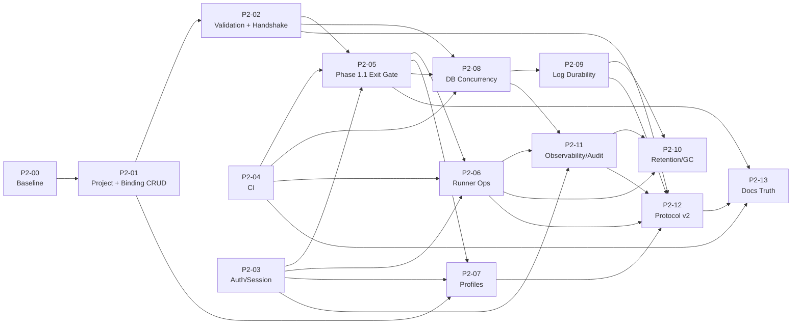
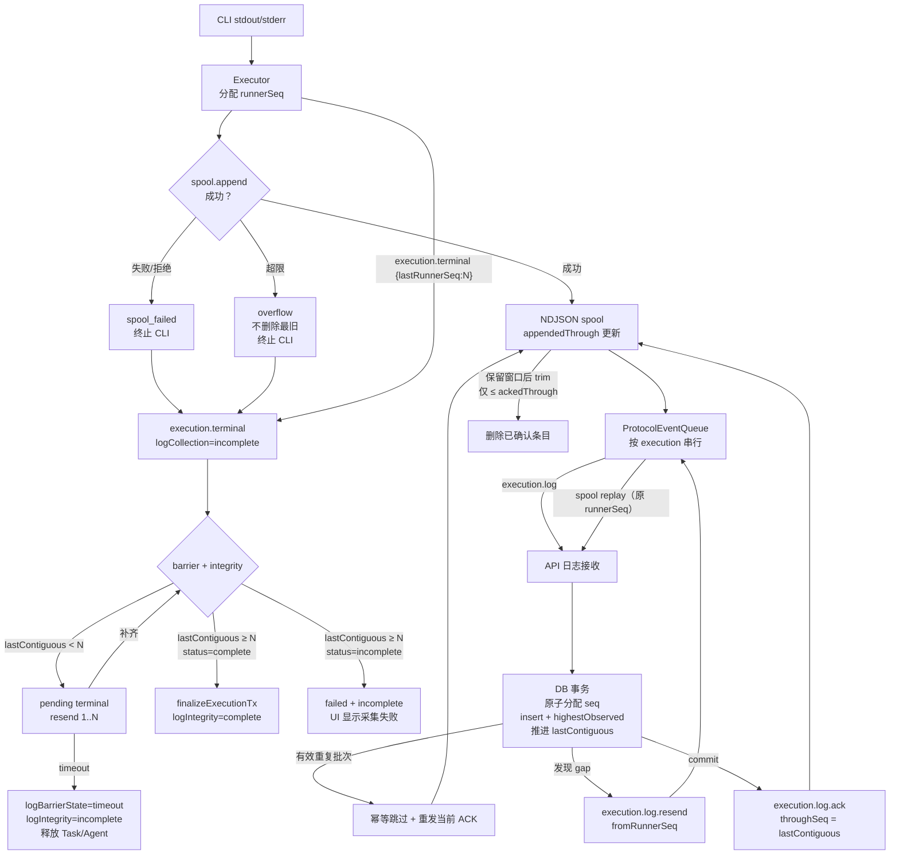
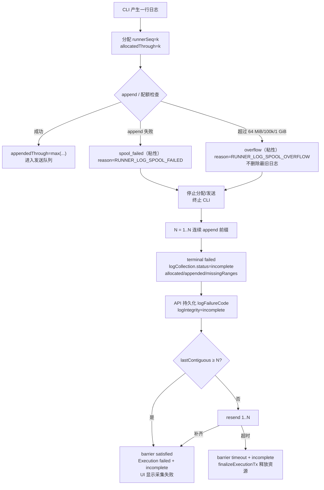
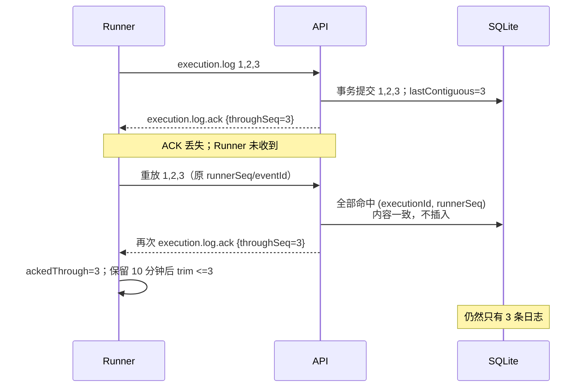
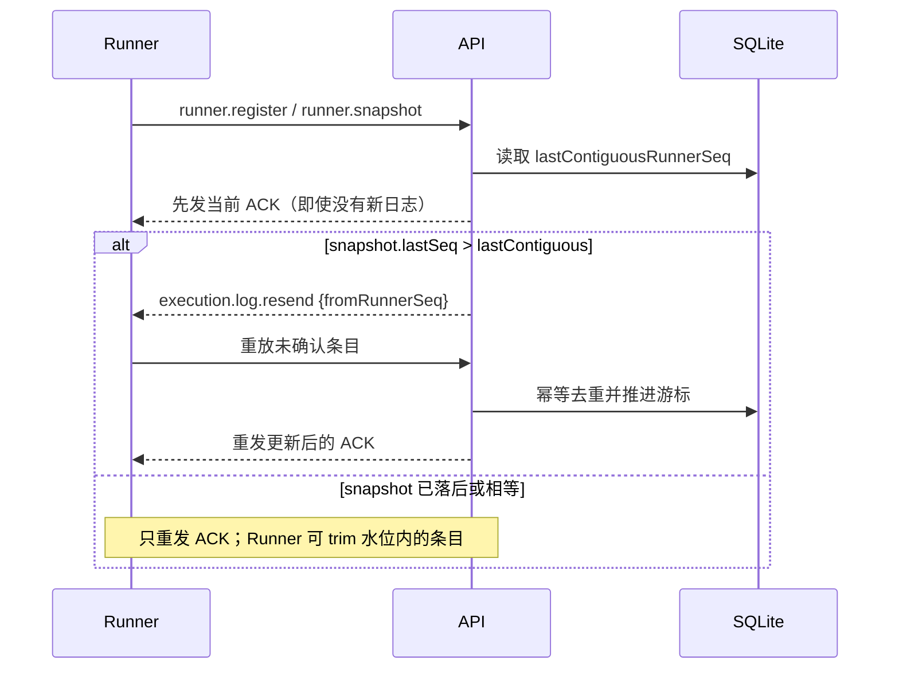
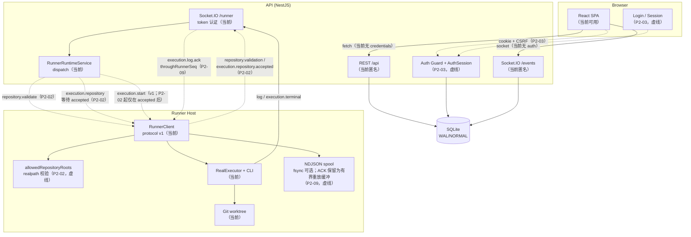
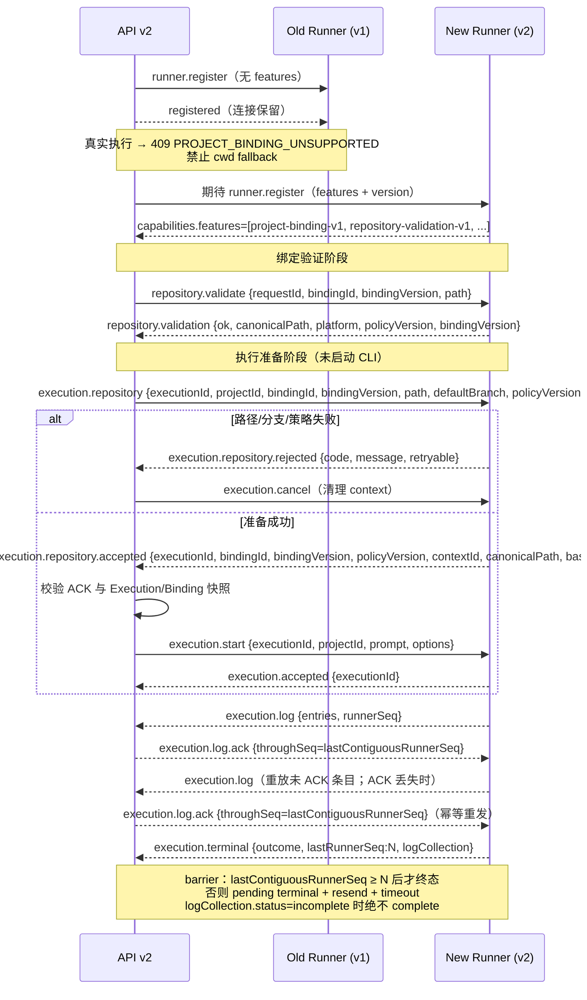
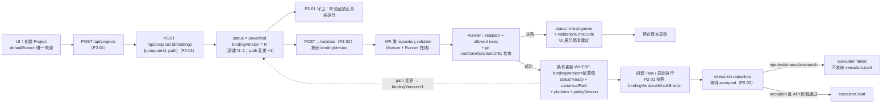
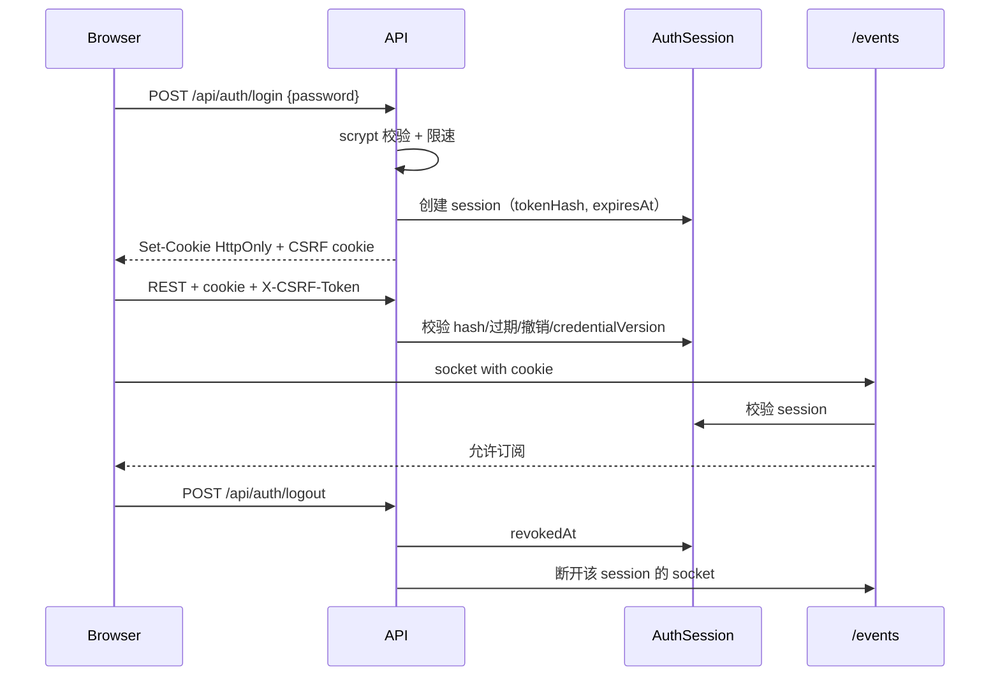
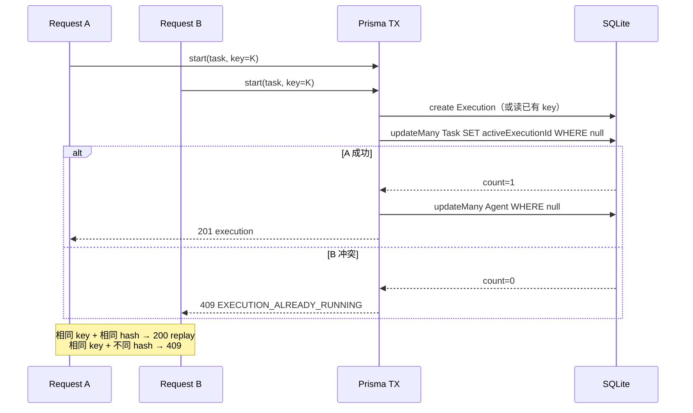

# Haft Phase 2 技术路线图与架构评审

> - **文档类型**：Final Development Baseline（最终开发基线）+ 第四轮定向可靠性修订
> - **评审基线**：`main` / `b58c4a4ad07728f15fe0354db75349950f460a0d`
> - **代码基线**：`633f7841f9cbcafa65cdfed8d266f51497891f90`（`633f784` 之后代码未变化）
> - **第一轮评审**：2026-11-09
> - **第二轮评审**：2026-11-09
> - **第三轮修订**：2026-11-09
> - **第四轮修订**：2026-11-09（P2-09 ACK 重放、Spool 完整性、Barrier 资源释放、SQLite durability 边界）
> - **评审范围**：`apps/api`、`apps/web`、`apps/runner`、`packages/contracts`、`tests`、`docs`
> - **证据原则**：以 HEAD 代码、测试和已提交验收 artifact 为准，不以 `REPORT.md` 的口头声明为准。
> - **修订约束**：本次只修改本文件；未修改源代码、Prisma Schema、迁移、测试、CI、`package.json` 或其他文档；未执行 Git 写操作。
> - **状态标注约定**：`已实现（HEAD）` = 当前代码存在且行为可核对；`冻结（Phase 2）` = 已在本文件确定、尚未实现；`待决策` = 明确未定，不允许 Agent 自行猜测。

## 目录

1. Executive Summary（执行摘要）
2. Repository Snapshot（仓库快照）
3. Current Architecture Review（当前架构评审）
4. Phase 1.1 Acceptance Review（Phase 1.1 验收复核）
5. Technical Debt & Risk Register（技术债与风险登记）
6. Phase 2 Roadmap（Phase 2 路线图）
7. Detailed Task Breakdown（详细任务卡）
8. Architecture & Data Flow Diagrams（架构与数据流图）
9. Automated Acceptance Strategy（自动化验收策略）
10. Security Review（安全评审）
11. Recommended Execution Order（建议执行顺序）
12. Architecture Review Resolution（架构问题决议，第二/三/四轮）
13. Final Development Baseline（最终开发基线）
14. Immediate Next Actions（立即执行的下一批任务）
15. Final Recommendation（最终建议）
16. Review Verification（只读复核记录）

---

## 1. Executive Summary（执行摘要）

**总体结论：Phase 1 的代码基础是真实存在的，但 Phase 1.1 的“真实 Codex 验收”仍然没有被证明。**

- 代码层面已经具备：独立 Runner、Socket.IO Runner 协议 v1、Codex/OpenCode 真实 CLI 执行、Git worktree 隔离、unified diff artifact、执行日志、取消/超时、journal + NDJSON spool + 崩溃恢复、Fake Runner 确定性 E2E。核心设计不是空壳。
- 验收层面：唯一已提交的验收报告 `docs/acceptance/phase-1-real-codex-acceptance.md` 结论是 **BLOCKED**，原因是缺少 Project 创建 API/UI，验收在预检阶段停止，未启动服务、未运行真实 Codex、未执行自动化测试。
- `docs/REPORT.md` 声称 Phase 1.1 的真实 Codex API/UI 测试 PASS（114 个确定性测试、42 个 E2E、真实 Codex 30.2s/34.4s），但没有提交对应的 JUnit、日志、截图、diff 或验收报告 artifact；且与 BLOCKED 验收文档直接矛盾。按“已提交 artifact 优先”的原则，**不能把 REPORT.md 的 PASS 当作当前 HEAD 的真实验收证据**。
- 静态复核确认测试数字：确定性 **114**（contracts 5 + API 27 + runner 60 + web 22）；E2E **42**（functional 38，其中 3 个 Fake Runner + business-loop 1 + visual 3）；真实 CLI opt-in **3**（Codex API、OpenCode API、Codex UI），不是旧版路线图写的 9 个。
- 当前最大产品缺口不是“CLI 能不能跑”，而是“能否创建一个真实 Project 并把它绑定到 Runner 上的仓库”。`Project` 只有 `key/name/description/color`，没有仓库路径、默认分支、Project CRUD API 或 UI；Runner 只能通过 `HAFT_RUNNER_PROJECTS`/`--project` 把 projectId 映射到路径，缺省时 fallback 到 `INIT_CWD`/`process.cwd()`，存在跑错仓库的风险。
- 第二轮审查确认了 7 项架构问题：Runner Protocol 兼容性、Repository Path 安全边界、Web/API Session 生命周期、数据库级并发控制、日志持久化可靠性、真实 CLI E2E 安全隔离、文档与验收状态体系。这 7 项都已写入对应的任务卡、依赖关系和验收标准，而不是只在文末追加意见。
- 第三轮定向修订解决 4 项跨卡不一致，并已写回所有相关章节：
  1. **P2-01/P2-02 循环依赖**：P2-01 只负责 Project CRUD、Binding 模型/Binding CRUD、未验证禁止真实执行；`repository.validate`、`repository.validation`、路径安全和执行前复验全部归 P2-02。依赖固定为 `P2-00 → P2-01 → P2-02 → P2-05`。
  2. **仓库上下文握手缺失**：`execution.repository` 之后必须收到与 Execution/Binding 精确匹配的 `execution.repository.accepted`，API 才允许发送 `execution.start`；失败走 `execution.repository.rejected`，超时/重试/幂等/重连恢复均有持久化状态定义。
  3. **日志序号与 ACK 语义混用**：`runnerSeq` 是 Runner 单执行内序号，`seq` 是服务端持久化序号；ACK 只表达 `lastContiguousRunnerSeq`，绝不表达 `highestObservedRunnerSeq`；终态使用显式 barrier，缺口超时不得谎报完成。
  4. **Binding 默认分支双来源**：`defaultBranch` 唯一权威来源是 `Project`；Binding 不再有 `defaultBranch` 字段/补丁；Execution 保存实际分支快照；`bindingVersion` 只表示绑定配置版本，`policyVersion` 只表示 Runner 路径策略版本。
- 第四轮定向修订解决 P2-09 的 4 项可靠性问题，并已写回任务卡、子节、测试与验收章节：
  1. **ACK 丢失后的重放闭环**：ACK 游标推进、ACK 消息发送、重复日志处理、Runner 重连恢复四件事分开定义；ACK 值永远等于 `lastContiguousRunnerSeq`，游标推进时必须发送，收到有效重复批次或重连对账时允许/必须重发当前 ACK；重复 ACK 只能是幂等水位，不得让 Spool 删除未确认日志。
  2. **Spool append 失败与日志完整性**：明确区分“已分配 runnerSeq”“已成功 append runnerSeq”“已确认持久化 runnerSeq”；`execution.terminal` 增加显式 `logCollection` 元数据；只要发生 `RUNNER_LOG_SPOOL_FAILED` / `RUNNER_LOG_SPOOL_OVERFLOW`，即使 `terminal.lastRunnerSeq == lastContiguousRunnerSeq`，也必须是 `logIntegrity=incomplete`、Execution 失败、UI 显示日志采集失败。
  3. **Barrier Timeout 的资源释放**：超时分支与成功/失败/取消统一调用 `finalizeExecutionTx`，在同一个数据库事务中写终态、`dispatchState=terminal`、`logBarrierState=timeout`、`logIntegrity=incomplete`，并用条件更新释放 `Task.activeExecutionId` / `Agent.activeExecutionId`；释放不匹配时记审计并由启动对账恢复，绝不误清其他 Execution。
  4. **SQLite durability 承诺边界**：ACK 只表示服务端数据库事务已提交，不等于断电级持久化；10 分钟 Spool 保留是有界重放缓冲，不是 SQLite 断电回滚保证；不声称它覆盖所有潜在回滚窗口，未来若要求断电级保证需单独评估 `synchronous=FULL`、fsync 与存储设备持久性。
- **关键架构决策**：v1 `execution.start` 保持不变，通过 capability-gated 的 `execution.repository` 加法消息引入仓库绑定，并增加 `execution.repository.accepted` / `.rejected` 确认；Runner 侧 `allowedRepositoryRoots` + realpath/相对路径包含校验；Web/API 采用数据库持久化 Session；Task/Agent 的 `activeExecutionId` 通过条件 `updateMany` 原子占用；日志由服务端原子分配 `seq`、按 `lastContiguousRunnerSeq` 提交后 ACK、显式终态 barrier，并由 `logCollection` 显式传递采集完整性；真实 CLI 使用独立受保护环境；验收状态统一为 7 态并允许历史报告不同。
- Phase 2 采用 **2.0–2.6** 七个阶段：2.0 Architecture Baseline & CI（P2-00、P2-04）→ 2.1 Project Management & Security（P2-01、P2-03）→ 2.2 Project-aware Runner & Repository Validation（P2-02）→ **2.3 Phase 1.1 Exit Gate（P2-05）** → 2.4 Runner Productization（P2-06、P2-07、P2-08、P2-09）→ 2.5 Lifecycle & Observability（P2-11、P2-10）→ 2.6 Architecture Evolution（P2-12、P2-13）。
- **P2-05 是 Phase 1.1 的最终退出门槛**，不是普通 Phase 2 功能。在它通过之前，不得宣布 Phase 1.1 真实验收完成，也不应全面启动后续产品化工作。
- 第一批：**P2-00、P2-04** 立即开始；P2-00 契约冻结后并行 **P2-01、P2-03**；P2-02 必须在 P2-01 完成后开始；P2-05 在 P2-01/02/03/04 完成后执行。
- 建议采用“先证明、再扩展”的顺序：先建立可重复的 CI 和契约基线，再打通 Project/仓库绑定与认证，再完成真实 Codex 验收，最后做 Runner 运维、执行 Profile、数据库级幂等、日志持久性、保留/GC、可观测性和协议 v2。
- **在 P2-03 认证完成前，不要让 API 离开 localhost。**

**Phase 2 完成的最低标准：**

1. 能通过 UI/API 创建 Project，并为目标 Computer 绑定仓库路径；`defaultBranch` 只来自 Project；绑定初始为 `unverified`，只有 P2-02 的 Runner 校验成功后才能变为 `ready`。
2. Runner 只使用服务端下发的显式绑定路径，不再 fallback 到 cwd；路径必须落在 `allowedRepositoryRoots` 内；未收到有效 `execution.repository.accepted` 时不得发送 `execution.start`，更不得启动 CLI。
3. 在固定 commit、干净工作区、独立 DB/端口/用户/仓库下，真实 Codex API + UI 验收通过，并把证据提交到 `docs/acceptance/`。
4. 所有 REST 与 `/events` 默认拒绝匿名访问；Session 可撤销、可登出、可轮换；Runner token 可配对、撤销、轮换。
5. CI 在 Linux + Windows 上绿；README/REPORT/验收状态可追溯，历史 PASS/BLOCKED 不矛盾。
6. 并发启动、Idempotency-Key、`runnerSeq`/`seq` 分离、ACK 丢失重放、spool 失败/超限、仓库握手、terminal barrier、barrier timeout 资源释放都有自动化测试证明，而不是靠“单实例不会发生”。
7. 保留/GC、health/readiness/metrics/audit 可用，且有运维 runbook。
8. 协议 v1/v2 兼容矩阵和滚动升级方案完成（可作为 Phase 2 尾部）。
9. 日志完整性状态（`complete | incomplete | legacy_inferred | unknown`）在所有执行终态可查；barrier 超时不会被显示为正常完成；spool 失败/超限即使终态序号连续也显示 `incomplete`，并保留具体失败码。

---

## 2. Repository Snapshot（仓库快照）

| 项目 | 值 |
|---|---|
| 仓库路径 | `D:\CODE\GIT\Haft` |
| 分支 | `main`，与 `origin/main` 同步 |
| HEAD | `9b32895dc5bdad9756ee5e4a3fd15e14b0cecfbd` |
| HEAD 标题 | `docs: finalize phase 2 architecture baseline and review resolution` |
| 代码基线 | `633f7841f9cbcafa65cdfed8d266f51497891f90` |
| 工作区 | `git status --porcelain` 无输出，干净 |
| Worktree | 仅 `D:/CODE/GIT/Haft  9b32895 [main]` |
| 提交历史 | `9c8e65a` 初始化 → `cf39a76` Runner/真实 CLI → `34c5618` BLOCKED 验收报告 → `553eb9a` diff/恢复 → `633f784` 加固 → `ea3d11a` roadmap → `9b32895` 架构基线收口 |
| 包管理 | pnpm `11.5.2`，Node `>=20.19` |
| Monorepo | `apps/api`、`apps/web`、`apps/runner`、`packages/contracts` |
| API | NestJS 11 + Prisma 6.16.2 + SQLite；REST `/api`、Socket.IO `/events`、`/runner` |
| Web | React 19 + Vite + TanStack Query + React Router + Socket.IO Client |
| Runner | 独立 Node 进程；Codex/OpenCode CLI；Git worktree；journal/spool/recovery |
| 确定性测试 | **114**：contracts 5 + API 27 + runner 60 + web 22 |
| E2E | **42**：38 functional（含 3 个 Fake Runner）+ 1 business-loop + 3 visual |
| 真实 CLI E2E | **3** 个 opt-in（2 API + 1 UI），需 `HAFT_REAL_CLI_E2E=1` |
| CI | **无** `.github/workflows` |
| 已提交验收 artifact | `docs/acceptance/phase-1-real-codex-acceptance.md`，结论 **BLOCKED** |
| SQLite 运行参数 | `journal_mode=WAL`、`synchronous=NORMAL`、`busy_timeout=15000`（`apps/api/src/common/prisma/prisma.service.ts:5-20`） |
| 文档一致性 | README 仍写 “72 tests”（`README.md:139,175`）；REPORT 写 114/42 并声称真实 Codex PASS |

> 上表是第三轮修订**开始时**的快照；写入本文件后的工作区状态见第 16 节。

**关键观察：**

- 这是“单机、单 workspace、单 SQLite”的架构，不是多租户/多实例架构。很多简化是刻意为之，但 Phase 2 必须把“单实例假设”显式化，否则会在验收或部署时暴露。
- 代码质量整体高于普通 Demo：Zod 严格 schema、`shell:false`、stdin 传 prompt、token 不传 CLI、diff 1 MiB 上限、日志 8k 行上限、测试端点双重门禁、token hash + `timingSafeEqual`，这些都应保留。
- 当前文档存在“实现完成”和“验收完成”混写的问题。Phase 2 必须把“代码存在”“确定性测试通过”“真实 CLI 验收通过”分成三个不同状态。
- 真实 CLI 测试当前使用开发者本机的 Codex 登录状态、`E2E_TEST_MODE=true` 的 reset 端点、固定 bootstrap token 和 `HAFT_RUNNER_ALLOW_AUTO_APPROVE=1`（`playwright.real.config.ts:12-58,83-87`）；它是“可重复的本地演示”，不是“隔离的验收环境”。

---

## 3. Current Architecture Review（当前架构评审）

### 3.1 运行时与执行主链路

```text
React SPA
  → REST /api（NestJS Controllers → Services → Prisma → SQLite）
  → Socket.IO /events（执行状态/日志广播）
  → RuntimeRegistryService
      → MockRuntimeService（内存模拟，演示/测试）
      → RunnerRuntimeService（服务端不 spawn CLI）
          → RunnerRegistryService + RunnerGateway（/runner，协议 v1）
              → Runner 进程
                  → RealExecutor / FakeExecutor
                  → GitWorktreeManager（worktree + diff）
                  → CLI（codex/opencode，spawn shell:false）
```

- `RuntimeRegistryService` 是唯一的 runtime 选择点，`ExecutionsService` 不直接按 runtime 名称分支，这是很好的边界（`apps/api/src/modules/runtime/runtime-registry.service.ts`）。
- `RunnerRuntimeService` 明确“Nest 进程永不 spawn CLI”，只向拥有该 Computer 的 Runner 发消息（`apps/api/src/modules/runtime/runner-runtime.service.ts:24-43`）。
- Runner 协议是严格 Zod envelope，消息带 `messageId`，设计上支持至少一次投递和幂等处理（`packages/contracts/src/runner-protocol.ts:12-18`）。
- Runner 侧 `RealExecutor` 负责 CLI 生命周期、超时、取消、journal、日志解析和 Git evidence；`GitWorktreeManager` 负责 worktree 创建、diff 收集、截断和清理。

### 3.2 数据模型

当前模型：`Workspace → Project → Task → Execution → ExecutionLog/ExecutionArtifact`，以及 `Computer → Runner`、`Agent → Execution`、`Activity`。

关键事实：

- `Project` 只有 `id/workspaceId/key/name/description/color`，**没有 `repoPath`、`repoUrl`、`defaultBranch`**（`apps/api/prisma/schema.prisma:22-36`）。
- `Execution` 有 `branchName/baseCommit/headCommit/changedFiles/diffStat/gitStatus/diffTruncated` 和单一 `lastRunnerSeq`，但没有服务端日志序号游标、没有连续 ACK 游标、没有终态 barrier 状态、没有执行 profile/options 快照、没有 repository 绑定/路径/分支快照（`schema.prisma:119-157`）。
- `ExecutionLog` 已有 `@@unique([executionId, seq])`、`@@unique([executionId, eventId])`、`@@unique([executionId, runnerSeq])`，数据库层具备幂等基础；但 `runnerSeq` 可空，服务端日志的 `seq` 由应用层读后写分配（`schema.prisma:176-192`、`executions.service.ts:654,887,894-900`）。
- `Runner` 有 `tokenHash`、`protocolVersion`、`capabilitiesJson`、`maxConcurrentExecutions`，但没有 `revokedAt`、没有配对 token 表、没有 `features` 字段（`schema.prisma:52-73`）。
- `Task`/`Agent` 没有 `activeExecutionId`，数据库没有“每个 Task/Agent 最多一个 running execution”的约束（`schema.prisma:75-117`）。
- `Workspace` 只有一个 seed 的 `ws_demo`，大量 service 直接使用 `DEFAULT_WORKSPACE_ID`，没有真正的多 workspace 解析。
- `Project` 和 `Computer` 没有直接关系；当前只有 `Agent.computerId`、`Runner.computerId`。仓库绑定必须是 `Project + Computer` 的显式关系，不能从 Project 直接推断 Runner 路径。

### 3.3 API 与 Web 表面

- API 模块：`agents`、`tasks`、`executions`、`runtime`、`runners`、`computers`、`workspace`、`events`、`test`、`health`。
- Web 路由只有：Dashboard、Agents、Tasks、Execution Detail（`apps/web/src/app.tsx:9-21`）。
- **没有 Projects 页面、没有 Runners/Computers 管理页面、没有登录页、没有设置页。**
- `GET /api/workspace` 会返回 projects，但只是 seed 数据的只读展示；没有 `POST/PATCH/DELETE /api/projects`（`workspace.controller.ts:10-20`）。
- Runner/Computer 只有只读 `GET`，没有配对、撤销、轮换、改名的管理面。
- `ExecutionsController` 没有“启动”路由；启动在 `TasksController` 的 `POST /api/tasks/:id/executions`。当前没有 `Idempotency-Key` 处理。

### 3.4 Runner 协议与恢复

- 协议版本硬编码为 `1`（`packages/contracts/src/constants.ts:54`，`runner-protocol.ts:43-52`）。
- 握手支持 `token` 或 `bootstrapToken`；服务端存 SHA-256 hash，并用 `timingSafeEqual` 比较（`runner-registry.service.ts:163-251,808-859`）。
- 派发有 20s accept 超时（`runner-registry.service.ts:50`）；断线有 60s 默认 reconnect grace（`:51`）。
- 断线期间执行不立即失败；重连后 `execution.reconcile` 让 Runner 报告本地状态；超过 grace 才失败为 `RUNNER_DISCONNECTED`。
- Runner 恢复依赖 journal + NDJSON spool + PID start-time/ownership 检查；恢复后**不会重跑**，而是把中断执行标记为 `RUNNER_INTERRUPTED`。
- `execution.reconcile` 目前主要是“日志 + 失败/终态”语义，不是完整的状态机对账；这是 Phase 2 要补的运维能力。
- 旧 Runner 对未知 server 消息的处理是：`runnerServerMessageSchema.safeParse` 失败 → 记 warning → 丢弃消息，不会断开连接（`apps/runner/src/runner-client.ts:264-307`）。这为“加法消息 + capability 门控”提供了兼容空间。
- 但 `execution.start` 的 payload 是严格 schema；**直接在 v1 payload 增加必需字段会让旧 Runner 丢弃该消息，20s 后 dispatch 超时并取消**。这是 P2-02 不能绕过 v1 schema 的原因。
- `execution.completed` / `execution.failed` / `execution.cancelled` 同样严格，且**没有 `lastRunnerSeq` 字段**；给终态 payload 增加字段会使旧 API 丢弃新 Runner 的终态消息。因此终态 barrier 必须使用新的 capability-gated 消息，或在 v2 中重新定义，不能直接改 v1 终态 schema（`runner-protocol.ts:263-289`）。
- 当前 `execution.accepted` 在 Runner 检查项目路径映射和 CLI capability **之前**发送（`runner-client.ts:354-368`）；它只证明消息到达 Runner，不证明仓库上下文可用，更不证明 CLI 可以启动。
- 当前服务端每条日志插入后立即 ACK；任何唯一约束错误都被当作重复并 ACK；`lastRunnerSeq` 只做 `max` 更新，没有连续游标、gap 检测或终态 barrier（`executions.service.ts:654-688`）。
- 当前 Runner 收到 ACK 后立即从 spool 删除对应条目，没有 ACK 保留窗口；spool 超限时会删除最旧条目（`runner-client.ts:299-305`、`log-spool.ts:182-197`）。

### 3.5 认证与信任边界

- Web/API：**没有认证/授权**。所有 REST 路由匿名可访问；`/events` 只做了 CORS，没有会话校验（`events.gateway.ts:22-43`）。
- `/runner`：有握手 token 认证，但 CORS 在未设置 `WEB_ORIGIN` 时返回 `true`（`runner.gateway.ts:30-33`），意味着浏览器来源不受限；真正的安全边界仍是 token，但这是一个容易误配置的危险默认值。
- Bootstrap token：`HAFT_RUNNER_BOOTSTRAP_TOKEN` 是静态环境变量，可重复使用；没有 TTL、一次性消费、撤销或轮换（`runner-registry.service.ts:218-251`，`apps/api/.env.example:9-13`）。
- Test API：仅当 `E2E_TEST_MODE=true` 且 `NODE_ENV!=production` 时注册（`app.module.ts:16-17,33`），这是正确的门禁；但没有额外的网络/认证保护，误配置仍有风险。
- Runner 管理：`GET /api/runners` 通过 `assertRunnerAdminAccess` 限制 loopback 或 `x-haft-admin-token`（`runner-access.ts:17-41`），不是产品级 Session 认证。
- Web 的 `fetch` 没有 `credentials: 'include'`；Socket.IO 客户端没有 `withCredentials` 和 auth 参数（`apps/web/src/services/api.ts`、`socket-provider.tsx:32-37`）。P2-03 必须同时改 REST 和 Socket 两条链路。

### 3.6 当前架构的优点

1. **契约先行**：请求体、查询、Runner 消息都由 Zod 严格校验，API/Web/Runner 不易静默漂移。
2. **Runtime 抽象清晰**：Mock 与 Runner 两种 runtime 通过同一接口选择，测试与真实执行分离。
3. **进程安全基础好**：`spawn` 参数数组、`shell:false`、prompt 走 stdin、CLI 环境清洗、token 不传 CLI、Codex `workspace-write` sandbox。
4. **Git 隔离正确方向**：每个执行独立 worktree/branch，diff 作为 artifact 持久化，主 checkout 不被直接修改。
5. **恢复设计认真**：journal、spool、PID identity、reconcile、grace window 都不是“假装恢复”。
6. **测试分层完整**：contracts/API/runner/web/E2E/Fake Runner/真实 CLI opt-in 的层次清楚，114 个确定性测试是实打实的基础。

### 3.7 当前架构的主要问题

| 问题 | 证据 | 影响 |
|---|---|---|
| 没有 Project CRUD/仓库绑定 | `schema.prisma:22-36`；无 `Controller('projects')`；`workspace.controller.ts:10-20` 只读 | 真实验收无法创建专用 Project；Runner 只能靠 env 映射 |
| 没有 Web/API 认证 | `events.gateway.ts:22-43`；无全局 guard | 任何本机/局域网客户端可读写所有数据、订阅执行日志 |
| `/runner` CORS 默认放开 | `runner.gateway.ts:30-33` | 误配置时浏览器来源不受限；应 fail closed |
| `/events` 无鉴权 | `events.gateway.ts:37-43` | 任意客户端可订阅全部执行日志/状态 |
| Bootstrap token 静态可复用 | `runner-registry.service.ts:218-251` | 泄露后可长期配对；无撤销/轮换 |
| 启动锁仅进程内 | `executions.service.ts:48,79-87,97-133` | 单实例由全局 `execution-start` 锁串行；多 API 实例可重复创建执行 |
| `nextLogSeq` 读后写 | `executions.service.ts:654,887,894-900` | 单实例被 per-execution 锁掩盖；跨实例冲突；P2002 误当重复会丢日志 |
| `LogSpool.append` 吞错 | `log-spool.ts:43-72` | 磁盘写失败仍 resolve，调用方可能发送未落盘日志 |
| Spool 超限静默丢弃 | `log-spool.ts:182-197` | 未 ACK 的旧日志被删除，无法证明完整性 |
| ACK 后立即 trim，无 fsync | `runner-client.ts:299-305`；`log-spool.ts:85-106` | ACK 只证明 DB 行已提交，不证明断电后仍在 |
| `git collect` 失败返回 null | `git-worktree.ts:142,239` | diff evidence 可能静默丢失，执行仍可能被当成成功 |
| 无保留/清理策略 | 无定时任务；`keepWorktrees` 默认 true；branch 不删除 | 日志、artifact、worktree、branch 无限增长 |
| 无 CI | 无 `.github` | 114/42 个测试靠人工执行，回归不可控 |
| 文档状态失真 | README `72`；REPORT `PASS`；验收文档 `BLOCKED` | 对外结论不可信，验收无法审计 |
| 真实 CLI E2E 使用开发机认证 | `playwright.real.config.ts:12-58,83-87`；`real-cli.spec.ts:47` | 不可信 PR/测试可能接触个人凭据；证据不可复现 |

### 3.8 架构审查新增事实（第二/三/四轮）

1. **严格 v1 不能直接扩展**：`executionStartPayloadSchema`、`runnerCapabilitiesSchema`、`runnerEnvelopeBaseSchema` 都是 `.strict()`；未知字段会导致解析失败。P2-02 必须使用能力门控的加法消息，而不是在 `execution.start` 加必需字段。
2. **cwd fallback 是默认行为，不是边缘情况**：`parseProjectPaths` 在没有 `HAFT_RUNNER_PROJECTS` 时返回 `{ [fallbackProjectId]: resolve(fallbackRoot) }`，`fallbackRoot` 来自 `INIT_CWD`/`process.cwd()`（`config.ts:238-265`）。只要 `projectId` 是默认的 `project_demo`，就会落到 cwd。
3. **路径校验只有“git 根目录”一层**：没有 allowed roots、realpath、UNC、junction、bare repo、linked worktree 的显式策略；`assertInside` 只保护 worktree root，不保护仓库路径（`git-worktree.ts:52-140,349-361`）。
4. **日志顺序存在，但持久性闭环不存在**：Runner 先 append 再 send，`ProtocolEventQueue` 保证终态排在前面的日志之后；但 append 失败被吞、没有 fsync、ACK 在单行提交后立即发送、终态没有 `lastRunnerSeq` barrier。
5. **并发正确性依赖进程内锁**：单实例内 `withExecutionLock`（全局 `execution-start`）+ gateway per-runner queue 把 `nextLogSeq`/check-then-create 串行化；多实例会暴露底层语句的非原子性。
6. **认证完全缺失**：REST、`/events`、Web 都没有 Session；只有 `/runner` 有 token。P2-03 必须同时覆盖 REST、Socket、CSRF、Session 撤销和登录限速。
7. **验收状态规则错误**：P2-13 原文“禁止 PASS 与 BLOCKED 同时出现”会否定历史报告；必须改为“同一报告内部不矛盾，历史报告可不同，README 指向最新”。
8. **P2-01/P2-02 存在循环依赖**：旧版 P2-01 要求调用 `repository.validate`，而该协议由 P2-02 实现，P2-02 又依赖 P2-01 的 Binding；第三轮已把验证流程整体移入 P2-02。
9. **仓库上下文没有确认机制**：旧版只发 `execution.repository` 后立即发 `execution.start`，Socket.IO 顺序不能证明 Runner 已校验并应用绑定；必须增加 `execution.repository.accepted/.rejected` 与持久化 `dispatchState`。
10. **两套日志序号被混用**：`ExecutionLog.seq` 是服务端持久化序号，`runnerSeq` 是 Runner 本地序号；旧版 ACK 的 `throughSeq` 实际传的是 runnerSeq，但没有连续游标，收到 1、3 时可能 ACK 3。
11. **Binding 默认分支设计存在双来源**：旧版一方面把 `defaultBranch` 放 Project，另一方面允许 Binding PATCH 修改它，且 Binding 缺少 `bindingVersion`/`policyVersion` 的职责划分；第三轮已统一为 Project 级唯一来源。
12. **ACK 游标推进与 ACK 消息发送被混为一条规则**：旧版“只有游标前进才发送 ACK”无法处理 ACK 丢失后的重复批次；ACK 值必须始终等于 `lastContiguousRunnerSeq`，但发送动作必须在重复重放和重连对账时也能重复执行。
13. **旧设计的 `terminal.lastRunnerSeq` 无法单独证明采集完整**：若某行已分配 `runnerSeq` 但 Spool append 失败，而终态只带最后成功 append 的序号，`terminal.lastRunnerSeq == lastContiguousRunnerSeq` 仍可能成立；必须由 `logCollection` 显式携带失败状态，不能只看 barrier。
14. **Barrier Timeout 没有纳入统一资源释放**：超时分支只定义 Execution 失败，未明确与 P2-08 相同的条件更新释放 `Task.activeExecutionId`/`Agent.activeExecutionId`，可能导致任务永久无法再次启动。
15. **10 分钟 Spool 保留被误当成断电恢复窗口**：`synchronous=NORMAL` 下 ACK 只代表事务提交，保留 10 分钟不能覆盖 SQLite 所有潜在断电回滚；文档不得把有限重放缓冲表述为持久性保证。

---

## 4. Phase 1.1 Acceptance Review（Phase 1.1 验收复核）

### 4.1 权威 artifact

`docs/acceptance/phase-1-real-codex-acceptance.md` 是唯一已提交的 Phase 1 真实验收报告。其开头明确写着：

> **验收结论：BLOCKED**  
> 本次验收在环境预检阶段发现前置能力缺失：Haft 当前没有 Project 创建 API/UI，无法按验收要求创建专用 Project。……未创建验收仓库、未启动服务、未执行真实 Codex、未运行自动化测试，也未伪造任何执行结果。  
> —— `docs/acceptance/phase-1-real-codex-acceptance.md:3-5`

报告记录的执行基线是 `cf39a76`（`:73`），即 **Runner/真实 CLI 刚加入、diff/recovery 加固之前** 的 commit。

### 4.2 时间线与状态变化

| Commit | 内容 | 对验收的意义 |
|---|---|---|
| `cf39a76` | Runner 架构 + 真实 CLI 执行 | 验收报告在此基线预检，因无 Project CRUD 而 BLOCKED |
| `34c5618` | 提交 BLOCKED 验收报告 | 唯一已提交的验收 artifact |
| `553eb9a` | 增加 git diff evidence + runner crash recovery | 代码层补齐了 Phase 1.1 的证据/恢复能力 |
| `633f784` | 加固 runner recovery 和 diff evidence | 代码基线；Project CRUD 缺口仍在 |
| `ea3d11a` | 提交本路线图 | 本文档基线；代码未变 |

**关键判断：** 验收文档的 HEAD 较旧，但它记录的阻塞条件在 HEAD 仍然成立——Project CRUD 依旧不存在。因此不能因为 `553eb9a`/`633f784` 增加了 diff/recovery，就推断 Phase 1.1 已通过。

### 4.3 逐项验收结论

> 状态使用第 9.1 节的统一定义。`PARTIAL` 表示代码/确定性测试存在，但缺少真实 CLI 或真实浏览器验收证据。

| 验收项 | 状态 | 证据/说明 |
|---|---|---|
| 创建专用 Project | **FAIL** | 无 Project CRUD API/UI；`Project` 无仓库字段；seed 只有 `project_demo` |
| 创建/绑定验收仓库 | **FAIL** | Runner 支持 worktree；但仓库映射只能靠 `HAFT_RUNNER_PROJECTS` 环境变量，且存在 cwd fallback |
| 创建 Agent/Task 并路由到 Runner | **PARTIAL** | 代码路径存在；Fake Runner 测试覆盖；真实 Project 绑定缺失 |
| 真实 Codex API 执行 | **NOT_VERIFIED at HEAD** | `tests/e2e-real/real-cli.spec.ts` 存在但 opt-in；无 HEAD 上的已提交运行证据 |
| 真实 Codex UI 执行 | **NOT_VERIFIED at HEAD** | `tests/e2e-real/real-ui.spec.ts` 存在但 opt-in；无 HEAD 上的已提交运行证据 |
| 实时日志/状态到终态 | **PARTIAL** | API/runner/web 确定性测试覆盖；真实 CLI 未验证 |
| Changes 面板渲染持久化 diff | **PARTIAL** | `553eb9a` 增加 diff artifact、`GET /api/executions/:id/diff`、Changes UI；无真实验收 artifact |
| 主 checkout/HEAD/remote 不被修改 | **PARTIAL** | worktree 隔离和 E2E 断言存在；无真实验收 artifact |
| 崩溃恢复 | **PARTIAL** | journal/spool/PID identity/reconcile；真实崩溃未做验收 |
| 验收证据可审计 | **FAIL** | 只有 BLOCKED 报告；REPORT.md 的 PASS 无 artifact 链接 |

### 4.4 对 `REPORT.md` 的处理

`docs/REPORT.md` 写了：

- 真实 Codex/OpenCode 执行 “Done”（`:257`）。
- 真实浏览器 UI + 真实 Codex UI E2E “Done — 34.4 s pass”（`:281`）。
- 真实 CLI E2E “Pass — 2 passed, 1 skipped”（`:297`）。
- API + real Codex “PASS — 30.2 s”；UI + real Codex “PASS — 34.4 s”（`:311-312`）。
- 手动验收命令与结果（`:326-328`）。

但这些声明没有对应的已提交 JUnit、JSON、日志、截图、视频、diff 或验收报告。仓库根目录的 `.log` 文件被 `.gitignore` 忽略（`.gitignore:6`），不能作为 HEAD 上的可审计证据。**结论：REPORT.md 只能视为“作者曾声称运行过”，不能视为“当前 HEAD 已通过验收”。**

### 4.5 Phase 1.1 最终评级

**代码能力：CONDITIONAL PASS（实现基本完整，确定性测试覆盖）。**  
**真实验收：BLOCKED / UNPROVEN。**  
**对外表述：不得写“Phase 1.1 已完成/真实 Codex 已通过”，直到 P2-05 产出可复现 artifact。**

---

## 5. Technical Debt & Risk Register（技术债与风险登记）

严重度定义：**P0** 阻塞验收或安全暴露；**P1** 影响正确性/可运维性；**P2** 影响规模化/生命周期；**P3** polish/演进。

| ID | 严重度 | 领域 | 证据 | 影响 | Phase 2 卡片 |
|---|---|---|---|---|---|
| TD-01 | P0 | Project/仓库绑定 | `schema.prisma:22-36`；无 projects controller；`workspace.controller.ts:10-20` 只读 | 无法创建验收 Project；Runner 仓库映射靠 env；Binding 无版本/验证状态 | P2-01（模型/CRUD）/P2-02（验证） |
| TD-02 | P0 | 认证/授权 | `events.gateway.ts:22-43`；无全局 guard | 任意客户端可读写 API、订阅日志 | P2-03 |
| TD-03 | P1 | CORS | `runner.gateway.ts:30-33`；`events.gateway.ts:22-25` | 未配置 `WEB_ORIGIN` 时默认 `origin: true` | P2-03 |
| TD-04 | P1 | Runner 配对 | `runner-registry.service.ts:218-251`；`.env.example:9-13` | 静态 bootstrap token 可复用，无 TTL/撤销/轮换 | P2-06 |
| TD-05 | P1 | 启动并发 | `executions.service.ts:48,79-87,97-133` | check-then-create 竞态；多实例会重复执行 | P2-08 |
| TD-06 | P1 | 日志序号 | `executions.service.ts:654,887,894-900` | `max(seq)+1` 非原子；单实例被锁掩盖；跨实例冲突；P2002 误 ACK 会丢日志；`seq` 与 `runnerSeq` 语义未分离 | P2-09 |
| TD-07 | P1 | Spool 持久性 | `log-spool.ts:43-72,182-197` | 写失败被吞；超限静默丢弃；无 fsync；ACK 后立即 trim；append 失败后仍可能以连续终态被误判完整 | P2-09 |
| TD-08 | P1 | 项目路由 | `apps/runner/src/config.ts:152-164,238-265` | 无 env 映射时 fallback cwd，可能跑错仓库 | P2-02 |
| TD-09 | P1 | Runner/Computer 运维 | 只有 GET；Web 无 runners 路由 | 无法配对、撤销、轮换、改名、看能力 | P2-06 |
| TD-10 | P1 | 测试门禁 | 无 `.github`；README `72` vs 实际 `114` | 回归不可控；文档不可信 | P2-04/P2-13 |
| TD-11 | P1 | 验收真实性 | `acceptance:3-5` vs `REPORT.md:281,297,309-313` | PASS 声明不可审计，和 BLOCKED 矛盾 | P2-05/P2-13 |
| TD-12 | P1 | Prompt/CLI 权限 | `cli-args.ts`、`real-executor.ts`；无审批 UI | CLI 以 Runner 用户权限运行；任务文本可诱导越权 | P2-03/P2-07 |
| TD-13 | P2 | Diff 证据 | `git-worktree.ts:142,239` | `collect` 失败返回 null，证据静默丢失 | P2-09/P2-11 |
| TD-14 | P2 | 恢复对账 | `runner-registry.service.ts:636-704` | reconcile 偏日志/失败，不是完整状态机对账 | P2-11/P2-12 |
| TD-15 | P2 | 执行 options | `agent-runtime.interface.ts:18-24`；`runner-protocol.ts:113-121` | 协议支持 model/agent/variant/sandbox/timeout，但 API 不持久化/不选 | P2-07 |
| TD-16 | P2 | 保留/清理 | 无定时任务；`keepWorktrees` 默认 true；branch 不删 | 日志/artifact/worktree/branch 无限增长 | P2-10 |
| TD-17 | P2 | 多实例/SQLite | Prisma SQLite；registry 内存态 | 单写者、无水平扩展；重启丢失 live 状态 | P2-08/P2-12 |
| TD-18 | P2 | 可观测性 | 仅基础 health；无 metrics/audit | 无法定位队列、runner、失败趋势 | P2-11 |
| TD-19 | P2 | 速率/背压 | Socket 2 MiB；日志 8k 行；无 rate limit | 大量日志/事件可拖垮 API/Runner | P2-09/P2-11 |
| TD-20 | P2 | 敏感数据 | diff/log 全量持久化；无 redaction/retention | 源码、token、路径可能进入日志/DB | P2-10/P2-11 |
| TD-21 | P2 | 单 workspace | `DEFAULT_WORKSPACE_ID` 遍布 service | 无法真正多 workspace/多团队 | P2-12/P2-13 |
| TD-22 | P3 | 协议演进 | `RUNNER_PROTOCOL_VERSION=1`，literal 1 | 未来字段变更会破坏旧 Runner | P2-12 |
| TD-23 | P3 | 备份/升级 | SQLite；无 runbook | 迁移/回滚/备份无标准流程 | P2-10/P2-13 |
| TD-24 | **P0** | Protocol 兼容性 | `runner-protocol.ts:43-52,145-156,263-289`；`runner-client.ts:264-307` | 直接加必需字段会让旧 Runner 丢消息并超时；终态也严格；无 feature 声明；无仓库握手 | P2-00/P2-02/P2-09/P2-12 |
| TD-25 | **P0** | Repository Path 边界 | `config.ts:238-265`；`git-worktree.ts:52-140,349-361` | 无 allowed roots/realpath/UNC/junction/bare 策略；可访问任意 Runner 路径 | P2-02 |
| TD-26 | **P0** | Session 生命周期 | 无 AuthSession；`/events` 匿名；Web 无 credentials | 无法撤销泄露 Session；Logout 无真实语义；WS 无认证 | P2-03 |
| TD-27 | P1 | DB 原子占用/幂等 | `executions.service.ts:97-133,184-207`；无 activeExecutionId | 并发启动重复执行；无 Idempotency-Key | P2-08 |
| TD-28 | P1 | 日志 ACK/终态 barrier | `executions.service.ts:654-688`；`protocol-event-queue.ts:14-33` | ACK 发送与游标推进未分离；ACK 丢失无法重发；spool 失败不进入 terminal 完整性；barrier timeout 未统一释放 activeExecution | P2-09 |
| TD-29 | P1 | 真实 CLI 隔离 | `playwright.real.config.ts:12-58,83-87`；`real-cli.spec.ts:47` | 开发机个人认证、test reset、固定 token、auto-approve | P2-04/P2-05 |
| TD-30 | P1 | 验收状态语义 | 本文件旧版“PASS/BLOCKED 互斥”规则；README `72`；REPORT PASS vs acceptance BLOCKED | 历史报告被错误否定；PASS 无证据 | P2-13 |
| TD-31 | **P0** | 仓库上下文握手 | `runner-client.ts:354-368`；`runner-registry.service.ts:542-579` | `execution.accepted` 只表示收到，不表示绑定已校验；API 可能在 Runner 未准备仓库时启动 CLI | P2-02/P2-09/P2-12 |
| TD-32 | P1 | Binding 版本/默认分支 | 本文件旧版 P2-01/P2-02 设计；当前 schema 无 Binding | `defaultBranch` 双来源；`bindingVersion`/`policyVersion` 职责不清；旧验证结果可能覆盖新配置 | P2-01/P2-02/P2-09 |
| TD-33 | P1 | 日志完整性/资源释放 | 本文件旧版 P2-09；`log-spool.ts`；P2-08 终态释放 | `terminal.lastRunnerSeq == lastContiguous` 被误当成完整；barrier timeout 不释放 `Task/Agent.activeExecutionId`；10 分钟保留被误表述为断电保证 | P2-09/P2-10 |

---

## 6. Phase 2 Roadmap（Phase 2 路线图）

### 6.1 路线图总览

原始规划的 4 个 Wave 方向正确，但把“设计决策”和“功能开发”混在一起，并且 P2-05 被当成普通 P0 卡。第二轮修订改为 7 个阶段，增加 P2-00 基线卡，把 P2-05 提升为 Phase 1.1 Exit Gate。

| Phase | 主题 | 卡片 | 退出标准 | 预估 |
|---|---|---|---|---|
| **2.0 Architecture Baseline & CI** | 冻结 11 项架构决策（7 项原审查 + 4 项第三轮修订）及第四轮 4 项 P2-09 可靠性修订；建立可重复门禁 | **P2-00**、P2-04 | 决策/契约/错误码/状态词表固化；CI Linux+Windows 绿；真实 CLI job 与普通 CI 分离 | 3–5 天 |
| **2.1 Project Management & Security** | Project CRUD、Binding 模型/CRUD、认证 | P2-01、P2-03 | Project + Binding 可 CRUD；Binding 初始 `unverified` 且禁止真实执行；所有 REST/`/events` 默认 401；Session 可撤销。**本阶段不实现 `repository.validate`。** | 1.5–2 周 |
| **2.2 Project-aware Runner & Validation** | 仓库验证、上下文握手、路径安全 | P2-02 | `repository.validate` 可用；成功才 `ready`；无 cwd fallback；`execution.repository.accepted` 后才发 `execution.start`；路径攻击测试通过 | 1–1.5 周 |
| **2.3 Phase 1.1 Exit Gate** | 真实 Codex API + UI 验收 | P2-05 | 固定 commit、独立环境、完整证据、PASS 报告；否则 FAIL/BLOCKED | 3–5 天 |
| **2.4 Runner Productization** | 配对、Profile、DB 幂等、日志持久性 | P2-06、P2-07、P2-08、P2-09 | 配对/撤销/轮换；Profile 生效；DB 原子占用；日志 ACK/终态闭环 | 2–3 周 |
| **2.5 Lifecycle & Observability** | 保留/GC、可观测性、审计 | P2-11 → P2-10 | audit/metrics/readiness/timeline；GC dry-run 安全；证据保护 | 1.5–2 周 |
| **2.6 Architecture Evolution** | 协议 v2、文档真实性 | P2-12、P2-13 | v1/v2 兼容矩阵；滚动升级；文档状态一致 | 1–2 周 |

### 6.2 路线图原则

1. **先证明，再扩展。** 没有 P2-05 的真实 artifact，不进入 P2-06 之后的产品化开发。
2. **先 fail closed，再谈体验。** 认证、CORS、配对 token、路径校验都必须默认拒绝，而不是“本地 demo 先放开”。
3. **数据库约束优先于进程内锁。** 任何“只能有一个”的规则都要能由 DB 条件更新/唯一约束/事务证明。
4. **验收证据必须可复现。** 固定 commit、固定环境、独立 DB/端口/用户/仓库、提交报告；不接受“我本地跑过”。
5. **协议兼容优先于字段便利。** 不允许在严格 v1 上直接加必需字段；不允许为了兼容旧 Runner 保留 cwd fallback。
6. **每张卡一个 PR。** 每张卡都必须带迁移、测试、文档和回滚说明；P0 卡必须有 E2E 或真实验收证据。
7. **不把未来设计画成当前实现。** 所有 Mermaid 图必须区分“当前已实现”和“Phase 2 计划”。

### 6.3 阶段依赖与关键路径



- **关键路径：** P2-00 → P2-01 → P2-02 → P2-05 → P2-08 → P2-09 → P2-10 → P2-12 → P2-13（P2-11 可与 P2-09 并行，但 P2-10 同时依赖两者）。
- **可并行：** P2-00 与 P2-04；P2-01 与 P2-03；P2-06 与 P2-07；P2-11 与 P2-09（P2-10 依赖两者）。
- **必须串行：** P2-01 → P2-02 → P2-05；P2-08 → P2-09；P2-11 → P2-10；P2-05 → P2-06/07/08。
- **已消除的循环：** 旧任务卡存在“P2-01 调用 P2-02 才实现的 `repository.validate`、P2-02 又依赖 P2-01 Binding”的反向依赖；新图只有 `P2-01 → P2-02`，P2-02 不再要求 P2-01 提供验证协议。

### 6.4 为什么调整顺序

- **P2-00 先行**：11 项决策（7 项架构问题 + 4 项第三轮修订）及第四轮 4 项 P2-09 可靠性修订横跨 contracts/API/Runner/DB/Web。没有基线，P2-01/02/03/08/09 会各自发明字段、错误码和状态语义。
- **P2-04 与 P2-00 并行**：CI 必须尽早成为门禁，否则后续卡无法证明“没有回归”。
- **P2-01/P2-03 并行**：两者都改 contracts/app.module/web shell/tests，必须按模块切分；P2-01 解决验收根阻塞，P2-03 解决安全暴露。
- **P2-01 先于 P2-02**：P2-01 只交付 Project CRUD、Binding 模型/CRUD 和“未验证禁止真实执行”的守卫；它不调用 Runner，也不假设任何验证已完成。P2-02 才实现 `repository.validate`、`repository.validation`、仓库上下文握手和路径安全，因此不存在“P2-01 等 P2-02 协议、P2-02 等 P2-01 模型”的循环。
- **P2-02 在 P2-05 之前**：P2-05 的真实验收必须使用已验证的 Binding 和显式握手；否则真实执行仍可能落到 cwd 或未校验路径。
- **P2-05 在 2.3 而不是 2.4**：它是 Phase 1.1 的最终退出门槛；只有通过后，才允许把 Runner 运维/Profile/幂等/日志当作产品化工作全面展开。
- **P2-08/P2-09 放在 2.4**：它们是正确性硬化，不应阻塞 Phase 1.1 Exit Gate，但必须在对外演示/长期运行前完成。
- **P2-11 在 P2-10 之前**：P2-10 的 GC 需要 audit、admin 权限和可观测性来确定“删了什么、谁删的”。
- **P2-12/P2-13 在 2.6**：协议演进和文档收口依赖前面所有能力稳定。

### 6.5 Phase 1.1 Exit Gate（P2-05）

P2-05 不是“再跑一次 E2E”，而是 Phase 1.1 的最终验收门。必须满足：

1. 代码基线是固定 commit（不是浮动分支）；工作区干净。
2. P2-01/P2-02/P2-03/P2-04 已完成，且 CI 绿。
3. 真实 Codex API + UI 两条路径都在独立环境执行；不 mock、不 retry 掩盖失败；执行必须先通过 `execution.repository.accepted` 握手。
4. 证据包含 commit、环境、命令、JUnit、日志、截图、diff、脱敏报告、cleanup 记录；同时记录 Binding `bindingVersion`/`policyVersion` 和 Execution 仓库快照。
5. 报告结论只能是 PASS/FAIL/BLOCKED/INCONCLUSIVE；PARTIAL/NOT_VERIFIED/SKIPPED 只能作为子项状态，不允许 SKIPPED 冒充 PASS。
6. 没有未关闭的 P0 安全问题；没有“未验证 Binding 真实执行”或“未收到仓库 ACK 就启动 CLI”的证据。
7. 通过后，README/REPORT/acceptance 三处状态一致；历史 BLOCKED 报告保留并标注 supersedes 关系。
8. 未通过时，停止进入 2.4 之后的产品化工作，先修复并重跑。
9. 本卡不要求 P2-09 的完整日志 barrier；但必须记录当前日志完整性状态，并把 P2-09 的缺口列为已知风险，不得声称“日志零丢失”。

---
## 7. Detailed Task Breakdown（详细任务卡）

> 每张卡保持 14 类信息：ID/Phase/Priority/Size、当前问题、代码证据、目标、涉及模块与可能文件、API 设计、Schema 变更、前端变化、自动化测试、验收标准、依赖、风险、DoD、兼容/迁移说明。
> P2-00 是第二轮新增的基线卡；P2-01..P2-13 是原 13 张卡的修订版。

### P2-00 · Architecture Baseline 与协议兼容性契约

- **ID/Phase/Priority/Size**：P2-00 / Phase 2.0 / **P0** / S
- **当前问题**：7 项架构决策 + 第三轮 4 项修订 + 第四轮 4 项 P2-09 可靠性修订横跨 contracts/API/Runner/DB/Web。若直接进入 P2-01/02/03/08/09，各卡会各自发明字段、错误码和状态语义；而 v1 是严格 schema，直接给 `execution.start` 加必需字段会让旧 Runner 丢弃消息并 20s 超时。
- **代码证据**：`packages/contracts/src/runner-protocol.ts:43-52`（strict envelope）、`:81-87`（capabilities 只有 runtimes/projectIds/maxConcurrent）、`:145-156`（start payload 的仓库字段只有 projectId，无路径）、`:172-177`（ack 只有 throughSeq）、`:263-289`（终态严格且无 lastRunnerSeq）、`:362-382`（discriminated union）；`packages/contracts/src/constants.ts:54`（literal 1）；`apps/api/src/modules/runners/runner-registry.service.ts:163-170`（只接受 v1）；`apps/runner/src/runner-client.ts:264-307`（旧 Runner 丢弃未知消息）。
- **目标**：把第二轮审查的 7 项决策、第三轮 4 项修订和第四轮 4 项 P2-09 可靠性修订固化为可执行契约：`RUNNER_FEATURES` 常量、v1 兼容性测试、错误码表、验收状态词表、路径策略、仓库验证/握手消息、Session/并发/日志语义（ACK 重放、`logCollection`、统一终态释放、durability 边界）。**不改变现有运行时行为。**
- **涉及模块**：contracts、tests、docs（本路线图）。
- **可能文件**：
  - `packages/contracts/src/constants.ts`、`runner-protocol.ts`、`types.ts`
  - `packages/contracts/test/contracts.test.ts`
  - `tests/contract/`（新增兼容性快照）
  - `docs/phase-2-technical-roadmap.md`
- **API 设计**：无新增 REST。
- **Schema 变更**：无。
- **前端变化**：无。
- **自动化测试**：
  - v1 `execution.start` 严格拒绝未知 `project` 字段（证明不能直接加字段）。
  - v1 `execution.completed/failed/cancelled` 严格拒绝 `lastRunnerSeq`，证明终态 barrier 必须走 `execution.terminal`。
  - `runner.register.capabilities.features` 为可选数组；缺失解析为 `[]`；非法 feature 名称拒绝。
  - `RUNNER_FEATURES` 至少包含：`project-binding-v1`、`repository-validation-v1`、`repository-path-policy-v1`、`repository-handshake-v1`、`log-replay-v1`、`contiguous-log-ack-v1`、`terminal-log-barrier-v1`、`terminal-log-integrity-v1`。
  - 新增消息 schema 快照：`repository.validate`、`repository.validation`、`execution.repository`、`execution.repository.accepted`、`execution.repository.rejected`、`execution.start.rejected`、`execution.log.resend`、`execution.log.replay.unavailable`、`execution.terminal`（含可选 `logCollection`）。`logCollection` 缺失必须解析为 `unknown`，不得默认 `complete`。
  - 现有 114 个确定性测试全绿，证明无行为变化。
- **验收标准**：决策表、错误码表、feature 表写入文档；contracts 兼容性测试可在 CI 运行；P2-01/02/03/08/09 的任务卡引用同一套常量/错误码；没有业务逻辑改动。
- **依赖**：与 P2-04 并行；阻塞 P2-01/P2-02/P2-03/P2-08/P2-09。
- **风险**：过度设计；feature 膨胀；旧 API + 新 Runner 不兼容（部署顺序必须 API-first）；把“设计”做成“实现”。
- **DoD**：constants + 兼容性测试 + 决策/错误码/状态表 + CI 绿；PR 说明“无运行时行为变化”。

### P2-01 · Project CRUD 与 Repository Binding 模型

- **ID/Phase/Priority/Size**：P2-01 / Phase 2.1 / **P0** / M
- **当前问题**：只有 seed 的 `project_demo`，没有 Project 创建/编辑/归档 API 或 UI；`Project` 没有默认分支；没有 `ProjectRepositoryBinding` 模型；真实验收无法创建专用 Project。旧版 P2-01 还要求调用 `repository.validate`，与 P2-02 形成循环依赖。
- **代码证据**：`apps/api/prisma/schema.prisma:22-36`；`apps/api/src/modules/workspace/workspace.controller.ts:10-20` 仅 GET；全仓库无 `Controller('projects')`；`docs/acceptance/phase-1-real-codex-acceptance.md:3-5`。
- **目标**：提供完整 Project 生命周期；建立 `ProjectRepositoryBinding` 数据模型和 Binding CRUD；`defaultBranch` 唯一权威来源是 Project；Binding 创建时为 `unverified`；未验证 Binding 禁止真实执行。**本卡不实现 Runner 通信、不实现 `repository.validate`、不读取 Runner 文件系统、不假设任何绑定已被验证。**
- **涉及模块**：contracts、API ProjectsModule、Prisma、Web Projects 页面、Task 表单、seed。
- **可能文件**：
  - `packages/contracts/src/schemas.ts`、`types.ts`
  - `apps/api/src/modules/projects/projects.module.ts`、`projects.controller.ts`、`projects.service.ts`
  - `apps/api/prisma/schema.prisma`、`apps/api/prisma/migrations/*`
  - `apps/web/src/pages/projects-page.tsx`、`apps/web/src/features/projects/*`
  - `apps/web/src/app.tsx`、`components/layout/app-shell.tsx`
  - `apps/web/src/features/tasks/task-form-dialog.tsx`
- **API 设计**：
  - `GET /api/projects` → `ListDto<ProjectDto>`（含 task/execution 计数）
  - `POST /api/projects` `{ key, name, description?, color?, defaultBranch? }`
  - `GET /api/projects/:id`
  - `PATCH /api/projects/:id` `{ name?, description?, color?, defaultBranch?, archived? }`；`archived=true` 设置 `archivedAt=now`，`false` 清空；不直接接受客户端时间戳。
  - `DELETE /api/projects/:id`（有 task 时 409 `PROJECT_HAS_TASKS`；归档走 `archived=true`，不删除数据）
  - `GET /api/projects/:id/bindings`
  - `POST /api/projects/:id/bindings` `{ computerId, path }` → `201 { status: "unverified", bindingVersion: 1 }`
  - `PATCH /api/projects/:id/bindings/:bindingId` **只接受 `{ path? }`**；请求含 `defaultBranch/status/bindingVersion/policyVersion/canonicalPath` → `400 BINDING_FIELD_IMMUTABLE`
  - `DELETE /api/projects/:id/bindings/:bindingId`
  - **不提供** `POST .../validate`；该路由由 P2-02 添加。P2-01 的 UI 不显示可点击的“验证”按钮，只显示“待验证（由 P2-02 提供验证）”。
  - 错误码：`PROJECT_NOT_FOUND`、`PROJECT_KEY_CONFLICT`、`PROJECT_HAS_TASKS`、`PROJECT_ARCHIVED`、`BINDING_NOT_FOUND`、`BINDING_DUPLICATE_COMPUTER`、`BINDING_FIELD_IMMUTABLE`、`BINDING_PATH_INVALID`、`PROJECT_BINDING_MISSING`、`PROJECT_BINDING_NOT_READY`。
- **Schema 变更**：
  - `Project` 增加 `defaultBranch String @default("main")`、`archivedAt DateTime?`。**不增加 `repoUrl`**：Phase 2 只执行 Runner 主机上的本地路径，URL/clone 不在范围内。
  - 新增 `ProjectRepositoryBinding`：
    `{ id, projectId, computerId, path, pathHash, bindingVersion Int @default(1), platform String?, status String @default("unverified"), validationRequestId String?, canonicalPath String?, validationErrorCode String?, validationError String?, lastValidatedAt DateTime?, validatedByRunnerId String?, validatedBindingVersion Int?, policyVersion String?, createdAt, updatedAt, @@unique([projectId, computerId]), @@index([projectId, status]), @@index([computerId]) }`
  - `status` 仅允许 `unverified | ready | missing | error`；只有 P2-02 可以把状态从 `unverified` 推进到 `ready/missing/error`，P2-01 的 API 不得直接写这些字段。
  - `path` 原样保存用户输入；`pathHash = sha256(path)` 仅用于审计/去重；`canonicalPath` 只能由 P2-02 的验证响应写入。
  - `Execution` 增加仓库快照字段：`repositoryProjectId String?`、`repositoryBindingId String?`、`repositoryBindingVersion Int?`、`repositoryDefaultBranch String?`；`repositoryBinding` 关系 `onDelete: SetNull`，但版本/分支快照保留。
  - `Computer` 增加 `repositoryBindings ProjectRepositoryBinding[]`；`Runner` 增加 `validatedBindings ProjectRepositoryBinding[]`（`validatedByRunnerId`，`onDelete: SetNull`）。
- **数据模型规则（冻结）**：
  1. `defaultBranch` 只存在于 `Project`；Binding 没有该列，Binding PATCH 不接受该字段。
  2. `POST /api/projects` 未传 `defaultBranch` 时使用 `main`；`PATCH /api/projects/:id` 修改后只影响后续 Execution，已有 Execution 保留快照。
  3. `defaultBranch` 校验：非空、≤255 字符、无空白/控制字符、不以 `-` 开头、不含 `..`、不是 `HEAD`；完整 git ref 规则由 P2-00 contracts 统一；**分支是否真实存在不在 P2-01 判断**，由 P2-02 的仓库握手在执行准备时 fail closed。
  4. `bindingVersion` 从 1 开始；仅当 `path` 实际变化时 +1；同值 PATCH 不递增；`computerId` 不允许 PATCH（换 Computer 必须删除后重建）；`defaultBranch` 变化不递增 `bindingVersion`，因为 Binding 配置未变。
  5. `path` 变化必须在一个事务中完成：`path = newPath`、`bindingVersion = bindingVersion + 1`、`status = "unverified"`、清空 `canonicalPath/validationRequestId/validationErrorCode/validationError/lastValidatedAt/validatedByRunnerId/validatedBindingVersion/policyVersion/platform`。
  6. 多 Computer 绑定同一 Project 时，每个 Binding 独立保存路径/版本/验证状态；所有 Binding 共享 Project 的 `defaultBranch`，**不支持 Computer 级分支覆盖**。需要不同分支时必须建立不同 Project；这是 Phase 2 的明确限制。
  7. 删除 Project 时先检查 task；Project 删除级联删除 Binding；Computer 删除级联删除 Binding；删除 Binding 不影响历史 Execution 的快照字段。
- **执行守卫（P2-01 内实现，P2-02 复用）**：
  - `startForTask` 对 `runtime != mock` 的执行，必须解析 `Task.projectId + Agent.computerId` 对应的 Binding。
  - 无 Binding → 409 `PROJECT_BINDING_MISSING`；`status != ready` → 409 `PROJECT_BINDING_NOT_READY`（payload 含 `bindingStatus` 和 `bindingVersion`）。
  - 守卫通过后，在创建 Execution 的同一事务写入 `repositoryProjectId/repositoryBindingId/repositoryBindingVersion/repositoryDefaultBranch` 快照。
  - P2-01 不检查 Runner capability，也不发送任何 `/runner` 消息；它只保证“未验证的 Binding 不会进入真实执行创建路径”。
- **前端变化**：Projects 列表/创建/编辑/归档；Project 详情显示默认分支、每个 Computer 的 Binding、`unverified/ready/missing/error` 状态和最近验证时间；Binding 创建/改路径/删除；Task 表单的 Project 选择改为真实 API 数据；空状态引导创建 Project；未验证 Binding 时真实执行按钮禁用并显示原因。
- **自动化测试**：
  - contract：合法/非法 key、空 name、`defaultBranch` 非法值、空路径、超长路径、NUL、PATCH 含 `defaultBranch` 被拒绝。
  - API integration：Project CRUD、重复 key 409、删除有 task 的 project 409、archive 后不可启动、Binding CRUD、`@@unique([projectId, computerId])` 409、跨 workspace 404、`bindingVersion` 递增/同值不递增、path 变更清空验证字段。
  - 执行守卫：无 Binding/`unverified`/`missing`/`error` → 409 `PROJECT_BINDING_*`；用测试 fixture 直接置 `ready` 时允许创建 Execution 并写入快照（不代表 P2-02 验证已实现）。
  - 隔离测试：P2-01 的 API 不向 Runner 发送任何消息；模拟 Runner 客户端断言零调用。
  - web component：列表、创建对话框、Binding 状态、空状态、未验证禁用启动。
  - migration：空库和既有 `project_demo` 都可迁移；既有 Project 获得 `defaultBranch="main"`。
- **验收标准**：UI/API 可创建 Project 和 Binding；刷新后持久化；Task 可引用；Binding 初始必为 `unverified`；未验证 Binding 无法创建真实 Execution；重复 key/重复 Computer 返回 409 而非 500；API 从不读取 Runner 文件系统、从不调用 Runner；迁移在空库和既有库都可执行。
- **依赖**：P2-00（错误码/契约）、P2-04（CI）；阻塞 P2-02、P2-05、P2-07。**不依赖 P2-02。**
- **风险**：仓库路径在 Runner 主机而非 API 主机；多 Runner 需要 binding；路径可能含凭据；删除 Project 的级联策略；Windows 路径/符号链接；绑定过期；Runner 离线时无法校验（P2-02 处理）。
- **DoD**：迁移 + API + UI + contracts + 单元/集成/E2E + 文档 + 回滚说明；PR 明确声明“本卡未实现 Runner 验证/握手”，并附 API 示例、未验证禁用启动截图和迁移说明。

### P2-02 · Project-aware Runner、Repository Validation 与执行前握手

- **ID/Phase/Priority/Size**：P2-02 / Phase 2.2 / **P0** / L
- **当前问题**：Runner 通过 `HAFT_RUNNER_PROJECTS`/`--project` 把 projectId 映射到路径，缺省时 fallback 到 `INIT_CWD`/`process.cwd()`；服务端不发送显式仓库路径；`execution.accepted` 在项目映射和 CLI capability 检查之前发送，不能证明仓库上下文已准备；v1 `execution.start` 是严格 schema，不能直接加 `project` 字段。旧版还把 `repository.validate` 放在 P2-01，造成循环依赖。
- **代码证据**：`apps/runner/src/config.ts:152-164,238-265`（cwd fallback）；`packages/contracts/src/runner-protocol.ts:145-156`（仓库字段只有 projectId）；`apps/api/src/modules/runtime/runner-runtime.service.ts:24-43`（dispatch 不传路径）；`apps/api/src/modules/runners/runner-registry.service.ts:506-580`（dispatchStart）；`apps/runner/src/runner-client.ts:354-368`（accepted 早于检查）；`apps/runner/src/git-worktree.ts:52-140`（只校验 git root）。
- **目标**：实现 `repository.validate` / `repository.validation` 绑定验证；实现 `execution.repository` → `execution.repository.accepted/.rejected` 握手；Runner 在 `allowedRepositoryRoots` 内做 realpath/路径策略校验；验证成功才把 Binding 更新为 `ready`；验证失败保存明确错误码和原因；执行启动前再次校验 Binding 状态、Runner capability 和路径策略；移除 cwd fallback 和 `HAFT_RUNNER_PROJECTS` 执行路径。
- **涉及模块**：contracts、API Runtime/Runners/Projects、Runner config/executor/git、Web Project Binding 与 Execution 详情、Fake Runner。
- **可能文件**：
  - `packages/contracts/src/runner-protocol.ts`、`constants.ts`、`types.ts`
  - `apps/api/src/modules/projects/projects.controller.ts`、`projects.service.ts`（只添加 validate 路由/状态更新）
  - `apps/api/src/modules/runtime/runner-runtime.service.ts`
  - `apps/api/src/modules/runners/runner-registry.service.ts`
  - `apps/api/src/modules/executions/executions.service.ts`
  - `apps/api/prisma/schema.prisma`、`apps/api/prisma/migrations/*`
  - `apps/runner/src/config.ts`、`runner-client.ts`、`executor.ts`、`real-executor.ts`、`git-worktree.ts`、`repository-policy.ts`（新增）
  - `apps/web/src/pages/projects-page.tsx`、`apps/web/src/pages/execution-page.tsx`
  - `tests/contract/*`、`tests/api/*`、`tests/runner/*`、`tests/integration/*`
- **协议兼容设计（冻结）**：
  1. `execution.start` v1 **保持不变**，仓库相关字段仍只有 `projectId`，不新增路径/默认分支。
  2. 新增 server→runner 消息 `repository.validate`，payload `{ requestId, projectId, computerId, bindingId, bindingVersion, path }`；仅当 Runner 声明 `repository-validation-v1` + `repository-path-policy-v1` 时发送。
  3. 新增 runner→server 消息 `repository.validation`，payload `{ requestId, projectId, computerId, bindingId, bindingVersion, ok, platform, policyVersion, canonicalPath?, headCommit?, errorCode?, message? }`；`requestId` 用于关联请求与幂等。
  4. 新增 server→runner 消息 `execution.repository`，payload `{ executionId, projectId, bindingId, bindingVersion, path, defaultBranch, policyVersion }`；仅当 Runner 声明 `project-binding-v1` + `repository-handshake-v1` + `repository-path-policy-v1` 时发送。
  5. 新增 runner→server 消息 `execution.repository.accepted`，payload `{ executionId, projectId, bindingId, bindingVersion, policyVersion, contextId, canonicalPath, defaultBranch, baseCommit, acceptedAt }`。
  6. 新增 runner→server 消息 `execution.repository.rejected`，payload `{ executionId, projectId, bindingId, bindingVersion, code, message, retryable }`。
  7. 新增 runner→server 消息 `execution.start.rejected`，payload `{ executionId, code, message, retryable }`，用于 Runner 在发送 `execution.accepted` 之前发现上下文缺失/策略变化；`execution.failed` 仍表示已接受后的进程失败。
  8. **`execution.accepted` 语义冻结**：它表示“`execution.start` 已通过仓库 context/策略/CLI capability 校验，CLI 已获准启动”，不是“消息已收到”。Runner 不得在 repository context 未 ready 时发送；旧 Runner 的“先 accepted 再检查”行为必须在新 Runner 中消除。
  9. Runner 在 `runner.register.capabilities.features` 声明 `project-binding-v1`、`repository-validation-v1`、`repository-path-policy-v1`、`repository-handshake-v1`；API 缓存到 live connection，同时写入 `Runner.capabilitiesJson` 仅作展示，执行判断以 live connection 为准。
  10. 旧 Runner（features 缺失）保持连接，但真实执行在创建 Execution 前返回 `409 PROJECT_BINDING_UNSUPPORTED`；验证返回 `409 RUNNER_FEATURE_UNSUPPORTED`；不得 fallback cwd，不得使用 `HAFT_RUNNER_PROJECTS` 作为执行路径。
  11. 部署顺序：**API 先升级，Runner 后升级**；旧 API + 新 Runner 因未知 `features` 字段拒绝注册，不在支持矩阵内。
- **API 设计**：
  - `POST /api/projects/:id/bindings/:bindingId/validate` → 201/200 `{ status, canonicalPath, platform, policyVersion, headCommit, validatedAt, errorCode?, message? }`
  - 验证前置：Binding 存在；目标 Computer 有在线 Runner；Runner 声明 `repository-validation-v1` + `repository-path-policy-v1`。否则 `409 RUNNER_OFFLINE` / `409 RUNNER_FEATURE_UNSUPPORTED`。
  - 验证超时 `REPOSITORY_VALIDATION_TIMEOUT_MS` 默认 15s（可配 5–30s）；同一 `requestId` 最多重试 1 次；超时返回 `504 REPOSITORY_VALIDATION_TIMEOUT`，**不改变** Binding 原状态（若原本 `ready` 仍保留，但 UI 标注“最近一次复验超时”）。
  - 验证请求发出前，API 条件写入 `validationRequestId=requestId`（同一 Binding 的并发验证只允许最后一个 requestId 生效）；验证响应必须携带请求时的 `bindingVersion` 和 `requestId`；API 用条件更新 `WHERE id=? AND bindingVersion=? AND validationRequestId=?` 写入结果。版本或 requestId 不匹配返回 `409 BINDING_VERSION_STALE`/记录 `STALE_REPOSITORY_VALIDATION`，不得把旧验证结果应用到新配置或新请求。
  - 成功：`status=ready`、`canonicalPath`、`platform`、`policyVersion`、`validatedByRunnerId`、`validatedBindingVersion=bindingVersion`、`lastValidatedAt`、清空错误。
  - 失败：路径不存在 → `status=missing`；其他 → `status=error`；保存 `validationErrorCode/validationError`，清空 `canonicalPath`。
  - 执行启动前置：`startForTask` 在创建 Execution 前检查 Binding=`ready`、`bindingVersion` 一致、Runner 在线、features 包含 `project-binding-v1`/`repository-handshake-v1`/`repository-path-policy-v1`、`policyVersion` 非空；否则 409。
  - Execution 创建时写入 `repositoryProjectId/repositoryBindingId/repositoryBindingVersion/repositoryDefaultBranch` 快照；握手 ACK 后写入 `repositoryPath/repositoryPolicyVersion/repositoryContextId/repositoryBaseCommit/repositoryPreparedAt`。
- **Schema 变更**：
  - 使用 P2-01 的 `ProjectRepositoryBinding`（本卡只写入验证字段，不新增 `defaultBranch` 列）。
  - `Execution` 增加：`repositoryPath String?`、`repositoryPolicyVersion String?`、`repositoryContextId String?`、`repositoryBaseCommit String?`、`repositoryPreparedAt DateTime?`、`dispatchState String @default("created")`。
  - `dispatchState` 只允许：`created | repository_preparing | repository_ready | start_sent | running | terminal`。`status/phase` 仍表达用户可见生命周期；`dispatchState` 表达协议阶段，不得混用。
  - 可选审计表 `RepositoryHandshakeEvent { id, executionId, state, bindingVersion, policyVersion, code?, message?, createdAt }`，用于重连/超时排障；若不建表，必须写结构化日志并保留 executionId。
- **路径安全设计（Runner 侧）**：
  - 配置 `allowedRepositoryRoots`（CLI `--allowed-root` 可重复；env `HAFT_RUNNER_ALLOWED_ROOTS` JSON 数组）；为空时拒绝真实执行和验证。
  - 拒绝相对路径、`..`、NUL、device path（`\\?\`、`\\.\`）；默认拒绝 UNC，除非显式允许。
  - allowed roots 与目标都做 `realpath`；Windows 大小写不敏感，Linux 大小写敏感；用 `path.relative` 判断包含，禁止字符串前缀。
  - 必须是目录、Git 主 worktree 根；拒绝 bare repo、linked worktree/submodule、位于 `worktreeRoot`/`recoveryRoot` 的路径。
  - 在 `git worktree add` 前再次校验（缓解 TOCTOU）；文档明确残余 TOCTOU 和“worktree 隔离 ≠ OS 权限隔离”。
  - `policyVersion` = 对 `allowedRepositoryRoots`（排序后）、`allowUnc`、`allowDevicePaths`、`worktreeRoot`、`recoveryRoot` 的规范化 JSON 取 SHA-256 前 16 位；策略变化必须改变 `policyVersion`。
  - 错误码：`REPOSITORY_POLICY_NOT_CONFIGURED`、`REPO_PATH_INVALID`、`REPO_PATH_NOT_ABSOLUTE`、`REPO_PATH_TRAVERSAL`、`REPO_UNC_NOT_ALLOWED`、`REPO_PATH_OUTSIDE_ALLOWED_ROOTS`、`REPO_PATH_NOT_FOUND`、`REPO_NOT_GIT_ROOT`、`REPO_BARE_UNSUPPORTED`、`REPO_PATH_IS_WORKTREE`、`REPO_PATH_NESTED_IN_WORKTREE_ROOT`、`REPO_DEFAULT_BRANCH_NOT_FOUND`、`REPO_VALIDATION_FAILED`。
- **仓库验证时序（`repository.validate`）**：
  1. API 读取 Binding 和 Project，捕获 `bindingVersion`。
  2. API 选择该 Computer 的在线 Runner，检查 feature，生成 `requestId`。
  3. API 发送 `repository.validate`；Runner 校验 request 字段与 feature。
  4. Runner 执行路径策略、realpath、git root/bare/linked worktree 检查，计算 `policyVersion` 和 `headCommit`。
  5. Runner 返回 `repository.validation`（成功或失败均带 `requestId` + `bindingVersion`）。
  6. API 校验 `requestId`、`projectId`、`computerId`、`bindingId`、`bindingVersion` 与当前 Binding 及 `validationRequestId` 一致；不匹配则丢弃并记录 `STALE_REPOSITORY_VALIDATION`。
  7. 条件更新 Binding；成功才 `ready`。响应丢失时 API 重试同一 `requestId`，Runner 重放同一结果（缓存 5 分钟）。
- **执行前仓库握手（必须完整实现）**：
  1. API 发送 `execution.repository`（含 executionId、projectId、bindingId、bindingVersion、path、defaultBranch、policyVersion）。
  2. Runner 校验：message 字段完整；`executionId` 未被其他 project/binding context 占用；若已有同 executionId context，其 bindingVersion/policyVersion/path 必须完全一致；projectId/bindingId 非空、bindingVersion 为正整数；`policyVersion` 等于本机当前策略；路径通过策略校验；defaultBranch 在本地存在（否则 `REPO_DEFAULT_BRANCH_NOT_FOUND`）。
  3. Runner 准备执行仓库上下文（解析 canonical path、读取 base commit、创建/登记 context），**不启动 CLI**。
  4. Runner 返回 `execution.repository.accepted`，必须原样回显 executionId/projectId/bindingId/bindingVersion/policyVersion/defaultBranch，并带 `contextId/canonicalPath/baseCommit`。
  5. API 校验 ACK：executionId、projectId、bindingId、bindingVersion、policyVersion、defaultBranch 与 Execution 快照一致；`canonicalPath` 与 Binding 的 `canonicalPath` 按平台规则一致（Windows 大小写不敏感 + 斜杠归一化；POSIX 精确）；任一不匹配 → `REPOSITORY_CONTEXT_MISMATCH`，失败并清理。
  6. 只有 ACK 有效且 `dispatchState=repository_ready` 时，API 才持久化 `start_sent` 并发送 `execution.start`。
  7. Runner 只有在对应 executionId 的 repository context 为 `ready` 时才接受 `execution.start`；否则返回 `execution.start.rejected { code: "REPOSITORY_CONTEXT_NOT_READY" }`，**绝不启动 CLI**。
- **握手状态转换（API 侧，持久化）**：
  - `created` → `repository_preparing`：发送前条件更新；失败说明已有 dispatcher。
  - `repository_preparing` → `repository_ready`：收到有效 `execution.repository.accepted`。
  - `repository_preparing` → `terminal`：收到 `execution.repository.rejected` 或超时/重试耗尽。
  - `repository_ready` → `start_sent`：再次确认 Binding=`ready` 且 `bindingVersion` 未变；持久化后发送 `execution.start`。
  - `start_sent` → `running`：收到 `execution.accepted`。
  - `start_sent` → `terminal`：收到 `execution.start.rejected` 或 start accept 超时。
  - `running` → `terminal`：收到 terminal 消息。
  - 所有转换使用 `updateMany({ where: { id, dispatchState: expected } })`；`count=0` 表示过期事件，记录后丢弃，不得回退状态。
- **超时、重试与幂等（冻结）**：
  - `execution.repository` 首次发送后 2s/4s 重试，总超时 15s；重试必须复用同一 `messageId` 和完全相同 payload。
  - Runner 以 `executionId` 为幂等键缓存已接受 context：相同 bindingVersion/policyVersion/path 的重复消息返回**同一** `accepted`（同一 contextId），不重复准备；不同 bindingVersion/path 返回 `REPOSITORY_CONTEXT_CONFLICT`。
  - `execution.start` 以 executionId 幂等：重复 start 在已启动时重发 `execution.accepted`，不重复 spawn CLI；未准备好时返回 `execution.start.rejected`。
  - ACK 丢失：API 重试同一消息；Runner 重放 accepted；API 的条件更新保证只落一次。
  - 重复收到 accepted/rejected/start.rejected：按 executionId + dispatchState 条件处理；过期事件只记审计。
  - 失败清理：任何在 `execution.start` 之前的失败，API 发送 `execution.cancel`（reason 说明握手失败）；Runner 必须把 `repository_preparing/repository_ready` 的 cancel 视为“中止准备、释放 context、不得启动 CLI”。**start 前**的 context 另设 10 分钟 TTL，超时自动清理；已 start/running 的执行不受该 TTL 影响。
  - Binding 在准备过程中被修改：API 在发送 start 前重新读取 Binding；`bindingVersion` 或 `status` 变化 → `REPOSITORY_BINDING_CHANGED`，发送 cancel，Execution 失败。Runner 的 accepted 只对请求中的 bindingVersion 有效，不承诺绑定仍然是最新。
  - `policyVersion` 在准备过程中变化：Runner 拒绝握手 `REPOSITORY_POLICY_CHANGED`；API 把 Binding 置为 `unverified`（保留路径），要求重新验证。
  - **Binding 修改语义（冻结）**：Execution 在创建时捕获 `repositoryBindingVersion`；API 在发送 `execution.start` 前再次确认 Binding 仍为 `ready` 且版本未变，否则 `REPOSITORY_BINDING_CHANGED`。**一旦 `execution.start` 已发送，当前 Execution 继续使用其快照，不会中途切换路径/分支**；Binding 后续修改只影响新 Execution。Binding 被删除时历史 Execution 快照保留，当前执行不因删除而改变路径。
  - 旧 Runner：无 feature → 启动前 409，不创建 Execution；不得静默降级到 cwd。
- **Runner 重连恢复**：
  - Runner 进程重启会丢失内存 context；API 必须按 `dispatchState` 恢复：
    - `repository_preparing`：重连后重发同一 `execution.repository`（同一 messageId，若超过 15s 则生成新 attempt 但 executionId 不变）；Binding 仍 ready 才重试，否则失败。
    - `repository_ready`：先重发 `execution.repository` 刷新/确认 context，再发 `execution.start`。
    - `start_sent`：发送 `execution.reconcile`；Runner 报告该 execution 活跃 → `running`；报告不存在 → 等待 30s grace 后 `RUNNER_START_UNCONFIRMED`。
    - `running`：沿用现有 reconcile；不得重新准备仓库或重复 spawn。
    - `terminal`：忽略迟到消息。
  - Runner 侧 context 不跨进程持久化；重连后一律要求 API 重新发送 `execution.repository`，避免“旧 context 被误认为仍有效”。
- **握手时序图**：

```mermaid
sequenceDiagram
  participant API
  participant Runner
  participant DB
  API->>DB: create Execution (dispatchState=created, binding snapshot)
  API->>DB: conditional update dispatchState=repository_preparing
  API->>Runner: execution.repository {executionId, projectId, bindingId, bindingVersion, path, defaultBranch, policyVersion}
  alt 校验/路径/分支失败
    Runner-->>API: execution.repository.rejected {code, message, retryable}
    API->>DB: dispatchState=terminal; Execution failed
    API->>Runner: execution.cancel (cleanup, best effort)
  else 准备成功
    Runner->>Runner: realpath + allowed roots + git root + branch check（不启动 CLI）
    Runner-->>API: execution.repository.accepted {executionId, bindingId, bindingVersion, policyVersion, contextId, canonicalPath, baseCommit}
    API->>API: 校验 ACK 与 Execution/Binding 快照一致
    alt ACK 不匹配或 Binding 已变化
      API->>DB: dispatchState=terminal; Execution failed
      API->>Runner: execution.cancel (release context)
    else ACK 有效
      API->>DB: conditional update dispatchState=repository_ready
      API->>DB: conditional update dispatchState=start_sent
      API->>Runner: execution.start {executionId, projectId, prompt, options}
      Runner->>Runner: 再次确认 context ready；启动 CLI
      Runner-->>API: execution.accepted {executionId, acceptedAt}
      API->>DB: dispatchState=running
    end
  end
  Note over API,Runner: ACK 丢失 → API 重发同一 messageId；Runner 返回同一 accepted<br/>超时 15s → Execution failed (REPOSITORY_HANDSHAKE_TIMEOUT)<br/>未收到 accepted → 绝不发送 execution.start
```
- **失败响应与错误码表**：

| 场景 | 响应/错误码 | Execution 结果 | 清理 |
|---|---|---|---|
| Runner 未收到 `execution.repository` | `REPOSITORY_HANDSHAKE_TIMEOUT` | failed | 重试 3 次后 cancel，释放 context |
| Runner 校验字段失败 | `execution.repository.rejected` + `REPOSITORY_CONTEXT_REJECTED` | failed | cancel |
| Runner 路径/分支准备失败 | `REPO_*` / `REPO_DEFAULT_BRANCH_NOT_FOUND` | failed | cancel |
| ACK 丢失 | 重发同一 messageId | 保持 preparing，直到 ACK/超时 | 不 cancel，继续重试 |
| ACK 与快照不匹配 | `REPOSITORY_CONTEXT_MISMATCH` | failed | cancel |
| Binding 准备中被修改 | `REPOSITORY_BINDING_CHANGED` | failed | cancel |
| policyVersion 变化 | `REPOSITORY_POLICY_CHANGED` | failed；Binding 置 unverified | cancel |
| Runner 不支持 feature | `PROJECT_BINDING_UNSUPPORTED` / `RUNNER_FEATURE_UNSUPPORTED` | 启动前 409，不创建 Execution | 无 |
| Runner 在 start 前拒绝 | `execution.start.rejected` + `REPOSITORY_CONTEXT_NOT_READY`/`REPOSITORY_POLICY_CHANGED` | failed | cancel |
| 未收到 `execution.accepted` | `START_ACCEPT_TIMEOUT` | failed | cancel |
| 重连后 Runner 无该执行 | `RUNNER_START_UNCONFIRMED` | failed（30s grace 后） | cancel/reconcile |
- **前端变化**：Project 绑定页显示验证状态、`canonicalPath`、`platform`、`policyVersion`、最近验证时间与错误修复建议；`unverified` 时禁用真实执行；Execution 详情显示 repository path/branch/bindingVersion/policyVersion/contextId、握手阶段和失败原因；启动失败显示 `PROJECT_BINDING_*`/`REPO_*` 的可操作提示。
- **自动化测试**：
  - contract：v1 `execution.start` 拒绝 `project` 字段；`features` 可选、缺失解析为 `[]`；`repository.validate/validation`、`execution.repository/accepted/rejected`、`execution.start.rejected` 严格校验；未知字段拒绝。
  - 验证：路径不存在、非目录、非 git root、bare、linked worktree、worktree root 内、符号链接/junction 逃逸、UNC、大小写、`..`、相对路径 → 对应错误码；`bindingVersion`/`validationRequestId` 条件更新；旧验证响应不覆盖新版本/新请求；验证超时/重试；Runner 离线/feature 缺失。
  - 握手成功：消息顺序必须是 `execution.repository` → `accepted` → `execution.start`；断言 accepted 前 CLI spawn 次数为 0。
  - 握手失败：字段不匹配、ACK 伪造、Binding 版本变化、policyVersion 变化、路径变化、`rejected`、超时、start reject → Execution 失败且无 CLI。
  - 幂等：重复 repository 消息返回同一 contextId；重复 start 不重复 spawn；重复 accepted 只落一次；ACK 丢失后重试成功。
  - 重连：在 preparing/ready/start_sent/running 四个阶段断开重连，分别验证重发/对账/失败；Runner 重启后 context 不残留。
  - 清理：失败后 cancel 被 Runner 处理；context TTL 到期释放；主 checkout 不被修改。
  - 兼容：旧 Runner 连接新 API → 可连接但真实执行 409；新 Runner → binding+start 成功；旧 API + 新 Runner → 明确失败（兼容矩阵记录）。
  - 回归：删除 `HAFT_RUNNER_PROJECTS` 后行为明确；确认不会读取 cwd。
  - E2E：Fake Runner 使用临时 git 仓库，主 checkout HEAD 不变。
- **验收标准**：真实执行只使用服务端绑定路径；未绑定/非法路径在启动阶段失败；**未收到有效 `execution.repository.accepted` 时绝不发送 `execution.start`**；Runner 在 context 未 ready 时拒绝 start；主 checkout 和工作区不被修改；错误码可在 UI 展示；Windows/Linux 各有一组路径测试；旧 Runner 不会被静默降级到 cwd；验证成功才把 Binding 置 `ready`，失败/超时不伪造成功。
- **依赖**：P2-00、P2-01；阻塞 P2-05、P2-12。**只依赖 P2-01 的 Binding 数据模型，不依赖 P2-01 的验证实现。**
- **风险**：TOCTOU；Windows 盘符/UNC/junction；远程 Runner 路径不一致；旧 Runner 兼容；绑定过期；API-first 部署窗口；握手消息重复/乱序；context 泄漏；验证与执行之间策略变化。
- **DoD**：协议/常量 + Runner 路径策略 + 验证流程 + 完整握手 + API 状态机 + 测试（Windows/Linux）+ Mermaid 时序图 + 文档（迁移指南：`HAFT_RUNNER_PROJECTS` 废弃，不再作为执行路径）+ 回滚说明。PR 必须附“无 accepted 则无 start”的测试证据和旧 Runner 兼容结果。

### P2-03 · Web/API 认证与 Session 生命周期

- **ID/Phase/Priority/Size**：P2-03 / Phase 2.1 / **P0** / L
- **当前问题**：REST 与 `/events` 匿名可访问；没有登录页；没有全局 guard；test API 只靠环境变量；Runner token 是唯一认证机制；没有 Session 撤销/登出/轮换。
- **代码证据**：`apps/api/src/modules/events/events.gateway.ts:22-43`；`apps/api/src/app.module.ts` 无 `APP_GUARD`；`apps/api/src/app.setup.ts:17-32` 只有 CORS；`apps/web/src/app.tsx:9-21` 无登录路由；`apps/web/src/providers/socket-provider.tsx:32-37` 无 auth；`apps/web/src/services/api.ts` 无 credentials。
- **目标**：单管理员 DB Session 认证；所有 REST 默认 401；`/events` 使用同一 Session；Runner `/runner` 保持 token 认证；登录/登出/会话检查/撤销可用；CSRF、Origin、登录限速；Session 可轮换、可撤销。
- **涉及模块**：API AuthModule、全局 guard、Web AuthProvider/Login、Socket auth、E2E fixtures、contracts、Prisma。
- **可能文件**：
  - `apps/api/src/modules/auth/*`
  - `apps/api/src/app.module.ts`、`app.setup.ts`、`main.ts`
  - `apps/api/src/modules/events/events.gateway.ts`
  - `apps/api/src/modules/runners/runner-access.ts`
  - `packages/contracts/src/auth.ts`（或 schemas）
  - `apps/web/src/features/auth/*`、`pages/login-page.tsx`
  - `apps/web/src/lib/api-client.ts`、`providers/socket-provider.tsx`
  - `tests/e2e/fixtures/*`
- **API 设计**：
  - `POST /api/auth/login` `{ password }` → `Set-Cookie: __Host-haft_session=...; HttpOnly; Secure; SameSite=Lax; Path=/`（本地 HTTP 用 `haft_session`，关闭 `Secure`）
  - `POST /api/auth/logout`
  - `POST /api/auth/logout-all`
  - `GET /api/auth/me`
  - `GET /api/auth/sessions`（可选）
  - `DELETE /api/auth/sessions/:id`
  - `GET /api/health` 公开；`GET /api/docs` 生产关闭或要求认证
  - 所有非 GET 请求要求 `X-CSRF-Token`（double-submit cookie）+ Origin/Referer 校验
  - 401 `AUTH_REQUIRED`；403 `CSRF_INVALID`；429 `AUTH_RATE_LIMITED`
- **Schema 变更**：
  - 新增 `AuthSession { id, tokenHash @unique, createdAt, lastSeenAt, expiresAt, revokedAt, userAgent, ip, credentialVersion }`
  - 单管理员凭据：`HAFT_ADMIN_PASSWORD_HASH`（scrypt + salt）+ `HAFT_ADMIN_PASSWORD_VERSION`；未配置启动失败
  - 绝对有效期 7 天，空闲 24 小时；`lastSeenAt` 最多每 5 分钟更新；最多 10 个 session
  - 登录时轮换 session id（防 fixation）；logout/revoke 删除或标记 revoked
  - 密码版本变化 → 旧 `credentialVersion` session 全部失效
- **前端变化**：登录页；`RequireAuth` 包装 AppShell；顶部用户菜单/登出；401 自动跳转；Socket 连接携带 cookie（`withCredentials: true`）；登出/撤销后断开 `/events`；E2E 登录 fixture。
- **自动化测试**：
  - 所有受保护路由匿名 401；登录后 200。
  - 错误密码 401 + 限速 429；未知用户也执行 dummy hash。
  - Cookie `HttpOnly/SameSite/Secure` 属性；CSRF 缺失 403；Origin 不匹配 403。
  - `/events` 匿名连接被拒绝；登录后收到事件；logout/revoke 后 socket 被断开。
  - Session 过期、revoke、logout-all、credentialVersion 失效。
  - Runner `/runner` 握手不受影响；`GET /api/runners` 对普通匿名请求 401。
  - E2E：登录 → 创建/执行 → 登出；确认没有 `E2E_TEST_MODE` 绕过认证。
- **验收标准**：匿名 curl 任何业务 API 都是 401；浏览器登录后全流程可用；`/events` 未认证无法订阅；Runner 协议测试仍全绿；Session 撤销立即生效；历史 BLOCKED 报告不受影响。
- **依赖**：P2-00、P2-04；可与 P2-01 并行；阻塞 P2-05、P2-06、P2-11。
- **风险**：破坏现有 E2E；CORS credentials；cookie Secure 在 localhost；CSRF 复杂度；Session 清理；默认密码必须 fail closed；`assertRunnerAdminAccess` 与 Session 双轨。
- **DoD**：AuthSession 迁移 + 认证模块 + 全局 guard + Web 登录/登出 + Socket 认证 + 所有测试更新 + 安全负向测试 + 部署文档（必须设置密码 hash）。

### P2-04 · CI 质量门禁与真实 CLI 隔离

- **ID/Phase/Priority/Size**：P2-04 / Phase 2.0 / **P0** / M
- **当前问题**：没有 `.github/workflows`；114 个确定性测试和 42 个 E2E 全靠人工运行；README 数字已过期；Windows 特定 runner 代码没有 CI 覆盖；真实 CLI 测试与开发机凭据混在一起。
- **代码证据**：仓库无 `.github`；`package.json:9-31` 有完整脚本；`README.md:139,175` 写 72；runner 有 Windows process identity 代码；`playwright.real.config.ts:12-58,83-87` 使用开发机认证和 test reset。
- **目标**：PR 必须通过 lint/typecheck/format/build/unit/integration/E2E；Linux + Windows 矩阵覆盖 runner；Playwright 报告作为 artifact；真实 CLI 作为独立受保护的手动 job，不与普通 CI 混跑。
- **涉及模块**：CI、脚本、文档。
- **可能文件**：`.github/workflows/ci.yml`、`.github/workflows/real-cli.yml`、`scripts/acceptance/*`、`docs/testing.md`、`README.md`。
- **API 设计**：无。
- **Schema 变更**：无。
- **前端变化**：无。
- **自动化测试 / CI job**：
  - `static`：`pnpm install --frozen-lockfile`、`pnpm lint`、`pnpm typecheck`、`pnpm format:check`、`pnpm build`。
  - `unit`：matrix `ubuntu-latest` + `windows-latest`，`pnpm test`。
  - `e2e`：Ubuntu，`pnpm exec playwright install --with-deps chromium`，`pnpm test:e2e`，上传 `playwright-report/`、`test-results/`，保留 ≥14 天。
  - `security`：`pnpm audit --prod`（失败策略单独定义）、`git diff --check`、依赖锁文件检查。
  - `real-cli`：独立 workflow，`workflow_dispatch`，environment approval，self-hosted/一次性 VM，`HAFT_REAL_CLI_E2E=1 HAFT_REAL_CLI_REQUIRED=1 pnpm test:e2e:real`，上传脱敏证据。
  - 普通 CI **永远不**注入真实 CLI 凭据；真实 CLI workflow **不**由 `pull_request`/`pull_request_target` 触发。
- **验收标准**：main 上 CI 绿；PR 必需检查；artifact 保留 ≥14 天；真实 CLI job 不与确定性 job 混跑；README 测试数字与 CI 输出一致；Windows 路径测试在 CI 执行。
- **依赖**：无；与 P2-00 并行；为 P2-05 提供可复现环境；为 P2-08/P2-09 提供门禁。
- **风险**：Windows runner 成本/不稳定；Playwright 浏览器安装；SQLite 文件锁；CI 时长；secret 泄漏；self-hosted runner 被污染。
- **DoD**：CI 文件 + 分支保护说明 + 失败排查文档 + 一次完整绿跑链接 + 真实 CLI workflow 的权限/审批/清理说明。

### P2-05 · Phase 1.1 Exit Gate：真实 Codex 验收与证据归档

- **ID/Phase/Priority/Size**：P2-05 / Phase 2.3 / **P0** / M
- **当前问题**：唯一已提交验收报告是 BLOCKED；REPORT.md 声称 PASS 但无 artifact；当前 HEAD 没有可复现的真实 Codex 证据；现有真实 CLI 测试使用开发机个人认证、`E2E_TEST_MODE` reset、固定 bootstrap token 和 auto-approve。
- **代码证据**：`docs/acceptance/phase-1-real-codex-acceptance.md:3-5,73`；`docs/REPORT.md:281,297,309-313,326-328`；`tests/e2e-real/real-cli.spec.ts:47,124-145`；`tests/e2e-real/real-ui.spec.ts:77`；`playwright.real.config.ts:12-58,83-87`。
- **目标**：在固定 commit、干净工作区、独立 DB/端口/OS 用户/仓库/CODEX_HOME 下执行真实 Codex API + UI 验收；执行必须经过 P2-01 的 Project/Binding、P2-02 的 `repository.validate` 和 `execution.repository.accepted` 握手；提交完整证据；如果失败，写 FAIL/BLOCKED/INCONCLUSIVE 而不是 PASS。**该卡是 Phase 1.1 的最终退出门槛。**
- **涉及模块**：tests/e2e-real、scripts/acceptance、docs/acceptance、CI 手动 workflow、部署脚本。
- **可能文件**：
  - `tests/e2e-real/real-cli.spec.ts`、`real-ui.spec.ts`、`prepare-project.mjs`
  - `playwright.real.config.ts`
  - `scripts/acceptance/real-codex.mjs`（preflight + evidence bundle + redaction + cleanup）
  - `docs/acceptance/phase-1.1-real-codex-<date>.md`
  - `docs/REPORT.md`、`README.md`
- **API 设计**：无新增（使用 P2-01 的 Project API + 现有执行 API）。
- **Schema 变更**：无。
- **前端变化**：无（测试驱动真实 UI）。
- **真实环境隔离要求**：
  - 专用 self-hosted runner 或一次性 VM；独立低权限 OS 用户（无 sudo/admin）；独立 home、`CODEX_HOME`、token 文件、DB、端口、Git 仓库、worktree root、recovery root、health port。
  - Codex CLI 固定版本 + SHA256；认证 secret 仅在该 job 挂载；禁止个人日常登录状态。
  - 不使用 `factory.reset('default')`；通过 P2-01 API/UI 创建唯一 Project/Agent/Task，通过 P2-02 验证 Binding；如必须 reset，使用一次性 DB + 每次运行随机 secret + 仅 loopback。
  - 证据必须记录 Binding 的 `bindingVersion`/`policyVersion`、Execution 的 `repositoryProjectId/repositoryBindingId/repositoryBindingVersion/repositoryDefaultBranch/repositoryPath/repositoryContextId/repositoryBaseCommit` 快照，以及 `execution.repository.accepted` 的时间戳/contextId。
  - `HAFT_REAL_CLI_REQUIRED=1` 时 CLI 缺失/未认证/版本不符 → FAIL/BLOCKED，不允许 `test.skip`；只有 OpenCode 可选测试允许显式 SKIPPED。
- **自动化测试**：
  - preflight：`git status --porcelain` 空、固定 commit、`codex --version`、`codex login status`、端口空闲、验收仓库/worktree root 干净、OS 用户正确。
  - 创建 Project + Binding + Runner `repository.validate`；创建 Agent/Task；启动真实 Codex。
  - 断言消息顺序：`execution.repository` → `execution.repository.accepted` → `execution.start`；accepted 之前 CLI 进程数为 0；Execution 仓库快照与 Binding 版本/策略一致。
  - 断言终态、日志、diff artifact、Changes 面板、主 checkout HEAD/remote 不变。
  - 证据：JUnit XML、JSON 摘要、API/Runner 日志、diff、截图、脱敏报告、cleanup 记录、manifest + SHA256。
  - 负向：CLI 环境无 Runner token；测试用户不能读取宿主敏感目录；路径逃逸被拒绝。
  - OpenCode：显式 `SKIPPED`，不冒充 PASS。
- **验收标准**：`HAFT_REAL_CLI_E2E=1 HAFT_REAL_CLI_REQUIRED=1 pnpm test:e2e:real` 的 Codex API + UI 两项通过；报告含 commit/环境/命令/结果/证据路径/cleanup、Binding 版本/策略、仓库握手证据；REPORT.md 更新为带链接的状态；无 retry 掩盖 flake；历史 BLOCKED 报告保留；报告明确记录当前日志完整性状态（P2-09 之前不得声称零丢失）。
- **依赖**：P2-00、P2-01、P2-02、P2-03、P2-04；阻塞 P2-13；**阻塞 Phase 1.1 完成声明**。
- **风险**：Codex 认证/版本漂移；网络/配额；耗时；敏感信息；flake；self-hosted runner 污染；证据脱敏不彻底。
- **DoD**：PASS/FAIL/BLOCKED 报告 + 证据 bundle + REPORT/README 更新 + 可重复脚本 + 清理验证 + 一次干净的受保护运行链接。

### P2-06 · Runner/Computer 运维与配对生命周期

- **ID/Phase/Priority/Size**：P2-06 / Phase 2.4 / **P1** / L
- **当前问题**：Runner/Computer 只有只读 GET；没有配对、撤销、轮换、改名、能力查看 UI；bootstrap token 静态可复用。
- **代码证据**：`apps/api/src/modules/runners/runners.controller.ts:8-19`、`computers/*` 只有 GET；`runner-registry.service.ts:218-251`；`schema.prisma:52-73` 无 `revokedAt`/配对 token 表；Web 无 runners 路由。
- **目标**：一次性配对 token（TTL + hash + usedAt）；Runner 撤销/轮换；Computer 改名；展示 heartbeat、版本、平台、features、allowed roots、maxConcurrency；所有操作审计。
- **涉及模块**：contracts、API Runners/Computers、Prisma、Web Runners 页面、Runner token store。
- **可能文件**：
  - `apps/api/src/modules/runners/runners.controller.ts`、`runner-registry.service.ts`
  - `apps/api/src/modules/computers/computers.controller.ts`
  - `apps/api/prisma/schema.prisma`、migration
  - `apps/web/src/pages/runners-page.tsx`、`features/runners/*`
  - `apps/web/src/app.tsx`、`components/layout/app-shell.tsx`
  - `apps/runner/src/runner-client.ts`、`token-store.ts`
- **API 设计**：
  - `GET /api/runners`、`GET /api/runners/:id`
  - `POST /api/runners/pairing-tokens` `{ computerId, ttlSeconds }` → 一次性明文 token
  - `POST /api/runners/:id/revoke`
  - `POST /api/runners/:id/rotate-token`
  - `PATCH /api/computers/:id` `{ name }`
  - `DELETE /api/computers/:id`（有 agent/runner 时 409）
- **Schema 变更**：
  - `Runner` 增加 `revokedAt DateTime?`、`label String?`
  - 新增 `RunnerPairingToken { id, tokenHash, computerId, expiresAt, usedAt, createdAt, createdBy }`
  - `Runner.capabilitiesJson` 增加 `features`、`allowedRepositoryRoots`（展示用；执行时仍以 live connection 为准）
- **前端变化**：Runners 页面：在线状态、heartbeat、版本、平台、features、allowed roots、maxConcurrency；配对对话框显示一次性 token（仅一次、可复制、明确警告）；撤销/轮换确认；Computer 改名；空状态。
- **自动化测试**：
  - pairing token：TTL 过期、单次使用、错误 computer、撤销后拒绝、并发消费只有一个成功。
  - 握手：旧 token 在 rotate 后失效；revoke 后 socket 被断开；重连被拒；clock skew 容忍。
  - UI：配对流程、复制、撤销确认、能力展示。
  - 审计：配对/撤销/轮换各一条记录。
- **验收标准**：新 Runner 可用一次性 token 配对；token 不能复用；撤销后无法重连；轮换有明确迁移路径；UI 可完成全流程。
- **依赖**：P2-03（管理员认证）、P2-04；阻塞 P2-10、P2-11、P2-12。
- **风险**：token 泄露；Runner 失联/锁死；时钟偏差；旧 Runner 兼容；撤销的恢复流程。
- **DoD**：迁移 + API + UI + Runner 客户端 + 测试 + 运维文档（配对/撤销/轮换/失联恢复）。

---
### P2-07 · Execution Profiles 与权限边界

- **ID/Phase/Priority/Size**：P2-07 / Phase 2.4 / **P1** / M
- **当前问题**：协议支持 `model/agent/variant/sandbox/timeout`，但 API 不持久化、不选择、不校验；执行只能使用默认值；Task 无法声明运行参数；服务端也没有 allowed sandbox/model 的白名单。
- **代码证据**：`packages/contracts/src/runner-protocol.ts:113-121`；`apps/api/src/modules/runtime/agent-runtime.interface.ts:18-24`；`apps/runner/src/cli-args.ts`；`runner-runtime.service.ts`（不传 options）。
- **目标**：新增执行 Profile 模型与快照；Task override → Agent profile → 系统默认的解析顺序；服务端白名单校验；Profile 变更不影响历史执行。
- **涉及模块**：contracts、API Profiles/Executions、Prisma、Web 设置与 Task 表单、Runner CLI 参数。
- **可能文件**：`packages/contracts/src/schemas.ts`、`apps/api/src/modules/execution-profiles/*`、`apps/api/src/modules/runtime/*`、`apps/api/prisma/schema.prisma`、`apps/web/src/features/profiles/*`、`apps/runner/src/cli-args.ts`、`tests/api/*`。
- **API 设计**：`GET/POST/PATCH/DELETE /api/execution-profiles`；`PATCH /api/agents/:id/profile`；`PATCH /api/tasks/:id/profile`；`POST /api/tasks/:id/executions` 可带 `profileId`。删除被引用的 Profile 返回 409；归档返回 200。
- **Schema 变更**：`ExecutionProfile { id, name, runtime, model, agent, variant, sandbox, timeoutSeconds, maxTurns?, createdAt, updatedAt, archivedAt }`；`Agent.profileId`、`Task.profileId`；`Execution.profileSnapshotJson`（不可变快照）。
- **权限边界**：
  - `sandbox` 只允许服务端白名单（Codex `workspace-write`/`read-only`；不得由 Task 任意写入）。
  - `model/variant` 只允许已知枚举；超时 60s–4h；`maxTurns` 有上限。
  - 不得通过 options 绕过 Codex sandbox 或 OpenCode `--auto` 限制；Runner 侧再次校验。
- **前端变化**：Profile 列表/编辑；Task 表单选择 Profile；Execution 详情显示 profile snapshot；删除冲突提示。
- **自动化测试**：解析优先级；快照不可变；非法 sandbox/model 拒绝；删除引用冲突；Runner 参数生成；E2E 选择 Profile 执行。
- **验收标准**：Profile 可创建并被 Task 使用；历史执行显示当时的快照；非法参数在 API 和 Runner 双侧拒绝。
- **依赖**：P2-01、P2-03；阻塞 P2-12。
- **风险**：模型枚举漂移；不同 CLI 参数不兼容；超时与整体取消语义冲突；Profile 权限提升。
- **DoD**：迁移 + contracts + API + Web + Runner 参数测试 + 文档。

### P2-08 · 数据库级并发控制与执行幂等

- **ID/Phase/Priority/Size**：P2-08 / Phase 2.4 / **P1** / L
- **当前问题**：启动锁是进程内 `Map`；启动流程是 check-then-create；DB 没有“每个 Task/Agent 最多一个 running”的约束；没有 `Idempotency-Key`。
- **代码证据**：`apps/api/src/modules/executions/executions.service.ts:48,79-87,97-133,184-207`；`schema.prisma:75-117` 无 `activeExecutionId`；`runner-registry.service.ts:530-535` 的并发 count 也非原子。
- **目标**：用 DB 条件更新 + 唯一约束实现原子占用；`Idempotency-Key` 重放安全；终态释放指针；启动时清理 stale 指针。
- **涉及模块**：API Executions/Runners、Prisma、contracts、Web 启动按钮、测试。
- **可能文件**：`apps/api/src/modules/executions/executions.service.ts`、`apps/api/src/modules/runners/runner-registry.service.ts`、`apps/api/prisma/schema.prisma`、`apps/api/prisma/migrations/*`、`packages/contracts/src/schemas.ts`、`tests/api/*`、`tests/integration/*`。
- **API 设计**：`POST /api/tasks/:id/executions` 接受 `Idempotency-Key`（8–128 字符，`[A-Za-z0-9._:-]`）；相同 key + 相同 requestHash → 200 + 已有 execution + `Idempotent-Replayed: true`；相同 key + 不同 hash → 409 `IDEMPOTENCY_KEY_REUSED`；并发冲突 → 409 `EXECUTION_ALREADY_RUNNING` / `AGENT_BUSY`。
- **Schema 变更**：
  - `Task.activeExecutionId String? @unique`
  - `Agent.activeExecutionId String? @unique`
  - `Execution.idempotencyKey String?`、`Execution.idempotencyRequestHash String?`、`@@unique([taskId, idempotencyKey])`
- **原子流程**（单个 interactive transaction，固定顺序 task → agent）：
  1. 创建 `Execution`（`running`/`queued`）。
  2. `updateMany({ where: { id: taskId, activeExecutionId: null }, data: { activeExecutionId, status: 'in_progress' } })`；`count !== 1` → `EXECUTION_ALREADY_RUNNING`。
  3. `updateMany({ where: { id: agentId, activeExecutionId: null }, data: { activeExecutionId, status: 'busy' } })`；`count !== 1` → `AGENT_BUSY`。
  4. 提交；任一步失败回滚，Execution 不落库。
- **要点**：可空 `@unique` 在 SQLite 允许多个 NULL，唯一约束只是兜底，条件 `updateMany` 才是主防线；`SQLITE_BUSY` 指数退避重试最多 3 次，仍失败返回 503，绝不当成功。
- **终态释放**：`finishExecution`/`failExecutionStart`/取消在事务中 `updateMany({ where: { id: taskId, activeExecutionId: executionId } })`；不匹配不清理，避免误清其他执行。P2-09 的 `finalizeExecutionTx` 统一实现该语义，Barrier Timeout、成功、失败、取消都必须调用它；释放不匹配写审计并由启动对账恢复。
- **启动对账**：清理指向不存在/已终态执行的指针；保留 grace 内 running；记录 `STALE_ACTIVE_EXECUTION_CLEARED` 审计。
- **前端变化**：启动按钮防重复点击只是 UX，不是正确性；409 展示明确原因；重放请求不新增执行。
- **自动化测试**：10 个并发 start 仅 1 个成功；两个 Nest 实例共享同一 SQLite；相同 key 重放；相同 key 不同 body 409；事务中途失败无残留；终态后可再次启动；stale 指针清理；`SQLITE_BUSY` 重试；Agent 与 Task 交叉占用。
- **验收标准**：并发下最多一个 running；幂等键行为符合规范；崩溃重启后无永久占用；不依赖进程内锁。
- **依赖**：P2-00、P2-04、P2-05；阻塞 P2-09。
- **风险**：SQLite 写锁；长事务；Prisma interactive transaction 超时；迁移时已有 running 数据；Agent/Task 状态与执行状态双写不一致。
- **DoD**：迁移（含存量数据修复）+ 事务实现 + 幂等 + 并发/故障注入测试 + 审计 + 回滚说明。

### P2-09 · 日志持久性、连续 ACK 与终态 Barrier

- **ID/Phase/Priority/Size**：P2-09 / Phase 2.4 / **P1** / L
- **当前问题**：`nextLogSeq` 是读后写；任何 `P2002` 都被当作重复并立即 ACK，seq 冲突会静默丢日志；ACK 逐条发送且等于最大观察序号；spool 写失败被吞、超限删除最旧日志、无 fsync；ACK 后立即 trim；终态可能越过未确认日志；`seq` 与 `runnerSeq` 语义没有在文档和代码中分离。第四轮复核进一步确认：①旧规则“只有游标推进才发送 ACK”无法闭合 ACK 丢失后的重放；②旧设计把 `terminal.lastRunnerSeq` 定义为“最大已 append 序号”，无法表达 append 失败/溢出造成的采集不完整；③Barrier Timeout 未纳入 P2-08 的统一资源释放；④10 分钟 Spool 保留被误表述为 `synchronous=NORMAL` 的断电回滚保证。
- **代码证据**：`executions.service.ts:654-688,754-819,887,894-900`；`apps/runner/src/log-spool.ts:43-72,182-197`；`protocol-event-queue.ts:14-33`；`runner-client.ts:299-305`；`packages/contracts/src/runner-protocol.ts:89-98,172-177,263-289`。
- **目标**：服务端原子分配 `seq`；显式区分 `runnerSeq`/`seq`；ACK 值只表达 `lastContiguousRunnerSeq`，并把“游标推进”和“ACK 发送”解耦（重复重放/重连可重发当前 ACK）；重复分类精确；gap 检测/补发；终态 barrier 与连续游标一致；`execution.terminal` 显式携带 `logCollection` 完整性元数据；spool append 失败/超限一律使 `logIntegrity=incomplete` 并保留失败原因；成功/失败/取消/Barrier Timeout 统一通过 `finalizeExecutionTx` 释放 `Task/Agent.activeExecutionId`；给出可审计的“进程崩溃级”可靠性承诺，不承诺零丢失或断电一致性。
- **涉及模块**：API Executions、Runner spool/client/executor、contracts、UI 日志视图、测试、Prisma。
- **可能文件**：
  - `apps/api/src/modules/executions/executions.service.ts`
  - `apps/api/prisma/schema.prisma`、`apps/api/prisma/migrations/*`
  - `packages/contracts/src/runner-protocol.ts`、`constants.ts`
  - `apps/runner/src/log-spool.ts`、`protocol-event-queue.ts`、`runner-client.ts`、`real-executor.ts`
  - `apps/web/src/pages/execution-page.tsx`、`apps/web/src/features/executions/*`
  - `tests/api/*`、`tests/runner/*`、`tests/integration/*`、`tests/chaos/*`

- **Schema 变更**：
  - `Execution` 新增 `lastLogSeq Int @default(0)`、`lastContiguousRunnerSeq Int @default(0)`、`terminalLastRunnerSeq Int?`、`terminalOutcome String?`、`pendingTerminalJson String?`、`logBarrierState String @default("none")`、`logIntegrity String @default("unknown")`、`logFailureCode String?`、`logFailureDetail String?`。
  - `Execution.lastRunnerSeq` 重命名为 `highestObservedRunnerSeq`（保留数据）；迁移后不再存在 `lastRunnerSeq`。
  - `ExecutionLog` 保持 `@@unique([executionId, seq])`、`@@unique([executionId, eventId])`、`@@unique([executionId, runnerSeq])`；不新增第二套序号。
  - `pendingTerminalJson` 保存完整 `execution.terminal` payload（含 `logCollection`）；barrier 满足/超时后仍保留到 P2-10 的保留策略清理，作为完整性审计副本，不得在终态事务中丢弃。
  - 存量回填：`lastLogSeq = MAX(seq)`；`highestObservedRunnerSeq = MAX(runnerSeq)`；`lastContiguousRunnerSeq` 从 1 开始扫描到第一个缺失的 `runnerSeq`；`logIntegrity` 对已有终态执行按“是否存在 runnerSeq 缺口”回填 `complete/incomplete`，无法判断时保持 `unknown`；无法证明采集完整的历史执行，`logFailureCode` 保持 null 但 `logIntegrity` 不得回填为 `complete`。

#### P2-09.1 序号定义（冻结，不得混用）

| 名称 | 产生者 | 范围 | 语义 | 用途 |
|---|---|---|---|---|
| `runnerSeq` | Runner | 单次 Execution，从 1 开始，单调递增 | Runner 为每条日志产生的本地序号；在 append 前分配；分配后即使 append 失败也不再复用；重放时保持不变 | 幂等键、gap 检测、连续 ACK、terminal barrier |
| `allocatedThroughRunnerSeq` | Runner | 单次 Execution | Runner 已分配（handed out）的最大 `runnerSeq`；可能大于已成功 append 的最大值 | 终态诊断、定位 append 失败烧掉的序号 |
| `appendedThroughRunnerSeq` | Runner | 单次 Execution | Spool append 已成功 resolve 的最大 `runnerSeq`；中间可能存在永久缺口 | 诊断、计算连续 append 前缀 |
| `seq` | API/数据库 | 单次 Execution，从 1 开始，单调递增 | 服务端持久化序号；服务端生成的日志也占用 `seq`；由 DB 原子分配 | 排序、分页、UI 展示、持久化唯一键 |
| `Execution.lastLogSeq` | API/DB | 单次 Execution | 已分配的最大 `seq`；只用于分配 `seq` | 服务端序号游标 |
| `Execution.highestObservedRunnerSeq` | API/DB | 单次 Execution | 已成功持久化的最大 `runnerSeq`；对应旧字段 `lastRunnerSeq`，迁移后重命名 | 诊断、判断是否还有更高日志、重连对账 |
| `Execution.lastContiguousRunnerSeq` | API/DB | 单次 Execution | 最大的 N，使得 `1..N` 的 `runnerSeq` 全部已持久化 | **唯一 ACK 游标**、已确认持久化序号、terminal barrier 判断 |
| `terminal.lastRunnerSeq` | Runner | 单次 Execution | Runner 在终态时**已成功 append 的最大连续前缀 N**（`1..N` 全部 append 成功）；终态消息本身不是日志，不占用序号；**不是** `allocatedThrough` 或 `appendedThrough` | barrier 目标 N |
| `execution.terminal.logCollection` | Runner | 单次 Execution | 可选的采集完整性元数据：`status`、`reasonCode`、`allocatedThroughRunnerSeq`、`appendedThroughRunnerSeq`、`missingRanges` | 区分 append 失败/溢出与正常连续终态 |
| `execution.log.ack.throughSeq` | API | 单次 Execution | `throughSeq` 是历史字段名，语义等于 `throughRunnerSeq = lastContiguousRunnerSeq`；**每次 ACK 的实际值都必须等于它**，绝不是 DB `seq` | 让 Runner 安全 trim/重放 |

**规则：**
1. `runnerSeq` 永不复用、永不回退；同一 `(executionId, runnerSeq)` 必须对应同一 `eventId` 和同一消息内容。已分配但 append 失败的序号视为“已烧掉”，不得在同一 Execution 内重新分配。
2. `seq` 与 `runnerSeq` 不得互相赋值；服务端日志（phase/failure/system）只有 `seq`，`runnerSeq` 为 null。
3. v1 `execution.log.entries[].sequence` 是 `runnerSeq` 的线上字段名；P2-09 不改 v1 schema，只在内部/DTO/新消息（如 `execution.log.resend`）使用 `runnerSeq`。不得把 `sequence` 与 DB `seq` 混淆。
4. 旧字段 `Execution.lastRunnerSeq` 在 P2-09 迁移中重命名为 `highestObservedRunnerSeq`；迁移后代码不得再读取 `lastRunnerSeq`，避免“最大值”被误当 ACK 游标。
5. `execution.log.ack.throughSeq` 保持 v1 字段名以兼容旧 Runner，但文档、DTO、UI 和日志必须标注其含义为 `throughRunnerSeq`；P2-12 的 v2 可改名为 `throughRunnerSeq`。
6. **`terminal.lastRunnerSeq` 只表示连续 append 前缀**：如果 append 在序号 k 失败，则 N 最多为 k-1；后续即使有更大序号被成功 append（失败竞态），也不得把 N 推到缺口之后。`allocatedThroughRunnerSeq`、`appendedThroughRunnerSeq` 与 `missingRanges` 通过 `logCollection` 单独传递。
7. **`lastContiguousRunnerSeq` 是唯一“已确认持久化”序号**：`highestObservedRunnerSeq` 只用于诊断，`allocatedThroughRunnerSeq`/`appendedThroughRunnerSeq` 只用于 Runner 本地诊断与完整性判断；三者都不得作为 ACK 值。
8. **ACK 是水位公告，不是一次性事件**：ACK 值始终等于 `lastContiguousRunnerSeq`；同一值可以重复发送，用于 ACK 丢失后的重放确认和重连对账。重复 ACK 是幂等的，不得使 Runner 回退水位或删除水位以上的条目。
9. **完整性不能由序号相等推导**：`terminal.lastRunnerSeq == lastContiguousRunnerSeq` 只证明 barrier 目标已满足；是否 `logIntegrity=complete` 还必须检查 `logCollection.status=complete` 且没有永久缺口/溢出/append 失败。任何采集失败都必须保留 `logFailureCode`。

#### P2-09.2 连续确认机制（核心算法）

示例：服务端收到 `runnerSeq = 1, 3`，且两条都已提交：

- `highestObservedRunnerSeq = 3`
- `lastContiguousRunnerSeq = 1`
- ACK `throughSeq = 1`，**不得 ACK 到 3**
- UI 标记“缺少 runnerSeq 2”，并请求补发

收到并持久化 2 之后：

- `highestObservedRunnerSeq = 3`（不变）
- `lastContiguousRunnerSeq = 3`
- ACK `throughSeq = 3`

**服务端批处理事务（单事务，建议每批 ≤200 条）：**

1. 校验 execution 存在且处于可接收日志状态：`status=running`；或 `logBarrierState=waiting` 且尚未终态；或 `logBarrierState=timeout` 且终态已落库（仅审计补写，不改变终态/barrier）。
2. 按 `runnerSeq` 排序输入；逐条处理：
   - 已存在相同 `(executionId, runnerSeq)`：比较 `eventId`/message；一致 → 幂等跳过；不一致 → `LOG_RUNNER_SEQ_CONFLICT`，整批失败，不 ACK。
   - 已存在相同 `(executionId, eventId)` 且 `runnerSeq` 相同 → 幂等跳过；`runnerSeq` 不同 → `LOG_EVENT_ID_CONFLICT`，整批失败，不 ACK。
   - 新日志：原子分配 `seq`（`UPDATE Execution SET lastLogSeq = lastLogSeq + 1 ... RETURNING`，或同事务等价的原子实现），插入 `ExecutionLog`。
3. 更新 `highestObservedRunnerSeq = max(旧值, 本批最大 runnerSeq)`。
4. 从 `lastContiguousRunnerSeq` 开始，查询 `runnerSeq > cursor` 的最小值并向前推进，直到第一个缺口；更新 `lastContiguousRunnerSeq`。
5. 提交事务。
6. **提交成功后**，`lastContiguousRunnerSeq` 成为新的 ACK 水位；ACK 发送按下面的触发条件执行，允许 100ms/32 条合并，但任何 ACK 的值都不得越过缺口。
7. 若发现缺口：写结构化 `LOG_GAP_DETECTED` 事件（expected/observed/ranges），发送 `execution.log.resend`（feature `log-replay-v1`），并保持 ACK 在缺口前。

**ACK 发送触发条件（与游标推进解耦，冻结）：**

| 触发场景 | 是否发送 | ACK 值 | 约束 |
|---|---|---|---|
| 连续游标推进（新日志或补齐缺口） | **必须** | `lastContiguousRunnerSeq` | DB 提交成功后发送；这是主路径 |
| 收到有效重复批次，且游标未推进 | **允许且应重发** | `lastContiguousRunnerSeq` | 用于 ACK 丢失闭环；每批最多触发一次，100ms 窗口内合并 |
| Runner 重连/对账，存在未确认条目或 `snapshot.lastSeq > lastContiguousRunnerSeq` | **必须在对账后发送** | `lastContiguousRunnerSeq` | 不等待新日志；API 用持久化游标主动重新确认 Runner |
| 新日志到达但因缺口未推进（如收到 1、3，游标=1） | 允许 | `lastContiguousRunnerSeq` | 只确认缺口前的安全前缀；不得 ACK 到 3 |
| 事务失败、冲突、解析失败、未持久化 | **禁止** | - | 不得发送任何 ACK |
| 无状态变化、无重复证据、无重连 | 不需要主动发送 | - | 避免 ACK 风暴；不要求周期性空 ACK |

**有效重复批次的定义**：批次内每一条都能在 `ExecutionLog` 中按 `(executionId, runnerSeq)` 或 `(executionId, eventId)` 找到内容一致的记录，且没有 `LOG_RUNNER_SEQ_CONFLICT` / `LOG_EVENT_ID_CONFLICT`。部分重复、部分新增的批次按正常事务处理；只有“全部重复且无冲突”的批次才走“幂等跳过 + 重发当前 ACK”路径。

所有 ACK 消息均为 `execution.log.ack { executionId, throughSeq: lastContiguousRunnerSeq }`；`executionId` 必须匹配，Runner 不得把 ACK 应用到其他执行的 spool。

**ACK 丢失重放闭环（冻结测试，必须逐条实现）：**

```text
1. Runner 发送 1、2、3。
2. API 成功提交 1、2、3。
3. API 发送 ACK=3，但 ACK 丢失。
4. Runner 重放 1、2、3。
5. API 全部识别为重复日志。
6. API 再次发送 ACK=3。
7. Runner 成功清理对应 Spool。
8. 数据库仍然只有三条日志。
```

该测试同时断言：第 6 步的 ACK 值来自数据库持久化的 `lastContiguousRunnerSeq`，不是内存中的 `highestObservedRunnerSeq`；第 7 步的清理只能发生在保留窗口之后，且只能删除 `runnerSeq <= 3` 的已 append 条目。

**重复与冲突分类表：**

| 冲突键 | 判定 | 处理 |
|---|---|---|
| `(executionId, runnerSeq)` 相同、内容相同 | 重放/重复投递 | 跳过；ACK 当前连续游标 |
| `(executionId, runnerSeq)` 相同、内容不同 | Runner 序号复用/数据损坏 | `LOG_RUNNER_SEQ_CONFLICT`；不 ACK；Execution failed |
| `(executionId, eventId)` 相同、runnerSeq 相同 | 重复 | 跳过；ACK 当前连续游标 |
| `(executionId, eventId)` 相同、runnerSeq 不同 | eventId 复用 | `LOG_EVENT_ID_CONFLICT`；不 ACK；Execution failed |
| `(executionId, seq)` 冲突 | 分配竞争 | 重试分配 ≤3 次；仍失败 `LOG_SEQ_ALLOCATION_FAILED`；**绝不 ACK** |
| `runnerSeq` 出现缺口 | 丢包/乱序 | 保留已到日志；`lastContiguous` 不前进；请求补发 |

#### P2-09.3 ACK 规则（冻结）

1. **DB 提交成功后才能 ACK**；提交前发送 ACK 视为严重缺陷。
2. ACK 的值**必须且只能**等于 `lastContiguousRunnerSeq`；不得表达 `highestObservedRunnerSeq`、`allocatedThroughRunnerSeq` 或 `appendedThroughRunnerSeq`。
3. **游标推进规则**：只有连续前缀实际变长时才推进 `lastContiguousRunnerSeq`；重复日志、乱序日志、缺口后的日志都不得让游标越过缺口。
4. **ACK 发送规则（与游标推进解耦）**：连续游标推进时必须发送 ACK；收到有效重复批次时允许且应重发当前 ACK；Runner 重连/对账后必须发送当前 ACK。不得继续保留“只有游标推进时才发送 ACK”的绝对表述。
5. **ACK 丢失**：允许 Runner 重放已持久化日志；重放必须幂等。API 必须把有效重复批次识别为重复，并重新发送当前 ACK；闭环测试见 P2-09.2。
6. **Runner 重连**：API 必须能仅依赖数据库中的 `lastContiguousRunnerSeq` 重新确认 Runner，不要求有新日志到达；Runner 重放 `runnerSeq > ackedThroughRunnerSeq` 的条目，API 去重后重发当前 ACK。
7. **重复 ACK 安全**：Runner 必须把 ACK 当作单调水位 `ackedThroughRunnerSeq = max(旧水位, throughSeq)`；低于当前水位的过期 ACK 只记录、不回退。只有 `runnerSeq <= ackedThroughRunnerSeq`、已成功 append、且超过保留窗口的条目才允许 trim；**任何 ACK 都不得删除水位以上的条目，也不得删除未 append/未确认条目**。
8. 发现 gap 必须记录 `LOG_GAP_DETECTED` 并请求补发；服务端不得静默丢弃日志。
9. 服务端不得因为 spool 超限、磁盘满、P2002 或解析失败而 ACK 未持久化日志。
10. 旧 Runner 收到连续 ACK 也能正确 trim（它本来就用 runnerSeq 比较 `throughSeq`）；新 Runner 必须把 `throughSeq` 解释为 runner 序号，而不是 DB seq。
11. Runner feature：`log-replay-v1`（补发）、`terminal-log-barrier-v1`（`execution.terminal`）、`contiguous-log-ack-v1`（显式连续 ACK 语义，含重复重放/重连重发）、`terminal-log-integrity-v1`（`logCollection`）；旧 Runner 缺 feature 时仍可接收连续 ACK，但不能声称有 barrier 或完整性保证。

**ACK 丢失闭环的冻结断言（与 P2-09.2 的 8 步测试对应）：** Runner 已发送 1、2、3 且 API 已提交后，ACK=3 丢失；Runner 重放 1、2、3；API 必须全部识别为重复、不新增 DB 行、再次发送 ACK=3；Runner 只能在水位内、且保留窗口到期后清理 Spool；数据库最终仍然只有三条日志。

#### P2-09.4 补发协议（`log-replay-v1`）

- 服务端→Runner：`execution.log.resend { executionId, fromRunnerSeq, toRunnerSeq? }`；`fromRunnerSeq` 是缺失区间起点，`toRunnerSeq` 可选（通常为 terminal N 或 `highestObserved`）。
- **ACK 丢失不是 gap**：Runner 可以主动重放未被 ACK 的已持久化条目；服务端按 `(executionId, runnerSeq)`/`(executionId, eventId)` 识别为重复，不写 `LOG_GAP_DETECTED`，并重发当前 ACK。不得因为重复而拒绝重放或重复插入。
- Runner 从 NDJSON spool 读取 `runnerSeq` 落在区间内的条目，按 ≤200 条批量重放；**重放条目必须保持原 `runnerSeq`/`eventId`/message，不得重新分配序号**。
- 重放失败/区间已被 trim：Runner→Server `execution.log.replay.unavailable { executionId, fromRunnerSeq, throughRunnerSeq, reason }`；服务端记录 `LOG_REPLAY_UNAVAILABLE`，`logIntegrity=incomplete`，barrier 不得满足。
- 重试退避：1s/2s/4s/8s/10s 上限；不得无限快速重试；终态等待窗口内仍失败则走 barrier timeout。
- **重连顺序**：Runner 注册/快照后，API 先对每个可接收日志或 barrier waiting 的 Execution 发送当前 `execution.log.ack { throughSeq: lastContiguousRunnerSeq }`，再按 `runner.snapshot.lastSeq` 与 `lastContiguousRunnerSeq` 的差值发送 `execution.log.resend`。Runner 不得因为已经发过就拒绝重放；API 也不得把“没有新日志”当作“无需重新确认”。
- 旧 Runner 不支持 `log-replay-v1`：服务端只记录 gap 并标记 `logIntegrity=incomplete`，不得假装补齐。

#### P2-09.5 Terminal Barrier（终态屏障）

**协议选择（兼容性理由）**：`execution.completed/failed/cancelled` 是严格 v1 schema，直接增加 `lastRunnerSeq` 会让旧 API 丢弃新 Runner 的终态消息。因此新增 capability-gated 消息 `execution.terminal`，payload：

```ts
{
  executionId: string,
  outcome: "completed" | "failed" | "cancelled",
  lastRunnerSeq: number, // 已成功 append 的最大连续前缀 N；不是 allocated/appended 最大值
  logCollection?: {
    status: "complete" | "incomplete",
    reasonCode?: "RUNNER_LOG_SPOOL_FAILED"
      | "RUNNER_LOG_SPOOL_OVERFLOW"
      | "RUNNER_LOG_SEQ_GAP"
      | "RUNNER_LOG_COLLECTION_ABORTED",
    allocatedThroughRunnerSeq: number,
    appendedThroughRunnerSeq: number,
    missingRanges?: Array<{ fromRunnerSeq: number, toRunnerSeq: number }>
  },
  exitCode: number | null,
  summary: string | null,
  git: GitResult | null,
  reason?: string | null,
  errorCode?: string | null
}
```

- 新 Runner 在 `terminal-log-barrier-v1` 下发送 `execution.terminal`；不再发送旧的三种终态消息。
- `logCollection` 由 `terminal-log-integrity-v1` 声明；它是可选字段，缺失时 API 必须解析为 `logIntegrity=unknown`，**不得默认 complete**。若 Runner 未声明该 feature，即使 payload 带了 `logCollection`，也按 `unknown` 处理并记录 capability mismatch；只有 declared feature + 合法 `status=complete` 才可判 complete。`execution.terminal` 本身是 P2-09 新增的 capability-gated 消息，不属于严格 v1；旧 API 不认识该消息，按 P2-12 的 API-first 部署矩阵处理。
- 新 API 同时支持 `execution.terminal`（显式 barrier + 可选完整性）和旧三种终态消息（`legacy_inferred`）。
- 旧 Runner 继续发送旧消息；API 不得伪造 `lastRunnerSeq`，只能标记 `legacy_inferred`。
- **payload 不变量（必须校验，违反即 `LOG_TERMINAL_LOG_COLLECTION_INVALID`）**：
  1. `0 <= lastRunnerSeq <= appendedThroughRunnerSeq <= allocatedThroughRunnerSeq`。
  2. `missingRanges` 必须落在 `[1, appendedThroughRunnerSeq]`，按升序且不重叠，并且不得与 `[1, lastRunnerSeq]` 相交。
  3. `status=complete` 必须满足 `allocatedThroughRunnerSeq == appendedThroughRunnerSeq == lastRunnerSeq` 且 `missingRanges` 为空。
  4. `status=incomplete` 必须带 `reasonCode`。
  5. `status=complete` 但服务器观察到 `highestObservedRunnerSeq > N`：`LOG_TERMINAL_SEQ_INCONSISTENT`，不得正常完成。
  6. `status=incomplete` 时允许 `highestObservedRunnerSeq > N`（缺口之后的尾部日志仍可持久化用于审计），但绝不因此把 `logIntegrity` 设为 `complete`。

> `missingRanges` 只表示 `1..appendedThroughRunnerSeq` 内的永久缺口；`allocatedThroughRunnerSeq > appendedThroughRunnerSeq` 的“尾部未 append”由两者差值表达，API 必须同时展示这两类缺口。`terminal.lastRunnerSeq` 之前的连续前缀不允许有缺口。

**状态字段：**

- `Execution.terminalLastRunnerSeq Int?`：收到终态时的 N（连续 append 前缀）。
- `Execution.terminalOutcome String?`：`completed|failed|cancelled`。
- `Execution.pendingTerminalJson String?`：保存完整终态 payload（含 `logCollection`）；barrier 未满足时用于恢复，终态后保留为审计副本。
- `Execution.logBarrierState String @default("none")`：`none | waiting | satisfied | timeout | legacy_inferred`。
- `Execution.logIntegrity String @default("unknown")`：`unknown | complete | incomplete | legacy_inferred`。
- `Execution.logFailureCode String?`：`RUNNER_LOG_SPOOL_FAILED`、`RUNNER_LOG_SPOOL_OVERFLOW`、`RUNNER_LOG_SEQ_GAP`、`LOG_BARRIER_TIMEOUT`、`LOG_REPLAY_UNAVAILABLE`、`LOG_TERMINAL_SEQ_INCONSISTENT`、`LOG_TERMINAL_LOG_COLLECTION_INVALID`、`LOG_INTEGRITY_INCOMPLETE`、`RUNNER_INTERRUPTED` 等。
- `Execution.logFailureDetail String?`：人类可读的缺口区间、溢出上限、append 错误等；不得只写“unknown”。

**完整性判定（在终态事务前计算，但必须在同一事务中落库）：**

| `logCollection` | barrier 条件 | `logIntegrity` | 终态处理 |
|---|---|---|---|
| `status=complete`，无永久缺口 | `lastContiguous ≥ N` | `complete` | 按 outcome 结束 |
| `status=complete`，但服务器观察到缺口且未补齐 | 未满足 | 等待/补发；超时 `incomplete` | `completed` 超时降级 `failed` |
| `status=incomplete`（append 失败/溢出/永久缺口） | `lastContiguous ≥ N` | **`incomplete`** | `completed` 必须降级 `failed`；保留 `logFailureCode`；UI 显示采集失败 |
| `status=incomplete` | `lastContiguous < N` | 先等待/补发 1..N；超时 `incomplete` | 同上，绝不变 complete |
| 缺失 `logCollection` 或未声明 `terminal-log-integrity-v1` | `lastContiguous ≥ N` | `unknown` | outcome 可保留，但 UI 必须显示“完整性未知”，不得显示正常完整 |
| `legacy`（旧终态消息） | `lastContiguous == highestObserved` | `legacy_inferred` | 按旧 outcome；有 gap 则 `incomplete` 并降级 |

**处理流程：**

1. 收到 `execution.terminal`：先校验 payload 不变量。失败则 `logFailureCode=LOG_TERMINAL_LOG_COLLECTION_INVALID`、`logIntegrity=incomplete`、`completed` 降级 `failed`，保存 payload 与失败原因后进入统一终态事务；不得进入 waiting 假装还能补齐。
2. 若 `logCollection.status=complete` 且 `N < highestObservedRunnerSeq`：`LOG_TERMINAL_SEQ_INCONSISTENT`，不得正常完成；按 `incomplete` + `failed` 处理。
3. 若 `N == 0` 且从未有日志：barrier 直接满足；但只有 `logCollection.status=complete` 才允许 `logIntegrity=complete`。`status=incomplete`（例如第一条 append 就失败）必须是 `failed + incomplete`，不得把空日志执行当成功。
4. 若 `lastContiguousRunnerSeq ≥ N`：barrier 满足，按“完整性判定”表进入统一终态事务。
5. 否则：保存 `pendingTerminalJson`、`terminalLastRunnerSeq=N`、`terminalOutcome`、`logBarrierState=waiting`、`phase=finalizing`；发送 `execution.log.resend { fromRunnerSeq: lastContiguous+1, toRunnerSeq: N }`。若 `logCollection.status=incomplete`，等待目标仍然只是 `1..N`，绝不等待缺口之后的序号。
6. 后续日志到达并推进 `lastContiguousRunnerSeq ≥ N`：按“完整性判定”表在统一终态事务中结束；`logBarrierState=satisfied`（或超时路径的 `timeout`），`dispatchState=terminal`，释放 activeExecution。
7. 超时 `LOG_BARRIER_TIMEOUT_MS` 默认 30s（可配 5–120s），重发补发请求于 0/5/15/25s：
   - `completed` → Execution `failed`，`logFailureCode=LOG_BARRIER_TIMEOUT`；保留 terminal 的 `exitCode/summary/git` 供审计，但不得把失败写成成功。
   - `failed` → 保持 `failed`，附加 `logFailureCode=LOG_BARRIER_TIMEOUT`。
   - `cancelled` → 保持 `cancelled`，附加 `logFailureCode=LOG_BARRIER_TIMEOUT`。
   - 三种情况统一 `logBarrierState=timeout`、`logIntegrity=incomplete`；**不得显示为正常完成**。
8. 终态先到、日志后到：按第 5 步保存 pending；日志补齐后按第 6 步完成。
9. 日志先到、终态后到：直接按第 1–4 步判断。
10. 重复终态：相同 `(outcome, lastRunnerSeq)` 且 `logCollection` 一致 → 幂等忽略；不同 → `LOG_TERMINAL_CONFLICT`，保留第一次终态，记录审计，不覆盖。
11. 终态已 timeout 后迟到的日志：仍可持久化用于审计；允许对已持久化的连续前缀发送 ACK 以便 Runner trim，但不得把 `logBarrierState` 从 `timeout` 改为 `satisfied`、不得改变 Execution 状态。仅当 `logCollection.status=complete`（或旧 Runner 无显式失败）且缺口补齐时，`logIntegrity` 才可更新为 `complete`；`status=incomplete` 必须保持 `incomplete`。**不自动把 failed/cancelled 翻成 completed**；UI 显示“日志已补齐，但 barrier 已超时，执行状态不变”。
12. 旧 Runner（无 N）：`logBarrierState=legacy_inferred`；若 `lastContiguous == highestObserved`，允许按原 outcome 结束但 `logIntegrity=legacy_inferred`；若存在 gap，`logIntegrity=incomplete`，`completed` 必须降级为 `failed` + `LOG_INTEGRITY_INCOMPLETE`，不得谎报完整。
13. **spool append 失败/溢出终态**：若 `logCollection.status=incomplete`，即使 `lastContiguousRunnerSeq == N` 也绝不进入 `complete`。`completed` 必须降级 `failed`，`logFailureCode` 取 `reasonCode`（`RUNNER_LOG_SPOOL_FAILED` / `RUNNER_LOG_SPOOL_OVERFLOW` / `RUNNER_LOG_SEQ_GAP`），`logFailureDetail` 记录分配/append/缺口区间，UI 显示“日志采集失败/不完整”。若 `reasonCode` 缺失，`logFailureCode` 依次回退到 `terminal.errorCode`、`LOG_INTEGRITY_INCOMPLETE`，不得留空或写成 `unknown`。

**统一终态事务 `finalizeExecutionTx`（成功、普通失败、取消、Barrier Timeout 共用）：**

所有终态路径必须调用同一个 helper，禁止在 timeout 分支另写一套只改 Execution 的逻辑。事务内固定顺序：Execution 条件更新 → Task 条件释放 → Agent 条件释放；任何一步的数据库错误都回滚整个事务并重试。

1. `updateMany Execution`：`where { id: executionId, dispatchState: { not: 'terminal' } }`；写入 `status`、`phase`、`endedAt`、`exitCode`、`summary`、git 字段、`failureReason`、`logFailureCode`、`logFailureDetail`、`logBarrierState`、`logIntegrity`、`terminalLastRunnerSeq`、`terminalOutcome`、`pendingTerminalJson`、`dispatchState='terminal'`。`count=0` 表示已终态：读取并校验幂等，不得回退状态。
2. `updateMany Task`：`where { id: taskId, activeExecutionId: executionId }`，`data { activeExecutionId: null }`；用户可见 Task `status` 按既有生命周期规则更新，P2-09 不改变 Task 状态机。
3. `updateMany Agent`：`where { id: agentId, activeExecutionId: executionId }`，`data { activeExecutionId: null, status: 'idle', lastActiveAt: endedAt }`。
4. **不得误清其他 Execution**：Task/Agent 的条件更新必须同时匹配 `id` 和 `activeExecutionId=executionId`；`count=0` 时不得写 `null`，也不得按 taskId/agentId 无条件清理。
5. **释放不匹配**：`count=0` 不使终态事务失败；读取当前指针区分：`activeExecutionId=null` 视为已释放（幂等，不重复审计）；指向其他 Execution 时写审计 `ACTIVE_EXECUTION_RELEASE_SKIPPED`（含 executionId、taskId/agentId、期望 owner、实际 owner、终态原因），并交给 P2-08 启动对账重试。实际 owner 是其他 Execution 时，绝不能覆盖。
6. **释放数据库错误**：`SQLITE_BUSY` 等按 P2-08 指数退避重试；重试耗尽时整个事务回滚，Execution 保持非终态，由 timeout/终态重投任务继续重试；不得出现“Execution 已 terminal 但指针永久占用”或“指针已清但 Execution 未终态”的半状态。
7. **审计与恢复**：成功释放写 `ACTIVE_EXECUTION_RELEASED`；跳过写 `ACTIVE_EXECUTION_RELEASE_SKIPPED`；启动对账清理指向已终态 Execution 的指针时写 `STALE_ACTIVE_EXECUTION_CLEARED`。审计失败不得掩盖终态，但必须有结构化日志兜底。
8. 提交后统一发事件、更新 UI、记录 metrics；不得在事务提交前对外广播终态。

**Barrier Timeout 冻结测试（必须逐条实现）：**

```text
1. 创建 Execution。
2. Runner 发送 terminal N=3。
3. API 只收到日志 1、2。
4. 补发超时。
5. Execution 转为 failed。
6. logIntegrity=incomplete。
7. Task.activeExecutionId 被释放。
8. Agent.activeExecutionId 被释放。
9. 再次启动任务成功。
```

该测试还必须断言：`dispatchState=terminal`、`logBarrierState=timeout`、`logFailureCode=LOG_BARRIER_TIMEOUT`、`pendingTerminalJson` 保留 N=3 的终态 payload；第 9 步使用同一 Task/Agent 新建 Execution 成功，且旧 Execution 的 ID 不再出现在任何 `activeExecutionId` 中。

#### P2-09.6 Spool 持久化与故障恢复

**三层序号（必须分开记录，禁止合并成一个 `lastRunnerSeq`）：**

| 层级 | 位置/字段 | 含义 | 失败语义 |
|---|---|---|---|
| 已分配 | Runner `allocatedThroughRunnerSeq` | Executor 已把 `runnerSeq` 发给某条日志；号码一旦分配即烧掉 | append 失败后该序号永久缺失，不得复用 |
| 已成功 append | Runner `appendedThroughRunnerSeq` | `spool.append` 已 resolve，条目可从 NDJSON 重放 | 中间可能有永久缺口；不等于连续 |
| 已确认持久化 | API `lastContiguousRunnerSeq` / Runner `ackedThroughRunnerSeq` | API 已把 `1..N` 提交到 DB 并通过 ACK 公告 | ACK 只代表事务提交，不代表断电持久 |

`terminal.lastRunnerSeq` 取“已成功 append 的最大连续前缀 N”，不是 `allocatedThroughRunnerSeq`，也不是 `appendedThroughRunnerSeq`。`logCollection` 负责把后两者和缺口区间带给 API。

**Spool append 成功流程：**

1. Executor 为日志分配 `runnerSeq`，更新 `allocatedThroughRunnerSeq`。
2. `await spool.append(entry)`：写 NDJSON；`append` 必须 reject，不得吞错。
3. append 成功后更新 `appendedThroughRunnerSeq`，并只在此时允许进入发送队列；`ProtocolEventQueue` 必须传播失败，不得 catch 后继续。
4. `HAFT_RUNNER_SPOOL_FSYNC=1` 时执行文件 `fsync` + 目录 `fsync`；默认 `0` 只保证进程崩溃级（page cache），不保证 OS 崩溃/断电。
5. 发送失败/断网：保留 spool，按退避重放；不删除未 ACK 条目。
6. API 提交后发送 ACK；Runner 更新 `ackedThroughRunnerSeq`，保留窗口后才允许 trim。

**Spool append 失败流程（fail closed，粘性）：**

1. 序号 k 已分配，`spool.append` reject（`ENOSPC`/`EACCES`/持续写失败等）。
2. `logCollection.status=incomplete`、`reasonCode=RUNNER_LOG_SPOOL_FAILED`；`allocatedThroughRunnerSeq ≥ k`，`appendedThroughRunnerSeq` 保持最后成功值。
3. 立即停止分配新序号、停止发送新日志、终止 CLI；不得继续尝试“跳过这一条再写后面”。
4. 计算 `terminal.lastRunnerSeq = N`（`1..N` 全部 append 成功；若失败发生在 k，则 N 最多为 k-1）。
5. 发送 `execution.terminal { outcome: "failed", lastRunnerSeq: N, logCollection: { status: "incomplete", reasonCode: "RUNNER_LOG_SPOOL_FAILED", allocatedThroughRunnerSeq, appendedThroughRunnerSeq, missingRanges } }`；终态通道不可用时写入 journal，恢复后补发或由 API 标记 `RUNNER_INTERRUPTED` + `incomplete`。
6. 不 ACK 任何未持久化日志；已 ACK 的前缀可保留/trim，未 ACK 的已 append 条目继续保留供补发/诊断。
7. API 必须持久化 `logFailureCode=RUNNER_LOG_SPOOL_FAILED`、`logFailureDetail` 和 `logIntegrity=incomplete`；**即使 `N == lastContiguousRunnerSeq` 也不得判定 complete**。
8. UI 显示“日志采集失败”，不得显示正常完整日志；`completed` 必须降级为 `failed`。

**Spool overflow 流程（fail closed，粘性）：**

1. 每执行 64 MiB / 100k 条、全局 1 GiB；在 append 前检查配额。
2. 超限时不写入、不删除最旧日志、不回收已 append 条目；`logCollection.status=incomplete`、`reasonCode=RUNNER_LOG_SPOOL_OVERFLOW`。
3. 终止 CLI，按与 append 失败相同的流程发送终态；`terminal.lastRunnerSeq=N` 取连续 append 前缀，`allocatedThroughRunnerSeq`/`appendedThroughRunnerSeq`/`missingRanges` 记录超限位置。
4. 保留现有 spool 供诊断；API 设 `logIntegrity=incomplete`、`logFailureCode=RUNNER_LOG_SPOOL_OVERFLOW`；UI 显示“日志超限，执行失败”。
5. 启动前检查磁盘空间；低于 `max(512 MiB, 2 × 单执行上限)` 拒绝真实执行 `RUNNER_DISK_SPACE_LOW`。

**并发/竞态规则：**

- **终态前 drain**：发送 `execution.terminal` 前必须停止接受新日志、等待 append 队列排空、按顺序发送已 append 条目；terminal 之后不得再分配或发送日志。若 drain 超时或仍有未 append 行，`logCollection.status=incomplete`，不得用“稍后补”掩盖。
- 同一 Execution 的 append 必须串行化；失败状态一旦置位不可恢复。已排队的 append 可以完成，因此可能出现“失败序号 k 之前的连续前缀 N < k，但 k 之后某个条目成功 append”的永久缺口；此时 `appendedThroughRunnerSeq > N`，`missingRanges` 必须包含 k，终态仍为 `incomplete`。
- 任何“重试 append 同一条日志”的行为都必须复用原 `runnerSeq`/`eventId`；不得分配新序号来掩盖缺口。
- `runnerSeq` 只在单次 Execution 内有效；Runner 重启后不恢复执行、不续写序号，按 P2-09.7 的中断恢复处理。

**Terminal Barrier 对日志完整性的处理：**

- `terminal.lastRunnerSeq=N` 只用于判断“barrier 目标是否已持久化”；`logCollection.status` 才决定 `logIntegrity`。
- `status=incomplete` 且 `lastContiguousRunnerSeq ≥ N`：`logBarrierState=satisfied`，但 `logIntegrity=incomplete`，Execution 必须失败并保留具体 `logFailureCode`。
- `status=incomplete` 且 `lastContiguousRunnerSeq < N`：只补发 `1..N`；补齐后仍以 `incomplete` 结束，绝不等待缺口之后的序号。
- `status=incomplete` 且补发超时：`logBarrierState=timeout`、`logIntegrity=incomplete`，统一走 `finalizeExecutionTx` 释放资源。
- `status=complete` 才允许 `logBarrierState=satisfied` + `logIntegrity=complete`。
- 缺失 `logCollection`：`logIntegrity=unknown`，不得显示为正常完整；旧 Runner 走 `legacy_inferred`。

**Spool append 失败冻结测试（必须逐条实现）：**

```text
1. CLI 产生一条日志。
2. Runner 分配 runnerSeq。
3. Spool append 失败。
4. Runner 终止 CLI。
5. Runner 发送失败终态。
6. API 接收终态。
7. Execution 不得被判定为 logIntegrity=complete。
8. UI 显示日志采集失败。
```

该测试还必须断言：终态 `logCollection.status=incomplete`、`reasonCode=RUNNER_LOG_SPOOL_FAILED`、`allocatedThroughRunnerSeq` 大于 `appendedThroughRunnerSeq`、`terminal.lastRunnerSeq` 不超过连续 append 前缀；即使数据库中的 `lastContiguousRunnerSeq` 恰好等于该前缀，`logIntegrity` 仍必须是 `incomplete`，`logFailureCode` 必须可查。

**ACK 与 trim：**

- ACK 只表示“服务端 DB 事务已提交到 `throughSeq`”，**不表示数据已经达到断电级持久性**；`synchronous=NORMAL` 下最近提交仍可能在 OS 崩溃/断电后回滚。
- Runner 收到 ACK 后先标记 `ackedThroughRunnerSeq = max(旧值, throughSeq)`，不立即删除；保留 `HAFT_RUNNER_SPOOL_ACK_RETENTION_MS` 默认 10 分钟（或终态后 10 分钟）。这 10 分钟是**有限重放缓冲**，用于 ACK 丢失、网络分区、进程崩溃和短时间对账，**不是断电恢复保证**，不得声称覆盖 SQLite 所有潜在断电回滚。
- 只有 `runnerSeq`（v1 线上字段为 `sequence`）`<= ackedThroughRunnerSeq`、已成功 append、且超过保留窗口的条目才允许 trim；trim 使用原子重写。重复/过期 ACK 不得降低水位，也不得删除水位以上或未 append 的条目。
- Runner 重启后 spool 中所有条目视为未 ACK（`ackedThroughRunnerSeq=0`），允许重放；服务端幂等去重，重复不会推进 ACK 越过缺口。
- 正常终态且 barrier 满足后，spool 保留至保留窗口结束；超时/失败现场按 P2-10 的证据保留策略处理。
- 若未来要求断电级保证，必须单独评估 `synchronous=FULL`、文件/目录 fsync、存储设备写缓存/FUA 和备份恢复；本轮不改变 SQLite 配置，也不承诺零丢失。

#### P2-09.7 可靠性承诺（不得夸大）

| 场景 | 保证 | 不保证 |
|---|---|---|
| 正常运行 | ACK 的日志已提交到 DB；ACK 值等于 `lastContiguousRunnerSeq`；终态不越过 barrier | 零延迟；ACK 前 UI 立即可见 |
| ACK 丢失 | Runner 重放已持久化条目；API 识别重复并重发当前 ACK；DB 不新增重复行；Spool 只在水位内 trim | 无限期保留；ACK 消息必达 |
| 重复/过期 ACK | 单调水位，重复幂等，不回退；不删除水位以上条目 | 用旧 ACK 提前清理未确认日志 |
| Runner 进程崩溃 | 已 append 的日志可从 spool 重放；重复幂等 | 未 append 的最后一行；OS 崩溃后的 page cache |
| API 进程崩溃 | 已提交日志保留；未提交不 ACK，Runner 重放 | 未提交瞬间；崩溃前未落盘的响应 |
| 重连且无新日志 | API 按持久化 `lastContiguousRunnerSeq` 主动重发当前 ACK | 把“没有新日志”当作“无需确认” |
| Spool append 失败 | fail closed；终止 CLI；终态带 `logCollection.status=incomplete`；Execution failed + `RUNNER_LOG_SPOOL_FAILED`；UI 显示采集失败 | 继续执行；把连续 N 当完整；自动补齐未 append 的行 |
| Spool 超限 | fail closed；不删除最旧日志；`RUNNER_LOG_SPOOL_OVERFLOW`；`logIntegrity=incomplete` | 静默丢弃后继续；超限后仍显示正常完整 |
| Barrier Timeout | `failed/incomplete`（或保留 cancelled）；`dispatchState=terminal`；条件释放 Task/Agent activeExecution；可再次启动 | 把超时显示为正常完成；只改 Execution 不释放资源 |
| OS 崩溃 / 断电 | 可检测 gap；`fsync=1` 时 spool 更强；DB 回滚后若 spool 仍在可重放，否则标记 `incomplete` | **零丢失**；断电一致性；10 分钟保留覆盖所有 SQLite 回滚 |
| 磁盘满 | fail closed，不 ACK，执行失败，`incomplete` | 继续执行 |
| 网络分区 | spool 保留、重连重放、重复幂等、重发 ACK | 无限缓存；超过上限即失败 |
| `synchronous=NORMAL` | ACK 只代表事务提交；WAL/NORMAL 是当前配置 | 断电级持久性；fsync 级保证；ACK 保留窗口的持久性承诺 |
| 旧 Runner | 兼容旧终态消息，标记 `legacy_inferred` | 显式 barrier 的完整性保证；`logCollection` 元数据 |

#### P2-09.8 日志数据流图

**主数据流（ACK 发送与游标推进解耦）：**



**Spool append 失败 / overflow（fail closed）：**



**ACK 丢失后的重放闭环（对应 P2-09.2 冻结测试）：**



**重连对账：**



#### P2-09.9 日志序号与 ACK 状态表

| 场景 | highestObserved | lastContiguous | ACK throughSeq | terminal N | logCollection | barrier 状态 | 结果 |
|---|---|---|---|---|---|---|---|
| 初始 | 0 | 0 | 0（或不发） | - | - | none | 正常 |
| 收到 1 | 1 | 1 | 1 | - | - | none | 正常 |
| 收到 1、3 | 3 | 1 | 1 | - | - | none | gap，请求补发 2 |
| 收到 1、2、3 | 3 | 3 | 3 | - | - | none | 正常 |
| 收到 1、3，terminal N=3 | 3 | 1 | 1 | 3 | complete | waiting | 等待 2；不得完成 |
| 补齐 2，terminal N=3 | 3 | 3 | 3 | 3 | complete | satisfied | `logIntegrity=complete` |
| terminal N=3，30s 内未补齐 | 3 | 1 | 1 | 3 | complete | timeout | `completed` → `failed`，`LOG_BARRIER_TIMEOUT` |
| 重复 2 | 3 | 3 | 3 | 3 | complete | satisfied | 幂等，不重复插入 |
| ACK=3 丢失，重放 1、2、3 | 3 | 3 | 3（重发） | - | - | none | 全部重复；DB 仍 3 条；保留窗口后 trim |
| 重连且无新日志 | 3 | 3 | 3（重发） | - | - | none | API 主动重新确认；Runner 可 trim |
| 过期 ACK=2 在 ACK=3 之后到达 | 3 | 3 | 3 | - | - | none | 水位不回退；不删除 >2 的未确认条目 |
| append 在 k=4 失败，1..3 已 append | 3 | 3 | 3 | 3 | incomplete / `RUNNER_LOG_SPOOL_FAILED` | satisfied | **`logIntegrity=incomplete`**；`completed` → `failed`；UI 显示采集失败 |
| overflow 在 k=4 | 3 | 3 | 3 | 3 | incomplete / `RUNNER_LOG_SPOOL_OVERFLOW` | satisfied | 同上；保留 spool，不删除最旧 |
| 第一条 append 失败，N=0 | 0 | 0 | 0 | 0 | incomplete / `RUNNER_LOG_SPOOL_FAILED` | satisfied | **不得当空日志成功**；failed + incomplete |
| terminal 缺 `logCollection` | 3 | 3 | 3 | 3 | 缺失 | satisfied | `logIntegrity=unknown`；UI 警告，不得显示正常完整 |
| 旧 Runner terminal（无 N）且有 gap | 3 | 1 | 1 | - | 缺失/legacy | legacy_inferred | `logIntegrity=incomplete`，不得正常完成 |

#### P2-09.10 故障恢复矩阵

| 故障 | Runner 侧 | API 侧 | 恢复行为 | 允许的损失 |
|---|---|---|---|---|
| append 前崩溃 | 该行从未存在 | 无记录 | 执行恢复为中断；无该行 | 最后一行 |
| append 后、send 前崩溃 | spool 有记录 | 未收到 | 重连重放；幂等 | 无（进程崩溃级） |
| send 后、API commit 前崩溃 | spool 有记录 | 未提交/ACK 未发 | Runner 重放；API 重新分配 seq | 无 |
| API commit 后、ACK 前崩溃 | spool 有记录 | 已提交 | 重连后 API 发当前 ACK；重复日志幂等 | 无 |
| ACK 丢失 | spool 未 trim | 已提交 | Runner 重放 1、2、3；API 全部去重并重发 ACK=3；DB 仍 3 条 | 无 |
| 重复/过期 ACK | 水位单调 | 已提交 | 旧 ACK 不回退水位；只 trim <= 已确认水位 | 无 |
| 重连且无新日志 | spool 保留 | 持久化游标 | API 主动重发当前 ACK；Runner 可 trim 水位内条目 | 无 |
| Runner 重启 | spool 重载，全部视为未 ACK | 已有部分日志 | 重放；gap 补发；必要时 barrier | 未 append 的行 |
| API 重启 | spool 保留 | 从 DB 游标恢复 | 重连后按 `lastContiguous` 发 ACK/补发 | 未提交事务 |
| 网络断开 | spool 增长 | 无新日志 | 重连重放；超过上限 fail closed | 超过上限即失败，不静默丢 |
| 磁盘满 / append 失败 | 分配序号 k 后 append reject；终止 CLI | 收到 `logCollection.incomplete` | `RUNNER_LOG_SPOOL_FAILED`；`logIntegrity=incomplete`；即使 N==lastContiguous 也不得 complete | 未 append 的行；已 append 的保留 |
| spool 超限 | fail closed；不删除最旧 | 收到 `logCollection.incomplete` | `RUNNER_LOG_SPOOL_OVERFLOW`；`logIntegrity=incomplete`；UI 显示超限 | 不丢已有，但执行失败 |
| append 失败后竞态又有 append 成功 | `appendedThrough > N`，永久缺口 | 收到 `missingRanges` | 尾部日志仅用于审计；barrier 只到 N；不得 complete | 缺口后的日志不纳入完整性 |
| terminal 先到、日志后到 | spool 保留 | pending terminal | 补发/等待 1..N；满足后按 logCollection 判定 | 超时则 incomplete |
| terminal 重复 | - | 已终态 | 同 outcome+N 且 logCollection 一致则忽略；冲突则告警 | 无 |
| terminal payload 缺 `logCollection` | - | 无法证明采集完整 | `logIntegrity=unknown`；UI 警告；不得显示正常完整 | 完整性未知 |
| terminal payload 违反不变量 | - | 拒绝 complete | `LOG_TERMINAL_LOG_COLLECTION_INVALID`；failed + incomplete | 终态可信度 |
| terminal 超时后日志补齐 | spool 保留 | failed/cancelled + incomplete | 仅当 status=complete 时可更新 integrity；不改状态 | 状态不回滚 |
| Barrier Timeout | spool 保留 | `failed/incomplete` + `dispatchState=terminal` | `finalizeExecutionTx` 条件释放 Task/Agent；审计；可再次启动 | 未补齐的日志 |
| OS 崩溃 / 断电（`synchronous=NORMAL`） | spool 可能保留也可能丢失 | 最近事务可能回滚 | 重启后对账；能重放则恢复，不能则 gap + incomplete；10 分钟保留不构成断电保证 | **可能有已 ACK 日志丢失**；不承诺零丢失 |

**P2-09.10 冻结场景摘要：**

- **ACK 丢失**：Runner 发送 1、2、3 且 API 已提交；ACK=3 丢失；Runner 重放 1、2、3；API 全部识别为重复；再次发送 ACK=3；Runner 清理对应 Spool；数据库仍然只有三条日志。
- **Spool append 失败**：CLI 产生一条日志；Runner 分配 runnerSeq；Spool append 失败；Runner 终止 CLI 并发送失败终态；API 接收终态；Execution 不得为 `logIntegrity=complete`；UI 显示日志采集失败（即使 N==lastContiguous）。
- **Barrier Timeout**：创建 Execution；Runner 发送 terminal N=3；API 只收到 1、2；补发超时；Execution failed + incomplete；Task/Agent.activeExecutionId 被释放；再次启动成功。

#### P2-09.11 Runner / API 双侧状态转换

**Runner 日志状态：**

`idle` → `allocating`（分配 runnerSeq，更新 allocatedThrough）→ `appending`（写 spool）→ `spooled`（append 成功，更新 appendedThrough）→ `sent`（进入队列）→ `acked`（收到 ACK 且 `<= ackedThroughRunnerSeq`）→ `trim_eligible`（保留窗口到期）→ `trimmed`。
失败分支：`appending` → `spool_failed`（粘性；终止 CLI，终态 `RUNNER_LOG_SPOOL_FAILED` + `logCollection.incomplete`）；任何阶段超限 → `overflow`（粘性；终止 CLI，终态 `RUNNER_LOG_SPOOL_OVERFLOW` + `logCollection.incomplete`）。
ACK 分支：重复 ACK 停留在 `acked`（值相同幂等）；过期 ACK 只记录不回退；重连后所有 spool 条目重置为未 ACK，进入 `sent`/重放。

**API 日志状态：**

`receiving` → `validating`（去重/冲突分类）→ `transaction`（原子 seq + insert + 游标）→ `committed` → `ack_sent`。
重复分支：`validating` → `duplicate_reack`（全部重复且无冲突）→ `ack_sent`，ACK 值取持久化 `lastContiguousRunnerSeq`。
gap 分支：`validating` → `gap_detected` → `resend_requested` → `receiving`（补发）→ `committed`。
重连分支：`reconnect` → `ack_current`（先发当前 ACK）→ `resend_requested`（如有更高序号）→ `receiving`。
terminal 分支：`terminal_received` → `integrity_evaluated` → `barrier_waiting` → `finalizing` → `complete` 或 `incomplete`；超时走 `barrier_timeout` → `finalizing`（`logBarrierState=timeout`、`logIntegrity=incomplete`、释放资源）。

#### P2-09.12 自动化故障注入测试

- 并发日志写入：10 个并发批次，`seq` 唯一、`runnerSeq` 唯一、无 P2002 丢日志。
- 乱序：先 1、3，断言 `highestObserved=3`、`lastContiguous=1`、ACK=1；补 2 后 ACK=3。
- 重复：重放 1、2、3，断言无重复行、ACK 不越过缺口、不重复推进。
- 冲突：同 runnerSeq 不同内容 → `LOG_RUNNER_SEQ_CONFLICT`；同 eventId 不同 runnerSeq → `LOG_EVENT_ID_CONFLICT`；均不 ACK。
- **ACK 丢失重放闭环（逐条执行 P2-09.2 的冻结测试）：**

```text
1. Runner 发送 1、2、3。
2. API 成功提交 1、2、3。
3. API 发送 ACK=3，但 ACK 丢失。
4. Runner 重放 1、2、3。
5. API 全部识别为重复日志。
6. API 再次发送 ACK=3。
7. Runner 成功清理对应 Spool。
8. 数据库仍然只有三条日志。
```

- 重连对账：Runner 无新日志，仅 `runner.snapshot`；断言 API 主动发送当前 ACK，Runner 不因“已经发过”而拒绝；`ackedThroughRunnerSeq` 不回退。
- 重复/过期 ACK：先 ACK=3，再注入 ACK=2/ACK=3；断言水位仍为 3，不删除 `runnerSeq>2` 的未确认条目，重复 ACK 幂等。
- API 崩溃：commit 前/后分别注入崩溃，重启后游标与 spool 对账；ACK 后崩溃必须能重发当前 ACK。
- Runner 崩溃：append 前/后注入崩溃，重连重放；未 append 行允许丢失，但必须体现为 `incomplete`/gap，不得显示完整。
- **spool 写失败/ENOSPC（逐条执行 P2-09.6 的冻结测试）：**

```text
1. CLI 产生一条日志。
2. Runner 分配 runnerSeq。
3. Spool append 失败。
4. Runner 终止 CLI。
5. Runner 发送失败终态。
6. API 接收终态。
7. Execution 不得被判定为 logIntegrity=complete。
8. UI 显示日志采集失败。
```

- spool 超限：不再删除最旧日志；执行失败 `RUNNER_LOG_SPOOL_OVERFLOW`；`logCollection.status=incomplete`；即使 N==lastContiguous 也不得 complete。
- append 失败竞态：失败后仍有 append 成功 → `appendedThrough > N`、`missingRanges` 非空；barrier 只到 N，尾部日志只用于审计。
- fsync 模式：`fsync=0/1` 分别验证 append 返回时序、崩溃恢复边界；不得把 fsync=0 的结果表述为断电安全。
- terminal barrier：N 先到、日志后到；日志先到、N 后到；N 永不满足；超时后状态/错误码/UI 断言。
- **Barrier Timeout 资源释放（逐条执行 P2-09.5 的冻结测试）：**

```text
1. 创建 Execution。
2. Runner 发送 terminal N=3。
3. API 只收到日志 1、2。
4. 补发超时。
5. Execution 转为 failed。
6. logIntegrity=incomplete。
7. Task.activeExecutionId 被释放。
8. Agent.activeExecutionId 被释放。
9. 再次启动任务成功。
```

- Barrier Timeout 释放失败：注入 Task/Agent 指针被其他 Execution 占用或释放语句失败；断言不误清其他 owner、写 `ACTIVE_EXECUTION_RELEASE_SKIPPED`、启动对账可恢复，且终态事务不产生半状态。
- 成功/失败/取消/超时一致性：四条终态路径都调用 `finalizeExecutionTx`；断言都设置 `dispatchState=terminal`、释放同一 Execution 的 Task/Agent 指针、可再次启动。
- terminal 重复/冲突：同 N 且 `logCollection` 一致幂等；不同 N/outcome → `LOG_TERMINAL_CONFLICT`。
- terminal 完整性元数据：缺失 `logCollection` → `logIntegrity=unknown`，不得默认 complete；违反不变量 → `LOG_TERMINAL_LOG_COLLECTION_INVALID` + failed/incomplete；`status=incomplete` 且 N==lastContiguous → 仍为 incomplete。
- 旧 Runner：旧终态消息标记 `legacy_inferred`；有 gap 时 completed 降级为 failed + `LOG_INTEGRITY_INCOMPLETE`。
- 补发不可用：spool 已 trim/超限 → `execution.log.replay.unavailable`，UI 标记 incomplete，barrier 不得满足。
- 终态后写日志：仅持久化用于审计，不改变终态、不把 barrier 从 timeout 改回 satisfied、不把 failed/cancelled 翻回 completed；ACK 只能确认已持久化的连续前缀，`status=incomplete` 时 `logIntegrity` 保持 incomplete。
- durability 边界：模拟 `synchronous=NORMAL` 下最近提交回滚；spool 保留时重放可恢复，spool 丢失时 gap/incomplete；断言 10 分钟保留不被当作断电恢复保证。

- **前端变化**：执行详情日志视图显示 `logIntegrity`（`complete/incomplete/legacy_inferred/unknown`）、`logCollection.status`/`reasonCode`、gap 区间、`lastContiguousRunnerSeq` 与 `highestObservedRunnerSeq` 的差异、barrier 状态、`logFailureCode` 和失败原因；`completed` 但 `logIntegrity!=complete` 时显示黄色/红色警告，不得显示纯绿色成功；spool 失败/超限显示“日志采集失败/超限，执行失败”，即使终态序号连续也不得显示正常完整；`logIntegrity=unknown` 显示“完整性未知”；终态超时时显示“执行已结束但日志不完整”及可重试/导出诊断建议；迟到日志可见但不改变终态。
- **验收标准**：任何 ACK 的值都等于 `lastContiguousRunnerSeq` 且日志已提交；ACK 永不越过缺失的 `runnerSeq`；游标推进时必须发送 ACK，有效重复批次和重连对账时必须能重发当前 ACK，ACK 丢失后 8 步重放闭环通过；重复/过期 ACK 不回退水位、不删除未确认日志；spool append 失败/超限即使 `terminal.lastRunnerSeq == lastContiguousRunnerSeq` 也必须是 `logIntegrity=incomplete`、Execution 失败、UI 显示采集失败；成功/失败/取消/Barrier Timeout 统一通过 `finalizeExecutionTx` 释放资源，超时后同一 Task/Agent 可再次启动；`logIntegrity` 在 UI 可查；文档明确 ACK 仅代表事务提交、10 分钟保留是有界重放缓冲、不承诺断电零丢失；旧 Runner 不被伪造成显式 barrier。
- **依赖**：P2-08（DB 原子占用/事务基础）；P2-00（feature/错误码）；阻塞 P2-10、P2-12。
- **风险**：SQLite 写放大；ACK 批量延迟；重复重放/重连重发导致 ACK 风暴（需 100ms/32 条合并与每批限一次）；旧 Runner 无 barrier/完整性；fsync 性能；日志上限策略影响长任务；`synchronous=NORMAL` 下断电丢最近事务；补发窗口与 spool 上限冲突；`logCollection` 兼容性与缺失元数据误判；终态释放审计/对账遗漏。
- **DoD**：迁移（含 `lastRunnerSeq` 重命名/存量修复、`logFailureCode`/`logFailureDetail`）+ 原子 seq + 连续 ACK（发送/推进解耦）+ ACK 丢失重放/重连对账 + gap/resend + `execution.terminal.logCollection` + terminal barrier + spool append/overflow fail closed + `finalizeExecutionTx` 统一释放 + UI 日志完整性展示 + 可靠性承诺表 + 故障注入测试 + 运维说明。

### P2-10 · 证据保留、清理与安全 GC

- **ID/Phase/Priority/Size**：P2-10 / Phase 2.5 / **P2** / M
- **当前问题**：没有保留/清理策略；`keepWorktrees` 默认 true；branch 不删除；日志/artifact/worktree 无限增长；没有 dry-run；没有删除审计。
- **代码证据**：`real-executor.ts`（`keepWorktrees`）；无定时任务；`git-worktree.ts` 清理函数只在显式调用时执行。
- **目标**：可配置保留策略；执行证据保护；安全 GC（dry-run → 人工确认 → 执行）；Runner worktree/branch 清理；删除审计。
- **涉及模块**：API Maintenance、Runner、Prisma、Web 设置、文档。
- **可能文件**：`apps/api/src/modules/maintenance/*`、`apps/api/prisma/schema.prisma`、`apps/runner/src/git-worktree.ts`、`apps/web/src/features/settings/*`、`scripts/maintenance/*`、`tests/api/*`。
- **前端变化**：设置页展示保留策略、GC dry-run 结果与保护集；删除操作需二次确认并显示影响范围；维护历史可查看。
- **API 设计**：`GET /api/maintenance/retention`；`POST /api/maintenance/gc/dry-run`；`POST /api/maintenance/gc`（admin + 二次确认）；`GET /api/maintenance/runs`。
- **Schema 变更**：`RetentionPolicy`（或配置表）；`MaintenanceRun { id, kind, dryRun, startedAt, finishedAt, deletedCountsJson, status, requestedBy, error }`。
- **保护规则**：running、近期失败、验收证据、被报告引用的执行永不自动删除；`logIntegrity=incomplete`、`logFailureCode`、`pendingTerminalJson`、barrier timeout 执行属于诊断证据，按保留策略保护；artifact 删除需显式保留标记；先删 worktree 再删 branch；Windows 文件锁重试；敏感数据按策略清除。
- **自动化测试**：dry-run 不删除；保护集不被删除；分页/大批量；Windows 锁；Runner 离线时跳过并报告；审计记录。
- **验收标准**：GC 默认 dry-run；保护规则可证明；删除有审计；可在 Runner 离线时安全失败。
- **依赖**：P2-06、P2-09、P2-11。
- **风险**：误删证据；Windows 锁；Runner 离线；跨主机一致性；不可逆。
- **DoD**：迁移 + API + Runner 清理 + Web + 测试 + runbook。

### P2-11 · 可观测性、审计与执行时间线

- **ID/Phase/Priority/Size**：P2-11 / Phase 2.5 / **P1** / M
- **当前问题**：只有基础 health；无 metrics/audit；无法定位队列、runner、失败趋势；没有 requestId 贯穿。
- **代码证据**：`apps/api/src/modules/health/*`；无 `AuditLog`；无 metrics 依赖；日志无统一 requestId。
- **目标**：结构化日志 + requestId；低基数 metrics；readiness 503 带原因；执行时间线；审计（登录、Session 撤销、Runner 配对/撤销/轮换、Project/binding、GC、执行启动/取消）；敏感数据脱敏。
- **涉及模块**：API common/observability、Auth、Executions、Runners、Maintenance、Web Execution 详情。
- **可能文件**：`apps/api/src/common/observability/*`、`apps/api/src/modules/audit/*`、`apps/api/src/modules/health/*`、`apps/api/prisma/schema.prisma`、`apps/web/src/pages/execution-page.tsx`、`apps/web/src/features/audit/*`、`tests/api/*`。
- **API 设计**：`GET /api/health`（liveness）、`GET /api/health/ready`、`GET /api/metrics`（admin 或内网）、`GET /api/executions/:id/timeline`、`GET /api/audit`（admin，分页/过滤）。
- **Schema 变更**：`AuditLog { id, actorType, actorId, action, targetType, targetId, requestId, ip, userAgent, metadataJson, createdAt }`（metadata 脱敏）。
- **指标**：执行开始/成功/失败/取消计数；启动延迟；runner 在线数；日志 ACK 延迟；`lastContiguousRunnerSeq` 停滞时长；gap 次数；barrier 超时；spool 失败/超限；`logIntegrity=incomplete/unknown` 计数；`ACTIVE_EXECUTION_RELEASE_SKIPPED` 次数；GC 删除数；认证失败/限速。禁止 executionId/taskId 作为标签。
- **前端变化**：Execution 时间线（queued → dispatched → started → logs → terminal）；readiness 原因；审计页（admin）。
- **自动化测试**：requestId 贯穿；审计写入；敏感字段脱敏；metrics 基数；readiness 503；timeline 顺序；admin-only。
- **验收标准**：可从 UI 定位一次执行的全部阶段；审计覆盖所有敏感操作；metrics 可被 Prometheus 抓取；readiness 不谎报。
- **依赖**：P2-03、P2-06、P2-08；阻塞 P2-10、P2-12。
- **风险**：日志量；PII；metrics 基数；审计表增长。
- **DoD**：结构化日志 + metrics + readiness + timeline + audit + 脱敏测试 + dashboard 说明。

### P2-12 · Runner Protocol v2 与兼容矩阵

- **ID/Phase/Priority/Size**：P2-12 / Phase 2.6 / **P2** / M
- **当前问题**：协议版本 literal 1；没有能力协商；没有 min/max version；没有滚动升级矩阵；未来字段变更会破坏旧 Runner。
- **代码证据**：`packages/contracts/src/runner-protocol.ts:43-52`；`constants.ts:54`；`runner-registry.service.ts:163-170`；`apps/runner/src/runner-client.ts:264-307`。
- **目标**：v2 能力协商；min/max supported version；feature registry；v1/v2 共存；滚动升级；明确拒绝不兼容。
- **涉及模块**：contracts、API Runners、Runner client、文档。
- **可能文件**：`packages/contracts/src/runner-protocol.ts`、`packages/contracts/src/constants.ts`、`apps/api/src/modules/runners/runner-registry.service.ts`、`apps/runner/src/runner-client.ts`、`tests/contract/*`、`docs/phase-2-technical-roadmap.md`。
- **前端变化**：无（仅在 Runner 详情展示协商后的协议版本与 features）。
- **协议设计**：握手增加 `protocolVersion` + `minSupportedVersion` + `maxSupportedVersion` + `features`；服务端选择双方都支持的版本；v1 继续接受但真实执行需要 P2-02 的 feature；未知 feature 忽略但记录；必需 feature 缺失拒绝执行。v2 可把 `execution.log.ack.throughSeq` 正式改名为 `throughRunnerSeq`，并统一 `execution.terminal`；`terminal-log-integrity-v1`/`logCollection` 可作为 v2 的正式字段或独立完整性消息；v1 字段名保留为兼容别名。
- **兼容矩阵**：API v1 + Runner v1（现有，无 binding）；API v2 + Runner v1（连接保留，真实执行 409 `PROJECT_BINDING_UNSUPPORTED`，旧终态标记 `legacy_inferred`）；API v2 + Runner v2（完整：validation/handshake/contiguous ACK/ACK 重放/terminal barrier/`logCollection`）；API v1 + Runner v2（拒绝注册，因为旧 API 不认识新字段/新消息）。部署顺序 API-first。
- **自动化测试**：版本协商；feature 缺失；旧 Runner 受限；新 Runner 连旧 API 失败；滚动升级；协议快照。
- **验收标准**：v1 客户端不崩溃；不兼容明确拒绝；矩阵写入文档；无静默降级。
- **依赖**：P2-02、P2-06、P2-07、P2-09、P2-11。
- **风险**：双版本维护成本；能力探测复杂性；测试矩阵爆炸。
- **DoD**：v2 schema + 协商 + 矩阵 + 测试 + 升级/回滚文档。

### P2-13 · 文档真实性、验收状态与发布收口

- **ID/Phase/Priority/Size**：P2-13 / Phase 2.6 / **P1** / S
- **当前问题**：README 写 72；REPORT 声称真实 Codex PASS 但无 artifact；已提交验收是 BLOCKED；旧规则“禁止 PASS 与 BLOCKED 同时出现”会错误否定历史报告。
- **代码证据**：`README.md:139,175`；`docs/REPORT.md:281,297,309-313`；`docs/acceptance/phase-1-real-codex-acceptance.md:3-5`；本文件旧版“PASS/BLOCKED 互斥”规则。
- **目标**：统一 7 态；报告是时间点快照；PASS 必须有证据；统计来自 CI artifact；README 指向最新；docs check 可自动验证。
- **状态定义**：`PASS`（全部执行且有 commit/环境/命令/JUnit/日志/截图/diff/时间戳/无 skip）、`FAIL`、`BLOCKED`（前置缺失未执行）、`PARTIAL`、`NOT_VERIFIED`、`SKIPPED`、`INCONCLUSIVE`。
- **规则**：
  1. 每份报告是时间点快照；允许 `2026-11-07 BLOCKED` 与 `2026-11-09 PASS` 同时存在。
  2. 同一份报告内部、同一个 claim 不得矛盾。
  3. PASS 必须有 evidence 路径 + SHA256；否则 docs check 失败。
  4. 报告记录 commit；必须是 HEAD 或祖先。
  5. README 只显示每个 phase 最新状态并链接历史；历史表保留所有状态。
  6. 测试统计只能来自 CI JUnit/JSON artifact；`docs/test-counts.json` 由脚本生成。
  7. docs check 检查内部矛盾、PASS 证据、commit 正确性、README 最新指针、统计可追溯、`supersedes` 链接。
  8. **删除“禁止 PASS 与 BLOCKED 同时出现”规则。**
- **涉及模块**：docs、scripts、CI、README、REPORT、acceptance。
- **可能文件**：`README.md`、`docs/REPORT.md`、`docs/acceptance/*`、`docs/test-counts.json`、`scripts/docs-check.mjs`、`.github/workflows/ci.yml`。
- **前端变化**：无。
- **自动化测试/检查**：docs check 脚本 + CI job；负向 fixture（无证据 PASS、未来 commit、README 指向旧报告、统计与 artifact 不一致）。
- **验收标准**：README 不再有过期数字；REPORT 明确区分历史声明与当前证据；BLOCKED 报告保留并通过 `supersedes` 指向新报告（如有）；docs check 在 CI 绿。
- **依赖**：P2-05（真实报告）、P2-04（CI artifact）、P2-12（v2 兼容矩阵）。
- **风险**：人工维护偏差；旧文档大量修改；历史链接失效。
- **DoD**：7 态定义 + docs check + README/REPORT/acceptance 更新 + CHANGELOG + 发布 checklist。

---

## 8. Architecture & Data Flow Diagrams（架构与数据流图）

> 约定：实线 = 当前 HEAD 已实现；虚线 = Phase 2 计划；图中标注 `P2-xx`。不得把未来能力画成现状。

### 8.1 系统上下文（当前 + Phase 2）



### 8.2 Runner 协议 v1/v2 与仓库握手（P2-00/P2-02/P2-12）



> 旧 Runner 的 `execution.completed/failed/cancelled` 继续被新 API 接受，但只能标记 `legacy_inferred`；不得伪造 `lastRunnerSeq`。`terminal-log-integrity-v1` 缺失或 `logCollection` 缺失时，完整性只能是 `unknown`，不得默认 `complete`。ACK 丢失后的重放是重复批次，不是 gap；API 必须重发当前 ACK。

### 8.3 Project → Binding → Runner 验证与执行握手（P2-01/P2-02）




### 8.4 Session 认证与撤销（P2-03）



### 8.5 并发启动与幂等（P2-08）



### 8.6 日志持久化、连续 ACK 与 Terminal Barrier（P2-09）

```mermaid
sequenceDiagram
  participant CLI
  participant Spool as LogSpool
  participant RC as RunnerClient
  participant API
  participant DB
  participant TA as Task/Agent
  CLI->>RC: stdout/stderr 行
  RC->>RC: 分配 runnerSeq = N（allocatedThrough）
  RC->>Spool: append(entry)（await；可选 fsync）
  alt append 成功
    Spool-->>RC: append 成功（appendedThrough 更新）
    RC->>API: execution.log {entries, runnerSeq}
    API->>DB: 事务：原子分配 seq<br/>insert（唯一 runnerSeq/eventId）<br/>highestObserved=max<br/>推进 lastContiguous
    DB-->>API: commit
    API-->>RC: execution.log.ack {throughSeq=lastContiguous}
    RC->>Spool: ackedThrough=max(旧值, throughSeq)<br/>保留 10 分钟再 trim
  else append 失败 / overflow
    Spool-->>RC: reject / 超限
    RC->>CLI: 终止 CLI
    RC->>API: execution.terminal {failed, N=连续前缀,<br/>logCollection.status=incomplete}
    API->>DB: 持久化 logFailureCode；logIntegrity=incomplete
  end
  alt ACK 丢失（重复批次）
    RC->>API: 重放 1、2、3（原 runnerSeq/eventId）
    API->>DB: 全部重复；不插入
    API-->>RC: 再次 ack {throughSeq=3}
  end
  alt 发现 gap（例如收到 1、3）
    API->>RC: execution.log.resend {fromRunnerSeq=2}
    RC-->>API: 重放 2（runnerSeq 不变）
    API->>DB: 幂等插入；lastContiguous=3
    API-->>RC: ack {throughSeq=3}
  end
  RC->>API: execution.terminal {outcome, lastRunnerSeq=N, logCollection}
  alt barrier 满足且 logCollection.status=complete
    API->>DB: finalizeExecutionTx：terminal + complete
    API->>TA: 条件释放 activeExecutionId
  else barrier 满足但 status=incomplete
    API->>DB: finalizeExecutionTx：failed + incomplete + logFailureCode
    API->>TA: 条件释放 activeExecutionId（含审计）
  else lastContiguous < N
    API->>DB: pendingTerminalJson; barrierState=waiting
    API->>RC: execution.log.resend（补发 1..N）
    alt 30s 内补齐
      API->>DB: finalizeExecutionTx：按 logCollection 判定
      API->>TA: 条件释放 activeExecutionId
    else 超时
      API->>DB: finalizeExecutionTx：barrierState=timeout<br/>logIntegrity=incomplete<br/>completed→failed(LOG_BARRIER_TIMEOUT)
      API->>TA: 条件释放 activeExecutionId + 审计
    end
  end
```

> `execution.log.ack.throughSeq` 是历史字段名，语义为 `throughRunnerSeq`，绝不是 DB `seq`。`execution.terminal.lastRunnerSeq` 是连续 append 前缀，不是 `allocatedThrough`/`appendedThrough` 最大值；`logCollection` 缺失时完整性为 `unknown`，不得默认 `complete`。旧 Runner 的终态消息没有 N，只能标记 `legacy_inferred`。所有终态（含 barrier timeout）都必须通过 `finalizeExecutionTx` 条件释放 `Task/Agent.activeExecutionId`。

### 8.7 Phase 2 依赖图


> 该图与 6.3 必须保持完全一致；任何一边修改，另一边必须同步。关键路径固定为 `P2-00 → P2-01 → P2-02 → P2-05`，不存在回边。

---

## 9. Automated Acceptance Strategy（自动化验收策略）

### 9.1 验收状态词表

| 状态 | 定义 | 必要证据 |
|---|---|---|
| `PASS` | 全部验收项执行并通过 | commit、环境、命令、JUnit/日志/截图/diff、时间戳、无 skip |
| `FAIL` | 已执行且失败 | 失败步骤、错误、日志、截图 |
| `BLOCKED` | 前置条件缺失，未执行 | 阻塞原因、缺失项、owner、下一步 |
| `PARTIAL` | 仅完成部分要求 | 已通过项 + 未完成项 |
| `NOT_VERIFIED` | 无充分证据 | 明确“未验证”，不得写 PASS |
| `SKIPPED` | 主动跳过 | 原因、gate、是否影响结论 |
| `INCONCLUSIVE` | 已执行但结果不确定 | flake/基础设施证据，不得算 PASS |

### 9.2 测试分层与门禁

| 层 | 内容 | 门禁 |
|---|---|---|
| L1 contracts | Zod schema、错误码、feature 常量、兼容快照 | PR 必须绿 |
| L2 unit | API service、runner config/policy/spool、web hooks | PR 必须绿 |
| L3 integration | API + SQLite + Fake Runner；并发/幂等/仓库验证/握手/日志 ACK（推进/重发/重连）/barrier/统一终态释放 | PR 必须绿 |
| L4 E2E | Fake Runner 全链路、Session、Project/binding、GC dry-run | PR 必须绿 |
| L5 real CLI | Codex API + UI，受保护环境 | 仅 P2-05 / 手动 / 发布前 |
| L6 chaos | spool append 失败/超限、磁盘满、断网、ACK 丢失重放、崩溃重启、barrier timeout、双实例、durability 回滚模拟 | 发布前 + 夜间 |

### 9.3 并发、握手与故障注入矩阵

| 场景 | 期望 |
|---|---|
| 10 并发 start 同一 Task | 1 成功，其余 409；DB 无重复 running |
| 双 API 实例共享 SQLite | 行为同单实例；无重复占用 |
| 相同 Idempotency-Key 重放 | 返回同一 execution；不新增 |
| 相同 key 不同 payload | 409 |
| `execution.repository` 未收到 ACK | 不得发送 `execution.start`；15s 后 failed `REPOSITORY_HANDSHAKE_TIMEOUT` |
| `execution.repository.accepted` 与 Execution/Binding 不匹配 | failed `REPOSITORY_CONTEXT_MISMATCH`；不启动 CLI |
| Binding 在准备过程中被修改 | failed `REPOSITORY_BINDING_CHANGED`；释放 context |
| policyVersion 变化 | failed `REPOSITORY_POLICY_CHANGED`；Binding 置 `unverified` |
| 重复 repository/start 消息 | 返回同一 contextId/accepted；不重复 spawn CLI |
| Runner 在握手各阶段断开 | 按 `dispatchState` 重发/对账/失败；不重复启动 |
| 旧 Runner 执行真实任务 | 409 `PROJECT_BINDING_UNSUPPORTED`；不 fallback cwd |
| 日志 seq 冲突 | 重试分配或失败；不 ACK 丢失 |
| 日志收到 1、3 | `highestObserved=3`、`lastContiguous=1`、ACK=1；请求补发 2 |
| 补齐 2 后 | `lastContiguous=3`、ACK=3；重复 2 不推进越界 |
| ACK 丢失后重放 1、2、3 | 全部识别重复；再次 ACK=3；DB 仍 3 条；保留窗口后只 trim <=3 |
| Runner 重连且无新日志 | API 主动重发当前 ACK；Runner 水位不回退；不要求新日志 |
| 重复/过期 ACK | 水位单调；ACK=2 在 ACK=3 后到达不回退；不删除未确认条目 |
| terminal N 先到、日志缺口 | pending terminal；不得完成；30s 超时 failed `LOG_BARRIER_TIMEOUT` |
| Barrier Timeout | `dispatchState=terminal`、`logBarrierState=timeout`、`logIntegrity=incomplete`、Task/Agent 条件释放、再次启动成功 |
| 成功/失败/取消/超时 | 全部调用 `finalizeExecutionTx`；资源释放语义一致；无半状态 |
| 旧 Runner 终态 + gap | `legacy_inferred` + `incomplete`；completed 降级 failed |
| Runner 崩溃后重连 | replay 幂等；无重复日志；终态可收敛（terminal 或超时失败） |
| spool 写失败/磁盘满 | 执行失败、`RUNNER_LOG_SPOOL_FAILED`、`logIntegrity=incomplete`、UI 可见；不 ACK 未持久化日志 |
| spool 写失败但 N==lastContiguous | **仍为 incomplete**；不得因序号相等判定 complete |
| spool 超限 | fail closed；不删除最旧日志；`RUNNER_LOG_SPOOL_OVERFLOW`；`incomplete` |
| terminal 缺 `logCollection` | `logIntegrity=unknown`；UI 警告；不得显示正常完整 |
| terminal `logCollection` 非法 | `LOG_TERMINAL_LOG_COLLECTION_INVALID`；failed + incomplete |
| API 在终态事务中崩溃 | 重启后按 `pendingTerminalJson`/游标对账；无“完成但无日志”假象；释放可重试 |
| 释放时指针属于其他 Execution | 不误清；写 `ACTIVE_EXECUTION_RELEASE_SKIPPED`；不产生半状态 |
| `synchronous=NORMAL` 回滚模拟 | spool 保留则重放，spool 丢失则 gap/incomplete；不承诺断电零丢失 |
| 路径逃逸（`..`/UNC/junction/符号链接） | 拒绝 + 明确错误码 |

### 9.4 真实 CLI 验收协议

- 固定 commit + 干净工作区 + 独立环境（P2-05）。
- `HAFT_REAL_CLI_REQUIRED=1`：CLI 缺失/未认证/版本不符 = FAIL/BLOCKED，不得 skip。
- 证据：JUnit、JSON、日志、截图、diff、脱敏报告、manifest + SHA256、cleanup 记录。
- 无 retry 掩盖 flake；失败保留证据并写 FAIL。
- 历史报告保留；README 只指向最新。

### 9.5 覆盖率与质量门槛

- contracts/API service 行覆盖 ≥ 80%（新增模块）；runner 路径策略、仓库握手状态机、日志连续 ACK（推进/重复重发/重连）、barrier、`logCollection` 完整性、spool append/overflow、`finalizeExecutionTx` 资源释放必须有分支覆盖。
- 新增错误码必须有测试；新增路径必须有 Windows/Linux 用例。
- 不允许以“本地跑过”替代 CI artifact。

---

## 10. Security Review（安全评审）

| ID | 风险 | 现状 | Phase 2 处置 |
|---|---|---|---|
| SEC-01 | REST 无认证 | 匿名可读写 | P2-03 全局 guard + DB Session |
| SEC-02 | `/events` 无认证 | 任意订阅日志 | P2-03 socket middleware + 撤销断连 |
| SEC-03 | CSRF | 无 | P2-03 double-submit + Origin 校验 |
| SEC-04 | `/runner` CORS 默认放开 | `origin: true` | P2-03 fail closed allowlist |
| SEC-05 | 静态 bootstrap token | 可复用、无 TTL | P2-06 一次性配对 + 撤销/轮换 |
| SEC-06 | Session 无法撤销 | 无 Session | P2-03 DB Session + logout-all |
| SEC-07 | 登录暴力破解 | 无 | P2-03 IP 限速 + dummy hash |
| SEC-08 | 仓库路径逃逸 | 仅 git root 检查 | P2-02 allowed roots + realpath + 验证/执行双重复验 |
| SEC-09 | CLI 以 Runner 用户权限运行 | 无 OS 隔离 | P2-02 文档 + P2-05 低权限用户 + 部署边界 |
| SEC-10 | 真实 CLI 使用个人凭据 | 开发机 Codex 登录 | P2-05 独立 CODEX_HOME + secret 挂载 |
| SEC-11 | 日志/证据含敏感信息 | 全量持久化 | P2-11 脱敏 + P2-10 保留策略 |
| SEC-12 | 测试端点误开 | 环境变量门禁 | P2-03 独立 secret + loopback；不得绕过认证 |
| SEC-13 | 依赖漏洞 | 无 audit | P2-04 `pnpm audit` + 锁文件 |
| SEC-14 | SQLite 文件权限 | 未定义 | P2-03/P2-10 部署文档：仅服务用户可读 |
| SEC-15 | 仓库上下文错配/伪造 ACK | 无握手 | P2-02 校验 executionId/projectId/bindingId/bindingVersion/policyVersion/canonicalPath；不匹配即失败 |
| SEC-16 | 未验证 Binding 真实执行 | 无 Binding 模型 | P2-01 初始 `unverified` + 执行守卫；P2-02 验证成功才 `ready` |
| SEC-17 | 日志 ACK 谎报完整性 | ACK 逐条且等于最大观察值；ACK 丢失无重发；spool 失败仍可能以连续终态收尾 | P2-09 `lastContiguousRunnerSeq` + ACK 重放/重连重发 + terminal barrier + `logIntegrity` |
| SEC-18 | 日志采集失败伪装正常完成 / 资源泄漏 | spool append 失败被吞；barrier timeout 未释放 activeExecution | P2-09 `logCollection` + `logFailureCode` + `finalizeExecutionTx` 条件释放 + UI 采集失败警告 |

**边界声明：**

- Git worktree 隔离 **不是** OS 权限隔离；CLI 仍以 Runner 用户权限运行。
- `allowedRepositoryRoots` 是“允许访问的仓库范围”，不是沙箱。
- 真正的隔离依赖：专用低权限 OS 用户 + CLI sandbox + 部署边界 + 凭据最小化。
- 在 P2-03 完成前，API 不得绑定非 loopback 地址。

---

## 11. Recommended Execution Order（建议执行顺序）

### 11.1 阶段顺序

1. **Phase 2.0**：P2-00 + P2-04（并行）。
2. **Phase 2.1**：P2-01 + P2-03（并行，按模块切分；P2-01 不实现 Runner 验证）。
3. **Phase 2.2**：P2-02（必须在 P2-01 合并后开始；实现验证 + 握手 + 路径安全）。
4. **Phase 2.3**：P2-05（Exit Gate）。
5. **Phase 2.4**：P2-06/P2-07（并行）→ P2-08 → P2-09。
6. **Phase 2.5**：P2-11 → P2-10。
7. **Phase 2.6**：P2-12 → P2-13。

### 11.2 关键路径

`P2-00 → P2-01 → P2-02 → P2-05 → P2-08 → P2-09 → P2-10 → P2-12 → P2-13`（P2-11 可与 P2-09 并行）

### 11.3 停止条件

- P2-00 未完成：不得开始 P2-01/02/03/08/09 的 schema/协议实现。
- P2-01 未合并：不得开始 P2-02 的 `repository.validate`/握手实现（防止再次形成循环）。
- P2-02 未通过“accepted 前不发送 start”测试：不得开始 P2-05。
- P2-04 未绿：不得把后续测试当作门禁。
- P2-05 未 PASS：不得宣布 Phase 1.1 完成；不得全面展开 2.4 之后的产品化。
- P2-09 未完成：不得对外声称日志完整、零丢失或断电安全；`completed` 必须显示 `logIntegrity`；ACK 丢失重放、spool 失败/超限完整性、barrier timeout 资源释放未通过测试时，不得把 P2-09 标为完成。
- 任一 P0 安全项未关闭：不得对外部署。

---

## 12. Architecture Review Resolution（架构问题决议，第二/三/四轮）

| # | 问题 | 结论 | 决议 | 落地卡片 |
|---|---|---|---|---|
| 1 | Runner Protocol 兼容性 | **确认** | v1 `execution.start` 不变；新增 capability-gated `execution.repository` + `accepted/.rejected`；`features` 可选；旧 Runner 真实执行 fail closed；API-first 部署 | P2-00/P2-02/P2-12 |
| 2 | Repository Path 安全边界 | **确认** | `allowedRepositoryRoots` + realpath + 相对路径包含 + 拒绝 UNC/junction/bare/linked worktree；空配置 fail closed；验证与执行双重复验；明确非 OS 沙箱 | P2-02 |
| 3 | Web/API Session 生命周期 | **确认** | 数据库 `AuthSession`；scrypt 密码 hash；HttpOnly/SameSite Cookie；CSRF；`/events` 认证；logout/revoke 断连；限速 | P2-03/P2-06/P2-11 |
| 4 | 数据库级并发控制 | **确认** | `Task/Agent.activeExecutionId` + 条件 `updateMany`；`Idempotency-Key` + `requestHash`；终态释放；stale 清理；双实例测试 | P2-08/P2-09 |
| 5 | 日志持久化可靠性 | **确认** | 原子 `seq`；`runnerSeq`/`seq` 分离；ACK 值只等于 `lastContiguousRunnerSeq`，发送与推进解耦；P2002 精确分类；gap/resend；`execution.terminal` barrier + `logCollection`；spool fail closed；统一终态释放；明确“进程崩溃级”承诺与 durability 边界 | P2-08/P2-09/P2-10 |
| 6 | 真实 CLI E2E 隔离 | **确认** | 普通 CI 与真实 CLI 分离；受保护 environment；独立 VM/低权限用户/CODEX_HOME；固定版本 + 证据脱敏；必需时硬失败 | P2-04/P2-05 |
| 7 | 验收状态体系 | **确认** | 7 态定义；历史报告可不同；同一报告不矛盾；PASS 必须有 artifact；README 指向最新；docs check | P2-05/P2-13 |
| 8 | P2-01/P2-02 循环依赖 | **确认** | P2-01 只交付 Project CRUD、Binding 模型/CRUD、`unverified` 守卫；P2-02 才实现 `repository.validate/validation`、路径安全、握手；依赖固定 `P2-00 → P2-01 → P2-02 → P2-05` | P2-00/P2-01/P2-02/P2-05 |
| 9 | `execution.repository` 无确认机制 | **确认** | `execution.repository` → `accepted/.rejected`；`dispatchState` 持久化；15s 超时 + 2s/4s 重试 + 同 messageId 幂等；ACK 校验 executionId/projectId/bindingId/bindingVersion/policyVersion/canonicalPath；未 accepted 不发 start | P2-02/P2-12 |
| 10 | 日志 ACK/序号语义 | **确认** | `runnerSeq` Runner 本地；`seq` 服务端持久化；`highestObservedRunnerSeq` 仅诊断；`lastContiguousRunnerSeq` 唯一 ACK 游标；`execution.terminal {lastRunnerSeq}` barrier；超时 failed/incomplete，不谎报完成 | P2-09/P2-12 |
| 11 | Binding 数据模型 | **确认** | `defaultBranch` 唯一在 Project；Binding 无该列/不可 PATCH；Execution 保存分支快照；`bindingVersion` 只随 path 变化；`policyVersion` 只表示 Runner 路径策略；验证结果条件更新绑定版本 | P2-01/P2-02/P2-09 |
| 12 | ACK 丢失后的重放闭环 | **确认** | ACK 游标推进与 ACK 发送分开；ACK 值永远等于 `lastContiguousRunnerSeq`；游标推进必须发送，有效重复批次与重连对账必须能重发当前 ACK；重复 ACK 是单调水位，不得删除未确认日志 | P2-09/P2-12 |
| 13 | Spool append 失败与日志完整性 | **确认** | 区分 allocated/appended/confirmed；`execution.terminal.logCollection` 显式携带 `status/reasonCode/allocated/appended/missingRanges`；`RUNNER_LOG_SPOOL_FAILED`/`OVERFLOW` 一律 `logIntegrity=incomplete`，即使 N==lastContiguous；UI 显示采集失败 | P2-09/P2-10 |
| 14 | Barrier Timeout 资源释放 | **确认** | 成功/失败/取消/超时统一 `finalizeExecutionTx`；Execution → Task → Agent 条件更新；不误清其他 Execution；释放不匹配写审计并由启动对账恢复；超时后同一 Task/Agent 可再次启动 | P2-08/P2-09 |
| 15 | SQLite durability 承诺边界 | **确认** | ACK 只代表 DB 事务提交，不等于断电级持久；10 分钟 Spool 保留是有界重放缓冲，不是断电回滚保证；不声称覆盖所有 SQLite 回滚窗口；未来要求断电级时单独评估 `synchronous=FULL` + fsync + 存储持久性 | P2-09/P2-10 |

**对原规划的 12 个事实修正：**

1. 真实 CLI E2E 是 **3** 个，不是 9 个。
2. `nextLogSeq` 的问题应描述为“跨实例非原子 + P2002 误分类导致丢日志”，不是“单实例必撞”。
3. “append-before-send”存在顺序保证，但**不是持久性保证**（append 吞错、无 fsync）。
4. P2-13 旧规则“禁止 PASS 与 BLOCKED 同时出现”错误；历史快照允许不同状态。
5. P2-01 旧版要求 `repository.validate`，而该协议由 P2-02 实现，P2-02 又依赖 P2-01；这是真实循环依赖，不是文档笔误。
6. Socket.IO 的发送顺序**不能证明** Runner 已校验/应用仓库绑定；必须有显式 ACK + API 侧校验 + 持久化 `dispatchState`。
7. `execution.log.ack.throughSeq` 的旧语义是 runner 序号，不是 DB `seq`；把“最大已提交 runnerSeq”当 ACK 会在 1、3 场景越过缺口。
8. `defaultBranch` 不能同时存在于 Project 和 Binding；Phase 2 冻结为 Project 唯一来源，Binding 只保留路径配置版本。
9. “ACK 只在游标推进时发送”过于绝对；ACK 丢失后的重复批次和重连对账必须允许重发当前 ACK，否则重放闭环不成立。
10. `terminal.lastRunnerSeq` 不是“最大已 append 序号”就足够；它必须是连续 append 前缀，且完整性由 `logCollection` 单独表达。
11. Barrier Timeout 不能只改 Execution 状态；必须与成功/失败/取消共用资源释放事务，否则 Task/Agent 可能永久占用。
12. ACK 的 10 分钟 Spool 保留不能解释为 `synchronous=NORMAL` 的断电回滚保证；它是有限重放缓冲。

**复核后不成立的断言（明确记录）：**

| 断言 | 复核结果 | 实际情况 |
|---|---|---|
| “单实例内 `nextLogSeq` 必然撞唯一约束” | **不成立** | `withExecutionLock` + gateway per-runner 队列基本串行化；真实风险是跨实例与 P2002 误分类 |
| “单实例内并发 start 会重复创建执行” | **不成立** | 锁 key 是全局 `execution-start`，单实例串行；风险在多实例/跨进程 |
| “没有 append-before-send，日志可能先于 spool 发送” | **不成立** | `onLog` 先 `await appendLog` 再 send；但 append 失败被吞且无 fsync，顺序 ≠ 持久性 |
| “仓库路径完全没有校验，可直接执行任意目录” | **不成立** | 存在 git root/目录检查与 worktree 内 `assertInside`；缺的是 allowed roots、realpath、UNC/junction/bare 策略 |
| “真实 CLI E2E 有 9 个测试” | **不成立** | 实际 3 个 opt-in（2 API + 1 UI） |
| “PASS 与 BLOCKED 同时存在就是文档错误” | **不成立** | 不同时间点报告可不同；错误只发生在同一报告/同一 claim 内部矛盾 |
| “Socket.IO 消息顺序足以保证仓库上下文安全” | **不成立** | 顺序只保证到达次序；Runner 可能校验失败、context 准备失败、ACK 丢失或 Binding 已变化；必须显式确认 |
| “ACK 到最大已提交 runnerSeq 是安全的” | **不成立** | 收到 1、3 时 ACK 3 会永久跳过 2；必须只 ACK `lastContiguousRunnerSeq` |
| “ACK 只在游标推进时才能发送” | **不成立（过于绝对）** | 重复批次和重连对账必须能重发当前 ACK；发送动作与游标推进是两件事 |
| “terminal.lastRunnerSeq == lastContiguous 就证明日志完整” | **不成立** | Spool append 失败/溢出可在连续前缀之后烧掉序号；必须看 `logCollection`，失败即 `incomplete` |
| “Barrier Timeout 只改 Execution 状态就够了” | **不成立** | 必须在同一事务中条件释放 `Task/Agent.activeExecutionId`，否则任务永久无法再次启动 |
| “10 分钟 Spool 保留覆盖 SQLite 所有潜在断电回滚” | **不成立** | 10 分钟是有界重放缓冲；`synchronous=NORMAL` 下断电仍可能丢最近提交，且 spool 自身也可能丢失 |
| “Binding PATCH 可以修改 defaultBranch” | **不成立（已删除）** | 默认分支只在 Project 层；Binding PATCH 只允许 path |

---

## 13. Final Development Baseline（最终开发基线）

### 13.0 状态分层（当前事实 / 冻结决策 / 本次修订 / 待决策）

| 类别 | 内容 | 证据/位置 |
|---|---|---|
| 当前代码已实现（HEAD） | Runner 协议 v1、cwd fallback、`lastRunnerSeq` 单一字段、逐条 ACK、spool 吞错/超限裁剪、无 Project/Binding、无仓库握手 | 第 3 节；代码自 `633f784` 未变化；本文件不把这些写成已完成 |
| Phase 2 已冻结 | v1 不改、feature-gated 加法消息、DB Session、DB 原子占用、独立真实 CLI 环境、7 态验收、日志 ACK 重放/完整性元数据/统一终态释放 | 13.1；第 6/9/10 节 |
| 本次修订（第四轮） | ACK 游标推进与发送解耦、ACK 丢失重放/重连重发；`logCollection` + `logFailureCode` 表达 Spool 完整性；Barrier Timeout 统一 `finalizeExecutionTx` 释放；SQLite durability 承诺边界；第三轮的 P2-01/P2-02 拆分、握手、序号分离、`defaultBranch` 单源保持有效 | 第 12 节 #12–#15；P2-09；13.1–13.2 |
| 尚未决定 | 是否要求断电零丢失、Computer 级分支覆盖、v2 是否改名 `throughRunnerSeq`、ACK 批量/保留时长调优 | 13.4 |

### 13.1 冻结决策

| 决策 | 取值 | 不可协商点 |
|---|---|---|
| 协议兼容 | v1 不变 + feature-gated 加法消息 | 不在 v1 `execution.start`/终态 payload 加必需字段；新消息显式 capability |
| 仓库绑定 | Project 唯一 `defaultBranch` + Binding 路径/版本 | Binding 不存/不改 `defaultBranch`；Execution 保存分支快照 |
| 仓库验证 | P2-02 的 `repository.validate/validation` | P2-01 不调用 Runner；验证结果条件绑定 `bindingVersion` |
| 仓库握手 | `execution.repository` → `accepted/.rejected` | 未收到有效 accepted 不发 `execution.start`；不靠 Socket 顺序 |
| 仓库路径 | Runner 侧 allowed roots + realpath | 无 cwd fallback；空配置 fail closed |
| 认证 | DB Session + Cookie + CSRF | 无默认密码；`/events` 必须认证 |
| 并发 | DB 条件更新 + 唯一约束 + 幂等键 | 进程内锁不是正确性保障 |
| 日志序号 | `runnerSeq`（Runner）/`seq`（DB）分离 | 不得互相赋值；ACK 不越过缺口；allocated/appended/confirmed 不得混用 |
| 日志 ACK | 提交后 ACK `lastContiguousRunnerSeq`；发送与推进解耦 | 不 ACK `highestObservedRunnerSeq`；游标推进必须发送；有效重复批次/重连必须能重发；重复 ACK 不回退水位、不删除未确认日志 |
| 日志完整性 | `execution.terminal.logCollection` + `logIntegrity` + `logFailureCode` | `RUNNER_LOG_SPOOL_FAILED`/`OVERFLOW` 即使 N==lastContiguous 也必须 `incomplete`；缺失元数据不得默认 complete |
| 终态 | `execution.terminal { lastRunnerSeq, logCollection }` + barrier | 未满足不得正常完成；超时 `failed + incomplete`；完整性失败覆盖 barrier 相等 |
| 终态资源释放 | 成功/失败/取消/超时统一 `finalizeExecutionTx` | 条件更新 `Task/Agent.activeExecutionId`；不误清其他 Execution；释放失败审计 + 对账 |
| 持久性承诺 | ACK = DB 事务提交；10 分钟 Spool = 有界重放缓冲 | 不承诺断电零丢失；不声称覆盖 SQLite 所有断电回滚；更强保证需单独评估 FULL/fsync/存储 |
| 真实 CLI | 独立受保护环境 | 不用个人凭据；必需时不得 skip |
| 验收状态 | 7 态 + 时间点快照 | 同一报告不矛盾；PASS 必须有证据 |

### 13.2 基线约束

- 只允许单管理员、单 workspace、单 SQLite；多实例只作为并发测试目标，不作为部署形态。
- SQLite 保持 `WAL + synchronous=NORMAL + busy_timeout=15000`；ACK 只表示事务提交，不承诺断电零丢失；`HAFT_RUNNER_SPOOL_ACK_RETENTION_MS=10 分钟` 是有界重放缓冲，不是断电恢复保证；若未来要求断电级持久性，单独评估 `synchronous=FULL`、文件/目录 fsync、存储写缓存/FUA 与备份。
- `defaultBranch` 只在 Project；修改分支不递增 Binding `bindingVersion`，但新 Execution 使用新快照；分支是否存在由 P2-02 握手 fail closed。
- `dispatchState`、`lastContiguousRunnerSeq`、`terminalLastRunnerSeq`、`logBarrierState`、`logIntegrity`、`logFailureCode`、`logFailureDetail`、`pendingTerminalJson` 必须持久化；不得只保存在进程内。
- 任何终态（completed/failed/cancelled/barrier timeout）都必须在同一事务中条件释放 `Task.activeExecutionId` 和 `Agent.activeExecutionId`；释放不匹配必须审计并可由启动对账恢复。
- 所有新增 API 默认要求认证（除 `/api/health`）。
- 所有新增错误码必须进入 contracts 并在 UI 可读。
- 所有新增 schema 必须有迁移、回滚说明和存量数据修复（含 `lastRunnerSeq` 重命名、`logFailureCode`/`logFailureDetail` 新增、`pendingTerminalJson` 完整性审计保留）。
- 所有 P0 卡必须有集成或 E2E 证据；P2-05 必须有真实 artifact。

### 13.3 Phase 退出标准

- 2.0：P2-00 契约冻结 + P2-04 CI 绿。
- 2.1：Project + Binding CRUD 可用；Binding 初始 `unverified`；未验证禁止真实执行；REST/`/events` 默认 401；Session 可撤销。
- 2.2：`repository.validate` 成功才 `ready`；`execution.repository.accepted` 后才 `execution.start`；无 cwd fallback；路径攻击测试通过。
- 2.3：P2-05 PASS（或明确 FAIL/BLOCKED，不得假 PASS）。
- 2.4：配对/Profile/DB 幂等/日志连续 ACK + ACK 丢失重放 + spool 完整性 + barrier/timeout 资源释放闭环。
- 2.5：audit/metrics/readiness/timeline；GC dry-run 安全。
- 2.6：v1/v2 矩阵；docs check 绿。

### 13.4 未决问题与外部依赖

| 类别 | 未决项 | 影响 | 处理方式 |
|---|---|---|---|
| 产品 | 是否长期保持单管理员/单 workspace | 影响 AuthSession 与权限模型 | Phase 2 按单管理员实现；多用户留到后续 |
| 存储 | 是否继续 SQLite | 影响并发上限与多实例 | Phase 2 只承诺单实例 SQLite；多实例仅测试 |
| 环境 | 是否有专用 self-hosted runner/VM | 影响 P2-05 隔离强度 | 没有则退化为受保护 environment + 专用测试账号，并标注残余风险 |
| 外部 | Codex CLI 版本与认证稳定性 | 影响真实验收可重复性 | P2-05 固定版本 + SHA256；不通过则 BLOCKED |
| 平台 | Windows junction/UNC/大小写行为 | 影响路径策略 | P2-02 必须用 Windows CI 实测，不靠推断 |
| 承诺 | 是否要求断电零丢失 | 影响 fsync/`synchronous` 选择 | Phase 2 默认只承诺进程崩溃级 + 可检测 gap；ACK 不等于断电持久，10 分钟保留不覆盖所有 SQLite 回滚；如要求更强，单独评估 `synchronous=FULL` + 文件/目录 fsync + 存储设备持久性 + 备份 |
| 安全 | CLI sandbox 是否足够 | 影响 Runner 主机隔离 | 文档明确 worktree ≠ OS 沙箱；依赖低权限用户与部署边界 |
| 分支 | 是否需要 Computer 级 defaultBranch 覆盖 | 影响 Binding 模型与多机一致性 | Phase 2 明确不支持；需要不同分支时建立不同 Project；后续若引入必须新增版本化字段并迁移 |
| 兼容 | 旧 Runner 终态消息支持多久 | 影响 `legacy_inferred` 清理与 v2 | Phase 2 保留；P2-12 给出 v3 移除条件，未定具体版本 |
| 调优 | ACK 批量窗口/spool 保留时长 | 影响延迟与磁盘占用 | 默认 100ms/32 条、ACK 保留 10 分钟；10 分钟是有界重放缓冲，不是持久性承诺；数值可在 P2-09 基准测试后调整，语义不变 |
| 完整性 | `logCollection` 是否在 v2 独立成消息 | 影响 P2-12 契约与旧 Runner 别名 | Phase 2 保持 `execution.terminal` 内嵌可选字段；P2-12 可评估独立 `execution.log.integrity` 消息，未定 |
| 兼容 | v2 是否把 `throughSeq` 正式改名 `throughRunnerSeq` | 影响 P2-12 契约与旧 Runner 别名 | Phase 2 保持 v1 字段名；P2-12 决定 v2 是否改名，未定 |

---

## 14. Immediate Next Actions（立即执行的下一批任务）

### 14.1 第一批 Agent 任务（P2-01/P2-03 在 P2-00 契约冻结后开始）

1. **P2-00**：新增 `RUNNER_FEATURES` 常量（含 `terminal-log-integrity-v1`）与 v1 兼容性测试；冻结 `execution.terminal.logCollection` schema、日志错误码、`finalizeExecutionTx` 资源释放语义、durability 词表；不改运行时行为。
2. **P2-04**：建立 `.github/workflows/ci.yml`（Linux + Windows）；真实 CLI workflow 独立且受保护；README 测试数字改为 CI 生成。
3. **P2-01**：Project CRUD + `ProjectRepositoryBinding` 模型/CRUD + `defaultBranch` Project 级唯一来源 + `unverified` 执行守卫；**不实现 `repository.validate`，不调用 Runner**。
4. **P2-03**：AuthSession + 登录/登出/撤销 + 全局 guard + `/events` 认证 + CSRF + 限速。

### 14.2 第二批

5. **P2-02**：`repository.validate/validation` + `execution.repository.accepted/.rejected` 握手 + allowed roots + 路径策略 + 移除 cwd fallback。必须在 P2-01 合并后开始。
6. **P2-05**：真实 Codex API + UI 验收（Exit Gate），必须验证握手顺序与 Binding 版本/策略快照。

### 14.3 每张卡的交付要求

- 一个 PR 一张卡；迁移、测试、文档、回滚说明齐全。
- 附 API 示例、错误码、截图（涉及 UI）。
- P0 卡附集成/E2E 证据；P2-05 附完整 artifact bundle。
- 不得修改本路线图以外的规划文档作为“实现”。

### 14.4 禁止事项

- 不得在 P2-00 之前给 `execution.start` 加字段。
- 不得保留 cwd fallback 作为“兼容”。
- 不得在未收到有效 `execution.repository.accepted` 时发送 `execution.start`。
- 不得把 Socket.IO 发送顺序当作仓库上下文安全证明。
- 不得在 Binding PATCH 中修改 `defaultBranch`（唯一来源是 Project）。
- 不得 ACK `highestObservedRunnerSeq` 或越过日志缺口。
- 不得把“只有游标推进时才发送 ACK”当作绝对规则；有效重复批次和重连对账必须能重发当前 ACK。
- 不得用 `terminal.lastRunnerSeq == lastContiguousRunnerSeq` 判定日志完整；必须检查 `logCollection.status`。
- 不得在 spool append 失败/`RUNNER_LOG_SPOOL_FAILED`/`RUNNER_LOG_SPOOL_OVERFLOW` 后把 Execution 标为 `logIntegrity=complete`。
- 不得在缺少 `logCollection` 时默认 `complete`；最多 `unknown`。
- 不得在 barrier timeout 时只改 Execution 状态而不条件释放 `Task/Agent.activeExecutionId`。
- 不得用无条件清理或按 taskId/agentId 清理释放指针，以免误清其他 Execution。
- 不得声称 10 分钟 Spool 保留覆盖 SQLite 所有断电回滚，或把 ACK 当成断电级持久化。
- 不得在 barrier 超时时把 `completed` 显示为正常完成。
- 不得在 P2-03 之前把 API 暴露到非 loopback。
- 不得用 `test.skip` 冒充真实 CLI 通过。
- 不得用进程内锁作为并发正确性的唯一证明。
- 不得在 ACK 前删除 spool 日志。

---

## 15. Final Recommendation（最终建议）

1. **先做 P2-00 + P2-04**，把契约和 CI 变成硬门禁。
2. **并行做 P2-01 + P2-03**，P2-01 只做 Project/Binding 模型与 `unverified` 守卫，不调用 Runner。
3. **P2-01 合并后再做 P2-02**，实现 `repository.validate/validation`、`execution.repository.accepted` 握手、路径安全和 cwd fallback 移除。
4. **P2-05 是 Phase 1.1 的最终退出门槛**；未通过前不得对外宣称完成。
5. **2.4 阶段做正确性硬化**：配对、Profile、DB 幂等、日志连续 ACK 与 ACK 丢失重放、spool 完整性、terminal barrier 与 barrier timeout 统一资源释放。
6. **2.5 做运维闭环**：审计、可观测性、保留/GC。
7. **2.6 做演进收口**：协议 v2、文档真实性。
8. **所有结论以 artifact 为准**：没有证据的 PASS 等于 NOT_VERIFIED；没有 barrier 的 completed 不等于日志完整；没有 `logCollection` 的 completed 不得显示为完整；spool 失败后的连续终态也不等于完整。
9. **可靠性承诺按现有能力表述**：ACK 代表 DB 事务提交，不代表断电级持久；10 分钟 Spool 保留是有界重放缓冲，不是 SQLite 断电回滚保证；如需更强保证，必须单独立项评估 `synchronous=FULL`、fsync 和存储设备持久性。

**最终判断：** 当前代码基础真实、方向正确，但“可创建 Project 并绑定仓库”“仓库验证与执行前握手”“认证与 Session”“DB 级并发与日志持久性”“隔离的真实 CLI 验收”五项尚未闭环。Phase 2 应按 2.0–2.6 执行：P2-01 只建立模型与守卫，P2-02 才实现验证/握手，P2-09 才闭合日志连续性（含 ACK 重放、spool 完整性、barrier 资源释放与 durability 边界）；P2-05 作为 Phase 1.1 Exit Gate 不可绕过。第四轮修订解决了 P2-09 的四项可靠性问题，但不改变“默认只承诺进程崩溃级、可检测 gap、不承诺断电零丢失”的总体边界。

---

## 16. Review Verification（只读复核记录）

### 16.1 修改前

| 项目 | 值 |
|---|---|
| 分支 | `main` |
| HEAD | `b58c4a4ad07728f15fe0354db75349950f460a0d` |
| `git status --porcelain` | 空 |
| `git diff --stat` | 空 |
| `git diff --name-only` | 空 |
| Worktree | 仅 `D:/CODE/GIT/Haft  b58c4a4 [main]` |
| 目标文档 | 163,078 bytes（第四轮修改前） |

### 16.2 修改后

| 项目 | 值 |
|---|---|
| 分支 | `main` |
| HEAD | `b58c4a4ad07728f15fe0354db75349950f460a0d`（未变化） |
| `git status --porcelain` | `M docs/phase-2-technical-roadmap.md` |
| `git diff --stat` | 仅 `docs/phase-2-technical-roadmap.md`；精确行数由最终只读命令输出，为避免文档自引用不写死在表内 |
| `git diff --name-only` | `docs/phase-2-technical-roadmap.md` |
| Worktree | 仅 `D:/CODE/GIT/Haft  b58c4a4 [main]`，未新增/删除 |
| 其他文件变化 | 无 |
| 最终文件 | 精确 bytes/SHA256 由最终只读命令输出；为避免文档自引用，不写入本表 |

### 16.3 Diff 摘要

- 文档头：评审基线更新到 `b58c4a4`，文档类型改为第四轮定向可靠性修订。
- 第 1 节：新增第四轮 4 项修订摘要；更新 Phase 2 最低标准中的 ACK 重放、spool 完整性、barrier timeout 资源释放。
- 第 3 节：新增 ACK 发送/游标推进混用、`terminal.lastRunnerSeq` 不足以证明完整、barrier timeout 未释放、10 分钟保留被夸大四项事实。
- 第 5 节：更新 TD-07/TD-28，新增 TD-33（日志完整性/资源释放）。
- 第 6 节：P2-00 冻结范围加入第四轮可靠性修订。
- 第 7 节：重写 P2-09.1–P2-09.12：三层序号、ACK 发送触发条件与 8 步重放测试、`logCollection` schema/不变量、spool append/overflow 流程、`finalizeExecutionTx` 统一终态释放、durability 边界；P2-00 新增 `terminal-log-integrity-v1`；P2-11 指标补充。
- 第 8 节：8.6 时序图加入 ACK 重放、append 失败、`logCollection`、timeout 释放；新增 ACK 重放/重连 Mermaid 图。
- 第 9 节：L3/L6 门禁、故障注入矩阵、覆盖率同步 ACK 重放/spool 完整性/统一释放。
- 第 10–11 节：新增 SEC-18；停止条件加入 P2-09 三项可靠性门禁。
- 第 12–15 节：新增决议 #12–#15、事实修正 9–12、四条不成立断言；最终基线与最终建议同步 durability 边界和统一释放。
- 第 16 节：更新第四轮修改前后只读复核记录。

### 16.4 约束遵守声明

- 未修改源代码、Prisma Schema、迁移、`package.json`、测试、CI、其他文档或 ADR。
- 未创建/删除 worktree。
- 未运行会修改工作区的测试/格式化。
- 未执行 commit、push、reset、rebase 等 Git 写操作。
- 未开始 P2-00/P2-04 或任何源代码功能开发。
- 本轮只修改 `docs/phase-2-technical-roadmap.md`。

