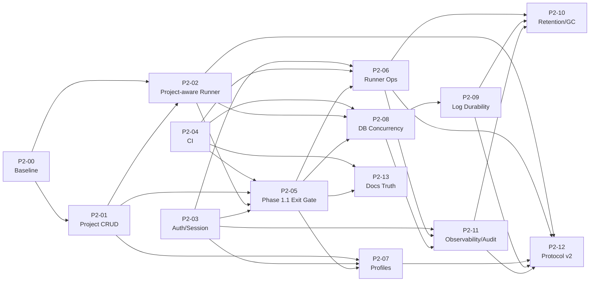
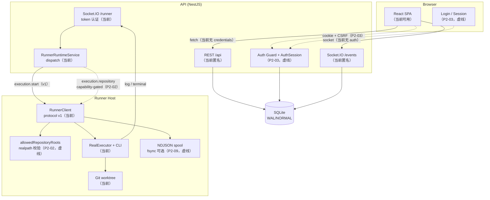
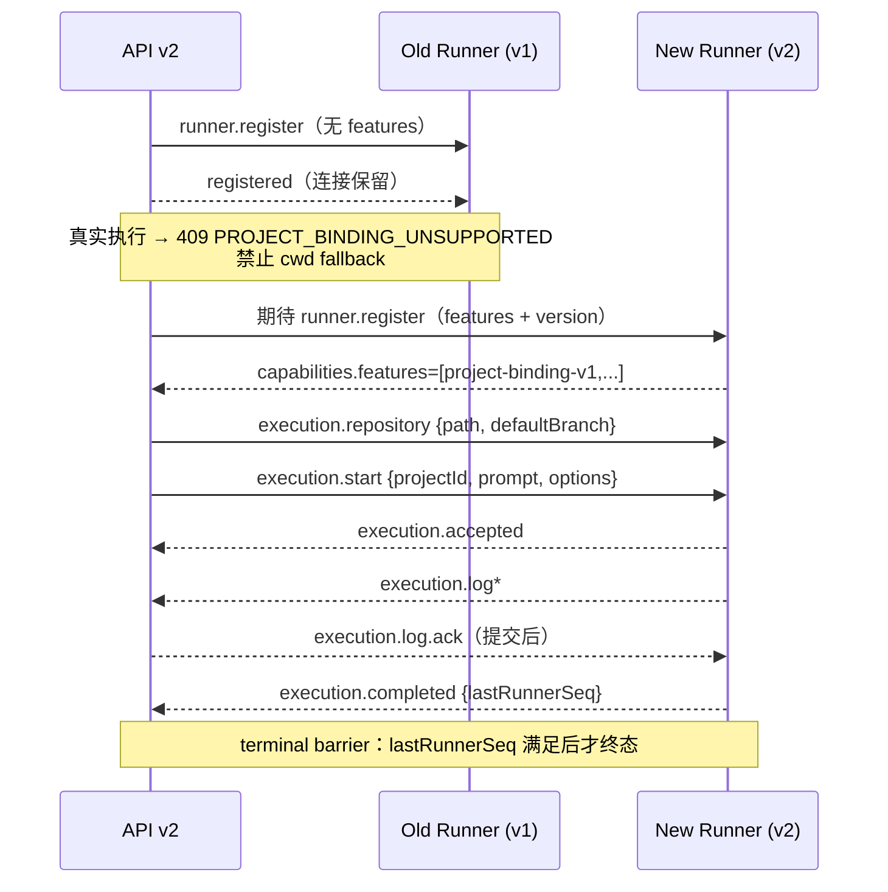
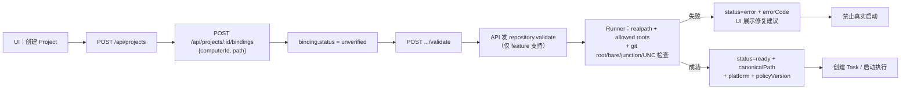
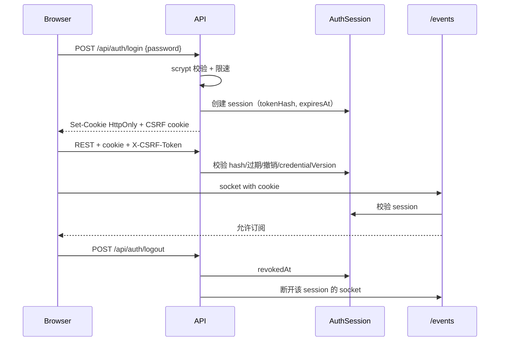
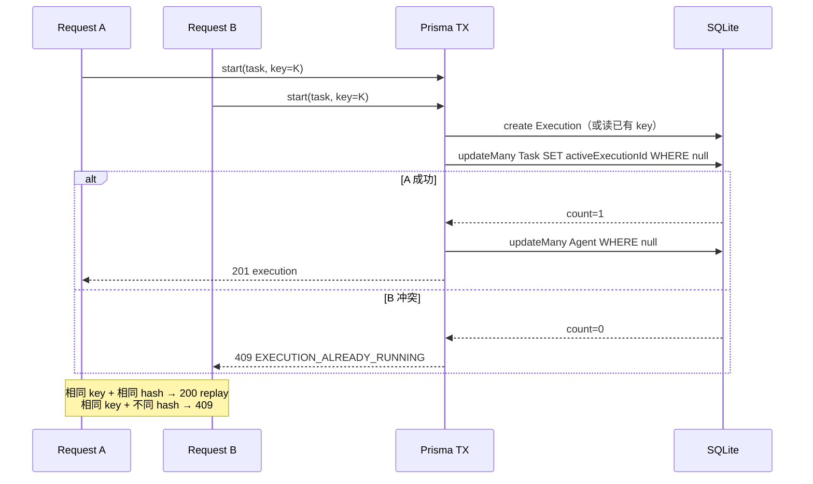
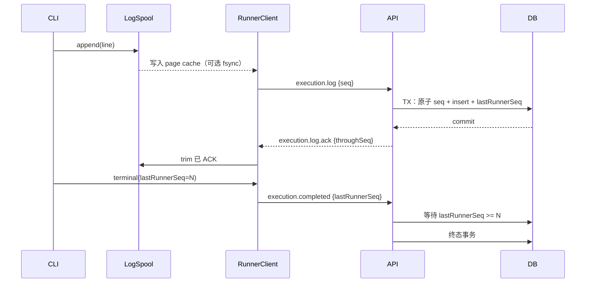
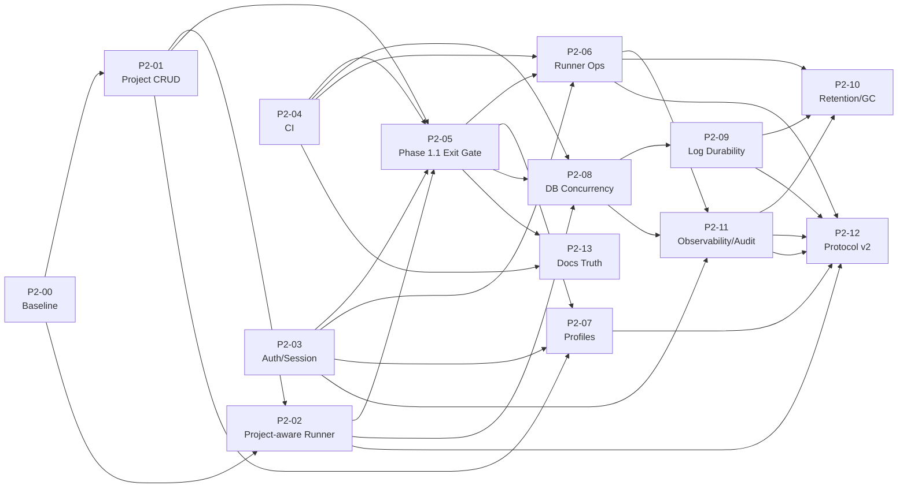

# Haft Phase 2 技术路线图与架构评审

> - **文档类型**：Final Development Baseline（最终开发基线）+ 第二轮架构评审
> - **评审基线**：`main` / `ea3d11a7b9340462889595ac469d2f6f4032f621`
> - **代码基线**：`633f7841f9cbcafa65cdfed8d266f51497891f90`（roadmap 提交后代码未变化）
> - **第一轮评审**：2026-11-09
> - **第二轮评审**：2026-11-09
> - **评审范围**：`apps/api`、`apps/web`、`apps/runner`、`packages/contracts`、`tests`、`docs`
> - **证据原则**：以 HEAD 代码、测试和已提交验收 artifact 为准，不以 `REPORT.md` 的口头声明为准。
> - **修订约束**：本次只修改本文件；未修改源代码、Prisma Schema、迁移、测试、CI、`package.json` 或其他文档；未执行 Git 写操作。

## 目录

1. Executive Summary（执行摘要）
2. Repository Snapshot（仓库快照）
3. Current Architecture Review（当前架构评审）
4. Phase 1.1 Acceptance Review（Phase 1.1 验收复核）
5. Technical Debt & Risk Register（技术债与风险登记）
6. Phase 2 Roadmap（Phase 2 路线图）
7. Detailed Task Breakdown（详细任务卡）
8. Architecture & Data Flow Diagrams（架构与数据流图）
9. Automated Acceptance Strategy（自动化验收策略）
10. Security Review（安全评审）
11. Recommended Execution Order（建议执行顺序）
12. Architecture Review Resolution（第二轮架构问题决议）
13. Final Development Baseline（最终开发基线）
14. Immediate Next Actions（立即执行的下一批任务）
15. Final Recommendation（最终建议）
16. Review Verification（只读复核记录）

---

## 1. Executive Summary（执行摘要）

**总体结论：Phase 1 的代码基础是真实存在的，但 Phase 1.1 的“真实 Codex 验收”仍然没有被证明。**

- 代码层面已经具备：独立 Runner、Socket.IO Runner 协议 v1、Codex/OpenCode 真实 CLI 执行、Git worktree 隔离、unified diff artifact、执行日志、取消/超时、journal + NDJSON spool + 崩溃恢复、Fake Runner 确定性 E2E。核心设计不是空壳。
- 验收层面：唯一已提交的验收报告 `docs/acceptance/phase-1-real-codex-acceptance.md` 结论是 **BLOCKED**，原因是缺少 Project 创建 API/UI，验收在预检阶段停止，未启动服务、未运行真实 Codex、未执行自动化测试。
- `docs/REPORT.md` 声称 Phase 1.1 的真实 Codex API/UI 测试 PASS（114 个确定性测试、42 个 E2E、真实 Codex 30.2s/34.4s），但没有提交对应的 JUnit、日志、截图、diff 或验收报告 artifact；且与 BLOCKED 验收文档直接矛盾。按“已提交 artifact 优先”的原则，**不能把 REPORT.md 的 PASS 当作当前 HEAD 的真实验收证据**。
- 静态复核确认测试数字：确定性 **114**（contracts 5 + API 27 + runner 60 + web 22）；E2E **42**（functional 38，其中 3 个 Fake Runner + business-loop 1 + visual 3）；真实 CLI opt-in **3**（Codex API、OpenCode API、Codex UI），不是旧版路线图写的 9 个。
- 当前最大产品缺口不是“CLI 能不能跑”，而是“能否创建一个真实 Project 并把它绑定到 Runner 上的仓库”。`Project` 只有 `key/name/description/color`，没有仓库路径、默认分支、Project CRUD API 或 UI；Runner 只能通过 `HAFT_RUNNER_PROJECTS`/`--project` 把 projectId 映射到路径，缺省时 fallback 到 `INIT_CWD`/`process.cwd()`，存在跑错仓库的风险。
- 第二轮审查确认了 7 项架构问题：Runner Protocol 兼容性、Repository Path 安全边界、Web/API Session 生命周期、数据库级并发控制、日志持久化可靠性、真实 CLI E2E 安全隔离、文档与验收状态体系。这 7 项都已写入对应的任务卡、依赖关系和验收标准，而不是只在文末追加意见。
- **关键架构决策**：v1 `execution.start` 保持不变，通过 capability-gated 的 `execution.repository` 加法消息引入仓库绑定；Runner 侧 `allowedRepositoryRoots` + realpath/相对路径包含校验；Web/API 采用数据库持久化 Session；Task/Agent 的 `activeExecutionId` 通过条件 `updateMany` 原子占用；日志序号服务端原子分配、DB 提交后 ACK、终态 barrier；真实 CLI 使用独立受保护环境；验收状态统一为 7 态并允许历史报告不同。
- Phase 2 采用 **2.0–2.6** 七个阶段：2.0 Architecture Baseline & CI（P2-00、P2-04）→ 2.1 Project Management & Security（P2-01、P2-03）→ 2.2 Project-aware Runner（P2-02）→ **2.3 Phase 1.1 Exit Gate（P2-05）** → 2.4 Runner Productization（P2-06、P2-07、P2-08、P2-09）→ 2.5 Lifecycle & Observability（P2-11、P2-10）→ 2.6 Architecture Evolution（P2-12、P2-13）。
- **P2-05 是 Phase 1.1 的最终退出门槛**，不是普通 Phase 2 功能。在它通过之前，不得宣布 Phase 1.1 真实验收完成，也不应全面启动后续产品化工作。
- 第一批可交给 Agent 的任务：**P2-00、P2-04、P2-01、P2-03**；P2-02 紧随 P2-01；P2-05 在 P2-01/02/03/04 完成后执行。
- 建议采用“先证明、再扩展”的顺序：先建立可重复的 CI 和契约基线，再打通 Project/仓库绑定与认证，再完成真实 Codex 验收，最后做 Runner 运维、执行 Profile、数据库级幂等、日志持久性、保留/GC、可观测性和协议 v2。
- **在 P2-03 认证完成前，不要让 API 离开 localhost。**

**Phase 2 完成的最低标准：**

1. 能通过 UI/API 创建 Project，并为目标 Computer 绑定仓库路径和默认分支；绑定必须经过 Runner 校验。
2. Runner 只使用服务端下发的显式绑定路径，不再 fallback 到 cwd；路径必须落在 `allowedRepositoryRoots` 内。
3. 在固定 commit、干净工作区、独立 DB/端口/用户/仓库下，真实 Codex API + UI 验收通过，并把证据提交到 `docs/acceptance/`。
4. 所有 REST 与 `/events` 默认拒绝匿名访问；Session 可撤销、可登出、可轮换；Runner token 可配对、撤销、轮换。
5. CI 在 Linux + Windows 上绿；README/REPORT/验收状态可追溯，历史 PASS/BLOCKED 不矛盾。
6. 并发启动、Idempotency-Key、日志序号、spool 失败、terminal barrier 都有自动化测试证明，而不是靠“单实例不会发生”。
7. 保留/GC、health/readiness/metrics/audit 可用，且有运维 runbook。
8. 协议 v1/v2 兼容矩阵和滚动升级方案完成（可作为 Phase 2 尾部）。

---

## 2. Repository Snapshot（仓库快照）

| 项目 | 值 |
|---|---|
| 仓库路径 | `D:\CODE\GIT\Haft` |
| 分支 | `main`，与 `origin/main` 同步 |
| HEAD | `ea3d11a7b9340462889595ac469d2f6f4032f621` |
| HEAD 标题 | `docs: add Phase 2 technical roadmap and architecture review` |
| 代码基线 | `633f7841f9cbcafa65cdfed8d266f51497891f90` |
| 工作区 | `git status --porcelain` 无输出，干净 |
| Worktree | 仅 `D:/CODE/GIT/Haft  ea3d11a [main]` |
| 提交历史 | `9c8e65a` 初始化 → `cf39a76` Runner/真实 CLI → `34c5618` BLOCKED 验收报告 → `553eb9a` diff/恢复 → `633f784` 加固 → `ea3d11a` roadmap |
| 包管理 | pnpm `11.5.2`，Node `>=20.19` |
| Monorepo | `apps/api`、`apps/web`、`apps/runner`、`packages/contracts` |
| API | NestJS 11 + Prisma 6.16.2 + SQLite；REST `/api`、Socket.IO `/events`、`/runner` |
| Web | React 19 + Vite + TanStack Query + React Router + Socket.IO Client |
| Runner | 独立 Node 进程；Codex/OpenCode CLI；Git worktree；journal/spool/recovery |
| 确定性测试 | **114**：contracts 5 + API 27 + runner 60 + web 22 |
| E2E | **42**：38 functional（含 3 个 Fake Runner）+ 1 business-loop + 3 visual |
| 真实 CLI E2E | **3** 个 opt-in（2 API + 1 UI），需 `HAFT_REAL_CLI_E2E=1` |
| CI | **无** `.github/workflows` |
| 已提交验收 artifact | `docs/acceptance/phase-1-real-codex-acceptance.md`，结论 **BLOCKED** |
| SQLite 运行参数 | `journal_mode=WAL`、`synchronous=NORMAL`、`busy_timeout=15000`（`apps/api/src/common/prisma/prisma.service.ts:5-20`） |
| 文档一致性 | README 仍写 “72 tests”（`README.md:139,175`）；REPORT 写 114/42 并声称真实 Codex PASS |

> 上表是第二轮审查**开始时**的快照；写入本文件后的工作区状态见第 16 节。

**关键观察：**

- 这是“单机、单 workspace、单 SQLite”的架构，不是多租户/多实例架构。很多简化是刻意为之，但 Phase 2 必须把“单实例假设”显式化，否则会在验收或部署时暴露。
- 代码质量整体高于普通 Demo：Zod 严格 schema、`shell:false`、stdin 传 prompt、token 不传 CLI、diff 1 MiB 上限、日志 8k 行上限、测试端点双重门禁、token hash + `timingSafeEqual`，这些都应保留。
- 当前文档存在“实现完成”和“验收完成”混写的问题。Phase 2 必须把“代码存在”“确定性测试通过”“真实 CLI 验收通过”分成三个不同状态。
- 真实 CLI 测试当前使用开发者本机的 Codex 登录状态、`E2E_TEST_MODE=true` 的 reset 端点、固定 bootstrap token 和 `HAFT_RUNNER_ALLOW_AUTO_APPROVE=1`（`playwright.real.config.ts:12-58,83-87`）；它是“可重复的本地演示”，不是“隔离的验收环境”。

---

## 3. Current Architecture Review（当前架构评审）

### 3.1 运行时与执行主链路

```text
React SPA
  → REST /api（NestJS Controllers → Services → Prisma → SQLite）
  → Socket.IO /events（执行状态/日志广播）
  → RuntimeRegistryService
      → MockRuntimeService（内存模拟，演示/测试）
      → RunnerRuntimeService（服务端不 spawn CLI）
          → RunnerRegistryService + RunnerGateway（/runner，协议 v1）
              → Runner 进程
                  → RealExecutor / FakeExecutor
                  → GitWorktreeManager（worktree + diff）
                  → CLI（codex/opencode，spawn shell:false）
```

- `RuntimeRegistryService` 是唯一的 runtime 选择点，`ExecutionsService` 不直接按 runtime 名称分支，这是很好的边界（`apps/api/src/modules/runtime/runtime-registry.service.ts`）。
- `RunnerRuntimeService` 明确“Nest 进程永不 spawn CLI”，只向拥有该 Computer 的 Runner 发消息（`apps/api/src/modules/runtime/runner-runtime.service.ts:24-43`）。
- Runner 协议是严格 Zod envelope，消息带 `messageId`，设计上支持至少一次投递和幂等处理（`packages/contracts/src/runner-protocol.ts:12-18`）。
- Runner 侧 `RealExecutor` 负责 CLI 生命周期、超时、取消、journal、日志解析和 Git evidence；`GitWorktreeManager` 负责 worktree 创建、diff 收集、截断和清理。

### 3.2 数据模型

当前模型：`Workspace → Project → Task → Execution → ExecutionLog/ExecutionArtifact`，以及 `Computer → Runner`、`Agent → Execution`、`Activity`。

关键事实：

- `Project` 只有 `id/workspaceId/key/name/description/color`，**没有 `repoPath`、`repoUrl`、`defaultBranch`**（`apps/api/prisma/schema.prisma:22-36`）。
- `Execution` 有 `branchName/baseCommit/headCommit/changedFiles/diffStat/gitStatus/diffTruncated/lastRunnerSeq`，但没有服务端日志序号游标、没有执行 profile/options 快照、没有 repository path 快照（`schema.prisma:119-157`）。
- `ExecutionLog` 已有 `@@unique([executionId, seq])`、`@@unique([executionId, eventId])`、`@@unique([executionId, runnerSeq])`，数据库层具备幂等基础（`schema.prisma:176-192`）。
- `Runner` 有 `tokenHash`、`protocolVersion`、`capabilitiesJson`、`maxConcurrentExecutions`，但没有 `revokedAt`、没有配对 token 表（`schema.prisma:52-73`）。
- `Task`/`Agent` 没有 `activeExecutionId`，数据库没有“每个 Task/Agent 最多一个 running execution”的约束（`schema.prisma:75-117`）。
- `Workspace` 只有一个 seed 的 `ws_demo`，大量 service 直接使用 `DEFAULT_WORKSPACE_ID`，没有真正的多 workspace 解析。
- `Project` 和 `Computer` 没有直接关系；当前只有 `Agent.computerId`、`Runner.computerId`。仓库绑定必须是 `Project + Computer` 的显式关系，不能从 Project 直接推断 Runner 路径。

### 3.3 API 与 Web 表面

- API 模块：`agents`、`tasks`、`executions`、`runtime`、`runners`、`computers`、`workspace`、`events`、`test`、`health`。
- Web 路由只有：Dashboard、Agents、Tasks、Execution Detail（`apps/web/src/app.tsx:9-21`）。
- **没有 Projects 页面、没有 Runners/Computers 管理页面、没有登录页、没有设置页。**
- `GET /api/workspace` 会返回 projects，但只是 seed 数据的只读展示；没有 `POST/PATCH/DELETE /api/projects`（`workspace.controller.ts:10-20`）。
- Runner/Computer 只有只读 `GET`，没有配对、撤销、轮换、改名的管理面。
- `ExecutionsController` 没有“启动”路由；启动在 `TasksController` 的 `POST /api/tasks/:id/executions`。当前没有 `Idempotency-Key` 处理。

### 3.4 Runner 协议与恢复

- 协议版本硬编码为 `1`（`packages/contracts/src/constants.ts:54`，`runner-protocol.ts:43-52`）。
- 握手支持 `token` 或 `bootstrapToken`；服务端存 SHA-256 hash，并用 `timingSafeEqual` 比较（`runner-registry.service.ts:163-251,808-859`）。
- 派发有 20s accept 超时（`runner-registry.service.ts:50`）；断线有 60s 默认 reconnect grace（`:51`）。
- 断线期间执行不立即失败；重连后 `execution.reconcile` 让 Runner 报告本地状态；超过 grace 才失败为 `RUNNER_DISCONNECTED`。
- Runner 恢复依赖 journal + NDJSON spool + PID start-time/ownership 检查；恢复后**不会重跑**，而是把中断执行标记为 `RUNNER_INTERRUPTED`。
- `execution.reconcile` 目前主要是“日志 + 失败/终态”语义，不是完整的状态机对账；这是 Phase 2 要补的运维能力。
- 旧 Runner 对未知 server 消息的处理是：`runnerServerMessageSchema.safeParse` 失败 → 记 warning → 丢弃消息，不会断开连接（`apps/runner/src/runner-client.ts:264-307`）。这为“加法消息 + capability 门控”提供了兼容空间。
- 但 `execution.start` 的 payload 是严格 schema；**直接在 v1 payload 增加必需字段会让旧 Runner 丢弃该消息，20s 后 dispatch 超时并取消**。这是 P2-02 不能绕过 v1 schema 的原因。

### 3.5 认证与信任边界

- Web/API：**没有认证/授权**。所有 REST 路由匿名可访问；`/events` 只做了 CORS，没有会话校验（`events.gateway.ts:22-43`）。
- `/runner`：有握手 token 认证，但 CORS 在未设置 `WEB_ORIGIN` 时返回 `true`（`runner.gateway.ts:30-33`），意味着浏览器来源不受限；真正的安全边界仍是 token，但这是一个容易误配置的危险默认值。
- Bootstrap token：`HAFT_RUNNER_BOOTSTRAP_TOKEN` 是静态环境变量，可重复使用；没有 TTL、一次性消费、撤销或轮换（`runner-registry.service.ts:218-251`，`apps/api/.env.example:9-13`）。
- Test API：仅当 `E2E_TEST_MODE=true` 且 `NODE_ENV!=production` 时注册（`app.module.ts:16-17,33`），这是正确的门禁；但没有额外的网络/认证保护，误配置仍有风险。
- Runner 管理：`GET /api/runners` 通过 `assertRunnerAdminAccess` 限制 loopback 或 `x-haft-admin-token`（`runner-access.ts:17-41`），不是产品级 Session 认证。
- Web 的 `fetch` 没有 `credentials: 'include'`；Socket.IO 客户端没有 `withCredentials` 和 auth 参数（`apps/web/src/services/api.ts`、`socket-provider.tsx:32-37`）。P2-03 必须同时改 REST 和 Socket 两条链路。

### 3.6 当前架构的优点

1. **契约先行**：请求体、查询、Runner 消息都由 Zod 严格校验，API/Web/Runner 不易静默漂移。
2. **Runtime 抽象清晰**：Mock 与 Runner 两种 runtime 通过同一接口选择，测试与真实执行分离。
3. **进程安全基础好**：`spawn` 参数数组、`shell:false`、prompt 走 stdin、CLI 环境清洗、token 不传 CLI、Codex `workspace-write` sandbox。
4. **Git 隔离正确方向**：每个执行独立 worktree/branch，diff 作为 artifact 持久化，主 checkout 不被直接修改。
5. **恢复设计认真**：journal、spool、PID identity、reconcile、grace window 都不是“假装恢复”。
6. **测试分层完整**：contracts/API/runner/web/E2E/Fake Runner/真实 CLI opt-in 的层次清楚，114 个确定性测试是实打实的基础。

### 3.7 当前架构的主要问题

| 问题 | 证据 | 影响 |
|---|---|---|
| 没有 Project CRUD/仓库绑定 | `schema.prisma:22-36`；无 `Controller('projects')`；`workspace.controller.ts:10-20` 只读 | 真实验收无法创建专用 Project；Runner 只能靠 env 映射 |
| 没有 Web/API 认证 | `events.gateway.ts:22-43`；无全局 guard | 任何本机/局域网客户端可读写所有数据、订阅执行日志 |
| `/runner` CORS 默认放开 | `runner.gateway.ts:30-33` | 误配置时浏览器来源不受限；应 fail closed |
| `/events` 无鉴权 | `events.gateway.ts:37-43` | 任意客户端可订阅全部执行日志/状态 |
| Bootstrap token 静态可复用 | `runner-registry.service.ts:218-251` | 泄露后可长期配对；无撤销/轮换 |
| 启动锁仅进程内 | `executions.service.ts:48,79-87,97-133` | 单实例由全局 `execution-start` 锁串行；多 API 实例可重复创建执行 |
| `nextLogSeq` 读后写 | `executions.service.ts:654,887,894-900` | 单实例被 per-execution 锁掩盖；跨实例冲突；P2002 误当重复会丢日志 |
| `LogSpool.append` 吞错 | `log-spool.ts:43-72` | 磁盘写失败仍 resolve，调用方可能发送未落盘日志 |
| Spool 超限静默丢弃 | `log-spool.ts:182-197` | 未 ACK 的旧日志被删除，无法证明完整性 |
| ACK 后立即 trim，无 fsync | `runner-client.ts:299-305`；`log-spool.ts:85-106` | ACK 只证明 DB 行已提交，不证明断电后仍在 |
| `git collect` 失败返回 null | `git-worktree.ts:142,239` | diff evidence 可能静默丢失，执行仍可能被当成成功 |
| 无保留/清理策略 | 无定时任务；`keepWorktrees` 默认 true；branch 不删除 | 日志、artifact、worktree、branch 无限增长 |
| 无 CI | 无 `.github` | 114/42 个测试靠人工执行，回归不可控 |
| 文档状态失真 | README `72`；REPORT `PASS`；验收文档 `BLOCKED` | 对外结论不可信，验收无法审计 |
| 真实 CLI E2E 使用开发机认证 | `playwright.real.config.ts:12-58,83-87`；`real-cli.spec.ts:47` | 不可信 PR/测试可能接触个人凭据；证据不可复现 |

### 3.8 第二轮审查新增事实

1. **严格 v1 不能直接扩展**：`executionStartPayloadSchema`、`runnerCapabilitiesSchema`、`runnerEnvelopeBaseSchema` 都是 `.strict()`；未知字段会导致解析失败。P2-02 必须使用能力门控的加法消息，而不是在 `execution.start` 加必需字段。
2. **cwd fallback 是默认行为，不是边缘情况**：`parseProjectPaths` 在没有 `HAFT_RUNNER_PROJECTS` 时返回 `{ [fallbackProjectId]: resolve(fallbackRoot) }`，`fallbackRoot` 来自 `INIT_CWD`/`process.cwd()`（`config.ts:238-265`）。只要 `projectId` 是默认的 `project_demo`，就会落到 cwd。
3. **路径校验只有“git 根目录”一层**：没有 allowed roots、realpath、UNC、junction、bare repo、linked worktree 的显式策略；`assertInside` 只保护 worktree root，不保护仓库路径（`git-worktree.ts:52-140,349-361`）。
4. **日志顺序存在，但持久性闭环不存在**：Runner 先 append 再 send，`ProtocolEventQueue` 保证终态排在前面的日志之后；但 append 失败被吞、没有 fsync、ACK 在单行提交后立即发送、终态没有 `lastRunnerSeq` barrier。
5. **并发正确性依赖进程内锁**：单实例内 `withExecutionLock`（全局 `execution-start`）+ gateway per-runner queue 把 `nextLogSeq`/check-then-create 串行化；多实例会暴露底层语句的非原子性。
6. **认证完全缺失**：REST、`/events`、Web 都没有 Session；只有 `/runner` 有 token。P2-03 必须同时覆盖 REST、Socket、CSRF、Session 撤销和登录限速。
7. **验收状态规则错误**：P2-13 原文“禁止 PASS 与 BLOCKED 同时出现”会否定历史报告；必须改为“同一报告内部不矛盾，历史报告可不同，README 指向最新”。

---

## 4. Phase 1.1 Acceptance Review（Phase 1.1 验收复核）

### 4.1 权威 artifact

`docs/acceptance/phase-1-real-codex-acceptance.md` 是唯一已提交的 Phase 1 真实验收报告。其开头明确写着：

> **验收结论：BLOCKED**  
> 本次验收在环境预检阶段发现前置能力缺失：Haft 当前没有 Project 创建 API/UI，无法按验收要求创建专用 Project。……未创建验收仓库、未启动服务、未执行真实 Codex、未运行自动化测试，也未伪造任何执行结果。  
> —— `docs/acceptance/phase-1-real-codex-acceptance.md:3-5`

报告记录的执行基线是 `cf39a76`（`:73`），即 **Runner/真实 CLI 刚加入、diff/recovery 加固之前** 的 commit。

### 4.2 时间线与状态变化

| Commit | 内容 | 对验收的意义 |
|---|---|---|
| `cf39a76` | Runner 架构 + 真实 CLI 执行 | 验收报告在此基线预检，因无 Project CRUD 而 BLOCKED |
| `34c5618` | 提交 BLOCKED 验收报告 | 唯一已提交的验收 artifact |
| `553eb9a` | 增加 git diff evidence + runner crash recovery | 代码层补齐了 Phase 1.1 的证据/恢复能力 |
| `633f784` | 加固 runner recovery 和 diff evidence | 代码基线；Project CRUD 缺口仍在 |
| `ea3d11a` | 提交本路线图 | 本文档基线；代码未变 |

**关键判断：** 验收文档的 HEAD 较旧，但它记录的阻塞条件在 HEAD 仍然成立——Project CRUD 依旧不存在。因此不能因为 `553eb9a`/`633f784` 增加了 diff/recovery，就推断 Phase 1.1 已通过。

### 4.3 逐项验收结论

> 状态使用第 9.1 节的统一定义。`PARTIAL` 表示代码/确定性测试存在，但缺少真实 CLI 或真实浏览器验收证据。

| 验收项 | 状态 | 证据/说明 |
|---|---|---|
| 创建专用 Project | **FAIL** | 无 Project CRUD API/UI；`Project` 无仓库字段；seed 只有 `project_demo` |
| 创建/绑定验收仓库 | **FAIL** | Runner 支持 worktree；但仓库映射只能靠 `HAFT_RUNNER_PROJECTS` 环境变量，且存在 cwd fallback |
| 创建 Agent/Task 并路由到 Runner | **PARTIAL** | 代码路径存在；Fake Runner 测试覆盖；真实 Project 绑定缺失 |
| 真实 Codex API 执行 | **NOT_VERIFIED at HEAD** | `tests/e2e-real/real-cli.spec.ts` 存在但 opt-in；无 HEAD 上的已提交运行证据 |
| 真实 Codex UI 执行 | **NOT_VERIFIED at HEAD** | `tests/e2e-real/real-ui.spec.ts` 存在但 opt-in；无 HEAD 上的已提交运行证据 |
| 实时日志/状态到终态 | **PARTIAL** | API/runner/web 确定性测试覆盖；真实 CLI 未验证 |
| Changes 面板渲染持久化 diff | **PARTIAL** | `553eb9a` 增加 diff artifact、`GET /api/executions/:id/diff`、Changes UI；无真实验收 artifact |
| 主 checkout/HEAD/remote 不被修改 | **PARTIAL** | worktree 隔离和 E2E 断言存在；无真实验收 artifact |
| 崩溃恢复 | **PARTIAL** | journal/spool/PID identity/reconcile；真实崩溃未做验收 |
| 验收证据可审计 | **FAIL** | 只有 BLOCKED 报告；REPORT.md 的 PASS 无 artifact 链接 |

### 4.4 对 `REPORT.md` 的处理

`docs/REPORT.md` 写了：

- 真实 Codex/OpenCode 执行 “Done”（`:257`）。
- 真实浏览器 UI + 真实 Codex UI E2E “Done — 34.4 s pass”（`:281`）。
- 真实 CLI E2E “Pass — 2 passed, 1 skipped”（`:297`）。
- API + real Codex “PASS — 30.2 s”；UI + real Codex “PASS — 34.4 s”（`:311-312`）。
- 手动验收命令与结果（`:326-328`）。

但这些声明没有对应的已提交 JUnit、JSON、日志、截图、视频、diff 或验收报告。仓库根目录的 `.log` 文件被 `.gitignore` 忽略（`.gitignore:6`），不能作为 HEAD 上的可审计证据。**结论：REPORT.md 只能视为“作者曾声称运行过”，不能视为“当前 HEAD 已通过验收”。**

### 4.5 Phase 1.1 最终评级

**代码能力：CONDITIONAL PASS（实现基本完整，确定性测试覆盖）。**  
**真实验收：BLOCKED / UNPROVEN。**  
**对外表述：不得写“Phase 1.1 已完成/真实 Codex 已通过”，直到 P2-05 产出可复现 artifact。**

---

## 5. Technical Debt & Risk Register（技术债与风险登记）

严重度定义：**P0** 阻塞验收或安全暴露；**P1** 影响正确性/可运维性；**P2** 影响规模化/生命周期；**P3** polish/演进。

| ID | 严重度 | 领域 | 证据 | 影响 | Phase 2 卡片 |
|---|---|---|---|---|---|
| TD-01 | P0 | Project/仓库绑定 | `schema.prisma:22-36`；无 projects controller；`workspace.controller.ts:10-20` 只读 | 无法创建验收 Project；Runner 仓库映射靠 env | P2-01/P2-02 |
| TD-02 | P0 | 认证/授权 | `events.gateway.ts:22-43`；无全局 guard | 任意客户端可读写 API、订阅日志 | P2-03 |
| TD-03 | P1 | CORS | `runner.gateway.ts:30-33`；`events.gateway.ts:22-25` | 未配置 `WEB_ORIGIN` 时默认 `origin: true` | P2-03 |
| TD-04 | P1 | Runner 配对 | `runner-registry.service.ts:218-251`；`.env.example:9-13` | 静态 bootstrap token 可复用，无 TTL/撤销/轮换 | P2-06 |
| TD-05 | P1 | 启动并发 | `executions.service.ts:48,79-87,97-133` | check-then-create 竞态；多实例会重复执行 | P2-08 |
| TD-06 | P1 | 日志序号 | `executions.service.ts:654,887,894-900` | `max(seq)+1` 非原子；单实例被锁掩盖；跨实例冲突；P2002 误 ACK 会丢日志 | P2-09 |
| TD-07 | P1 | Spool 持久性 | `log-spool.ts:43-72,182-197` | 写失败被吞；超限静默丢弃；无 fsync | P2-09 |
| TD-08 | P1 | 项目路由 | `apps/runner/src/config.ts:152-164,238-265` | 无 env 映射时 fallback cwd，可能跑错仓库 | P2-02 |
| TD-09 | P1 | Runner/Computer 运维 | 只有 GET；Web 无 runners 路由 | 无法配对、撤销、轮换、改名、看能力 | P2-06 |
| TD-10 | P1 | 测试门禁 | 无 `.github`；README `72` vs 实际 `114` | 回归不可控；文档不可信 | P2-04/P2-13 |
| TD-11 | P1 | 验收真实性 | `acceptance:3-5` vs `REPORT.md:281,297,309-313` | PASS 声明不可审计，和 BLOCKED 矛盾 | P2-05/P2-13 |
| TD-12 | P1 | Prompt/CLI 权限 | `cli-args.ts`、`real-executor.ts`；无审批 UI | CLI 以 Runner 用户权限运行；任务文本可诱导越权 | P2-03/P2-07 |
| TD-13 | P2 | Diff 证据 | `git-worktree.ts:142,239` | `collect` 失败返回 null，证据静默丢失 | P2-09/P2-11 |
| TD-14 | P2 | 恢复对账 | `runner-registry.service.ts:636-704` | reconcile 偏日志/失败，不是完整状态机对账 | P2-11/P2-12 |
| TD-15 | P2 | 执行 options | `agent-runtime.interface.ts:18-24`；`runner-protocol.ts:113-121` | 协议支持 model/agent/variant/sandbox/timeout，但 API 不持久化/不选 | P2-07 |
| TD-16 | P2 | 保留/清理 | 无定时任务；`keepWorktrees` 默认 true；branch 不删 | 日志/artifact/worktree/branch 无限增长 | P2-10 |
| TD-17 | P2 | 多实例/SQLite | Prisma SQLite；registry 内存态 | 单写者、无水平扩展；重启丢失 live 状态 | P2-08/P2-12 |
| TD-18 | P2 | 可观测性 | 仅基础 health；无 metrics/audit | 无法定位队列、runner、失败趋势 | P2-11 |
| TD-19 | P2 | 速率/背压 | Socket 2 MiB；日志 8k 行；无 rate limit | 大量日志/事件可拖垮 API/Runner | P2-09/P2-11 |
| TD-20 | P2 | 敏感数据 | diff/log 全量持久化；无 redaction/retention | 源码、token、路径可能进入日志/DB | P2-10/P2-11 |
| TD-21 | P2 | 单 workspace | `DEFAULT_WORKSPACE_ID` 遍布 service | 无法真正多 workspace/多团队 | P2-12/P2-13 |
| TD-22 | P3 | 协议演进 | `RUNNER_PROTOCOL_VERSION=1`，literal 1 | 未来字段变更会破坏旧 Runner | P2-12 |
| TD-23 | P3 | 备份/升级 | SQLite；无 runbook | 迁移/回滚/备份无标准流程 | P2-10/P2-13 |
| TD-24 | **P0** | Protocol 兼容性 | `runner-protocol.ts:43-52,145-156`；`runner-client.ts:264-307` | 直接加必需字段会让旧 Runner 丢消息并超时；无 feature 声明 | P2-00/P2-02/P2-12 |
| TD-25 | **P0** | Repository Path 边界 | `config.ts:238-265`；`git-worktree.ts:52-140,349-361` | 无 allowed roots/realpath/UNC/junction/bare 策略；可访问任意 Runner 路径 | P2-01/P2-02 |
| TD-26 | **P0** | Session 生命周期 | 无 AuthSession；`/events` 匿名；Web 无 credentials | 无法撤销泄露 Session；Logout 无真实语义；WS 无认证 | P2-03 |
| TD-27 | P1 | DB 原子占用/幂等 | `executions.service.ts:97-133,184-207`；无 activeExecutionId | 并发启动重复执行；无 Idempotency-Key | P2-08 |
| TD-28 | P1 | 日志 ACK/终态 barrier | `executions.service.ts:654-688`；`protocol-event-queue.ts:14-33` | ACK 不等完整持久性；终态可越过缺口；重复分类错误 | P2-09 |
| TD-29 | P1 | 真实 CLI 隔离 | `playwright.real.config.ts:12-58,83-87`；`real-cli.spec.ts:47` | 开发机个人认证、test reset、固定 token、auto-approve | P2-04/P2-05 |
| TD-30 | P1 | 验收状态语义 | 本文件旧版“PASS/BLOCKED 互斥”规则；README `72`；REPORT PASS vs acceptance BLOCKED | 历史报告被错误否定；PASS 无证据 | P2-13 |

---

## 6. Phase 2 Roadmap（Phase 2 路线图）

### 6.1 路线图总览

原始规划的 4 个 Wave 方向正确，但把“设计决策”和“功能开发”混在一起，并且 P2-05 被当成普通 P0 卡。第二轮修订改为 7 个阶段，增加 P2-00 基线卡，把 P2-05 提升为 Phase 1.1 Exit Gate。

| Phase | 主题 | 卡片 | 退出标准 | 预估 |
|---|---|---|---|---|
| **2.0 Architecture Baseline & CI** | 冻结 7 项架构决策；建立可重复门禁 | **P2-00**、P2-04 | 决策/契约/错误码/状态词表固化；CI Linux+Windows 绿；真实 CLI job 与普通 CI 分离 | 3–5 天 |
| **2.1 Project Management & Security** | Project CRUD、仓库绑定、认证 | P2-01、P2-03 | Project + binding 可用且经 Runner 校验；所有 REST/`/events` 默认 401；Session 可撤销 | 1.5–2 周 |
| **2.2 Project-aware Runner** | 显式仓库路由、capability、路径安全 | P2-02 | 无 cwd fallback；旧 Runner 明确拒绝；allowed roots/路径攻击测试通过 | 1 周 |
| **2.3 Phase 1.1 Exit Gate** | 真实 Codex API + UI 验收 | P2-05 | 固定 commit、独立环境、完整证据、PASS 报告；否则 FAIL/BLOCKED | 3–5 天 |
| **2.4 Runner Productization** | 配对、Profile、DB 幂等、日志持久性 | P2-06、P2-07、P2-08、P2-09 | 配对/撤销/轮换；Profile 生效；DB 原子占用；日志 ACK/终态闭环 | 2–3 周 |
| **2.5 Lifecycle & Observability** | 保留/GC、可观测性、审计 | P2-11 → P2-10 | audit/metrics/readiness/timeline；GC dry-run 安全；证据保护 | 1.5–2 周 |
| **2.6 Architecture Evolution** | 协议 v2、文档真实性 | P2-12、P2-13 | v1/v2 兼容矩阵；滚动升级；文档状态一致 | 1–2 周 |

### 6.2 路线图原则

1. **先证明，再扩展。** 没有 P2-05 的真实 artifact，不进入 P2-06 之后的产品化开发。
2. **先 fail closed，再谈体验。** 认证、CORS、配对 token、路径校验都必须默认拒绝，而不是“本地 demo 先放开”。
3. **数据库约束优先于进程内锁。** 任何“只能有一个”的规则都要能由 DB 条件更新/唯一约束/事务证明。
4. **验收证据必须可复现。** 固定 commit、固定环境、独立 DB/端口/用户/仓库、提交报告；不接受“我本地跑过”。
5. **协议兼容优先于字段便利。** 不允许在严格 v1 上直接加必需字段；不允许为了兼容旧 Runner 保留 cwd fallback。
6. **每张卡一个 PR。** 每张卡都必须带迁移、测试、文档和回滚说明；P0 卡必须有 E2E 或真实验收证据。
7. **不把未来设计画成当前实现。** 所有 Mermaid 图必须区分“当前已实现”和“Phase 2 计划”。

### 6.3 阶段依赖与关键路径



- **关键路径：** P2-00 → P2-01 → P2-02 → P2-05 → P2-08 → P2-09 → P2-10 → P2-12 → P2-13（P2-11 可与 P2-09 并行，但 P2-10 同时依赖两者）。
- **可并行：** P2-00 与 P2-04；P2-01 与 P2-03；P2-06 与 P2-07；P2-11 与 P2-09（P2-10 依赖两者）。
- **必须串行：** P2-01 → P2-02；P2-08 → P2-09；P2-11 → P2-10；P2-05 → P2-06/07/08。

### 6.4 为什么调整顺序

- **P2-00 先行**：7 项决策横跨 contracts/API/Runner/DB/Web。没有基线，P2-01/02/03/08/09 会各自发明字段、错误码和状态语义。
- **P2-04 与 P2-00 并行**：CI 必须尽早成为门禁，否则后续卡无法证明“没有回归”。
- **P2-01/P2-03 并行**：两者都改 contracts/app.module/web shell/tests，必须按模块切分；P2-01 解决验收根阻塞，P2-03 解决安全暴露。
- **P2-02 在 P2-01 之后**：需要 binding 表、Runner 校验 API 和 Project/Computer 关系；同时把 cwd fallback 彻底移除。
- **P2-05 在 2.3 而不是 2.4**：它是 Phase 1.1 的最终退出门槛；只有通过后，才允许把 Runner 运维/Profile/幂等/日志当作产品化工作全面展开。
- **P2-08/P2-09 放在 2.4**：它们是正确性硬化，不应阻塞 Phase 1.1 Exit Gate，但必须在对外演示/长期运行前完成。
- **P2-11 在 P2-10 之前**：P2-10 的 GC 需要 audit、admin 权限和可观测性来确定“删了什么、谁删的”。
- **P2-12/P2-13 在 2.6**：协议演进和文档收口依赖前面所有能力稳定。

### 6.5 Phase 1.1 Exit Gate（P2-05）

P2-05 不是“再跑一次 E2E”，而是 Phase 1.1 的最终验收门。必须满足：

1. 代码基线是固定 commit（不是浮动分支）；工作区干净。
2. P2-01/P2-02/P2-03/P2-04 已完成，且 CI 绿。
3. 真实 Codex API + UI 两条路径都在独立环境执行；不 mock、不 retry 掩盖失败。
4. 证据包含 commit、环境、命令、JUnit、日志、截图、diff、脱敏报告、cleanup 记录。
5. 报告结论只能是 PASS/FAIL/BLOCKED/INCONCLUSIVE；PARTIAL/NOT_VERIFIED/SKIPPED 只能作为子项状态，不允许 SKIPPED 冒充 PASS。
6. 没有未关闭的 P0 安全问题。
7. 通过后，README/REPORT/acceptance 三处状态一致；历史 BLOCKED 报告保留并标注 supersedes 关系。
8. 未通过时，停止进入 2.4 之后的产品化工作，先修复并重跑。

---
## 7. Detailed Task Breakdown（详细任务卡）

> 每张卡保持 14 类信息：ID/Phase/Priority/Size、当前问题、代码证据、目标、涉及模块与可能文件、API 设计、Schema 变更、前端变化、自动化测试、验收标准、依赖、风险、DoD、兼容/迁移说明。
> P2-00 是第二轮新增的基线卡；P2-01..P2-13 是原 13 张卡的修订版。

### P2-00 · Architecture Baseline 与协议兼容性契约

- **ID/Phase/Priority/Size**：P2-00 / Phase 2.0 / **P0** / S
- **当前问题**：7 项架构决策横跨 contracts/API/Runner/DB/Web。若直接进入 P2-01/02/03/08/09，各卡会各自发明字段、错误码和状态语义；而 v1 是严格 schema，直接给 `execution.start` 加必需字段会让旧 Runner 丢弃消息并 20s 超时。
- **代码证据**：`packages/contracts/src/runner-protocol.ts:43-52`（strict envelope）、`:81-87`（capabilities 只有 runtimes/projectIds/maxConcurrent）、`:145-156`（start payload 的仓库字段只有 projectId，无路径）、`:362-382`（discriminated union）；`packages/contracts/src/constants.ts:54`（literal 1）；`apps/api/src/modules/runners/runner-registry.service.ts:163-170`（只接受 v1）；`apps/runner/src/runner-client.ts:264-307`（旧 Runner 丢弃未知消息）。
- **目标**：把第二轮审查的 7 项决策固化为可执行契约：`RUNNER_FEATURES` 常量、v1 兼容性测试、错误码表、验收状态词表、路径策略与 Session/并发/日志语义。**不改变现有运行时行为。**
- **涉及模块**：contracts、tests、docs（本路线图）。
- **可能文件**：
  - `packages/contracts/src/constants.ts`、`runner-protocol.ts`、`types.ts`
  - `packages/contracts/test/contracts.test.ts`
  - `tests/contract/`（新增兼容性快照）
  - `docs/phase-2-technical-roadmap.md`
- **API 设计**：无新增 REST。
- **Schema 变更**：无。
- **前端变化**：无。
- **自动化测试**：
  - v1 `execution.start` 严格拒绝未知 `project` 字段（证明不能直接加字段）。
  - `runner.register.capabilities.features` 为可选数组；缺失解析为 `[]`；非法 feature 名称拒绝。
  - `RUNNER_FEATURES` 至少包含 `project-binding-v1`、`repository-path-policy-v1`、`log-replay-v1`、`terminal-log-barrier-v1`。
  - 现有 114 个确定性测试全绿，证明无行为变化。
- **验收标准**：决策表、错误码表、feature 表写入文档；contracts 兼容性测试可在 CI 运行；P2-01/02/03/08/09 的任务卡引用同一套常量/错误码；没有业务逻辑改动。
- **依赖**：与 P2-04 并行；阻塞 P2-01/P2-02/P2-03/P2-08/P2-09。
- **风险**：过度设计；feature 膨胀；旧 API + 新 Runner 不兼容（部署顺序必须 API-first）；把“设计”做成“实现”。
- **DoD**：constants + 兼容性测试 + 决策/错误码/状态表 + CI 绿；PR 说明“无运行时行为变化”。

### P2-01 · Project CRUD 与仓库绑定

- **ID/Phase/Priority/Size**：P2-01 / Phase 2.1 / **P0** / M
- **当前问题**：只有 seed 的 `project_demo`，没有 Project 创建/编辑/归档 API 或 UI；`Project` 没有仓库路径、默认分支、仓库 URL；真实验收无法创建专用 Project。
- **代码证据**：`apps/api/prisma/schema.prisma:22-36`；`apps/api/src/modules/workspace/workspace.controller.ts:10-20` 仅 GET；全仓库无 `Controller('projects')`；`docs/acceptance/phase-1-real-codex-acceptance.md:3-5`。
- **目标**：提供完整 Project 生命周期，并为每个 Computer 绑定仓库路径/默认分支；绑定必须经过目标 Runner 的 `repository.validate` 校验；Task 可以引用真实 Project；Runner 可以拿到显式仓库绑定。
- **涉及模块**：contracts、API ProjectsModule、Prisma、Web Projects 页面、Task 表单、seed。
- **可能文件**：
  - `packages/contracts/src/schemas.ts`、`types.ts`
  - `apps/api/src/modules/projects/projects.module.ts`、`projects.controller.ts`、`projects.service.ts`
  - `apps/api/src/modules/runners/runner-registry.service.ts`（validation 请求/响应）
  - `apps/api/prisma/schema.prisma`、`apps/api/prisma/migrations/*`
  - `apps/web/src/pages/projects-page.tsx`、`apps/web/src/features/projects/*`
  - `apps/web/src/app.tsx`、`components/layout/app-shell.tsx`
  - `apps/web/src/features/tasks/task-form-dialog.tsx`
- **API 设计**：
  - `GET /api/projects` → `ListDto<ProjectDto>`（含 task/execution 计数）
  - `POST /api/projects` `{ key, name, description?, color?, repoUrl?, defaultBranch? }`
  - `GET /api/projects/:id`
  - `PATCH /api/projects/:id`
  - `DELETE /api/projects/:id`（有 task 时 409，或改为 archive）
  - `GET /api/projects/:id/bindings`
  - `POST /api/projects/:id/bindings` `{ computerId, path }` → `status: unverified`
  - `PATCH /api/projects/:id/bindings/:bindingId` `{ path?, defaultBranch? }`
  - `DELETE /api/projects/:id/bindings/:bindingId`
  - `POST /api/projects/:id/bindings/:bindingId/validate` → 通过 Runner `repository.validate` 返回 `{ status, canonicalPath, platform, headCommit, errorCode?, message? }`
  - 绑定校验失败返回 `409 PROJECT_BINDING_INVALID` 或 `422`；Runner 离线返回 `409 RUNNER_OFFLINE`；Runner 不支持返回 `409 PROJECT_BINDING_UNSUPPORTED`。
- **Schema 变更**：
  - `Project` 增加 `repoUrl String?`、`defaultBranch String @default("main")`、`archivedAt DateTime?`
  - 新增 `ProjectRepositoryBinding { id, projectId, computerId, path, pathHash, platform, status, validationError, lastValidatedAt, validatedByRunnerId, policyVersion, createdAt, updatedAt, @@unique([projectId, computerId]) }`
  - `status`：`unverified | ready | missing | error`
  - `path` 原样保存用户输入；API **不做**平台相关规范化；`pathHash` 用于审计/去重。
- **前端变化**：新增 Projects 列表/创建/编辑/归档；Project 详情显示仓库绑定、默认分支、最近执行、校验状态；Task 表单的 Project 选择改为真实 API 数据；空状态引导创建 Project；绑定未校验时禁止启动真实执行。
- **自动化测试**：
  - contract：合法/非法 key、空 name、重复 key、空路径、超长路径、NUL。
  - API integration：CRUD、重复 key 409、删除有 task 的 project 409、binding CRUD、跨 workspace 404、未校验 binding 不能启动。
  - Runner validation：路径不存在、非目录、非 git root、bare repo、符号链接逃逸、junction、UNC、worktree 内路径 → 对应错误码。
  - web component：列表、创建对话框、校验错误、空状态、未校验禁用启动。
  - E2E：创建 Project → 绑定 → 校验 → 创建 Task → Fake Runner 执行。
  - migration：`project_demo` 自动获得默认值，不破坏 seed。
- **验收标准**：UI/API 可创建 Project；刷新后持久化；Task 可引用；binding 只有 Runner 校验通过才是 `ready`；重复 key 返回 409 而非 500；迁移在空库和既有库都可执行；API 从不读取 Runner 文件系统。
- **依赖**：P2-00（错误码/契约）、P2-04（CI）；阻塞 P2-02、P2-05、P2-07。
- **风险**：仓库路径在 Runner 主机而非 API 主机；多 Runner 需要 binding；路径可能含凭据；删除 Project 的级联策略；Windows 路径/符号链接；绑定过期；Runner 离线时无法校验。
- **DoD**：迁移 + API + UI + contracts + 单元/集成/E2E + 文档 + 回滚说明；PR 附 API 示例、校验失败示例和截图。

### P2-02 · Project-aware Runner 路由、Capability 与路径安全

- **ID/Phase/Priority/Size**：P2-02 / Phase 2.2 / **P0** / M
- **当前问题**：Runner 通过 `HAFT_RUNNER_PROJECTS`/`--project` 把 projectId 映射到路径，缺省时 fallback 到 `INIT_CWD`/`process.cwd()`；服务端不发送显式仓库路径；可能对错误仓库执行。v1 `execution.start` 是严格 schema，不能直接加 `project` 字段。
- **代码证据**：`apps/runner/src/config.ts:152-164,238-265`（cwd fallback）；`packages/contracts/src/runner-protocol.ts:145-156`（仓库字段只有 projectId）；`apps/api/src/modules/runtime/runner-runtime.service.ts:24-43`（dispatch 不传路径）；`apps/api/src/modules/runners/runner-registry.service.ts:506-580`（dispatchStart）；`apps/runner/src/git-worktree.ts:52-140`（只校验 git root）。
- **目标**：服务端按目标 Computer 的 `ProjectRepositoryBinding` 下发显式路径；Runner 在 `allowedRepositoryRoots` 内校验并只使用该路径；移除 cwd fallback；未知/缺失/不支持绑定明确失败。
- **涉及模块**：contracts、API Runtime/Runners、Runner config/executor/git、Web Execution 详情。
- **可能文件**：
  - `packages/contracts/src/runner-protocol.ts`、`constants.ts`、`types.ts`
  - `apps/api/src/modules/runtime/runner-runtime.service.ts`
  - `apps/api/src/modules/runners/runner-registry.service.ts`
  - `apps/api/src/modules/executions/executions.service.ts`
  - `apps/runner/src/config.ts`、`runner-client.ts`、`executor.ts`、`real-executor.ts`、`git-worktree.ts`、`repository-policy.ts`（新增）
  - `apps/web/src/pages/execution-page.tsx`
- **协议兼容设计（必须遵守）**：
  1. `execution.start` v1 **保持不变**，仓库相关字段仍只有 `projectId`，不新增路径/默认分支。
  2. 新增 server→runner 消息 `execution.repository`，payload `{ executionId, projectId, path, defaultBranch, bindingVersion }`；仅在 Runner 声明 `project-binding-v1` 时发送。
  3. Runner 在 `runner.register.capabilities.features` 声明 `project-binding-v1`、`repository-path-policy-v1`；API 把它缓存到 live connection，而不是只读 DB。
  4. 旧 Runner（features 缺失）保持连接，但真实执行返回 `409 PROJECT_BINDING_UNSUPPORTED`；不得 fallback cwd，不得使用 `HAFT_RUNNER_PROJECTS` 作为执行路径。
  5. 新增 `repository.validate` / `repository.validation` 请求-响应消息，用于 P2-01 的绑定校验；同样按 feature 门控。
  6. 部署顺序：**API 先升级，Runner 后升级**；新 Runner 连接旧 API 不在支持矩阵内，旧 API 会因未知 `features` 字段拒绝注册。
- **API 设计**：无新 REST；`dispatchStart` 先发 `execution.repository`，再发 `execution.start`；`startForTask` 在创建 Execution 前检查 binding=`ready`、Runner 在线、feature 存在；`Execution` 保存 `repositoryPath`、`repositoryBindingId` 快照。
- **Schema 变更**：
  - 使用 P2-01 的 `ProjectRepositoryBinding`
  - `Execution.repositoryPath String?`、`Execution.repositoryBindingId String?`（`onDelete: SetNull`）
- **路径安全设计（Runner 侧）**：
  - 配置 `allowedRepositoryRoots`（CLI `--allowed-root` 可重复；env `HAFT_RUNNER_ALLOWED_ROOTS` JSON 数组）；为空时拒绝真实执行。
  - 拒绝相对路径、`..`、NUL、device path（`\\?\`、`\\.\`）；默认拒绝 UNC，除非显式允许。
  - allowed roots 与目标都做 `realpath`；Windows 大小写不敏感，Linux 大小写敏感；用 `path.relative` 判断包含，禁止字符串前缀。
  - 必须是目录、Git 主 worktree 根；拒绝 bare repo、linked worktree/submodule、位于 `worktreeRoot`/`recoveryRoot` 的路径。
  - 在 `git worktree add` 前再次校验（缓解 TOCTOU）；文档明确残余 TOCTOU 和“worktree 隔离 ≠ OS 权限隔离”。
  - 错误码：`REPOSITORY_POLICY_NOT_CONFIGURED`、`REPO_PATH_INVALID`、`REPO_PATH_NOT_ABSOLUTE`、`REPO_PATH_TRAVERSAL`、`REPO_UNC_NOT_ALLOWED`、`REPO_PATH_OUTSIDE_ALLOWED_ROOTS`、`REPO_PATH_NOT_FOUND`、`REPO_NOT_GIT_ROOT`、`REPO_BARE_UNSUPPORTED`、`REPO_PATH_IS_WORKTREE`、`REPO_PATH_NESTED_IN_WORKTREE_ROOT`、`REPO_VALIDATION_FAILED`。
- **前端变化**：Execution 详情显示 repository path/branch/binding；启动失败时显示 `PROJECT_BINDING_MISSING`/`PROJECT_BINDING_UNSUPPORTED`/`REPO_*` 的可操作提示；Project 绑定页显示 allowed roots 校验结果。
- **自动化测试**：
  - protocol schema：v1 `execution.start` 拒绝 `project` 字段；`features` 可选；`execution.repository` 严格校验。
  - 兼容：旧 Runner 连接新 API → 可连接但真实执行 409；新 Runner → binding+start 成功；旧 API + 新 Runner → 明确失败（兼容矩阵记录）。
  - runner 路径：不存在、非目录、非 git root、bare、linked worktree、worktree root 内、符号链接/junction 逃逸、UNC、大小写、`..`、相对路径 → 对应错误码。
  - API：无 binding、binding 属于其他 Computer、Runner 离线、feature 缺失 → 409。
  - 回归：删除 `HAFT_RUNNER_PROJECTS` 后行为明确；确认不会读取 cwd。
  - E2E：Fake Runner 使用临时 git 仓库，主 checkout HEAD 不变。
- **验收标准**：真实执行只使用服务端绑定路径；未绑定/非法路径在启动阶段失败；主 checkout 和工作区不被修改；错误码可在 UI 展示；Windows/Linux 各有一组路径测试；旧 Runner 不会被静默降级到 cwd。
- **依赖**：P2-00、P2-01；阻塞 P2-05、P2-07、P2-12。
- **风险**：TOCTOU；Windows 盘符/UNC/junction；远程 Runner 路径不一致；旧 Runner 兼容；绑定过期；API-first 部署窗口。
- **DoD**：协议/常量 + Runner 路径策略 + API 路由 + 测试（Windows/Linux）+ 文档（迁移指南：`HAFT_RUNNER_PROJECTS` 废弃，不再作为执行路径）+ 回滚说明。

### P2-03 · Web/API 认证与 Session 生命周期

- **ID/Phase/Priority/Size**：P2-03 / Phase 2.1 / **P0** / L
- **当前问题**：REST 与 `/events` 匿名可访问；没有登录页；没有全局 guard；test API 只靠环境变量；Runner token 是唯一认证机制；没有 Session 撤销/登出/轮换。
- **代码证据**：`apps/api/src/modules/events/events.gateway.ts:22-43`；`apps/api/src/app.module.ts` 无 `APP_GUARD`；`apps/api/src/app.setup.ts:17-32` 只有 CORS；`apps/web/src/app.tsx:9-21` 无登录路由；`apps/web/src/providers/socket-provider.tsx:32-37` 无 auth；`apps/web/src/services/api.ts` 无 credentials。
- **目标**：单管理员 DB Session 认证；所有 REST 默认 401；`/events` 使用同一 Session；Runner `/runner` 保持 token 认证；登录/登出/会话检查/撤销可用；CSRF、Origin、登录限速；Session 可轮换、可撤销。
- **涉及模块**：API AuthModule、全局 guard、Web AuthProvider/Login、Socket auth、E2E fixtures、contracts、Prisma。
- **可能文件**：
  - `apps/api/src/modules/auth/*`
  - `apps/api/src/app.module.ts`、`app.setup.ts`、`main.ts`
  - `apps/api/src/modules/events/events.gateway.ts`
  - `apps/api/src/modules/runners/runner-access.ts`
  - `packages/contracts/src/auth.ts`（或 schemas）
  - `apps/web/src/features/auth/*`、`pages/login-page.tsx`
  - `apps/web/src/lib/api-client.ts`、`providers/socket-provider.tsx`
  - `tests/e2e/fixtures/*`
- **API 设计**：
  - `POST /api/auth/login` `{ password }` → `Set-Cookie: __Host-haft_session=...; HttpOnly; Secure; SameSite=Lax; Path=/`（本地 HTTP 用 `haft_session`，关闭 `Secure`）
  - `POST /api/auth/logout`
  - `POST /api/auth/logout-all`
  - `GET /api/auth/me`
  - `GET /api/auth/sessions`（可选）
  - `DELETE /api/auth/sessions/:id`
  - `GET /api/health` 公开；`GET /api/docs` 生产关闭或要求认证
  - 所有非 GET 请求要求 `X-CSRF-Token`（double-submit cookie）+ Origin/Referer 校验
  - 401 `AUTH_REQUIRED`；403 `CSRF_INVALID`；429 `AUTH_RATE_LIMITED`
- **Schema 变更**：
  - 新增 `AuthSession { id, tokenHash @unique, createdAt, lastSeenAt, expiresAt, revokedAt, userAgent, ip, credentialVersion }`
  - 单管理员凭据：`HAFT_ADMIN_PASSWORD_HASH`（scrypt + salt）+ `HAFT_ADMIN_PASSWORD_VERSION`；未配置启动失败
  - 绝对有效期 7 天，空闲 24 小时；`lastSeenAt` 最多每 5 分钟更新；最多 10 个 session
  - 登录时轮换 session id（防 fixation）；logout/revoke 删除或标记 revoked
  - 密码版本变化 → 旧 `credentialVersion` session 全部失效
- **前端变化**：登录页；`RequireAuth` 包装 AppShell；顶部用户菜单/登出；401 自动跳转；Socket 连接携带 cookie（`withCredentials: true`）；登出/撤销后断开 `/events`；E2E 登录 fixture。
- **自动化测试**：
  - 所有受保护路由匿名 401；登录后 200。
  - 错误密码 401 + 限速 429；未知用户也执行 dummy hash。
  - Cookie `HttpOnly/SameSite/Secure` 属性；CSRF 缺失 403；Origin 不匹配 403。
  - `/events` 匿名连接被拒绝；登录后收到事件；logout/revoke 后 socket 被断开。
  - Session 过期、revoke、logout-all、credentialVersion 失效。
  - Runner `/runner` 握手不受影响；`GET /api/runners` 对普通匿名请求 401。
  - E2E：登录 → 创建/执行 → 登出；确认没有 `E2E_TEST_MODE` 绕过认证。
- **验收标准**：匿名 curl 任何业务 API 都是 401；浏览器登录后全流程可用；`/events` 未认证无法订阅；Runner 协议测试仍全绿；Session 撤销立即生效；历史 BLOCKED 报告不受影响。
- **依赖**：P2-00、P2-04；可与 P2-01 并行；阻塞 P2-05、P2-06、P2-11。
- **风险**：破坏现有 E2E；CORS credentials；cookie Secure 在 localhost；CSRF 复杂度；Session 清理；默认密码必须 fail closed；`assertRunnerAdminAccess` 与 Session 双轨。
- **DoD**：AuthSession 迁移 + 认证模块 + 全局 guard + Web 登录/登出 + Socket 认证 + 所有测试更新 + 安全负向测试 + 部署文档（必须设置密码 hash）。

### P2-04 · CI 质量门禁与真实 CLI 隔离

- **ID/Phase/Priority/Size**：P2-04 / Phase 2.0 / **P0** / M
- **当前问题**：没有 `.github/workflows`；114 个确定性测试和 42 个 E2E 全靠人工运行；README 数字已过期；Windows 特定 runner 代码没有 CI 覆盖；真实 CLI 测试与开发机凭据混在一起。
- **代码证据**：仓库无 `.github`；`package.json:9-31` 有完整脚本；`README.md:139,175` 写 72；runner 有 Windows process identity 代码；`playwright.real.config.ts:12-58,83-87` 使用开发机认证和 test reset。
- **目标**：PR 必须通过 lint/typecheck/format/build/unit/integration/E2E；Linux + Windows 矩阵覆盖 runner；Playwright 报告作为 artifact；真实 CLI 作为独立受保护的手动 job，不与普通 CI 混跑。
- **涉及模块**：CI、脚本、文档。
- **可能文件**：`.github/workflows/ci.yml`、`.github/workflows/real-cli.yml`、`scripts/acceptance/*`、`docs/testing.md`、`README.md`。
- **API 设计**：无。
- **Schema 变更**：无。
- **前端变化**：无。
- **自动化测试 / CI job**：
  - `static`：`pnpm install --frozen-lockfile`、`pnpm lint`、`pnpm typecheck`、`pnpm format:check`、`pnpm build`。
  - `unit`：matrix `ubuntu-latest` + `windows-latest`，`pnpm test`。
  - `e2e`：Ubuntu，`pnpm exec playwright install --with-deps chromium`，`pnpm test:e2e`，上传 `playwright-report/`、`test-results/`，保留 ≥14 天。
  - `security`：`pnpm audit --prod`（失败策略单独定义）、`git diff --check`、依赖锁文件检查。
  - `real-cli`：独立 workflow，`workflow_dispatch`，environment approval，self-hosted/一次性 VM，`HAFT_REAL_CLI_E2E=1 HAFT_REAL_CLI_REQUIRED=1 pnpm test:e2e:real`，上传脱敏证据。
  - 普通 CI **永远不**注入真实 CLI 凭据；真实 CLI workflow **不**由 `pull_request`/`pull_request_target` 触发。
- **验收标准**：main 上 CI 绿；PR 必需检查；artifact 保留 ≥14 天；真实 CLI job 不与确定性 job 混跑；README 测试数字与 CI 输出一致；Windows 路径测试在 CI 执行。
- **依赖**：无；与 P2-00 并行；为 P2-05 提供可复现环境；为 P2-08/P2-09 提供门禁。
- **风险**：Windows runner 成本/不稳定；Playwright 浏览器安装；SQLite 文件锁；CI 时长；secret 泄漏；self-hosted runner 被污染。
- **DoD**：CI 文件 + 分支保护说明 + 失败排查文档 + 一次完整绿跑链接 + 真实 CLI workflow 的权限/审批/清理说明。

### P2-05 · Phase 1.1 Exit Gate：真实 Codex 验收与证据归档

- **ID/Phase/Priority/Size**：P2-05 / Phase 2.3 / **P0** / M
- **当前问题**：唯一已提交验收报告是 BLOCKED；REPORT.md 声称 PASS 但无 artifact；当前 HEAD 没有可复现的真实 Codex 证据；现有真实 CLI 测试使用开发机个人认证、`E2E_TEST_MODE` reset、固定 bootstrap token 和 auto-approve。
- **代码证据**：`docs/acceptance/phase-1-real-codex-acceptance.md:3-5,73`；`docs/REPORT.md:281,297,309-313,326-328`；`tests/e2e-real/real-cli.spec.ts:47,124-145`；`tests/e2e-real/real-ui.spec.ts:77`；`playwright.real.config.ts:12-58,83-87`。
- **目标**：在固定 commit、干净工作区、独立 DB/端口/OS 用户/仓库/CODEX_HOME 下执行真实 Codex API + UI 验收；提交完整证据；如果失败，写 FAIL/BLOCKED/INCONCLUSIVE 而不是 PASS。**该卡是 Phase 1.1 的最终退出门槛。**
- **涉及模块**：tests/e2e-real、scripts/acceptance、docs/acceptance、CI 手动 workflow、部署脚本。
- **可能文件**：
  - `tests/e2e-real/real-cli.spec.ts`、`real-ui.spec.ts`、`prepare-project.mjs`
  - `playwright.real.config.ts`
  - `scripts/acceptance/real-codex.mjs`（preflight + evidence bundle + redaction + cleanup）
  - `docs/acceptance/phase-1.1-real-codex-<date>.md`
  - `docs/REPORT.md`、`README.md`
- **API 设计**：无新增（使用 P2-01 的 Project API + 现有执行 API）。
- **Schema 变更**：无。
- **前端变化**：无（测试驱动真实 UI）。
- **真实环境隔离要求**：
  - 专用 self-hosted runner 或一次性 VM；独立低权限 OS 用户（无 sudo/admin）；独立 home、`CODEX_HOME`、token 文件、DB、端口、Git 仓库、worktree root、recovery root、health port。
  - Codex CLI 固定版本 + SHA256；认证 secret 仅在该 job 挂载；禁止个人日常登录状态。
  - 不使用 `factory.reset('default')`；通过 P2-01 API/UI 创建唯一 Project/Agent/Task；如必须 reset，使用一次性 DB + 每次运行随机 secret + 仅 loopback。
  - `HAFT_REAL_CLI_REQUIRED=1` 时 CLI 缺失/未认证/版本不符 → FAIL/BLOCKED，不允许 `test.skip`；只有 OpenCode 可选测试允许显式 SKIPPED。
- **自动化测试**：
  - preflight：`git status --porcelain` 空、固定 commit、`codex --version`、`codex login status`、端口空闲、验收仓库/worktree root 干净、OS 用户正确。
  - 创建 Project + 绑定仓库 + Runner 校验；创建 Agent/Task；启动真实 Codex。
  - 断言终态、日志、diff artifact、Changes 面板、主 checkout HEAD/remote 不变。
  - 证据：JUnit XML、JSON 摘要、API/Runner 日志、diff、截图、脱敏报告、cleanup 记录、manifest + SHA256。
  - 负向：CLI 环境无 Runner token；测试用户不能读取宿主敏感目录；路径逃逸被拒绝。
  - OpenCode：显式 `SKIPPED`，不冒充 PASS。
- **验收标准**：`HAFT_REAL_CLI_E2E=1 HAFT_REAL_CLI_REQUIRED=1 pnpm test:e2e:real` 的 Codex API + UI 两项通过；报告含 commit/环境/命令/结果/证据路径/cleanup；REPORT.md 更新为带链接的状态；无 retry 掩盖 flake；历史 BLOCKED 报告保留。
- **依赖**：P2-00、P2-01、P2-02、P2-03、P2-04；阻塞 P2-13；**阻塞 Phase 1.1 完成声明**。
- **风险**：Codex 认证/版本漂移；网络/配额；耗时；敏感信息；flake；self-hosted runner 污染；证据脱敏不彻底。
- **DoD**：PASS/FAIL/BLOCKED 报告 + 证据 bundle + REPORT/README 更新 + 可重复脚本 + 清理验证 + 一次干净的受保护运行链接。

### P2-06 · Runner/Computer 运维与配对生命周期

- **ID/Phase/Priority/Size**：P2-06 / Phase 2.4 / **P1** / L
- **当前问题**：Runner/Computer 只有只读 GET；没有配对、撤销、轮换、改名、能力查看 UI；bootstrap token 静态可复用。
- **代码证据**：`apps/api/src/modules/runners/runners.controller.ts:8-19`、`computers/*` 只有 GET；`runner-registry.service.ts:218-251`；`schema.prisma:52-73` 无 `revokedAt`/配对 token 表；Web 无 runners 路由。
- **目标**：一次性配对 token（TTL + hash + usedAt）；Runner 撤销/轮换；Computer 改名；展示 heartbeat、版本、平台、features、allowed roots、maxConcurrency；所有操作审计。
- **涉及模块**：contracts、API Runners/Computers、Prisma、Web Runners 页面、Runner token store。
- **可能文件**：
  - `apps/api/src/modules/runners/runners.controller.ts`、`runner-registry.service.ts`
  - `apps/api/src/modules/computers/computers.controller.ts`
  - `apps/api/prisma/schema.prisma`、migration
  - `apps/web/src/pages/runners-page.tsx`、`features/runners/*`
  - `apps/web/src/app.tsx`、`components/layout/app-shell.tsx`
  - `apps/runner/src/runner-client.ts`、`token-store.ts`
- **API 设计**：
  - `GET /api/runners`、`GET /api/runners/:id`
  - `POST /api/runners/pairing-tokens` `{ computerId, ttlSeconds }` → 一次性明文 token
  - `POST /api/runners/:id/revoke`
  - `POST /api/runners/:id/rotate-token`
  - `PATCH /api/computers/:id` `{ name }`
  - `DELETE /api/computers/:id`（有 agent/runner 时 409）
- **Schema 变更**：
  - `Runner` 增加 `revokedAt DateTime?`、`label String?`
  - 新增 `RunnerPairingToken { id, tokenHash, computerId, expiresAt, usedAt, createdAt, createdBy }`
  - `Runner.capabilitiesJson` 增加 `features`、`allowedRepositoryRoots`（展示用；执行时仍以 live connection 为准）
- **前端变化**：Runners 页面：在线状态、heartbeat、版本、平台、features、allowed roots、maxConcurrency；配对对话框显示一次性 token（仅一次、可复制、明确警告）；撤销/轮换确认；Computer 改名；空状态。
- **自动化测试**：
  - pairing token：TTL 过期、单次使用、错误 computer、撤销后拒绝、并发消费只有一个成功。
  - 握手：旧 token 在 rotate 后失效；revoke 后 socket 被断开；重连被拒；clock skew 容忍。
  - UI：配对流程、复制、撤销确认、能力展示。
  - 审计：配对/撤销/轮换各一条记录。
- **验收标准**：新 Runner 可用一次性 token 配对；token 不能复用；撤销后无法重连；轮换有明确迁移路径；UI 可完成全流程。
- **依赖**：P2-03（管理员认证）、P2-04；阻塞 P2-10、P2-11、P2-12。
- **风险**：token 泄露；Runner 失联/锁死；时钟偏差；旧 Runner 兼容；撤销的恢复流程。
- **DoD**：迁移 + API + UI + Runner 客户端 + 测试 + 运维文档（配对/撤销/轮换/失联恢复）。

---
### P2-07 · Execution Profiles 与权限边界

- **ID/Phase/Priority/Size**：P2-07 / Phase 2.4 / **P1** / M
- **当前问题**：协议支持 `model/agent/variant/sandbox/timeout`，但 API 不持久化、不选择、不校验；执行只能使用默认值；Task 无法声明运行参数；服务端也没有 allowed sandbox/model 的白名单。
- **代码证据**：`packages/contracts/src/runner-protocol.ts:113-121`；`apps/api/src/modules/runtime/agent-runtime.interface.ts:18-24`；`apps/runner/src/cli-args.ts`；`runner-runtime.service.ts`（不传 options）。
- **目标**：新增执行 Profile 模型与快照；Task override → Agent profile → 系统默认的解析顺序；服务端白名单校验；Profile 变更不影响历史执行。
- **涉及模块**：contracts、API Profiles/Executions、Prisma、Web 设置与 Task 表单、Runner CLI 参数。
- **可能文件**：`packages/contracts/src/schemas.ts`、`apps/api/src/modules/execution-profiles/*`、`apps/api/src/modules/runtime/*`、`apps/api/prisma/schema.prisma`、`apps/web/src/features/profiles/*`、`apps/runner/src/cli-args.ts`、`tests/api/*`。
- **API 设计**：`GET/POST/PATCH/DELETE /api/execution-profiles`；`PATCH /api/agents/:id/profile`；`PATCH /api/tasks/:id/profile`；`POST /api/tasks/:id/executions` 可带 `profileId`。删除被引用的 Profile 返回 409；归档返回 200。
- **Schema 变更**：`ExecutionProfile { id, name, runtime, model, agent, variant, sandbox, timeoutSeconds, maxTurns?, createdAt, updatedAt, archivedAt }`；`Agent.profileId`、`Task.profileId`；`Execution.profileSnapshotJson`（不可变快照）。
- **权限边界**：
  - `sandbox` 只允许服务端白名单（Codex `workspace-write`/`read-only`；不得由 Task 任意写入）。
  - `model/variant` 只允许已知枚举；超时 60s–4h；`maxTurns` 有上限。
  - 不得通过 options 绕过 Codex sandbox 或 OpenCode `--auto` 限制；Runner 侧再次校验。
- **前端变化**：Profile 列表/编辑；Task 表单选择 Profile；Execution 详情显示 profile snapshot；删除冲突提示。
- **自动化测试**：解析优先级；快照不可变；非法 sandbox/model 拒绝；删除引用冲突；Runner 参数生成；E2E 选择 Profile 执行。
- **验收标准**：Profile 可创建并被 Task 使用；历史执行显示当时的快照；非法参数在 API 和 Runner 双侧拒绝。
- **依赖**：P2-01、P2-03；阻塞 P2-12。
- **风险**：模型枚举漂移；不同 CLI 参数不兼容；超时与整体取消语义冲突；Profile 权限提升。
- **DoD**：迁移 + contracts + API + Web + Runner 参数测试 + 文档。

### P2-08 · 数据库级并发控制与执行幂等

- **ID/Phase/Priority/Size**：P2-08 / Phase 2.4 / **P1** / L
- **当前问题**：启动锁是进程内 `Map`；启动流程是 check-then-create；DB 没有“每个 Task/Agent 最多一个 running”的约束；没有 `Idempotency-Key`。
- **代码证据**：`apps/api/src/modules/executions/executions.service.ts:48,79-87,97-133,184-207`；`schema.prisma:75-117` 无 `activeExecutionId`；`runner-registry.service.ts:530-535` 的并发 count 也非原子。
- **目标**：用 DB 条件更新 + 唯一约束实现原子占用；`Idempotency-Key` 重放安全；终态释放指针；启动时清理 stale 指针。
- **涉及模块**：API Executions/Runners、Prisma、contracts、Web 启动按钮、测试。
- **可能文件**：`apps/api/src/modules/executions/executions.service.ts`、`apps/api/src/modules/runners/runner-registry.service.ts`、`apps/api/prisma/schema.prisma`、`apps/api/prisma/migrations/*`、`packages/contracts/src/schemas.ts`、`tests/api/*`、`tests/integration/*`。
- **API 设计**：`POST /api/tasks/:id/executions` 接受 `Idempotency-Key`（8–128 字符，`[A-Za-z0-9._:-]`）；相同 key + 相同 requestHash → 200 + 已有 execution + `Idempotent-Replayed: true`；相同 key + 不同 hash → 409 `IDEMPOTENCY_KEY_REUSED`；并发冲突 → 409 `EXECUTION_ALREADY_RUNNING` / `AGENT_BUSY`。
- **Schema 变更**：
  - `Task.activeExecutionId String? @unique`
  - `Agent.activeExecutionId String? @unique`
  - `Execution.idempotencyKey String?`、`Execution.idempotencyRequestHash String?`、`@@unique([taskId, idempotencyKey])`
- **原子流程**（单个 interactive transaction，固定顺序 task → agent）：
  1. 创建 `Execution`（`running`/`queued`）。
  2. `updateMany({ where: { id: taskId, activeExecutionId: null }, data: { activeExecutionId, status: 'in_progress' } })`；`count !== 1` → `EXECUTION_ALREADY_RUNNING`。
  3. `updateMany({ where: { id: agentId, activeExecutionId: null }, data: { activeExecutionId, status: 'busy' } })`；`count !== 1` → `AGENT_BUSY`。
  4. 提交；任一步失败回滚，Execution 不落库。
- **要点**：可空 `@unique` 在 SQLite 允许多个 NULL，唯一约束只是兜底，条件 `updateMany` 才是主防线；`SQLITE_BUSY` 指数退避重试最多 3 次，仍失败返回 503，绝不当成功。
- **终态释放**：`finishExecution`/`failExecutionStart`/取消在事务中 `updateMany({ where: { id: taskId, activeExecutionId: executionId } })`；不匹配不清理，避免误清其他执行。
- **启动对账**：清理指向不存在/已终态执行的指针；保留 grace 内 running；记录 `STALE_ACTIVE_EXECUTION_CLEARED` 审计。
- **前端变化**：启动按钮防重复点击只是 UX，不是正确性；409 展示明确原因；重放请求不新增执行。
- **自动化测试**：10 个并发 start 仅 1 个成功；两个 Nest 实例共享同一 SQLite；相同 key 重放；相同 key 不同 body 409；事务中途失败无残留；终态后可再次启动；stale 指针清理；`SQLITE_BUSY` 重试；Agent 与 Task 交叉占用。
- **验收标准**：并发下最多一个 running；幂等键行为符合规范；崩溃重启后无永久占用；不依赖进程内锁。
- **依赖**：P2-00、P2-04、P2-05；阻塞 P2-09。
- **风险**：SQLite 写锁；长事务；Prisma interactive transaction 超时；迁移时已有 running 数据；Agent/Task 状态与执行状态双写不一致。
- **DoD**：迁移（含存量数据修复）+ 事务实现 + 幂等 + 并发/故障注入测试 + 审计 + 回滚说明。

### P2-09 · 日志持久性、ACK 与终态 Barrier

- **ID/Phase/Priority/Size**：P2-09 / Phase 2.4 / **P1** / L
- **当前问题**：`nextLogSeq` 是读后写；任何 `P2002` 都被当作重复并 ACK，seq 冲突会静默丢日志；ACK 在单行提交后立即发送；spool 写失败被吞且无 fsync；超限静默丢弃；终态可能越过未确认日志。
- **代码证据**：`executions.service.ts:654-688,754-819,887,894-900`；`apps/runner/src/log-spool.ts:43-72,182-197`；`protocol-event-queue.ts:14-33`；`runner-client.ts:299-305`。
- **目标**：服务端原子分配 seq；只在 DB 提交成功后 ACK；重复分类精确；gap 检测/补发；终态 barrier；spool fail closed；明确可靠性承诺等级。
- **涉及模块**：API Executions、Runner spool/client/executor、contracts、UI 日志视图、测试。
- **可能文件**：`apps/api/src/modules/executions/executions.service.ts`、`apps/api/prisma/schema.prisma`、`packages/contracts/src/runner-protocol.ts`、`apps/runner/src/log-spool.ts`、`apps/runner/src/protocol-event-queue.ts`、`apps/runner/src/runner-client.ts`、`apps/runner/src/real-executor.ts`、`tests/runner/*`、`tests/api/*`。
- **Schema 变更**：`Execution.lastLogSeq Int @default(0)`；可选 `Execution.logBarrier String?`（`confirmed | inferred | timeout`）；`ExecutionLog` 保持现有三个唯一键。
- **服务端设计**：
  1. 单条原子语句分配 seq（`UPDATE ... SET lastLogSeq = lastLogSeq + 1 ... RETURNING`，或等价实现），在同一事务插入日志并更新 `lastRunnerSeq`。
  2. 只有提交成功才发 `execution.log.ack`；`throughSeq` 是该批已提交最大 `runnerSeq`；可批量（100ms/32 条），不得提前 ACK。
  3. 重复分类：只有 `(executionId, runnerSeq)` / `(executionId, eventId)` 冲突才 ACK 重复；`(executionId, seq)` 冲突必须重试分配（≤3 次）或失败，绝不 ACK 丢日志。
  4. gap：`seq > lastRunnerSeq + 1` 记录 `LOG_GAP_DETECTED`；支持 `log-replay-v1` 时发 `execution.log.resend { fromSeq }`；否则 UI 标注“日志可能缺失”。
  5. terminal barrier：终态消息带可选 `lastRunnerSeq`；服务端等待 `lastRunnerSeq >= terminal.lastRunnerSeq`，超时 5s 标记 `LOG_BARRIER_TIMEOUT`，不得声称 completed；旧 Runner 无字段时标记 `inferred`。
- **Runner 设计**：
  - `append` 成功 = 写入 OS page cache；`HAFT_RUNNER_SPOOL_FSYNC=1` 时 `fsync(file)` + 目录 `fsync`。
  - `append` 失败必须 reject；`ProtocolEventQueue` 不得吞错；瞬时错误重试 3 次；`ENOSPC`/`EACCES`/持续失败 → 停止发送、终止 CLI、`RUNNER_LOG_SPOOL_FAILED`，不 ACK 未持久化日志，保留现场。
  - 上限：每执行 64 MiB/100k 条，全局 1 GiB；超限暂停并失败 `RUNNER_LOG_SPOOL_OVERFLOW`，不静默丢弃。
  - 启动前检查磁盘空间；低于阈值拒绝真实执行。
- **可靠性承诺表**（必须写入文档）：

| 场景 | 保证 | 不保证 |
|---|---|---|
| 正常运行 | ACK 的日志已提交；终态不越过已确认日志 | 零延迟 |
| Runner 进程崩溃 | 已 append 日志可 replay；重复幂等 | 未 append 的最后一行 |
| API 进程崩溃 | 已提交日志保留；未提交不 ACK，Runner replay | 未提交瞬间 |
| OS 崩溃 | 无损坏；可能丢最近未 fsync 的 spool/WAL；gap 检测报告 | 零丢失 |
| 突然断电 | 同 OS 崩溃；`synchronous=NORMAL` 下最近事务可能丢 | 零丢失 |
| 磁盘满 | fail closed，不 ACK，执行失败 | 继续执行 |
| 网络分区 | spool 保留、重连 replay、重复幂等 | 无限缓存 |

- **前端变化**：日志视图显示 gap 标记、barrier 状态、spool 失败原因；终态与日志完整性的可视化。
- **自动化测试**：并发日志 seq 唯一；P2002 分类；ACK after commit；gap/resend；barrier 成功/超时；spool 写失败/磁盘满/超限；`fsync` 模式；终态后不再写日志；故障注入。
- **验收标准**：任何 ACK 的日志都已提交；终态不越过 barrier；spool 失败可见且执行失败；文档明确“进程崩溃级”默认承诺。
- **依赖**：P2-08；阻塞 P2-10、P2-12。
- **风险**：SQLite 写放大；ACK 批量延迟；旧 Runner 无 barrier；fsync 性能；日志上限策略影响长任务。
- **DoD**：迁移 + 原子 seq + ACK/barrier + Runner spool 硬化 + 可靠性承诺表 + 故障注入测试 + 运维说明。

### P2-10 · 证据保留、清理与安全 GC

- **ID/Phase/Priority/Size**：P2-10 / Phase 2.5 / **P2** / M
- **当前问题**：没有保留/清理策略；`keepWorktrees` 默认 true；branch 不删除；日志/artifact/worktree 无限增长；没有 dry-run；没有删除审计。
- **代码证据**：`real-executor.ts`（`keepWorktrees`）；无定时任务；`git-worktree.ts` 清理函数只在显式调用时执行。
- **目标**：可配置保留策略；执行证据保护；安全 GC（dry-run → 人工确认 → 执行）；Runner worktree/branch 清理；删除审计。
- **涉及模块**：API Maintenance、Runner、Prisma、Web 设置、文档。
- **可能文件**：`apps/api/src/modules/maintenance/*`、`apps/api/prisma/schema.prisma`、`apps/runner/src/git-worktree.ts`、`apps/web/src/features/settings/*`、`scripts/maintenance/*`、`tests/api/*`。
- **前端变化**：设置页展示保留策略、GC dry-run 结果与保护集；删除操作需二次确认并显示影响范围；维护历史可查看。
- **API 设计**：`GET /api/maintenance/retention`；`POST /api/maintenance/gc/dry-run`；`POST /api/maintenance/gc`（admin + 二次确认）；`GET /api/maintenance/runs`。
- **Schema 变更**：`RetentionPolicy`（或配置表）；`MaintenanceRun { id, kind, dryRun, startedAt, finishedAt, deletedCountsJson, status, requestedBy, error }`。
- **保护规则**：running、近期失败、验收证据、被报告引用的执行永不自动删除；artifact 删除需显式保留标记；先删 worktree 再删 branch；Windows 文件锁重试；敏感数据按策略清除。
- **自动化测试**：dry-run 不删除；保护集不被删除；分页/大批量；Windows 锁；Runner 离线时跳过并报告；审计记录。
- **验收标准**：GC 默认 dry-run；保护规则可证明；删除有审计；可在 Runner 离线时安全失败。
- **依赖**：P2-06、P2-09、P2-11。
- **风险**：误删证据；Windows 锁；Runner 离线；跨主机一致性；不可逆。
- **DoD**：迁移 + API + Runner 清理 + Web + 测试 + runbook。

### P2-11 · 可观测性、审计与执行时间线

- **ID/Phase/Priority/Size**：P2-11 / Phase 2.5 / **P1** / M
- **当前问题**：只有基础 health；无 metrics/audit；无法定位队列、runner、失败趋势；没有 requestId 贯穿。
- **代码证据**：`apps/api/src/modules/health/*`；无 `AuditLog`；无 metrics 依赖；日志无统一 requestId。
- **目标**：结构化日志 + requestId；低基数 metrics；readiness 503 带原因；执行时间线；审计（登录、Session 撤销、Runner 配对/撤销/轮换、Project/binding、GC、执行启动/取消）；敏感数据脱敏。
- **涉及模块**：API common/observability、Auth、Executions、Runners、Maintenance、Web Execution 详情。
- **可能文件**：`apps/api/src/common/observability/*`、`apps/api/src/modules/audit/*`、`apps/api/src/modules/health/*`、`apps/api/prisma/schema.prisma`、`apps/web/src/pages/execution-page.tsx`、`apps/web/src/features/audit/*`、`tests/api/*`。
- **API 设计**：`GET /api/health`（liveness）、`GET /api/health/ready`、`GET /api/metrics`（admin 或内网）、`GET /api/executions/:id/timeline`、`GET /api/audit`（admin，分页/过滤）。
- **Schema 变更**：`AuditLog { id, actorType, actorId, action, targetType, targetId, requestId, ip, userAgent, metadataJson, createdAt }`（metadata 脱敏）。
- **指标**：执行开始/成功/失败/取消计数；启动延迟；runner 在线数；日志 ACK 延迟；spool 失败；GC 删除数；认证失败/限速。禁止 executionId/taskId 作为标签。
- **前端变化**：Execution 时间线（queued → dispatched → started → logs → terminal）；readiness 原因；审计页（admin）。
- **自动化测试**：requestId 贯穿；审计写入；敏感字段脱敏；metrics 基数；readiness 503；timeline 顺序；admin-only。
- **验收标准**：可从 UI 定位一次执行的全部阶段；审计覆盖所有敏感操作；metrics 可被 Prometheus 抓取；readiness 不谎报。
- **依赖**：P2-03、P2-06、P2-08；阻塞 P2-10、P2-12。
- **风险**：日志量；PII；metrics 基数；审计表增长。
- **DoD**：结构化日志 + metrics + readiness + timeline + audit + 脱敏测试 + dashboard 说明。

### P2-12 · Runner Protocol v2 与兼容矩阵

- **ID/Phase/Priority/Size**：P2-12 / Phase 2.6 / **P2** / M
- **当前问题**：协议版本 literal 1；没有能力协商；没有 min/max version；没有滚动升级矩阵；未来字段变更会破坏旧 Runner。
- **代码证据**：`packages/contracts/src/runner-protocol.ts:43-52`；`constants.ts:54`；`runner-registry.service.ts:163-170`；`apps/runner/src/runner-client.ts:264-307`。
- **目标**：v2 能力协商；min/max supported version；feature registry；v1/v2 共存；滚动升级；明确拒绝不兼容。
- **涉及模块**：contracts、API Runners、Runner client、文档。
- **可能文件**：`packages/contracts/src/runner-protocol.ts`、`packages/contracts/src/constants.ts`、`apps/api/src/modules/runners/runner-registry.service.ts`、`apps/runner/src/runner-client.ts`、`tests/contract/*`、`docs/phase-2-technical-roadmap.md`。
- **前端变化**：无（仅在 Runner 详情展示协商后的协议版本与 features）。
- **协议设计**：握手增加 `protocolVersion` + `minSupportedVersion` + `maxSupportedVersion` + `features`；服务端选择双方都支持的版本；v1 继续接受但仅 mock/受限；未知 feature 忽略但记录；必需 feature 缺失拒绝执行。
- **兼容矩阵**：API v1 + Runner v1（现有）；API v2 + Runner v1（受限，无 binding）；API v2 + Runner v2（完整）；API v1 + Runner v2（拒绝注册，因为旧 API 不认识新字段）。部署顺序 API-first。
- **自动化测试**：版本协商；feature 缺失；旧 Runner 受限；新 Runner 连旧 API 失败；滚动升级；协议快照。
- **验收标准**：v1 客户端不崩溃；不兼容明确拒绝；矩阵写入文档；无静默降级。
- **依赖**：P2-02、P2-06、P2-07、P2-09、P2-11。
- **风险**：双版本维护成本；能力探测复杂性；测试矩阵爆炸。
- **DoD**：v2 schema + 协商 + 矩阵 + 测试 + 升级/回滚文档。

### P2-13 · 文档真实性、验收状态与发布收口

- **ID/Phase/Priority/Size**：P2-13 / Phase 2.6 / **P1** / S
- **当前问题**：README 写 72；REPORT 声称真实 Codex PASS 但无 artifact；已提交验收是 BLOCKED；旧规则“禁止 PASS 与 BLOCKED 同时出现”会错误否定历史报告。
- **代码证据**：`README.md:139,175`；`docs/REPORT.md:281,297,309-313`；`docs/acceptance/phase-1-real-codex-acceptance.md:3-5`；本文件旧版“PASS/BLOCKED 互斥”规则。
- **目标**：统一 7 态；报告是时间点快照；PASS 必须有证据；统计来自 CI artifact；README 指向最新；docs check 可自动验证。
- **状态定义**：`PASS`（全部执行且有 commit/环境/命令/JUnit/日志/截图/diff/时间戳/无 skip）、`FAIL`、`BLOCKED`（前置缺失未执行）、`PARTIAL`、`NOT_VERIFIED`、`SKIPPED`、`INCONCLUSIVE`。
- **规则**：
  1. 每份报告是时间点快照；允许 `2026-11-07 BLOCKED` 与 `2026-11-09 PASS` 同时存在。
  2. 同一份报告内部、同一个 claim 不得矛盾。
  3. PASS 必须有 evidence 路径 + SHA256；否则 docs check 失败。
  4. 报告记录 commit；必须是 HEAD 或祖先。
  5. README 只显示每个 phase 最新状态并链接历史；历史表保留所有状态。
  6. 测试统计只能来自 CI JUnit/JSON artifact；`docs/test-counts.json` 由脚本生成。
  7. docs check 检查内部矛盾、PASS 证据、commit 正确性、README 最新指针、统计可追溯、`supersedes` 链接。
  8. **删除“禁止 PASS 与 BLOCKED 同时出现”规则。**
- **涉及模块**：docs、scripts、CI、README、REPORT、acceptance。
- **可能文件**：`README.md`、`docs/REPORT.md`、`docs/acceptance/*`、`docs/test-counts.json`、`scripts/docs-check.mjs`、`.github/workflows/ci.yml`。
- **前端变化**：无。
- **自动化测试/检查**：docs check 脚本 + CI job；负向 fixture（无证据 PASS、未来 commit、README 指向旧报告、统计与 artifact 不一致）。
- **验收标准**：README 不再有过期数字；REPORT 明确区分历史声明与当前证据；BLOCKED 报告保留并通过 `supersedes` 指向新报告（如有）；docs check 在 CI 绿。
- **依赖**：P2-05（真实报告）、P2-04（CI artifact）。
- **风险**：人工维护偏差；旧文档大量修改；历史链接失效。
- **DoD**：7 态定义 + docs check + README/REPORT/acceptance 更新 + CHANGELOG + 发布 checklist。

---

## 8. Architecture & Data Flow Diagrams（架构与数据流图）

> 约定：实线 = 当前 HEAD 已实现；虚线 = Phase 2 计划；图中标注 `P2-xx`。不得把未来能力画成现状。

### 8.1 系统上下文（当前 + Phase 2）



### 8.2 Runner 协议 v1/v2 兼容（P2-00/P2-02/P2-12）



### 8.3 Project → Runner 仓库绑定（P2-01/P2-02）



### 8.4 Session 认证与撤销（P2-03）



### 8.5 并发启动与幂等（P2-08）



### 8.6 日志持久化与 ACK（P2-09）



### 8.7 Phase 2 依赖图



---

## 9. Automated Acceptance Strategy（自动化验收策略）

### 9.1 验收状态词表

| 状态 | 定义 | 必要证据 |
|---|---|---|
| `PASS` | 全部验收项执行并通过 | commit、环境、命令、JUnit/日志/截图/diff、时间戳、无 skip |
| `FAIL` | 已执行且失败 | 失败步骤、错误、日志、截图 |
| `BLOCKED` | 前置条件缺失，未执行 | 阻塞原因、缺失项、owner、下一步 |
| `PARTIAL` | 仅完成部分要求 | 已通过项 + 未完成项 |
| `NOT_VERIFIED` | 无充分证据 | 明确“未验证”，不得写 PASS |
| `SKIPPED` | 主动跳过 | 原因、gate、是否影响结论 |
| `INCONCLUSIVE` | 已执行但结果不确定 | flake/基础设施证据，不得算 PASS |

### 9.2 测试分层与门禁

| 层 | 内容 | 门禁 |
|---|---|---|
| L1 contracts | Zod schema、错误码、feature 常量、兼容快照 | PR 必须绿 |
| L2 unit | API service、runner config/policy/spool、web hooks | PR 必须绿 |
| L3 integration | API + SQLite + Fake Runner；并发/幂等/日志 ACK | PR 必须绿 |
| L4 E2E | Fake Runner 全链路、Session、Project/binding、GC dry-run | PR 必须绿 |
| L5 real CLI | Codex API + UI，受保护环境 | 仅 P2-05 / 手动 / 发布前 |
| L6 chaos | spool 失败、磁盘满、断网、崩溃重启、双实例 | 发布前 + 夜间 |

### 9.3 并发与故障注入矩阵

| 场景 | 期望 |
|---|---|
| 10 并发 start 同一 Task | 1 成功，其余 409；DB 无重复 running |
| 双 API 实例共享 SQLite | 行为同单实例；无重复占用 |
| 相同 Idempotency-Key 重放 | 返回同一 execution；不新增 |
| 相同 key 不同 payload | 409 |
| 日志 seq 冲突 | 重试分配或失败；不 ACK 丢失 |
| Runner 崩溃后重连 | replay 幂等；无重复日志；终态不丢 |
| spool 写失败/磁盘满 | 执行失败、错误可见、不 ACK 未持久化日志 |
| API 在终态事务中崩溃 | 重启后对账；无“完成但无日志”假象 |
| 路径逃逸（`..`/UNC/junction/符号链接） | 拒绝 + 明确错误码 |

### 9.4 真实 CLI 验收协议

- 固定 commit + 干净工作区 + 独立环境（P2-05）。
- `HAFT_REAL_CLI_REQUIRED=1`：CLI 缺失/未认证/版本不符 = FAIL/BLOCKED，不得 skip。
- 证据：JUnit、JSON、日志、截图、diff、脱敏报告、manifest + SHA256、cleanup 记录。
- 无 retry 掩盖 flake；失败保留证据并写 FAIL。
- 历史报告保留；README 只指向最新。

### 9.5 覆盖率与质量门槛

- contracts/API service 行覆盖 ≥ 80%（新增模块）；runner 路径策略与 spool 必须有分支覆盖。
- 新增错误码必须有测试；新增路径必须有 Windows/Linux 用例。
- 不允许以“本地跑过”替代 CI artifact。

---

## 10. Security Review（安全评审）

| ID | 风险 | 现状 | Phase 2 处置 |
|---|---|---|---|
| SEC-01 | REST 无认证 | 匿名可读写 | P2-03 全局 guard + DB Session |
| SEC-02 | `/events` 无认证 | 任意订阅日志 | P2-03 socket middleware + 撤销断连 |
| SEC-03 | CSRF | 无 | P2-03 double-submit + Origin 校验 |
| SEC-04 | `/runner` CORS 默认放开 | `origin: true` | P2-03 fail closed allowlist |
| SEC-05 | 静态 bootstrap token | 可复用、无 TTL | P2-06 一次性配对 + 撤销/轮换 |
| SEC-06 | Session 无法撤销 | 无 Session | P2-03 DB Session + logout-all |
| SEC-07 | 登录暴力破解 | 无 | P2-03 IP 限速 + dummy hash |
| SEC-08 | 仓库路径逃逸 | 仅 git root 检查 | P2-02 allowed roots + realpath |
| SEC-09 | CLI 以 Runner 用户权限运行 | 无 OS 隔离 | P2-02 文档 + P2-05 低权限用户 + 部署边界 |
| SEC-10 | 真实 CLI 使用个人凭据 | 开发机 Codex 登录 | P2-05 独立 CODEX_HOME + secret 挂载 |
| SEC-11 | 日志/证据含敏感信息 | 全量持久化 | P2-11 脱敏 + P2-10 保留策略 |
| SEC-12 | 测试端点误开 | 环境变量门禁 | P2-03 独立 secret + loopback；不得绕过认证 |
| SEC-13 | 依赖漏洞 | 无 audit | P2-04 `pnpm audit` + 锁文件 |
| SEC-14 | SQLite 文件权限 | 未定义 | P2-03/P2-10 部署文档：仅服务用户可读 |

**边界声明：**

- Git worktree 隔离 **不是** OS 权限隔离；CLI 仍以 Runner 用户权限运行。
- `allowedRepositoryRoots` 是“允许访问的仓库范围”，不是沙箱。
- 真正的隔离依赖：专用低权限 OS 用户 + CLI sandbox + 部署边界 + 凭据最小化。
- 在 P2-03 完成前，API 不得绑定非 loopback 地址。

---

## 11. Recommended Execution Order（建议执行顺序）

### 11.1 阶段顺序

1. **Phase 2.0**：P2-00 + P2-04（并行）。
2. **Phase 2.1**：P2-01 + P2-03（并行，按模块切分）。
3. **Phase 2.2**：P2-02。
4. **Phase 2.3**：P2-05（Exit Gate）。
5. **Phase 2.4**：P2-06/P2-07（并行）→ P2-08 → P2-09。
6. **Phase 2.5**：P2-11 → P2-10。
7. **Phase 2.6**：P2-12 → P2-13。

### 11.2 关键路径

`P2-00 → P2-01 → P2-02 → P2-05 → P2-08 → P2-09 → P2-10 → P2-12 → P2-13`（P2-11 可与 P2-09 并行）

### 11.3 停止条件

- P2-00 未完成：不得开始 P2-01/02/03/08/09 的 schema/协议实现。
- P2-04 未绿：不得把后续测试当作门禁。
- P2-05 未 PASS：不得宣布 Phase 1.1 完成；不得全面展开 2.4 之后的产品化。
- 任一 P0 安全项未关闭：不得对外部署。

---

## 12. Architecture Review Resolution（第二轮架构问题决议）

| # | 问题 | 结论 | 决议 | 落地卡片 |
|---|---|---|---|---|
| 1 | Runner Protocol 兼容性 | **确认** | v1 `execution.start` 不变；新增 capability-gated `execution.repository`；`features` 可选；旧 Runner 真实执行 fail closed；API-first 部署 | P2-00/P2-02/P2-12 |
| 2 | Repository Path 安全边界 | **确认** | `allowedRepositoryRoots` + realpath + 相对路径包含 + 拒绝 UNC/junction/bare/linked worktree；空配置 fail closed；明确非 OS 沙箱 | P2-01/P2-02 |
| 3 | Web/API Session 生命周期 | **确认** | 数据库 `AuthSession`；scrypt 密码 hash；HttpOnly/SameSite Cookie；CSRF；`/events` 认证；logout/revoke 断连；限速 | P2-03/P2-06/P2-11 |
| 4 | 数据库级并发控制 | **确认** | `Task/Agent.activeExecutionId` + 条件 `updateMany`；`Idempotency-Key` + `requestHash`；终态释放；stale 清理；双实例测试 | P2-08/P2-09 |
| 5 | 日志持久化可靠性 | **确认** | 原子 seq；ACK after commit；P2002 精确分类；gap/resend；terminal barrier；spool fail closed；明确“进程崩溃级”承诺 | P2-08/P2-09/P2-10 |
| 6 | 真实 CLI E2E 隔离 | **确认** | 普通 CI 与真实 CLI 分离；受保护 environment；独立 VM/低权限用户/CODEX_HOME；固定版本 + 证据脱敏；必需时硬失败 | P2-04/P2-05 |
| 7 | 验收状态体系 | **确认** | 7 态定义；历史报告可不同；同一报告不矛盾；PASS 必须有 artifact；README 指向最新；docs check | P2-05/P2-13 |

**对原规划的 4 个事实修正：**

1. 真实 CLI E2E 是 **3** 个，不是 9 个。
2. `nextLogSeq` 的问题应描述为“跨实例非原子 + P2002 误分类导致丢日志”，不是“单实例必撞”。
3. “append-before-send”存在顺序保证，但**不是持久性保证**（append 吞错、无 fsync）。
4. P2-13 旧规则“禁止 PASS 与 BLOCKED 同时出现”错误；历史快照允许不同状态。

**复核后不成立的断言（明确记录）：**

| 断言 | 复核结果 | 实际情况 |
|---|---|---|
| “单实例内 `nextLogSeq` 必然撞唯一约束” | **不成立** | `withExecutionLock` + gateway per-runner 队列基本串行化；真实风险是跨实例与 P2002 误分类 |
| “单实例内并发 start 会重复创建执行” | **不成立** | 锁 key 是全局 `execution-start`，单实例串行；风险在多实例/跨进程 |
| “没有 append-before-send，日志可能先于 spool 发送” | **不成立** | `onLog` 先 `await appendLog` 再 send；但 append 失败被吞且无 fsync，顺序 ≠ 持久性 |
| “仓库路径完全没有校验，可直接执行任意目录” | **不成立** | 存在 git root/目录检查与 worktree 内 `assertInside`；缺的是 allowed roots、realpath、UNC/junction/bare 策略 |
| “真实 CLI E2E 有 9 个测试” | **不成立** | 实际 3 个 opt-in（2 API + 1 UI） |
| “PASS 与 BLOCKED 同时存在就是文档错误” | **不成立** | 不同时间点报告可不同；错误只发生在同一报告/同一 claim 内部矛盾 |

---

## 13. Final Development Baseline（最终开发基线）

### 13.1 冻结决策

| 决策 | 取值 | 不可协商点 |
|---|---|---|
| 协议兼容 | v1 不变 + feature-gated 加法消息 | 不在 v1 `execution.start` 加必需字段 |
| 仓库路径 | Runner 侧 allowed roots + realpath | 无 cwd fallback；空配置 fail closed |
| 认证 | DB Session + Cookie + CSRF | 无默认密码；`/events` 必须认证 |
| 并发 | DB 条件更新 + 唯一约束 + 幂等键 | 进程内锁不是正确性保障 |
| 日志 | 原子 seq + ACK after commit + barrier | 不 ACK 未提交日志；不静默丢弃 |
| 真实 CLI | 独立受保护环境 | 不用个人凭据；必需时不得 skip |
| 验收状态 | 7 态 + 时间点快照 | 同一报告不矛盾；PASS 必须有证据 |

### 13.2 基线约束

- 只允许单管理员、单 workspace、单 SQLite；多实例只作为并发测试目标，不作为部署形态。
- SQLite 保持 `WAL + synchronous=NORMAL + busy_timeout=15000`；不承诺断电零丢失。
- 所有新增 API 默认要求认证（除 `/api/health`）。
- 所有新增错误码必须进入 contracts 并在 UI 可读。
- 所有新增 schema 必须有迁移、回滚说明和存量数据修复。
- 所有 P0 卡必须有集成或 E2E 证据；P2-05 必须有真实 artifact。

### 13.3 Phase 退出标准

- 2.0：P2-00 契约冻结 + P2-04 CI 绿。
- 2.1：Project + binding 可用；REST/`/events` 默认 401；Session 可撤销。
- 2.2：显式绑定生效；无 cwd fallback；路径攻击测试通过。
- 2.3：P2-05 PASS（或明确 FAIL/BLOCKED，不得假 PASS）。
- 2.4：配对/Profile/DB 幂等/日志闭环。
- 2.5：audit/metrics/readiness/timeline；GC dry-run 安全。
- 2.6：v1/v2 矩阵；docs check 绿。

### 13.4 未决问题与外部依赖

| 类别 | 未决项 | 影响 | 处理方式 |
|---|---|---|---|
| 产品 | 是否长期保持单管理员/单 workspace | 影响 AuthSession 与权限模型 | Phase 2 按单管理员实现；多用户留到后续 |
| 存储 | 是否继续 SQLite | 影响并发上限与多实例 | Phase 2 只承诺单实例 SQLite；多实例仅测试 |
| 环境 | 是否有专用 self-hosted runner/VM | 影响 P2-05 隔离强度 | 没有则退化为受保护 environment + 专用测试账号，并标注残余风险 |
| 外部 | Codex CLI 版本与认证稳定性 | 影响真实验收可重复性 | P2-05 固定版本 + SHA256；不通过则 BLOCKED |
| 平台 | Windows junction/UNC/大小写行为 | 影响路径策略 | P2-02 必须用 Windows CI 实测，不靠推断 |
| 承诺 | 是否要求断电零丢失 | 影响 fsync/`synchronous` 选择 | 默认只承诺进程崩溃级；如要求更强，单独评估 |
| 安全 | CLI sandbox 是否足够 | 影响 Runner 主机隔离 | 文档明确 worktree ≠ OS 沙箱；依赖低权限用户与部署边界 |

---

## 14. Immediate Next Actions（立即执行的下一批任务）

### 14.1 第一批 Agent 任务

1. **P2-00**：新增 `RUNNER_FEATURES` 常量与 v1 兼容性测试；输出决策/错误码/状态词表；不改运行时行为。
2. **P2-04**：建立 `.github/workflows/ci.yml`（Linux + Windows）；真实 CLI workflow 独立且受保护；README 测试数字改为 CI 生成。
3. **P2-01**：Project CRUD + `ProjectRepositoryBinding` + `repository.validate` 契约；API 不做文件系统访问。
4. **P2-03**：AuthSession + 登录/登出/撤销 + 全局 guard + `/events` 认证 + CSRF + 限速。

### 14.2 第二批

5. **P2-02**：`execution.repository` + allowed roots + 路径策略；移除 cwd fallback。
6. **P2-05**：真实 Codex API + UI 验收（Exit Gate）。

### 14.3 每张卡的交付要求

- 一个 PR 一张卡；迁移、测试、文档、回滚说明齐全。
- 附 API 示例、错误码、截图（涉及 UI）。
- P0 卡附集成/E2E 证据；P2-05 附完整 artifact bundle。
- 不得修改本路线图以外的规划文档作为“实现”。

### 14.4 禁止事项

- 不得在 P2-00 之前给 `execution.start` 加字段。
- 不得保留 cwd fallback 作为“兼容”。
- 不得在 P2-03 之前把 API 暴露到非 loopback。
- 不得用 `test.skip` 冒充真实 CLI 通过。
- 不得用进程内锁作为并发正确性的唯一证明。
- 不得在 ACK 前删除 spool 日志。

---

## 15. Final Recommendation（最终建议）

1. **先做 P2-00 + P2-04**，把契约和 CI 变成硬门禁。
2. **并行做 P2-01 + P2-03**，打通 Project/binding 与认证，这是 Phase 1.1 的两个根阻塞。
3. **再做 P2-02**，彻底移除 cwd fallback，确保真实执行只使用显式绑定。
4. **P2-05 是 Phase 1.1 的最终退出门槛**；未通过前不得对外宣称完成。
5. **2.4 阶段做正确性硬化**：配对、Profile、DB 幂等、日志持久性。
6. **2.5 做运维闭环**：审计、可观测性、保留/GC。
7. **2.6 做演进收口**：协议 v2、文档真实性。
8. **所有结论以 artifact 为准**：没有证据的 PASS 等于 NOT_VERIFIED。

**最终判断：** 当前代码基础真实、方向正确，但“可创建 Project 并绑定仓库”“认证与 Session”“DB 级并发与日志持久性”“隔离的真实 CLI 验收”四项尚未闭环。Phase 2 应按 2.0–2.6 执行，P2-05 作为 Phase 1.1 Exit Gate 不可绕过。

---

## 16. Review Verification（只读复核记录）

### 16.1 修改前

| 项目 | 值 |
|---|---|
| 分支 | `main` |
| HEAD | `ea3d11a7b9340462889595ac469d2f6f4032f621` |
| `git status --porcelain` | 空 |
| `git diff --stat` | 空 |
| `git diff --name-only` | 空 |
| Worktree | 仅 `D:/CODE/GIT/Haft  ea3d11a [main]` |
| 目标文档 | 76,534 bytes；SHA256 `EA8E6D2F5E51C299C3C90841F6228817C0E8043130214DA50CB1777B75CE4DE3` |

### 16.2 修改后

| 项目 | 值 |
|---|---|
| 分支 | `main` |
| HEAD | `ea3d11a7b9340462889595ac469d2f6f4032f621`（未变化） |
| `git status --porcelain` | `M docs/phase-2-technical-roadmap.md` |
| `git diff --stat` | 仅 `docs/phase-2-technical-roadmap.md`（1 file changed；精确行数见最终命令输出） |
| `git diff --name-only` | `docs/phase-2-technical-roadmap.md` |
| Worktree | 仅 `D:/CODE/GIT/Haft  ea3d11a [main]`，未新增/删除 |
| 其他文件变化 | 无 |

### 16.3 Diff 摘要

- 文档头与目录：更新评审基线、第二轮日期，新增第 12–16 节。
- 第 1–5 节：修正真实 CLI 测试数为 3；补充 strict v1、cwd fallback、spool/P2002、进程内锁、无认证等事实；新增 TD-24..TD-30。
- 第 6 节：4 个 Wave 改为 2.0–2.6 七阶段；新增 P2-00；P2-05 提升为 Phase 1.1 Exit Gate。
- 第 7 节：新增 P2-00 完整卡；P2-01..P2-13 全部按 7 项决议修订。
- 第 8 节：新增/更新 8 张 Mermaid 图（上下文、协议、绑定、Session、并发、日志、依赖；含 6.3 的依赖图）。
- 第 9–11 节：7 态验收、故障注入矩阵、安全评审、执行顺序。
- 第 12–15 节：7 项问题决议、最终基线、首批任务、最终建议。
- 第 16 节：修改前后只读复核记录。

### 16.4 约束遵守声明

- 未修改源代码、Prisma Schema、迁移、`package.json`、测试、CI、其他文档或 ADR。
- 未创建/删除 worktree。
- 未运行会修改工作区的测试/格式化。
- 本轮只修改 `docs/phase-2-technical-roadmap.md`。

